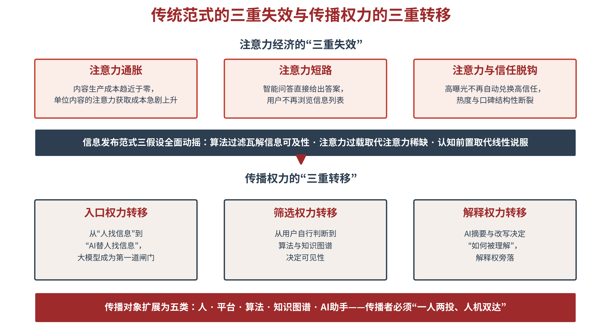
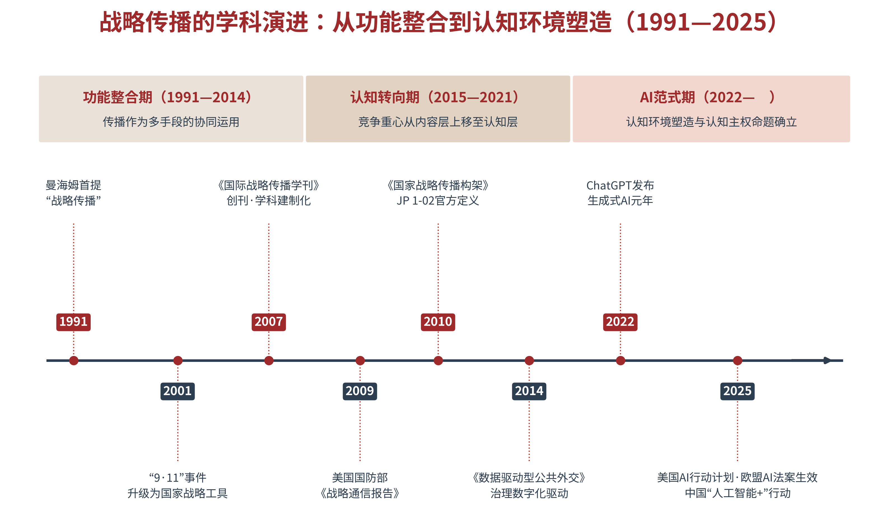
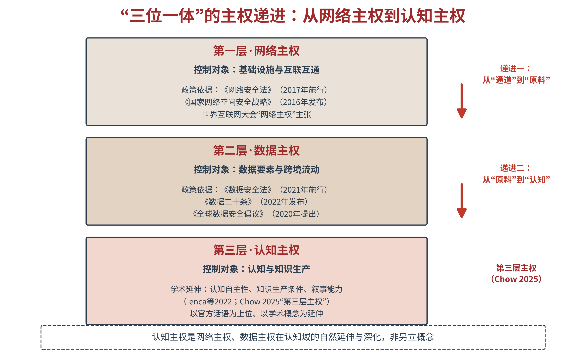

# 第一章 范式之变：AI战略传播塑造认知空间

每一次传播革命，都会沉淀为一部理论的进化史。生成式人工智能已经重构了人类获取信息、形成判断、作出决策的底层路径，沿用多年的战略传播理论由此走到范式更替的关口。本章系统梳理战略传播从“信息发布”到“认知空间塑造”的演进脉络，论证传统范式的三重失效与传播权力的三重转移，提出“认知主权”这一核心命题，再以数字时代AI的演进与世界地缘格局演变的交汇为背景，标定了AI时代战略传播所处的时代方位。读完本章，读者会明白：重建战略传播，是AI时代国家、城市和企业的必修课，而非选修课。

## 1.1 理论源流——不同时代传播范式演进的基础理论与底层逻辑

**传统传播过程研究的四大基础理论**

在AI时代，传播生态剧变，其影响是全过程的。要理解AI时代的战略传播为何构建，得先回答一个更基础的问题：传播作为一个“过程”，其研究框架是怎么来的，又是怎样一步步走到今天的。这个问题看似属于学科史，实则决定了我们能否判断“究竟什么真的变了”。

传播过程研究的奠基发生在20世纪40—50年代。1948年，拉斯韦尔在《社会传播的结构与功能》中给出了一个至今仍被引用的简便办法：描述传播行为，只需回答五个问题——谁在传播、说了什么、通过什么渠道、对谁传播、取得什么效果；五个问句，分别对应控制分析、内容分析、媒介分析、受众分析、效果分析五类研究。 这一模式的价值不在精巧，而在于它第一次把混沌的传播活动拆成了可分析的结构。它后来常被批评为单向线性、忽略反馈，但要素划分本身并未过时——AI时代我们所做的，恰恰是为这五个问句逐一更换新的答案。

1949年，香农与韦弗在《传播的数学理论》中给出了传播过程的另一条研究进路：信源—发射器（编码）—信道—接收器（解码）—信宿，并首次引入“噪声”概念；韦弗进一步把传播问题分为技术、语义与效果三个层次。 这条线索把传播还原为可度量、可优化的工程过程，为此后的数据驱动传播埋下伏笔。但它的价值与它的边界同样醒目：它有意悬置了“意义”，因而无法解释理解与信任究竟如何发生——而理解与信任，恰恰是战略传播的全部工作对象。

1954年，施拉姆受心理学家奥斯古德的启发提出传播过程的循环模式：传播的双方都是主体，同时进行编码、解码与解释；只有当讯息落在双方“经验场”的重叠区域，传播才可能成功。 这一模式完成了传播过程研究的第一次范式跃迁——从“传递”到“共享”，从“单向”到“循环”，从“传者中心”到“关系中心”。它对后来传播者的启示直接而尖锐：跨文化传播的失败，往往不是话说得不好，而是经验场不重叠；战略传播要做的，正是扩展这种重叠区域。

1964年，加拿大传播学者麦克卢汉在《理解媒介——论人的延伸》中提出“媒介即讯息”：真正改变人的，不是媒介所运载的内容，而是媒介本身——每一种新媒介都在人们的事务中引入一种新的尺度，重塑人的感知方式与社会的组合方式。这一命题把分析的重心从“讯息说了什么”扭转到“媒介做了什么”，传播过程研究由此第一次获得了媒介本体的维度。它给我们的启示在于：渠道从来不是中立的管道，选定了渠道，就等于选定了认知后果；AI时代重新追问“哪一种媒介在塑造认知”，正是这一命题的延长线。

自然，传播学的百年积累取得卓越学术成就的远不止这几位。李普曼的“拟态环境”理论，卢因的“守门人”概念，拉扎斯菲尔德的“两级传播”，以及此后的议程设置、沉默的螺旋、框架理论等一大批研究，都曾为传播研究立下路标。但仅就“传播过程”研究而言，即过程如何构成、结构如何演变、单向如何循环、媒介中心如何影响——上面几位给出的，是最具代表性的坐标。

**数字化互联网下沉为社会基础设施**

随着信息技术的迅猛发展和广泛普及，人类社会已经进入到一个全新的数字化时代。数字化不仅是新兴技术的集合，更是成为构建现代信息基础设施的基石，为全球信息交换和资源整合提供了前所未有的便捷与效率。作为信息时代的重要标志，数字化涵盖了技术革新、数据处理、网络通讯及信息流通等多维度的发展，已成为推动当代社会变革的核心力量。数字化不仅仅是技术层面的进步，它涉及数据驱动的决策模式、网络空间治理以及信息传播结构的根本变革，成为深刻重塑全球社会结构和人类生活方式的重要动力，更推动着当今世界进入到一个全新的发展阶段，对世界产生了多维、全面、深刻而持久的重大影响。

1995年，麻省理工学院媒体实验室主任尼葛洛庞帝出版的《数字化生存》，是宣告数字化时代到来的奠基之作。该书提出，如果说物质时代世界的基本粒子是“原子”的话，那么构成信息时代新世界的基本粒子就是“比特”（bit，binary digit 之缩写）。“比特，作为信息的DNA正迅速取代原子而成为人类社会的基本要素”，“比特没有颜色、尺寸或重量，能以光速传播。它就好比人体内的DNA一样，是信息的最小单位。信息高速公路的含义就是以光速在全球传输没有重量的比特”等等。在《数字化生存》中，尼葛洛庞帝将数字化提高到了前所未有的地步。他认为“从原子到比特的飞跃已是势不可当、无法逆转”，“计算不再和计算机有关，它将决定我们的生存”。

1996年，生于西班牙的社会学家曼纽尔·卡斯特出版《网络社会的崛起》，提出信息技术革命正在催生一种新的社会形态：网络建构了社会的新形态，网络化逻辑的扩散，实实在在地改变着生产、经验、权力与文化的过程和结果；“流动空间”与“真实虚拟”成为这个社会主导性的组织形式与经验方式。这条研究进路把传播过程从“人与人之间的对话”，扩展为“嵌入社会网络结构的过程”——谁占据网络的节点，谁掌握连接的开关，谁就掌握意义流动的走向。

互联网等数字媒介引发的传播革命正在史无前例地改变社会的基本形态，新传播所建构的新型关系已经在很大程度上重构了以往各种社会关系。数字媒介从嵌入社会到重组社会正在驱动一个新的媒介化社会理论的出现，传播不再是社会的附属品，传播本身就是社会的新形态。在这个理论视角中，“传播不再只是社会结构中一个组成部分，而是构成了整个社会形态的基本要素，传播编织的网络就是社会结构本身，或者说，是传统社会结构的一种替代”。正如知名学者喻国明所言，以互联网与智能算法为代表的数字媒介作为一种新的结构社会的力量，其作用于社会的方式与以往任何一种“旧”媒介不同，它已下沉为整个社会的“操作系统”。

**技术—产业—媒介，数字媒介的底层演进及其特征**

在数字时代，数字技术无所不在、无时不在，最富有活力与创新，影响并改变着整个时代。譬如数字技术首先将图书、通讯社、报刊、广播、电视和目前的传统互联网和无线互联网等媒体在信息技术基础上融合为声像图文并茂的多媒体媒介平台。其次现代化的数字媒体又与电子商务、电子政务、电子公务、电子医务、电子教务以及其他社会功能融合为人类赖以生存的“数字社会”，成为一种与传统人类文明互补的人类文明新形态。

回看数字时代媒介一路走过的几十年的来路，一个发展规律的线索清晰可辨：先是计算机、网络、移动通信等数字技术出现，技术成熟到一定程度，便会汇聚成数字产业。数字产业经过一段时间的蓬勃发展，形成大规模市场后，市场用户水到渠道变身数字媒介受众。在这一过程中，技术——产业——媒介，三者不是同时出现，而是依次展开、层层递进：技术是源头，产业是中间层，媒介是终端形态。先有数字技术，再有数字产业，然后才有数字媒介——这是数字媒介的底层演进规律。

数字技术是数字时代最基本的技术支撑，其深层机理在于“协议”，因为有了“协议”这样的概念，全球的一台台计算机才能够互相联结成网络，才能相互打通融合，才能够平等对话与互动。笔者认为，数字时代媒介表现为数字化、信息化、网络化、互动化与融合化。数字技术推动了范围广泛的产品革命，从家用电器到办公设备，从通信网络到传统媒体，整个社会都在向数字化方向发展，进一步带动了社会信息化进步。

和之前的报刊、广播、电视等传统媒介相比，数字媒介传播过程出现五个方面的结构性变化：传播方向从线性链条式的单向传播，拓展为系统交互式的双向传播；传播方式从大众传播走向分众传播与个性化传播，“传受分离”走向“传受合一”；产品业态从单一形态走向多媒体融合；信息渠道从单一走向复合；传受互动从低频的“参与式反馈”，走向即时化与智能化。互联网时代和之前的本质不同，是去中心化与可互动。它拆解了“传者垄断”这条铁律，却没有改变传播仍由人主导这一前提。但是，互联网时代的数字传播为AI时代的数智传播预备了最贴近的结构底图：今天的认知竞争，正是在这个网络化的社会形态中展开的。

**AI时代传播生态的变与不变**

AI时代到来，标志着我们进入到第六次传播革命。与前五次不同，这一次变化的性质带有根本性的颠覆：机器第一次同时成为传者、受者与媒介。传播进入人机协作的智能传播时代。

具体来说，AI时代的智能传播有以下五大变化。其一，主体之变：从“人与人的传播”到“人机共生的传播”——机器不再是渠道，而是行动者，一台模型可以自主筛选、生成与分发内容。其二，内容之变：从“表达”到“生成”——生成式人工智能使内容生产的边际成本趋近于零，信息的稀缺性瓦解，稀缺性被迫从供给端转移到注意力端与信任端。其三，路径之变：从“渠道串联”到“链路耦合”——“人—机—人”成为主路径，人的意图先进入机器，经机器转述后才抵达另一方；分发则从人工编辑走向算法推荐，再走向智能体分发，传播的通行证由“被触达”变为“被采信”。其四，受众之变：从“人类受众”到“人类与机器的双重受众”——AI替人类检索、比较、摘要与初步判断，机器“读”什么，很大程度上决定了人“看到”什么。其五，效果与反馈之变：效果的结算从“到达与说服”转向“采信与引用”，反馈从“事后统计”转为“实时回流”，反馈第一次走到了传播链的前端。

人机协作的智能传播在变化中同样有三个不变。其一，传播过程的要素不变，依然要回答“谁在说、说什么、经何渠道、对谁说、有何效果”；变的不是问题，而是每一个问题的答案形态。其二，传播的本质不变：施拉姆所说的“建立共同性”在AI时代不但没有过时，反而被强化——当信息无限、答案无限，稀缺的恰恰是认知协同；从“信息网络”走向“认知网络”，正是“共同性”命题的技术化表达。其三，信任的生成规律不变：信任只能由真实、一致性与长期积累而来；技术可以加快传播的速度与广度，却无法替代信任的积累过程——在机器可以跨源交叉验证的条件下，言行之间的落差反而更难以掩藏。

## 1.2 范式失效——旧范式为何在AI时代失灵

**信息发布范式的三大假设及其动摇**

把传播过程研究的四大基础理论、网络时代的演进路径与AI时代的变与不变串起来，新时代战略传播过程研究呈现出清晰的研究进路：线性传递（谁—说什么—渠道—对谁—效果）→循环共享（传受双方互为传者与受者）→网络交互（去中心化、可互动）→智能共生（人机同为传者与受者，信宿与信源）。基于这样的研究进路，综观不同时代的传播全过程，可以发现AI时代的传播的最本质特征在于人机协作带来的智能化，智能传播催生了“生成式媒体”与“智能化传播”的新范式。

之前的传统传播，不管是报刊、广播、电视还是网络，虽然在媒介形式上有很大的进化，但是它们基本上都可以算是信息发布范式。但是，AIGC技术使文字、图像、音视频的自动化、规模化、个性化生产成为常态，大幅降低了专业创作门槛；算法系统从“内容推荐”演进为“场景构建”，能够动态生成适配情境的传播形态。特别是传受关系从“传播—接收”转向“传受互动”，并进一步转向“协同演化”，用户通过与智能体的持续对话，共同参与信息意义的实时构建。

在AI时代，之前的传统媒介运营体系得以正常运作的三大假设同时动摇。第一个是信息可及性假设：只要信息被发布，就有可能被目标受众接收。第二个是注意力稀缺假设：受众的注意力是有限的，谁抢到注意力谁就赢得传播。第三个是说服线性假设：信息的接收会线性地导致认知改变，进而导致态度改变，最终导致行为改变。围绕这三个假设，形成了“策划—生产—发布—反馈”的作业流程，也形成了以曝光量、阅读量、收视率为核心的评估体系。

但是，到了AI时代，信息可及性被算法过滤瓦解——你发布的信息，可能根本进不了用户的信息茧房。注意力稀缺被注意力过载取代——注意力不是太少而是太多，多到任何单一信息都难以驻留。说服线性被认知前置取代——在用户接触你的信息之前，AI系统已经通过知识图谱、模型参数和训练数据，完成了对相关议题的预结构化。你最担心的不是“说服不了用户”，而是“用户看到的答案里根本没有你”。

> **【通俗释义】认知前置**
> 过去是“先看内容，后形成判断”；现在是“AI先形成判断，你才看到答案”。就像考试之前，有人已经替你写好了标准答案——你看到的，只是AI希望你看到的。这个过程发生在你接触任何具体信息之前，所以叫“认知前置”。它是AI时代传播竞争最隐蔽、也最致命的变化。

**注意力经济的三重失效**

注意力经济的核心逻辑是“眼球即货币”。自西蒙（Herbert Simon）1971年断言“信息的丰裕造成注意力的贫乏”[7]、戈德哈伯（Michael Goldhaber）1997年正式提出“注意力经济”[8]以来，“抢眼球”一直是传播业的第一法则。但法则的效度，取决于环境的前提。AI时代，注意力经济出现三重失效（见图1-1）。

其一，注意力通胀。生成式AI使内容生产的边际成本趋近于零，海量内容稀释着单位内容的注意力价值。一边是全球数字广告支出突破7859亿美元[9]、2024年全球企业AI投资达2523亿美元、同比增长44.5%[10]；另一边是仅有33%的消费者信任品牌广告[11]。投放越猛，信任越薄——注意力的“通货膨胀”已经肉眼可见。

其二，注意力短路。在智能问答与AI搜索场景中，用户不再逐条浏览信息列表，而是直接获得一个整合好的答案。信息还来不及“被看见”，就已经“被替代”。对传播者而言，这是比曝光不足更彻底的失败：你的内容没有输给对手，而是输给了“不需要被看见”这个新规则。

其三，注意力与信任脱钩。高曝光不再自动兑换为高信任，热度与口碑之间出现结构性断裂。哈尔滨冰雪游元旦假期3天接待游客304.79万人次、实现旅游总收入59.14亿元，全年接待游客1.79亿人次、实现旅游总花费2314.2亿元（据哈尔滨市文化广电和旅游局），流量之巨堪称现象级。但正如本书第二章将论证的：真正决定这座城市竞争力的，不是这些注意力本身，而是注意力能否转化为长期认知、信任与复访行为。热梗会退潮，账本会冷却，只有信任能过冬。

三重失效的背后，是一次更深刻的“决策成本的结构性迁移”。传统环境下，消费者的决策成本是信息搜集的时间与精力——不知道哪家好，只能自己搜索、阅读、比较，品牌要做的，是在这条路径上截获注意力。AI环境下，信息搜集成本转由AI系统承担，几秒钟就能完成用户过去几小时的比对；但新的不对称随之出现——不再是“信息不对称”，而是“AI信任不对称”：用户不知道AI为什么推荐这个而不是那个，不知道推荐基于客观数据还是算法偏差，也不知道一个主体在AI认知库中的位置是如何形成的。与此同步，成本的性质也从一次性消耗转向资本性积累——结构化数据、权威信源、跨平台一致性一旦建成，便可持续产生被推荐的价值，无需为每一次曝光重复付费。我们此前的《破圈力》《信任力》研究将这一变化概括为一句话：信任不对称取代信息不对称，成为AI时代竞争的第一变量。这句话，是理解本章后续所有论证的钥匙。

**传播权力的三重转移**

范式失效的深层，是传播权力的历史性转移。在传统搜索时代，用户输入关键词，搜索引擎返回链接列表，判断与选择权在用户手中；在生成式AI时代，用户提出问题，模型直接生成答案，权力结构被彻底改写。转移发生在三个层面（见图1-1）。

图1-1　三重失效与三重转移

入口权力的转移——从“人找信息”到“AI替人找信息”，大模型成为信息世界的第一道闸门，闸门开向哪里，用户就看到哪里。筛选权力的转移——从用户自行判断，到算法与知识图谱决定可见性，机器规则接管了信息世界的通行证。解释权力的转移——从内容生产者手中，到AI摘要与改写那里，“如何被理解”不再由传播者单方掌控，同一个事实，可能被AI转述成完全不同的故事。三重转移指向同一个结论：谁掌握了可信、可引用、可被AI采信的知识资产，谁就掌握了被推荐与被引用的机会；反之，不在AI答案中的主体，正在从认知世界中被悄悄“除名”。

**五类传播对象——传播者必须“一人两投、人机双达”**

传播对象的历史性扩展，是理解这场变局的钥匙。传统传播的对象是人（拉斯韦尔“谁—说什么—通过什么渠道—对谁说—产生什么效果”的经典范式即以人为对象[6]）。AI时代的传播对象扩展为五类——人（人类受众）、平台（社交媒体与内容平台的算法机制）、算法（推荐与排序算法）、知识图谱（结构化知识库）、AI助手（大模型、智能问答系统、AI代理）。五类对象中，后四类是机器，它们代表人类接收信息、筛选信息并替人作出预判。这意味着传播者必须同时完成两项任务：面向人类受众讲好故事，面向机器受众建好资产——我们称之为“一人两投、人机双达”。只会对人说话的传播者，正在失去一半的世界。

**传统传播流程的系统性失灵**

范式之变最终落到作业层面。传统的“策划—生产—发布—反馈”流程，是按周、按月计的断裂式作业：策划靠经验，生产靠人工，发布靠渠道，反馈靠滞后数据。而AI环境的认知竞争以秒、以小时计——议题在AI答案中的排位变化、语料的交叉验证结果、负面信息的引用扩散，都需要实时监测、实时响应。断裂式作业无法应对实时认知竞争，这就是为什么本书第三章要把传播过程重构为“数据洞察—内容生成—智能分发—人机交互—品牌生根”的智能传播闭环：不是流程优化，而是运行体系级的更换。

运行体系级的更换，就是要在战略层面重建整个传播过程。首先，是实现认知前置与传播前置，将传播置至战略的核心问题加以看待；其次，就是要紧紧围绕战略，实现战略性的传播。此即谓战略传播。

## 1.3 范式转变——战略传播从信息发布到认知塑造

**学科演进：从学术概念到国家战略工具**

数字化正在形成推动世界格局演变的核心动力，为各领域的深度融合与创新提供了坚实的基础，也为传播的战略升级提供了一个新的历史起点。数字技术与战略传播的深度融合，让当今世界的大国博弈的“隐蔽性”“不对称性”特征更加凸显，其影响力已渗透到国家治理、社会共识、国际舆论等各个关键领域，成为可以左右大国博弈态势走向的核心工具。事实上，伴随着数字化技术的深入发展，信息传播展现了与之相适应的并向对进的姿态，悄然开始了一场向战略传播的转型升级。

从学术史的角度来看，在20世纪80年代末东欧剧变至苏联解体这段时期，国际传播领域引入了“战略传播”的概念。1991年美国学者曼海姆（Jarol B. Manheim）首次将西方政治精英结合“经验”和“知识”向全世界推广新自由主义价值观的传播行为称为“战略传播”。 曼海姆将战略传播界定为基于决策科学、把信息作为政治资源加以有目的管理，以实现既定目标的行为[1]。战略传播这一概念建构契合了后冷战时代地缘政治变局和美国自身的内政外交需求，纠正了国际传播长期存在的“媒介中心”偏向，并将以往处于人际传播、组织传播等“灰色地带”的非传统外交主体的沟通和交往行为纳入研究视野。

2001年“9·11”事件，是战略传播史上的第一道分水岭。“9·11”事件后，美国正式提出“战略传播”（Strategic Communication）构想并大规模调整对外传播机构，缓解国家形象危机，消除来自各方面的“敌意”，以支持配合美国发动的反恐战争和改善美国在世界尤其是在阿拉伯世界的形象。美国借用上世纪90年代工商业界使用的整合营销传播而提出战略传播概念，将其作为打赢“思想战”和“观念战”有力武器加以运用。

2010年5月，奥巴马政府正式发布《国家安全战略报告》，首次全面、系统地阐述了美国国家战略传播体系的定位、性质及目标。2012年3月，美国国防部进一步推出《国家战略传播构架》修订版，该报告重申了战略传播的两层含义：第一，坚持同步言行一致的原则进行有效传播；第二，通过公共事务、公共外交和信息运作等多重手段，针对特定受众精心设计传播和接触活动。 奥巴马总统时期提出的美国国家战略传播构架及其后不断地修订完善，并上升为国家安全战略，标志着美国战略传播体系的正式形成。

**从功能整合到认知塑造——三重驱动力**

在2011年5月美国击毙本•拉登，名义上为十年的反恐战争划了一个阶段性句号之后，奥巴马政府重点“重返亚洲”，实施“亚太再平衡”战略 ，其战略传播开始出现了明显的服务于大国博弈的转向。

如果说2001年至2011年的战略传播研究聚焦“功能整合”——把散落的传播手段拧成一股绳，那么2012年以后，战略传播的重心明显转向“认知塑造”。这一转向由三重力量共同驱动。其一是技术之变：社交媒体与平台算法使传播路径变得非线性、多中心、跨边界，“发布—接收”的线性模型失效，传播者必须具备“语境适配”能力。其二是安全之变：地缘政治竞争把传播纳入安全分析框架，竞争重心从“内容层”上移至“认知层”，从信息供给转向解释框架的争夺。其三是治理之变：2014年9月，美国公共外交咨询委员会发布《数据驱动型公共外交》报告，系统评估公共外交与国际广播的效果，推动传播评估走向数据化、机构化[25]；此后各国竞相以数据驱动重塑传播决策流程。三重力量交汇，宣告了一个事实：传播竞争的主战场，正在从信息的表层沉入认知的底层（见图1-2）。

图1-2　战略传播的学科演进（1991—2025）

这一全球性转向，在中国学界与实务界激起了广泛回应。从加强国际传播能力建设、塑造主流舆论新格局的战略部署，到学术界对战略传播本土化的持续探索，再到主流媒体的全媒体转型实践，中国的战略传播研究呈现出鲜明的自主知识体系建构意识：不是移植西方概念，而是立足中国实践提炼中国命题。本书正是在这一谱系中展开——以中国城市、企业与国家的鲜活实践为素材库，以中国主权话语与治理体系为坐标系，回应“AI时代战略传播如何重建”这一全球共同问题。中国的答案，既要讲给中国听，也要讲给世界听。

**本书的理论立场与对话**

在AI时代构建与之相适配的战略传播理论与范式，世界各国其实都在同一起跑线上，包括前一阶段领先的美国。而在AI的时代大潮中，中美两国处于第一梯队的实际现状，为中国学者借助国家整体超越之势，可能在AI时代的战略传播理论领域同样实现后来居上。在这一历史性的机遇与挑战面前，在这一重要的时间节点，郑重审视并声明本书的理论立场是有必要的。

回溯历史，中国战略传播的思想和实践源远流长，而且丰富生动。无论是战略传播思想还是战略传播实践，中国都走在世界前列，甚至堪称世界级经典。但是，现代意义上的战略传播概念，始于西方，发展壮大于美国。目前世界普遍认同的战略传播的定义是美国构建的，即战略传播是传播主体为实现特定的战略目标，将信息传播作为重要战略，并从战略层面通过各种渠道，运用各种符号广泛、深入地向目标受众传递信息，进而影响其态度、信念和行为的机制与过程。

构建AI时代的战略传播理论与范式，实现人工智能语境下的战略传播的演进，不仅是工作方法层面的调整，而且是知识体系层面的重构，更是基于中国本土知识体系和战略传播的实践进行理论的对话与提升。构建具有中国特色与世界眼光的战略传播理论与范式，不能停留在对西方战略传播理论的移植与挪用上。需要在与当前西方主导的传播理论与战略传播实践基础上，进行东西方不同思维下的平等的对话。

理论对话的前提，是先站稳自己的立场。本书以马克思主义新闻观为指导，坚持党性与人民性相统一，坚持正确的政治方向、舆论导向、价值取向；以中国实践为根基，吸收人类优秀传播学成果为我所用。全书提及的西方理论——从拉斯韦尔的5W模式、曼海姆的战略传播、到奈的软实力——只作学术对话的坐标；本书原创的战略传播双∞共轭模型——以“五维一体”为纵向理论环、“五力飞轮”为横向运行环——以及“四级跃迁”“AI三度”等概念，均以中国实践为主干生长而成。

本书与经典理论的关系，遵循三条准则：其一，溯源而不照搬——凡引进概念，先回到它的原初语境与政策意图，辨明其“他者印记”，再判断可否为我所用。其二，接续而不割裂——凡属人类传播研究的一般规律，如议程设置、框架效应、信任的维度结构等，承认其解释力，并推进到AI时代的新场景。其三，生长而不封闭——以中国城市、企业与国家的鲜活实践为素材库，以中国主权话语与治理体系为坐标系，提炼中国命题，形成可讲授、可复制、可检验的自主知识体系。

战略传播中的“认知主权”概念，以网络主权、数据主权的官方话语为上位、以学术概念为延伸，与国家主权话语一脉相承。这一立场贯穿全书，也是本书区别于西方同类著作的根本标志。

**学科边界——战略传播不是什么**

一个学科的独立性，一半来自它研究什么，一半来自它不研究什么。战略传播与广告、营销、公关、公共外交多有交叠，边界却截然分明——分界的钥匙，是权力的性质（见表1-1）。

表1-1　战略传播与相邻学科辨析

| 学科 | 核心目标 | 主要对象 | 时间尺度 | 权力属性 |
|---|---|---|---|---|
| 广告 | 促成购买行为 | 消费者 | 短期 | 市场权力 |
| 营销 | 建立品牌偏好 | 消费者/客户 | 中短期 | 市场权力 |
| 公关 | 维护组织声誉 | 利益相关方 | 中期 | 关系权力 |
| 公共外交 | 改善国家形象 | 外国公众 | 中长期 | 软权力 |
| 战略传播 | 塑造认知环境 | 人、平台、算法、AI | 长期 | 认知权力 |

战略传播的独特性有三：它以“认知环境”为最终产品；它同时面向人类受众与非人类认知主体——算法、知识图谱、AI助手；它把传播视为需要持续经营、可积累、可复利的战略资产，而非一次性的传播活动。理解了这三点，就理解了本书为什么主张：战略传播力是国家、城市和企业的第一竞争力。

> **【通俗释义】战略传播**
> 通俗地说，广告是“吆喝”，营销是“诱购”，公关是“修好”，公共外交是“交友”，战略传播是“造环境”——营造一个让你被看见、被理解、被相信、被选择的整体认知环境。前三者算的是一笔一账，战略传播算的是环境账、长期账、复利账。本书讨论的，就是AI时代这笔新账的算法。

## 1.4 认知主权——新范式确立的核心命题

**传播范式的新内核——从“解释世界”到“塑造认知”**

旧范式回答的问题是“如何把信息解释给世界”；新范式回答的问题是“如何塑造世界形成认知的环境”。毕研韬（2024）将这一转向概括为：传播正在从“解释世界”转向“塑造环境”，评估标准也从关注信息的真实性或吸引力，转向是否改变认知结构、影响政策空间、重塑舆论环境[12]。这一概括点破了新范式的三个特征：其一，对象不再只是受众，而是受众所处的整个认知环境；其二，目标不再是“这一次传播的效果”，而是“长期认知结构的改变”；其三，手段不再只是内容，而是内容、数据、算法、制度、场景的总和。用一句话概括：AI时代的战略传播，是以数据力为基础、以人—机—人传播为途径、以信任力为内核，系统塑造认知环境、治理信任资产的战略能力——这就是本书第二章将展开的核心定义。

**认知主权的内涵**

新范式的核心命题，是认知主权（Cognitive Sovereignty）。学界从两个方向给出了界定。法律与伦理方向，伊恩卡（Ienca）等学者将认知主权界定为“我们理解和认知自身及环境的能力”所要求的控制权与自主性[13]；国家能力方向，周（Chow，2025）将认知主权定位为继数据主权、数字主权之后的“第三层”主权概念[14]。两个方向指向同一内核：认知主权是对认知自主性、知识生产条件与叙事能力的控制权。数据主权关注“谁拥有数据”——输入的控制；认知主权关注“谁定义知识”“谁掌握推理过程”——更深一层的控制。当一个国家的形象由他国的模型来生成、一座城市的 story 由他人的语料来讲述、一个企业的产品由别的AI来定义，认知主权问题就不再是书斋里的思辨，而是摆在桌面的现实。

**“三位一体”的主权递进——网络主权、数据主权、认知主权**

必须强调：本书提出认知主权，不是另立概念，而是既有主权话语在认知域的自然延伸与深化。中国实践已经完成了主权体系的“两级跳”（见图1-3）。第一级，网络主权：《网络安全法》2017年施行、《国家网络空间安全战略》2016年发布，以及在世界互联网大会上提出的网络主权主张，确立了国家在基础设施与互联互通层面的主权地位。第二级，数据主权：《数据安全法》2021年施行、《数据二十条》2022年发布，加上中国提出的《全球数据安全倡议》，把主权延伸到数据要素与跨境流动层面。在此基础上的第三级，就是认知主权——对认知与知识生产的控制权，它以官方话语为上位、以学术概念为延伸，构成“网络主权—数据主权—认知主权”三位一体的递进序列。这一序列昭示了一个趋势：主权的边界，正在跟随技术演进的脚步，从有形的疆土、无形的网络，一路推进到最无形的认知空间。

图1-3　“三位一体”的主权递进：网络主权—数据主权—认知主权

**学术定位——认知主权不是主权、不是软实力、也不是国家品牌**

一个概念的法理性，来自它与既有概念的清晰边界。认知主权与四个相邻概念的关系，需要逐一厘清（见表1-2）：主权是国际关系中的法理概念，指国家对内最高、对外独立的统治权，认知主权不是法理主权，而是认知领域的控制权。软实力是约瑟夫·奈1990年提出的概念，指通过吸引力而非强制力影响他者的能力[15]，认知主权是软实力得以可持续的前提——没有叙事自主的吸引力，终究是无根之木。国家品牌是安霍尔特提出的形象管理体系[16]，认知主权是防御性概念，国家品牌是进攻性概念，一守一攻，互为表里。品牌资产是消费者对品牌感知价值的总和，认知主权则是获得品牌资产的新前提。五组概念，五种权力，层层嵌套，各司其职。

表1-2　认知主权与相关概念辨析

| 概念 | 属性 | 核心问题 | 时间尺度 | 主体 |
|---|---|---|---|---|
| 主权 | 法理权力 | 谁统治 | 永久 | 国家 |
| 软实力 | 影响力 | 能否吸引 | 长期 | 国家 |
| 国家品牌 | 形象定位 | 如何被认知 | 中长期 | 国家/城市 |
| 品牌资产 | 价值存量 | 值多少钱 | 中期 | 企业/产品 |
| 认知主权 | 控制权/自主性 | 能否自主 | 长期 | 国家/城市/企业 |

**概念边界——认知主权不是什么**

为防止概念过度延伸，本书为认知主权划定三条边界。第一，它限定于国家、城市、企业在AI知识生态中的结构性位置，不指向个体的信息选择行为——个人“愿意让AI替自己想”，属于数字素养议题，不在本书讨论之列。第二，它不是信息封锁的同义词——认知主权追求的是“被正确理解”的自主能力，而非“不被理解”的隔绝状态，关起门来永远建不成认知主权。第三，它不是操纵算法的通行证——用造假与话术去“骗”AI，短期或可获利，长期必然崩塌。认知主权是“种”出来的，不是“抢”来的。划定边界，是为了让概念站得住、用得上、走得远。

**认知域竞争与认知安全——国家安全的新维度**

认知主权之所以上升为战略命题，背景是认知域竞争成为国家安全的新维度。在国际学界与军事领域，“认知域作战”已被北约等纳入作战域讨论，传播与心理、技术深度融合；“认知安全”作为学术概念，指国家主流价值、社会共识与公众判断力免受系统性干扰与侵蚀的安全状态。本书对相关话语作严格分级：意识形态安全与网络意识形态安全属于党的舆论工作与网信工作范畴，认知安全是学术概念，“认知域作战”是军事术语，原来仅在学科史引述国际军事语境时使用，但是在数字化带来的全球化背景下，国家或组织之间在认知塑造的战略传播较量。分级的目的在于正本清源：中国主张的是塑造认知环境、建设可信传播生态，而不是输出对抗。AI生成内容让这一维度的紧迫性陡增：深度伪造以假乱真，虚假信息借智能分发指数级扩散，AI幻觉把错误包装成权威。认知安全因此需要两道防线：第一道，对AI生成内容的核验与标识，让机器产出可追溯、可问责；第二道，权威信源在AI答案中的可见性——谁在AI答案里被引用，谁就掌握认知安全的主动权。认知安全的落点，是让真实、立体、全面的中国形象在AI时代不被误读、不被稀释、不被改写。

**国家、城市、企业的共同战略命题**

认知主权不是国家的专属议题，而是三主体的共同命题。对国家而言，认知主权意味着在全球AI知识生态中拥有自主的叙事能力与知识资产。对城市而言，意味着在城市品牌传播中不被平台算法边缘化，守住存在权、解释权、优先权。对企业而言，意味着在AI搜索与智能问答中“被AI正确理解”，不因语料缺失而被答案除名。三重命题，一个内核：在人与机器的双重认知环境中，把叙事的主动权牢牢掌握在自己手里。这为本书的分层架构——国家层、城市层、企业层——埋下了理论伏笔（详见第四章）。

> **【通俗释义】认知主权**
> 打个比方：过去争的是“谁的喇叭响”，后来争的是“谁的数据多”，现在争的是“AI讲故事时，用的是谁的版本”。如果全世界问AI“中国是什么样”“哈尔滨值不值得去”“这个品牌可不可信”，AI讲的都不是你自己的版本，甚至讲错了还不自知——这就叫认知主权的流失。守住它，就是守住AI时代“我是谁、我说了算”的底线。

**三大共同趋势与研判——从技术竞争到信任竞争**

横向比较七大经济体（见表1-3），三条共同趋势清晰可辨。其一，国家战略化——AI传播已从企业行为上升为国家议程，无一国缺席。其二，基础设施化——竞争焦点从模型本身转向数据集、知识图谱、算力等认知基础设施，谁掌握基础设施，谁掌握答案的来源。其三，规则主导权竞争——监管框架即认知框架，把本国价值观写进AI的底层规则，正在成为新一轮“制标权”之争。

表1-3　主要经济体AI战略传播比较

| 经济体 | 战略目标 | 治理模式 | 传播机制 | 认知主权路径 |
|---|---|---|---|---|
| 美国 | 维持全球AI领导地位 | 轻监管、重发展 | 平台—政府协同 | 平台+创新 |
| 欧盟 | 以规则塑造全球标准 | 硬法监管 | 以规则塑造认知 | 规则+伦理 |
| 中国 | AI赋能经济社会发展 | 发展与安全并重 | “AI+”叙事体系 | 应用+数据要素 |
| 新加坡 | 打造治理型AI枢纽 | 政策指引+行业自律 | 以治理信誉立认知枢纽 | 治理+枢纽 |
| 日本 | 促进创新与社会应用 | 指南为基础、无罚则 | 国际规范参与 | 制造+软治理 |
| 韩国 | 可信赖的AI创新发展 | 宽监管、重扶持 | 法律框架输出 | 产业+立法 |
| 阿联酋/沙特 | 全球AI技术与资本枢纽 | 宪章+指南（软治理） | 合作与投资叙事 | 资本+合作 |

趋势的尽头是什么？本书的研判是：从技术竞争到信任竞争。技术会扩散，模型会同质化，算力会拉平，唯有信任无法复制。皮尤研究中心2025年春季全球态度调查显示，25国超过2.8万名受访者中，34%对AI感到担忧、仅16%感到兴奋，多数受访者对本国及欧盟的监管信任度高于对美中两国监管的信任度[24]——这组数据说明，全球公众对AI的焦虑已经先于技术本身到来，谁能让公众相信“我的AI可信”，谁就赢得了下一阶段的竞争。这也是本书把信任力置于理论内核、把“可信、可爱、可敬”作为传播目标的政治与学理依据。

## 1.5 本章小结——范式之变下的关键行动

**本章逻辑链复盘**

本章完成五步推演。第一步，不同时代的传播范式理论溯源。对传统传播范式、网络媒介特征与底层逻辑以及AI时代传播媒介的变化与不变进行了研究。第二步，范式诊断——信息发布范式的三大假设全面动摇，注意力经济三重失效，传播权力三重转移，传播对象扩展为五类。第三步，对战略传播的范式转变进行了分析，从战略传播学科演进到现实实践进行了分析。第四步，提出了战略传播的新范式，把战略传播提升到“环境营造”的高度。以“认知环境塑造”为新内核，以“认知主权”为核心命题，上承网络主权、数据主权的官方话语，下启国家、城市、企业的共同行动。第五步，能力自检——以战略传播要素为自检表照见差距，把理论转译为可自评、可补强的行动工具。五步归结为一句话：传播竞争的主战场，已经从信息的表层沉入认知的底层。

**战略传播能力自检表**

理论的价值在于照见差距。表1-4给出五维度自检工具，国家、城市、企业三类主体均可使用，每项按1—5分自评，总分25分。15分以下者，尚处于“信息发布范式”；15—20分者，转型已经起步；20分以上者，初步建立认知环境塑造能力。

表1-4　战略传播能力自检表（五维度）

| 维度 | 自检问题 | 评分（1—5分） |
|---|---|---|
| 数据力 | 是否拥有结构化、多语种、带出处的可信知识资产库？ |  |
| AI可见性 | 核心叙事是否被主流AI问答系统引用？ |  |
| 认知监测 | 是否建立受众情绪与议题的实时监测体系？ |  |
| 信任资产 | 是否有可验证的证据链支撑核心主张？ |  |
| 认知主权 | 是否在AI知识生态中拥有自主位置？ |  |

**两类主体的能力差距与政策对照更新机制**

自检之后，应对差距。宣传系统与主流媒体的典型短板，集中在AI可见性与认知监测两栏——议题设置能力强，但“进入AI答案”的能力弱；企业传播团队的典型短板，集中在数据力与信任资产两栏——内容产能强，但结构化、可验证的知识资产弱。值得注意的是，差距的分布恰恰提示了协同的价值：宣传系统的强项（议题设置、渠道动员、公信力背书）正是企业的弱项，企业的强项（数据资产、转化闭环、场景创新）正是宣传系统的弱项。本书第五篇的信任力协同模型（数据共享、叙事协同、危机联动、生态共建），正是为了把两类强项拧成一股合力。附录二（宣传系统AI传播能力训练清单）与附录四（企业AI传播合规与内容审核清单）分别给出补强路径。此外，全球AI传播政策仍在密集更新，本书在附录六设置“全球AI传播政策对照表”，按季度更新各国战略文本、生效时点与适用范围，读者可持续跟踪，把本章的全球坐标变成动态罗盘。

> **本章案例｜中国“AI+”国家科技形象传播**
> 【核心问题】如何把国家形象从“制造大国”升级为“智能创新大国”，让全球受众在AI搜索、智能问答与国际舆论中，对中国AI发展“被看见、被理解、被采信”。
> 【模型工具】以“人工智能+”行动、国产大模型、开源模型和产业应用为叙事支点，构建“成果—案例—主张”三层叙事：以权威政策文本（国发〔2017〕35号“三步走”、国发〔2025〕11号六大行动）与备案规模等官方数据为成果层，以国产大模型、开源生态与产业应用为案例层，以发展与安全并重的治理主张为主张层。将三层叙事组织为多语种、结构化、带出处的知识资产，部署进国际主流AI问答与搜索场景。
> 【技术实现与效果】成果层，政策文本的连续接力为国际知识库提供了稳定的锚点。案例层，国产开源大模型以开放权重进入全球开发者社区，2025年初发布后迅速登顶多国应用商店下载榜，成为国际AI社区讨论的热点，开源策略让中国AI以“可验证的代码”而非“宣传的口号”进入全球认知。主张层，发展与安全并重的治理框架为全球AI治理提供了可引用的中国方案。从效果看，三层叙事已显现可测量的认知变化：国际主流AI问答系统在回答“中国AI发展如何”类问题时，越来越多地引用官方政策文本与国产模型的开源数据，“人工智能+”成为国际科技报道的高频框架（据商业监测机构数据，待第三方验证）。三层叙事彼此印证，共同支撑“智能创新大国”的形象跃迁。
> 【案例启示】机制上，国家形象传播已从“对外宣传”转向“认知环境塑造”：谁掌握可信、可引用的AI知识资产，谁就掌握被国际AI系统推荐与引用的机会——叙事资产的结构化与可验证，是进入AI答案的前提。条件上，该机制成立依赖三点：权威成果真实存在、多语种结构化部署到位、持续监测与迭代跟上。迁移上，“成果—案例—主张”三层叙事可迁移至城市（发展成就—应用场景—营商环境）与企业（技术认证—客户案例—行业主张），宣传系统读者可将其用于国家科技议题的国际传播，企业传播团队可将其用于出海品牌的知识资产建设。
> 【行动清单】①盘点国家（城市、企业）在AI领域的权威成果与多语种素材。②构建结构化、带出处的可信知识资产库。③将资产部署进主流AI问答与搜索系统，持续监测引用质量。④以“成果—案例—主张”三层叙事统一对外口径，并按附录六时效分级要求定期更新。

## 本章参考文献

[1] MANHEIM J B. All of the People, All the Time: Strategic Communication and American Politics[M]. Armonk: M. E. Sharpe, 1991.

[2] HALLAHAN K, HOLTZHAUSEN D, VAN RULER B, et al. Defining strategic communication[J]. International Journal of Strategic Communication, 2007, 1(1): 3-35.

[3] U.S. Department of Defense. Report on Strategic Communication[R]. Washington, D.C.: DoD, 2009.

[4] The White House. National Framework for Strategic Communication[R]. Washington, D.C.: The White House, 2010.

[5] U.S. Department of Defense. Joint Publication 1-02: Department of Defense Dictionary of Military and Associated Terms[S]. Washington, D.C.: DoD, 2010.

[6] LASWELL H D. The structure and function of communication in society[M]//BRYSON L. The Communication of Ideas. New York: Institute for Religious and Social Studies, 1948: 37-51.

[7] SIMON H A. Designing organizations for an information-rich world[M]//GREENBERGER M. Computers, Communications, and the Public Interest. Baltimore: Johns Hopkins Press, 1971: 37-72.

[8] GOLDHABER M H. The attention economy and the Net[J]. First Monday, 1997, 2(4).

[9] Statista Research Department. Global advertising spending worldwide 2018—2030[R]. Hamburg: Statista, 2025.

[10] Stanford University Human-Centered Artificial Intelligence Institute. Artificial Intelligence Index Report 2025[R]. Stanford: Stanford HAI, 2025.

[11] Nielsen. Global Trust in Advertising Study[R]. New York: Nielsen, 2024.

[12] 毕研韬. 认知环境塑造：战略传播范式的新转向[J]. 2024.

[13] IENCA M, et al. 论认知主权的法律与伦理界定[C]//〔会议名称与出版地待作者补录〕. 2022.

[14] CHOW R. Cognitive sovereignty: the third layer of sovereignty[J/OL]. 2025.

[15] NYE J S. Bound to Lead: The Changing Nature of American Power[M]. New York: Basic Books, 1990.

[16] ANHOLT S. Competitive Identity: The New Brand Management for Nations, Cities and Regions[M]. Basingstoke: Palgrave Macmillan, 2007.

[17] The White House. America's AI Action Plan: Winning the AI Race[R]. Washington, D.C.: The White House, 2025.

[18] European Parliament and Council. Regulation (EU) 2024/1689 laying down harmonised rules on artificial intelligence (Artificial Intelligence Act)[S]. Official Journal of the European Union, 2024.

[19] 国务院. 新一代人工智能发展规划：国发〔2017〕35号[A/OL]. 2017.

[20] 国务院. 关于深入实施“人工智能+”行动的意见：国发〔2025〕11号[A/OL]. 2025.

[21] 中国互联网络信息中心（CNNIC）. 生成式人工智能应用发展报告（2025）[R]. 北京: 中国互联网络信息中心, 2025.

[22] Singapore Ministry of Communications and Information. National AI Strategy 2.0 (NAIS 2.0)[R]. Singapore: MCI, 2023.

[23] 韩国国会. 人工智能发展及信任基础建立基本法[S]. 2024年12月通过，2026年1月施行。

[24] 皮尤研究中心（Pew Research Center）. 2025年春季全球态度调查：公众对人工智能的态度[R]. 华盛顿: Pew Research Center, 2025.

[25] U.S. Advisory Commission on Public Diplomacy. Data-Driven Public Diplomacy: A Progress Review[R]. Washington, D.C.: ACPD, 2014.

| 认知主权 | 在AI生态中占据自主位置 | 议题设置·认知安全·对内对外统一口径 | 认知主权 |
|---|---|---|---|
