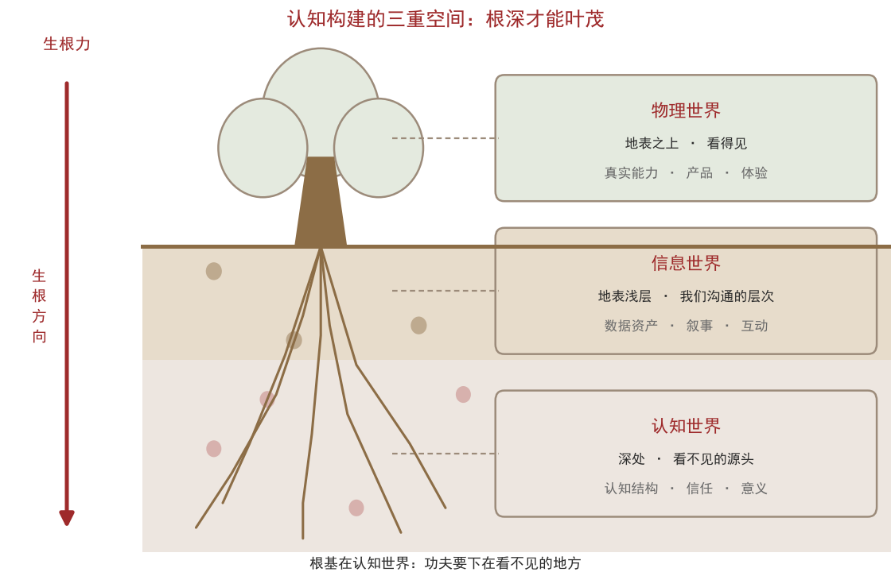
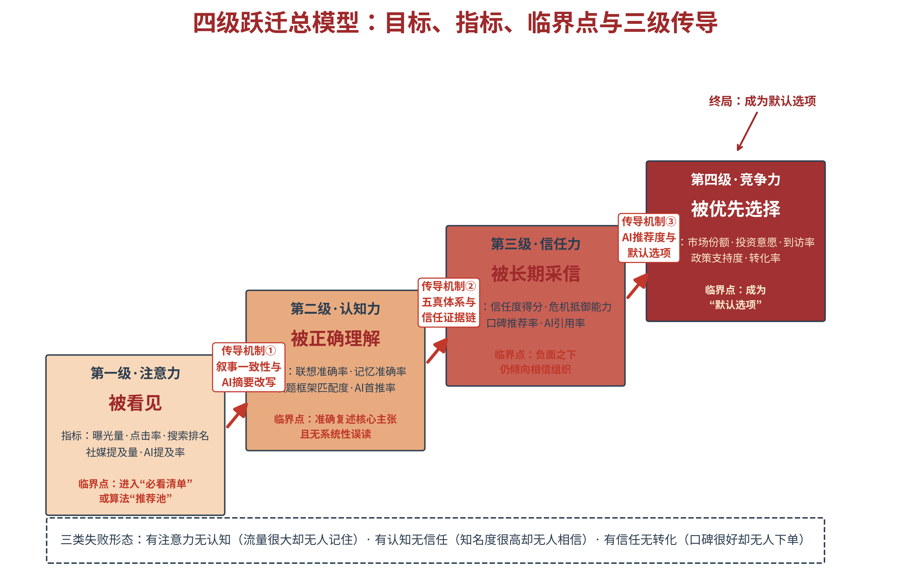

# 第二章 理论总纲：AI战略传播的时代演进

第一章回答了AI时代战略传播“为什么必须重建”，本章回答“重建成什么样”。作为全书的理论核心，本章对战略传播理论源流进行了梳理，阐释了战略传播的内涵、特征及基本原则，构建了数字时代以传播受众为中心的战略传播三角理论。AI时代传播生态剧变，战略传播的时代演进，不仅强化了以受众为中心，亦导致人机协作的传播机制全面重塑。读完本章，读者手中的不再是一份概念的清单，而是一座结构分明的理论大厦：战略传播应因循AI时代信息传播流程，实现战略传播目标层层跃迁。

## 2.1 战略传播的内涵、特征与基本原则

**国内外关于战略传播内涵的相关论述**

回答“AI时代如何重建”，先要回答“战略传播究竟是什么”。这个问题在学界与业界并没有统一的答案，但呈现了公共外交、国际传播、信息战与心理战三大流派的交融。

国际学界的定义大体沿三条主线展开。一条来自美国学者哈拉汉等人2007年在《国际战略传播学刊》创刊号上提出的、被引用最广的界定——“战略传播是组织有目的地利用传播来完成其使命”。它的贡献在于点明了战略传播的本质属性，即目的性：传播之所以是“战略的”，不在于形式或渠道，而在于它服务于组织使命的明确意图。一条来自德国学者策法斯等人的推进——战略传播是组织或其他实体有目的地利用传播，参与对其目标具有战略意义的对话。它的创新在于引入“对话”，把战略传播从单向的、自上而下的过程，转为互动性的沟通过程。还有一条来自军事与安全领域，美国《国防部军事及相关术语词典》给出了官方定义：战略传播是“美国政府集中努力理解并接触关键受众，通过国家权力机构各部门协调一致的项目、计划、主题、信息、产品和行动，创造、强化或维持有利于美国利益、政策和目标的环境”。

2010年3月，美国白宫发布奥巴马政府首份《国家战略传播构架》报告，该文件对战略传播的定义进行了修订和完善，即言行一致以及特定的受众将如何看待这种一致性；针对特定受众人群设计交流与互动的计划和活动。2010年5月，奥巴马政府正式发布《国家安全战略报告》，首次全面、系统地阐述了美国国家战略传播体系的定位、性质及目标。2012年3月，美国国防部进一步推出《国家战略传播构架》修订版，重申了战略传播的两层含义：第一，坚持同步言行一致的原则进行有效传播；第二，通过公共事务、公共外交和信息运作等多重手段，针对特定受众精心设计传播和接触活动。

中国学界对战略传播的界定，则经历了从移植到本土化建构的过程。毕研韬、王金岭认为，战略传播是政府或组织为实现特定战略利益，动员协调各种资源，向特定目标受众传递信息、施加影响的过程；赵启正提出，战略传播是为实现国家战略利益和战略目标而对重要的特定受众进行的传播、沟通和接触活动；程曼丽强调，战略传播是顶层设计之下的专业性传播，特别突出传播过程的系统性、整体性与协同性；中国社科院大学副校长姜飞认为，战略传播是指政府综合使用政治、军事、文化、经济、外交等各种渠道和工具把握全球舆论、态度及文化，并透过传播策略来影响人们的态度与行为，以强化或维持有利于国家利益、政策和目标的环境的整合营销政治传播；史安斌则把核心特征概括为目标导向与整合导向，前者面向“关键受众”而非泛化的外国公众，后者强调对多元主体和多种资源的最大化协调。

**本书对战略传播的界定：定义、特征与基本原则**

综合国际与国内对战略传播的论述，笔者认为有必要超越具体的相关行业，在战略层面对战略传播进行定义。战略传播是基于对世界趋势和发展潮流的深刻洞察，立足舆论场客观现实，从战略高度通盘研判、统筹布局，精确定位传播目标、遴选传播对象、制定系统传播规划、设计完整传播步骤、整合全域传播体系、适配优质传播资源，最终服务和维护国家核心战略利益的公众性精准信息传播活动。

战略传播具有四大特征。其一，战略性——战略传播服务于特定战略利益乃至国家战略，需要敏锐把握战略制高点、时代趋势关键点与主要矛盾发力点。其二，系统性——战略传播是目标明确、步骤完整、逻辑闭环、资源适配的系统工程，追求运行的规范化、体系化与长效化。其三，协同性——强调传播主体与传播渠道的系统整合，强调战略传播与公共外交及政治、经济、军事行动的协同配合。其四，精准性——既强调传播时机的精准，也强调传播对象的精准，在深度媒介化时代精准触达“特定目标受众”与“关键受众”。

战略传播还有一条基本原则，就是一致性。一致性的具体要求是：与趋势一致，顺应时代潮流、把握发展大势；言行一致，实现传播与实践的统一；前后一致，保持传播的连续性和稳定性；内外一致，统筹国内传播与国际传播。一致性之所以是基本原则，在于它渗透并贯穿了战略传播的全过程及其四大特征：一致性是战略性的内在要求，是系统性的逻辑前提，是协同性的基本保障，也是精准性的价值底色。这一条在AI环境中尤其吃紧，因为机器会跨源比对——一处口径失守，全链可信度都会折价。

## 2.2 数字时代战略传播三角模型理论

**战略传播三角——战略意图、战略叙事、战略传播体系**

数字时代基于互联网和移动互联网的战略传播，以去中心化和高频互动的媒介特征，已经初步形成了以受众为中心的战略传播三角理论。战略传播三角模型的三个角，分别是战略意图、战略叙事与战略传播体系。

战略意图是对“为何传播”的回答——它是传播的价值内核，核心在于“目标之公、立场之正”。所谓“目标之公”，指战略传播的根本目标服务于国家正当战略利益与全人类共同福祉的统一；所谓“立场之正”，指以平等对话、文明互鉴取代认知操控与舆论压制。战略意图处在三角的顶端，是因为它先于一切技术选择而存在：它决定的不是怎样传播，而是值不值得传播、以什么名义传播。意图一旦含混或失正，后面两个角越精密，偏得越远。

战略叙事是把战略意图转译为一条贯通路线，把“传播什么、对谁说、经何渠道、求何效果”设计成一个整体，核心在于“想得清楚、说得动人”。想得清楚，指叙事内部自洽、各层级信息彼此不打架；说得动人，指叙事能落到受众的经验与情感结构上，而不是停留在自我陈述。叙事由此成为意图与受众之间的翻译装置：未经叙事转译的意图，永远只是传播者自己听得懂的口号；只有被叙事承载的意图，才可能被理解、被记住、被复述。

战略传播体系则是把战略意图与传播资源连接起来的组织装置，整合资源、协调主体、保障运转，核心在于构建“上下联动、内外协同、左右贯通”的协调机制。所谓“上下联动”，是决策层与执行层的意图传导不衰减；“内外协同”，是国内传播与国际传播的口径不打架；“左右贯通”，是宣传、外交、经贸、文化、军事等平行部门的行动不互相抵销。体系是把三角从“想清楚”推向“做得到”的那一环——没有体系，再好的意图与叙事都只能停留在文本上。

三个角不是并列的三块砖，而是一组互为前提的关系：意图给方向，叙事给表达，体系给保障；三者协同作用、动态循环，体系又以其实际效果反过来检验与修正意图（见图2-1）。

图2-1　战略传播三角模型

**真正以用户为中心**

战略传播三角理论的基本性质，就是以传播受众为中心。战略意图的落点是“围绕受众的需求传播”，战略叙事的落点是“打动受众”，战略传播体系的落点是“组织协调资源以触达受众”。比如，数字化互联网与移动互联网时代，平台的产品设计、算法的推荐逻辑、内容的运营方法，无一不是围绕受众展开。三角的三个角各自站在不同的位置，却共同指向同一个原点——传播受众。

受众中心的第一重含义，是传播的问题意识发生了倒转。过去的传播从“我要说什么”出发，先把材料备齐，再找对象、找渠道；今天的传播必须从“受众处在什么处境、带着什么问题”出发，先确定受众此刻需要什么证据、在哪一个环节会被机器截流，再倒推内容与渠道的配置。问题意识一经倒转，“传播效果”就不再是发布之后的检验题，而成了策划之前的必答题。

受众中心的第二重含义，是受众从“被说服的对象”变为“共同的裁决者”。在算法分发与智能问答环境中，受众不必等待传播者递上结论——他们可以直接向机器提问、比对、追问，并用二次创作把判断扩散出去。传播者可以设计开场，却无法单方面决定结局。承认这一点，不是放弃引导，而是把引导的着力点从“最后一句话”移到“第一手证据”：与其争夺结论，不如把结论背后的证据链铺到受众与机器都能查证的地方。这正是以用户为中心在AI时代的高阶形态，也是本章随后展开“双重受众”与“四级跃迁”两节的逻辑起点。

**以用户为中心意味着传播必须前置**

在数字环境中，传播的双向即时互动功能被充分强化：受众获取信息后的互动发声，会带来难以预测的传播效果，一条信息在几小时内的走向，可能超出任何人事前的推演。面对这样的环境，把传播留在战略末端，等于把风险留到最后一步才处理。于是，传播前置进入战略策划环节成为必然选择，并与战略一体化付诸实施——与受众即时良性互动，及时反馈、系统优化。在整个过程中，传播战略升维，跃升为战略的核心组成部分。

传播前置有三层含义，层层递进。时序前置：传播进入战略策划的起点，而不是战略实施完成后的末端——在方案形成阶段就要回答“这件事将被怎样理解”。结构前置：传播成为战略的组成部分，因为战略意图的表达方式本身就在塑造战略的可接受性，表达即战略的一部分。反馈前置：传播的效果数据即时回流战略决策，形成“决策—传播—反馈—修正”的短周期循环，而不是事后复盘的长周期。三层合起来，构成“做好战略性传播”的操作前提——先让传播进入战略，才谈得上让战略获得认知。

**战略意图——传播前置的价值内核**

传播前置的价值内核是战略意图。战略意图须具正义底色，集中体现为“目标之公”与“立场之正”：目标之公，即战略传播的根本目标服务于国家正当战略利益与全人类共同福祉的统一；立场之正，即以平等对话、文明互鉴取代认知操控与舆论压制。只讲一般规律而无正义底色，战略传播易沦为冷冰冰的认知操控；只讲正义底色而无一般规律，战略传播则流于空洞的道德宣示。科学之维与价值之维的统一，是本书理论建构的底色。

**战略叙事——如何做好精心设计的战略性传播**

明确了“为何而传播”，紧接着的问题是“如何做好战略性传播”。本书的答案是两手抓：一手抓战略叙事，一手抓战略传播体系。前者回答“说什么、对谁说、在哪里说、怎么说”，后者回答“靠谁做、如何持续做”。

战略叙事是围绕战略意图形成的一条贯通路线，它把“传播什么、对谁说、经何渠道、求何效果”四件事设计成一个整体，而不是四个部门各自领任务。一条合格的战略叙事，至少要过三道关：其一，与战略意图对齐——传播目标必须能回译为国家或组织的战略目标，否则再热闹也属旁枝；其二，与认知现实对齐——它要建立在受众与机器已有的认知结构之上，而不是建立在传播者自己的表达偏好之上；其三，可执行、可检验——有明确的责任主体、资源配称与效果判据。三道关之外，还有一条贯穿始终的纪律，即一致性：与趋势一致、言行一致、前后一致、内外一致。这四条在AI环境中尤其吃紧，因为机器会跨源比对——一处口径失守，全链可信度都会折价。

**战略传播体系——把战略意图与传播资源精准对接的组织装置**

战略传播体系则是把战略意图与传播资源连接起来的组织装置。它整合各类传播资源、协调多元传播主体、保障传播活动高效运转，核心是构建“上下联动、内外协同、左右贯通”的协调机制。之所以需要体系，是因为传播的战略性越强，参与主体就越多、周期就越长、口径就越难统一——没有体系，多主体的传播必然走向各说各话；有了体系，多个主体的声音才能叠成同一个叙事。

这一要求在国家层面有明确的政策表达。2021年5月31日，习近平总书记在主持中共十九届中央政治局第三十次集体学习时明确提出：“必须加强顶层设计和研究布局，构建具有鲜明中国特色的战略传播体系，着力提高国际传播影响力、中华文化感召力、中国形象亲和力、中国话语说服力、国际舆论引导力。”其中，“顶层设计和研究布局”属于战略叙事层面的要求，“构建战略传播体系”则直指组织装置本身——中央要求的两句话，恰好对应本节所讲的“路线”与“路网”。

**战略传播三角的逻辑关系**

战略传播三角的逻辑关系是，战略意图是原点与灵魂，决定传播的方向与底色；战略叙事是核心内容，决定传播的吸引力和感染力；战略传播体系是战略传播资源的组织协调，是战略传播的保障支撑，决定传播的覆盖面和执行效能。

战略传播三角中，传播即战略，战略意图是传播前置与战略合为一体的表现，战略意图引领战略叙事与战略传播体系； 战略叙事与战略传播体系是做好战略性传播的双翼，前者是内容，后者是形式，二者合起来，才叫“战略性传播”。三者之间往复循环、动态协同。

## 2.3 AI时代传播生态剧变

**受众的历史性扩展——五类受众并存**

受众的历史性扩展，是AI时代传播的第一位结构性变化。今天的传播对象不再只是人，而是人、平台、算法、知识图谱、AI助手五类受众并存：人需要被说服；平台掌握分发的规则；算法决定内容的可见性；知识图谱规定实体的归属；AI助手则代表人在检索、比较与判断。它们各有一套“阅读方式”——人看情感、态度与行为，机器看语料、实体与引用网络。这要求传播者完成一次任务升级，本书称之为“一人两投、人机双达”：既面向人类受众讲好故事（人的可读、可感），也面向机器受众建好资产（机器可发现、可解析、可采信、可引用）。这不是两项工作，而是同一项工作的两个面——因为AI正在替人类阅读，内容若无法被机器识别，就等于无法抵达人类。

由此，“受众”这个概念本身需要重新界定：受众不再是被动的接收端，而是传播的“共同生产者”与“共同裁决者”。在人类一侧，受众通过评论、转发与二次创作参与意义的生成；在机器一侧，受众通过检索、摘要与引用参与意义的分发与确权。二者共同决定了一条信息最终被如何理解——这正是“受众中心”在AI时代的强化形态：不是传播者更关心受众了，而是受众（连同替受众阅读的机器）第一次真正握住了传播的裁决权。

**传统“传者—受众”二元结构的瓦解**

传统传播理论的世界里，站着两个人：传者与受众。传者生产内容、选择渠道、发布信息，受众接收、理解、反馈——拉斯韦尔的5W模式、香农与韦弗的数学模型，无论精粗，都建立在“人传人”的二元假设之上。这一假设在大众媒介时代固若金汤，在AI时代土崩瓦解：当用户向AI提问、由AI作答，信息的“最后一公里”不再由人类传者走完，而是由机器接力完成。传者与受众之间，横亘着一个既非传者、又非受众，却兼具两者部分职能的第三者。

**AI的三重角色与四类传播主体**

AI在新的传播格局中一身三任。第一重角色，认知中介——它是人—机—人传播的枢纽，用户的提问经过它，传者的信息也经过它，两端不再直接相见。第二重角色，传播主体——智能体自主完成信息的筛选、生成与分发，一条新闻以什么角度进入答案、一家企业以什么排序被提及，都是它“编辑”的结果。第三重角色，机器受众——它代表人类接收信息并作出预判，传播者必须先“说服”这个不睡觉、不吃回扣、只认证据的受众。

三重角色之外，是人机共生的四类主体格局（见图2-2）：组织主体（国家、城市、企业）是传播的战略发起者；结构主体（平台）以算法规则重塑传播秩序，是事实上的“守门人”；智能主体（AI）以三重角色嵌入传播链条；参与主体（公众与创作者）以用户生成内容供给语料、验证真相、扩散叙事。四类主体相互依存又相互制衡，任何一方的缺席都让传播系统残缺。传播者的新任务由此明确：“一人两投、人机双达”——既面向人类受众讲好故事，也面向机器受众建好资产。

图2-2　人机共生的传播主体格局

人机共生格局中，国家、城市、企业三类组织主体的角色分工各不相同。国家是叙事者与规则供给者——它供给价值叙事（“为什么值得信任”）与治理规则（平台规范、数据制度、AI管理办法），决定整个传播生态的底座。城市是场景营造者——它供给可体验的场景与温度，把抽象叙事落到可触摸的具体细节上。企业是证据供给者——它供给可验证的产品证据（技术指标、认证资质、客户案例），是整个信任链条的“最小验证单元”。叙事给方向，场景给体验，证据给底气——三者的分工，第四章的分层架构将充分展开。

本书对传播主体的这一重构，与国际学术界的人机传播（Human-Machine Communication，HMC）研究同频共振。冈克尔（Gunkel）2012年提出传播研究的“机器转向”，追问“机器能否成为传播主体”；古兹曼（Guzman）2018年主编《人机传播》，把HMC确立为建制化的研究领域。HMC的贡献在于打破了“传播只在人与人之间发生”的成见；其局限在于聚焦人际尺度——人与聊天机器人如何对话、人对社交机器人的拟人化感知。本书的增量在于把这一视角推进到组织与战略尺度：机器受众的组织化传播（国家、城市、企业如何面向AI系统布局）与AI认知链路的战略设计，是HMC尚未系统处理的命题。一句话：HMC回答“人与机器如何交谈”，本书回答“组织与机器如何博弈共生”。

## 2.4 AI时代的战略传播的演进

**AI时代战略传播的核心定义——四个要件，缺一不可**

在综合考虑AI时代传播生态的变与不变之后，本书将AI时代的战略传播力定义为：在人机共生条件下，国家、城市、企业等组织主体，面向“人类传播对象＋机器认知系统”，以数据力为基础、以信任力为内核，以人—机—人传播为途径，通过系统塑造认知环境、沉淀信任资产，使组织战略意图在人类受众与AI认知系统中依次获得“被看见、被理解、被采信、被选择”的战略能力。这种战略能力，指的是在AI的信息洪流中持续扎根而生生不息的能力。形象地说，这是AI时代的生根力。

AI时代的战略传播力这一定义包含四个要件，缺一不可。其一，数据力是基础——没有可被AI识别、理解、采信与引用的数据资产，一切传播都是沙上筑塔。其二，人—机—人传播是途径——传播链条从“传者—受众”的直达，变为“传者—AI—受众”的中转，机器成为绕不过去的中介。其三，信任力是内核——传播的终极产出不是曝光，而是信任资产，信任是AI时代唯一无法被批量制造的稀缺品。其四，“四个被”是目标——被看见只是起点，被理解、被采信、被选择，才是传播的完整旅程。四个要件层层递进：数据力解决“入场资格”，人—机—人传播解决“到达路径”，信任力解决“价值根基”，四级目标解决“效果衡量”。

与前文引述的战略传播传统界定相比，这一定义有三处延伸：作用对象由“受众”扩展为“认知生态”，传播路径由“渠道”扩展为“人—机—人”链路，成效尺度由“影响”扩展为“信任资产”。一句话，战略传播在AI时代从“把信息发出去”的学问，变成了“让认知环境朝着有利于自己的方向生长”的学问。

**AI时代战略传播三角理论的延伸——四个新特征**

数字时代萌芽的战略传播三角模型，在AI时代没有改变这一逻辑，而是把以受众为中心的三角推到了新的强度，并赋予了战略传播三角以新的特征。

其一，受众前置为认知的共同生产者。在智能问答与社交分发环境中，受众的每一次提问、转发与二次创作，都直接参与叙事的再生产。战略认知与战略意图不再只是传播者单方的“把握”与“宣示”，而是与受众（以及替受众行动的机器）的持续校准。过去我们说“从受众出发”，是一种工作方法；现在它是技术事实——受众不参与，认知就不成立。

其二，机器受众入列。三角模型中的“受众”，必须同时包含人类受众与机器受众：AI助手、算法、知识图谱都参与内容的选择与解释，它们以“可解析、可采信、可引用”为标准阅读组织的一切内容。战略叙事的内容因此需要“双轨可读”——既能被人读懂，也能被机器解析与引用。此点将在2.5节展开。

其三，循环周期被压缩。AI摘要在极短时间内即可完成“意图—叙事—反馈”的一轮循环，三角的动态循环从“策划周期”变为“实时周期”。这意味着战略传播的响应速度第一次成为战略能力本身：不是“反应快一点更好”，而是“慢一轮就出局”。

其四，体系的功能重心转向可信资产的建设与维护。当分发由算法与智能体接管，传播体系的核心任务不再是“把内容发出去”，而是“把可信的知识资产建起来、维护好、确权清”。体系从“编辑部”变成“资产部”，这是AI时代战略传播最容易被低估的一处结构性变化。

四句话可以概括三角理论在AI时代的面貌：受众前置、机器入列、循环实时、体系转向资产。这也正是本书把三角理论与五力系统并置为理论内核的原因——三角回答“怎么运转”，而AI时代的新特征决定了这种运转必须依托一套可累积的能力，这套能力就是第三章要展开的五力系统与五力飞轮。

**AI时代传播前置的三条理由**

根据战略传播三角理论，从传播价值来看，传播为了实现战略意图；从传播交互来看，战略叙事为认知构建；从传播过程来看，战略传播体系构建为了放大传播效果。在AI时代，原来线性传播的循环周期进一步压缩，并呈现智能化的进化，构成本书所称的“战略性传播”新范式——传播与战略同构，认知与行动同步。

AI时代的传播前置，有三个层面的理由同时在起作用：其一，AI时代数字鸿沟进一步拉大，传播媒介作为意识形态竞争工具的重要性持续加强；其二，AI时代认知战升级，使认知环境本身成为竞争对象；其三，核恐怖平衡下的信息化混合战争，在AI环境下使无人战争与战略传播博弈同时成为冲突的常态手段。由此，传播成为战略问题，不是传播界的自我抬升，而是环境变化的结果。

**认知构建的三重空间——物理世界、信息世界、认知世界**

图2-3　认知构建的三重空间：根深才能叶茂

认知构建的三重空间给出的是空间坐标。物理世界是人类的现实存在基础，是认知构建的第一层空间；信息世界是数字化浪潮推动下形成的高度复杂且动态的信息环境，是连接物理世界与认知世界的重要中介平台；认知世界则指向个体和群体内部的认知结构、认知偏差及其动态演变过程，是传播效果的最终体现。三者之间的关系不是并列，而是链条：物理世界产生信息，经感官与媒介构成信息世界；个体基于自身知识图式与社会文化背景对信息世界进行加工建构，形成认知世界；认知反应再反馈回信息世界，并进一步影响物理世界中的行为变革，完成闭环。

对本书而言，三重空间给出了生根力扎根的方向（见图2-3）：物理世界是地表之上看得见的一层——组织的真实能力、产品与体验，它像露出地面的树冠与枝叶，是人们能亲眼看到、亲身验证的部分；信息世界是地表浅层的土壤与水——我们日常沟通、发布与互动的层次，数据资产与叙事在此流通；认知世界则是树根扎入的深处——由无数个体的认知结构、信任倾向与意义系统汇聚而成的源头活水，它看不见、摸不着，却决定着信息被如何理解、信任被如何积累，根深才能叶茂。

**主要矛盾：构建认知世界的生根力**

把空间坐标与结构模型合起来看，AI时代战略传播的主要矛盾便显露出来：它不在信息世界的流量上，而在认知世界的扎根深度上。信息世界里，内容产量、发布频次、话题热度都在快速增长；认知世界里，信任的积累却受制于一条更慢的规律——信任只能由被反复验证的证据逐步沉淀，无法由声量批量生产。于是形成一组反差：可被发现的内容越来越多，可被采信的判断越来越少；机器可以在一秒内读完万条信息，受众却要用数周乃至数月才能重建一次信任。战略传播的主要矛盾，就是这种“信息世界的供给过剩”与“认知世界的扎根不足”之间的落差。简言之，在AI时代认知世界的生根力是核心竞争力。

这一判断规定了AI时代战略传播的工作重心。其一，把资源从“增加发声”转向“增加可验证的资产”——数据资产、证据链、结构化知识库，这些才是机器读得懂、受众查得到的东西；其二，把衡量从“发了多少”转向“留下了多少”——每完成一轮传播，组织在认知世界里多扎下多少根，应当可以被盘点、被审计；其三，把周期从“战役节奏”转向“生长节奏”——认知世界的根系不是一次冲锋长成的，任何以短期声量替代长期扎根的做法，最终都会在信任的压力测试中回吐。

**从破圈力到生根力——核心竞争力的时代转移**

理解生根力的分量，需要一个参照系。移动互联网时代，核心竞争力的关键词是“连接的破圈力”；AI时代，核心竞争力的关键词是“扎根的生根力”。这不是概念的翻新，而是稀缺资源的转移。

移动互联网时代的传播红利，来自连接本身。那个时代最稀缺的东西，是“到达”——把信息送达此前到不了的人群，穿透一个个封闭的圈层，让品牌与内容完成从一个小圈子到另一个小圈子的横向扩张。谁连接得更广、破圈得更快，谁就掌握了议价权。因此，破圈力——穿透圈层、扩大连接、制造出圈的横向扩张能力——成为那个时代无可争议的核心竞争力。流量、覆盖、出圈指数，是它的度量衡。

AI时代改变了稀缺性的分布。大模型把信息分发的边际成本推向趋近于零：人人都可以被“看见”，也人人都极易被淹没。当“连接”不再稀缺，“到达”不再昂贵，真正稀缺的东西就浮出水面——是信任，是在信息洪流中不被冲走、越积越深的扎根能力。AI以语料与权威性为依据重塑了“谁能被引用”的规则；信息越泛滥，可信度越稀缺；热点越易逝，累积越珍贵。于是核心竞争力从横向的破圈力，转向纵向的生根力。

## 2.5 AI时代战略传播重塑信息流程

**数据力——AI时代传播的基础能力**

AI时代，信息传播的第一块基石，是数据力，即组织收集、整理、结构化、验证、部署数据资产，使其可被AI系统识别、理解、采信与引用的能力。AI战略传就是将发挥数据力作用——不是“拥有数据”，而是“让数据可用”。一个组织可以坐拥海量数据，但如果这些数据散落在各部门的PPT里、口径互相打架、没有结构化字段、没有权威出处，那么在AI眼中，它等于不存在。问题从来不在数据不够多，而在数据不可信——你的数据，AI不敢采信。数据力的本质，是把组织的真实能力，翻译成机器可读、可验、可信、可引的语言。

**AI采信机制与可见性四层模型**

要让AI采信，先要明白AI如何判断。主流大模型生成答案时，对信息源的采信遵循五项机制：来源权威性——权威机构、学术期刊、政府网站的信息权重更高。事实一致性——各平台口径是否自洽。跨源交叉验证——多个独立信源能否相互印证。时效性判断——信息是否过时。引用归因——答案是否标注来源。五项机制如同一道质检流水线，任何一项不过关，信息就难以进入答案。

据此，AI时代的战略传播构建AI可见性四层模型（见图2-4、表2-2）：第一层，可发现——数据被搜索引擎与AI爬虫索引，这是“找得到”。第二层，可解析——数据结构化、语义清晰、格式规范，这是“读得懂”。第三层，可采信——来源权威、事实准确、引用可溯，这是“信得过”。第四层，可引用——被AI在生成答案时引用并标注来源，这是“用得上”。四层拾级而上，一层比一层难，也一层比一层值钱：可发现只保证你入场，可引用才保证你上桌。大量组织停留在第一、二层——有官网、有公众号，但没有结构化知识资产；少数组织摸到第三层；能稳定占据第四层的，凤毛麟角。差距，就是机会。

图2-4　数据力的运行机制：从数据资产到AI采信

表2-2　AI可见性四层模型：判断问题与操作要点

| 层级 | 判断问题 | 操作要点 | 参考指标 |
|---|---|---|---|
| 可发现 | AI能否找到你 | 多平台部署、允许爬虫抓取、站点可及 | AI收录率、搜索索引量 |
| 可解析 | AI能否读懂你 | 结构化字段、语义清晰、实体标注规范 | 实体识别准确率 |
| 可采信 | AI能否相信你 | 权威信源锚定、口径统一、出处可溯 | 跨源交叉验证通过率 |
| 可引用 | AI是否引用你 | 答案式内容、证据链完整、带出处表述 | AI首提率、引用率、转述准确率 |

**人—机—人传播路径——AI认知链路四环节**

数据力要沿什么路径落地？答案是AI认知链路。一个信息从存在到进入AI答案，要经过四个环节：训练环节——进入模型的训练语料，成为模型“从小听到大”的常识。检索环节——被RAG（检索增强生成）机制实时调取，成为回答即时问题的素材。推理环节——参与模型的答案生成，影响观点与排序。归因环节——被引用并标注来源，把流量与信任返还给信源。四环节环环相扣，传播者应在每一环节占位：训练环节布局权威语料，检索环节优化结构化部署，推理环节供给可论证证据，归因环节确保出处准确。这就是人—机—人传播的完整路径——传播者建资产，AI认知链路处理，人类受众获得答案；谁布局了链路，谁就掌握了中转站。

**生成式引擎优化（GEO）——让AI推荐你**

沿着认知链路落地的操作体系，是生成式引擎优化（Generative Engine Optimization, GEO）。如果说SEO解决“让用户在搜索结果中看到你”，GEO解决的就是“让AI在生成答案时推荐你”[4]。其核心策略有四：一是面向机器可扫描性与可论证性组织内容——用结构、数据与出处说话，少用华丽的修辞。二是主导第三方权威——AI明显偏好第三方权威来源，赢得权威媒体报道比自有渠道声量更有效。三是采用引擎特定与语言感知的策略——不同模型、不同语种的行为差异显著，需分别调优。四是克服“大品牌偏见”——算法天然偏向头部，中小主体须以垂直深度与证据密度突围。

GEO的有效性已有实证支撑。Chen等人（2025）的大规模对照实验显示，AI搜索对第三方权威来源存在系统性偏好，远超品牌自有内容与社交媒体内容；为内容添加引用，可将可见性提升约41%[5]。但本书必须同步作出实证边界声明：该数据基于英文环境的受控实验，不可直接外推至中文平台生态。中文场景的效果，需按附录九的复测协议——以文心一言、通义千问、Kimi、豆包、DeepSeek等模型清单，对照标准化提问集——自行开展A/B验证。理论的诚实，比理论的漂亮更重要。

> **【通俗释义】GEO（生成式引擎优化）**
> SEO是“讨好搜索引擎”：关键词、外链、排名，目标是让网页排在结果列表前面。GEO是“讨好AI”：结构化数据、权威出处、可验证事实，目标是让品牌出现在AI的答案里、并被点名推荐。一个争“排名”，一个争“引用”；一个是列表时代的功夫，一个是答案时代的功夫。

**信任力：机制的价值内核——三层五真与信任证据链**

数据力解决“机器敢不敢用你”，信任力解决“人与机器信不信你”——后者是传播机制的价值内核。AI时代的战略传播要以“三层五真”结构化信任力。三层，指信任的三个层面：产品层——受众对组织能力与履约的信任（国家的治理能力、企业的产品服务）；关系层——受众对组织与自己关系的信任（是否真诚、是否在乎我）；价值层——受众对组织所代表价值观的认同。五真，指三层信任落地的五项行为准则：真实——信息不虚假；真诚——态度不敷衍；真懂——理解受众需求；真行——言行一致；真值——提供真实价值。

“三层五真”并非凭空造出，它对接梅耶（Mayer）等人1995年提出的经典三维信任模型——能力（ability）、善意（benevolence）、正直（integrity）[6]：产品层对应能力，关系层对应善意，价值层对应正直。五真则是三维信任在AI语境下的行为化表达。与概念同样重要的，是信任证据链：信任不是宣称出来的，而是被证据支撑出来的——产品证据（技术指标、性能数据、认证资质）、用户证据（用户评价、案例故事、口碑）、第三方证据（权威媒体报道、学术研究、国际组织认可），三类证据首尾相接，构成AI可检索、公众可验证的信任链条。数据力让证据进入答案，信任力让证据经得起追问。

> **【通俗释义】三层五真**
> 三层，是别人信你的三个方面：信你的本事（产品层）、信你的心意（关系层）、信你的人品（价值层）。五真，是攒这三层信用的五个动作：说真话（真实）、掏真心（真诚）、懂真需（真懂）、办真事（真行）、给真利（真值）。三层是账本，五真是记账的动作——AI时代，每一笔都记在链上，抵赖不得。

**数据力的边界与伦理**

数据力不是免罪的通行证。四条边界必须划清：隐私合规——个人信息采集与跨境流动必须遵守《个人信息保护法》等法规，用户授权是底线。算法偏见——训练数据的偏差会被模型放大，数据力建设须主动纠偏。数据污染——虚假信息一旦进入语料，将以AI的名义获得“权威感”，危害倍增。认知操纵——以话术与造假“优化”AI答案，短期或可获利，长期必然崩塌。我们的立场一以贯之：数据力是镜子，不是画笔——它放大真实，不生产真实；认知主权是种出来的，不是抢来的。优化与操纵的分界线，就是这条：你呈现的是更好的真实，还是伪造的假象。

## 2.6 AI时代战略传播目标的四级跃迁

**传播目标的升级——从“被看见”到“被选择”**

主体立了，机制通了，目标是什么？传统传播的目标函数是“被看见”——发行量、收视率、点击量、粉丝数，皆是注意力的度量衡。本书主张，AI时代的传播目标必须升级为四级：被看见（注意力）、被正确理解（认知力）、被长期采信（信任力）、被优先选择（竞争力）。四级不是修辞的排比，而是传播效果的四级台阶——一级比一级深入，一级比一级难，也一级比一级接近竞争的终点。

**四级跃迁分述——目标、指标与临界点**

第一级，注意力跃迁——被看见。在信息过载环境中获得目标受众的注意，操作化指标包括曝光量、点击率、搜索排名、社交媒体提及量，以及AI时代的新指标——AI提及率（AI答案中提及该主体的频次）。临界点：当传播内容进入目标受众的“必看清单”或算法的“推荐池”时，注意力跃迁完成。

第二级，认知力跃迁——被正确理解。受众对组织核心信息的理解与组织意图一致，指标包括品牌联想准确率、信息记忆准确率、议题框架匹配度，以及AI首推率（在相关问题的AI答案中被首选提及的比率）。临界点：当受众能够准确复述组织的核心主张、且不产生系统性误读时，认知力跃迁完成。请注意“正确”二字——被记住不等于被理解，被误解的出名比无名的代价更高。

第三级，信任力跃迁——被长期采信。受众对组织形成稳定、正向、可抵御负面信息的信任，指标包括信任度调查得分、危机抵御能力、口碑推荐率，以及AI引用率（被AI答案引用并标注来源的频次）。临界点：当组织遭遇负面信息时，受众倾向于“相信组织”而非“相信负面”，信任力跃迁完成——这是信任的“压力测试”标准。

第四级，竞争力跃迁——被优先选择。目标受众在同类选项中优先选择该组织，指标包括市场份额、投资意愿、旅游到访率、政策支持度与转化率。临界点：当组织成为目标受众心中的“默认选项”——不必比较、无需犹豫的选择——竞争力跃迁完成。默认选项，是传播的终极奖赏（四级指标与临界点全景，见图2-5）。

图2-5　四级跃迁与三级传导机制（详版）

**三级传导机制——四级之间如何咬合**

四级跃迁不是概念的并列排序，而是具有因果传导关系的机制模型。传导机制一：注意力→认知力，靠叙事一致性与AI摘要改写——叙事口径统一，AI转述才不会走样，热度才能沉淀为理解。传导机制二：认知力→信任力，靠五真体系与信任证据链——被正确理解的形象，须经证据链的反复验证，才能升格为被采信的声誉。传导机制三：信任力→竞争力，靠AI推荐度与默认选项的形成——长期采信积累为AI的高推荐权重，最终兑现为“不假思索的选择”。三级传导环环相扣，断在任何一环，跃迁即告失败。

**跃迁失败的三类形态**

传导的断裂，呈现为三类典型失败形态。有注意力无认知——“流量很大却无人记住”：热点蹭了一波又一波，受众却说不清你是谁；病灶在叙事不一致，热闹归热闹，形象归零。有认知无信任——“知名度很高却无人相信”：人人都知道你，但没人敢信你；病灶在证据链缺失，宣称与事实两张皮。有信任无转化——“口碑很好却无人下单”：老用户交口称赞，新用户无动于衷；病灶在转化路径淤塞，信任没有出口。三类形态对应三级传导的三个断点，诊断表与干预策略详见本章2.9节与附录一。

**四级跃迁的适用边界与前提假设**

任何模型都有边界，四级跃迁的前提假设有三。其一，竞争性认知环境——该模型适用于存在认知竞争的场景（市场选择、目的地选择、形象竞争），在完全垄断或指令性场景中解释力有限。其二，主体具备可验证的真实能力——四级跃迁放大真实，也放大虚假，没有产品力与服务力支撑的跃迁，爬得越高、摔得越重。其三，AI生态相对开放——模型假设传播者可通过数据力建设影响AI认知，在极端封闭或单一垄断的AI生态中，策略空间将大幅收窄。边界之内，模型是罗盘；边界之外，它是需要修正的地图。

## 2.7 理论对话——本书的增量与坐标

理论创新的价值，一半来自解释新世界，一半来自接续旧传统。本节把本书框架放回传播学的坐标系，逐一说明它从经典理论继承了什么、改变了什么、新增了什么（对话全景见表2-1）。

**与拉斯韦尔5W模式的对话——继承与扩展**

1948年，拉斯韦尔以“谁—说什么—渠道—对谁—效果”五问，为传播研究立下第一张地图[1]。AI时代，五问各自质变：谁——变成人机共生的多元主体；说什么——变成结构化的知识资产；渠道——变成智能分发与人机交互；对谁——变成人类与机器的双重受众；效果——变成四级跃迁。五维框架是对5W五问的战略化重组与系统扩展，而非否定：在五问之上新增“机制”与“分层”两维，回答AI时代战略传播“如何运转、在哪些层面展开”——这两个问题，恰是5W时代未曾提出、而AI时代无法回避的问题。

**与科特勒5A、AIDMA、AISAS的辨析——线性链条与机制传导**

消费者行为研究领域，AIDMA（注意—兴趣—欲望—记忆—行动）刻画了大众媒介时代的购买旅程[7]，AISAS（注意—兴趣—搜索—行动—分享）适配了移动互联时代[8]，科特勒5A（认知—吸引—问询—行动—拥护）则描绘了数字时代的完整旅程[9]。三者的共同底色是线性链条——受众沿着旅程依次走过每个站点。四级跃迁的增量有二：其一，把“认知”与“信任”明确分离——5A的Aware与Advocate之间，信任是被忽略的关键变量，本书将其独立为一级。其二，以机制传导取代线性递进——每一级跃迁由明确的传导机制驱动，可诊断、可干预、可测量，而不仅是旅程的描述。

**与议程设置、框架理论的承接——从媒体议程到算法议程**

麦库姆斯与肖1972年证明，媒体虽不能决定人们怎么想，却能决定人们想什么[10]；恩特曼1993年阐明，框架就是选择与凸显——选出部分事实、凸显特定面向[11]。AI时代，这两大理论的效力机制发生转移：设置议程的不再只是媒体，还有算法与知识图谱——“算法议程设置”决定哪些议题进入视野；框架的权力从编辑部转移到模型与语料——“AI框架控制”决定议题如何被定义。本书承接两大理论，把分析单元从“媒体的版面”推进到“AI的答案”。

**与安霍尔特国家品牌、奈软实力理论的对话**

安霍尔特的国家品牌六边形（旅游、出口、治理、文化、人民、投资）为“国家如何被认知”提供了管理框架[12]；奈的软实力理论阐明了“吸引而非强制”的影响力逻辑[13]。本书的增量有二：其一，把认知主权引入国家品牌讨论——形象管理的前提，是形象定义权不被旁落；其二，把信任力明确为软实力的内核——没有可信度支撑的吸引力，是无法持续的空心吸引力。国际传播的竞争，归根结底是信任的竞争。

**与梅耶三维信任、哈贝马斯三世界的对接**

微观层面，梅耶等人的三维信任（能力、善意、正直）为“三层五真”提供了学理基座[6]——产品层承能力、关系层承善意、价值层承正直。宏观层面，哈贝马斯的“三个世界”（客观世界、社会世界、主观世界）提示了认知环境塑造的哲学深度[14]：传播同时运作于三个世界——陈述事实（客观）、协调关系（社会）、表达自我（主观），AI时代的三重运作都要经过机器的翻译。三层五真与信任证据链，就是在三个世界中同时建立可验证性。

表2-1　与经典理论对话一览

| 经典理论 | 核心命题 | 本书的继承 | 本书的增量 |
|---|---|---|---|
| 拉斯韦尔5W（1948） | 谁—说什么—渠道—对谁—效果 | 五问的战略化底架 | 新增“机制”“分层”两维 |
| 科特勒5A / AIDMA / AISAS | 消费者旅程的线性描述 | 旅程分层的直觉 | 认知与信任分离；机制传导取代线性 |
| 议程设置 / 框架理论（1972/1993） | 媒体决定想什么与怎么想 | 议题与框架的分析传统 | 算法议程设置与AI框架控制 |
| 软实力（奈，1990） | 吸引力而非强制力 | 影响力的话语逻辑 | 信任力作为软实力内核 |
| 国家品牌（安霍尔特） | 形象六维度管理 | 形象管理的框架 | 认知主权引入形象定义权 |
| 三维信任（梅耶等，1995） | 能力·善意·正直 | 信任的三维结构 | 三层五真的AI语境行为化 |
| 哈贝马斯三世界 | 客观·社会·主观三重世界 | 传播的多重现实性 | 机器翻译下的三重可验证性 |

**本书的五点增量贡献**

综合上述对话，本书的理论增量可归纳为五点：对象扩展——从人类受众扩展到人、平台、算法、知识图谱、AI助手。目标升级——从“被看见”扩展到四级跃迁。资产化——把传播视为可积累、可复利的认知资产，而非一次性活动。主权化——把传播自主性上升为认知主权命题。可操作化——为每一级跃迁、每一层能力提供可测量、可诊断、可迭代的指标。五点增量，就是本书向传播学知识大厦添的五块砖。

**双∞共轭——全书理论的总体架构**

把上述增量合为一图，本书的理论架构可以概括为战略传播双∞共轭模型。纵向是理论环：主体、机制、目标、体系、分层五个维度一体联动，构成战略传播的解释框架——它回答“传播力为什么、是什么”；横向是运行环：数据力、生成力、分发力、信任力、进化力五力咬合成飞轮，构成战略传播的运转机制——它回答“传播力怎么转”。两个环各自完整，又在中枢处衔接、交换信息：理论环为运行环提供价值坐标与目标函数，运行环把理论判断转化为可测量、可迭代的行动反馈，如同两个相互咬合的∞字，一环解释世界，一环改变世界。本章与第三章分别展开纵向理论环与横向运行环，第四章再把两个环合入国家、城市、企业三层的应用架构。

## 2.8 边界反思——理论适用的边界与反例

一个负责任的理论，必须说明自己在何处失效。本节以四个反例检验框架的边界，再给出可证伪性判据——本书拒绝把理论做成不可证伪的“万金油”。

**反例一——传播资源丰裕但认知主权缺失（有传播无主权）**

部分国家或企业拥有丰裕的传播资源与强大的内容产能，却在AI知识生态中被边缘化：内容未被AI训练数据覆盖，来源权威性不足，结构化程度低下。这一反例提示：传播资源的丰富程度与认知主权之间并非正相关——决定位置的不是“说了多少”，而是“AI敢不敢引用”。可采信性，比数量更关键。

**反例二——注意力充沛但信任力薄弱（有流量无信任）**

某些城市与品牌在短期内获得巨大流量，却因服务质量、信息一致性或危机应对的缺陷，信任未能同步积累，流量退潮后认知资产归零。近年多起“网红城市”与“网红品牌”的大起大落，皆循此径。反过来看，哈尔滨案例之所以成为正面样本，恰在于它把注意力迅速转化为服务体验与信任沉淀（见本章案例）。注意力是流水，信任才是蓄水池。

**反例三——GEO策略的伦理边界（优化与操纵的分界）**

GEO的某些灰色玩法——批量制造问答式内容、操纵引用网络、虚构权威出处——短期或可提升AI可见性，长期则损害来源可信度，甚至触发AI系统的反操纵机制。这一反例表明：数据力的积累必须与信任力的建设同步，否则将陷入“可见但不可信”的困境。分界线只有一条：呈现更好的真实，还是伪造的假象。

**反例四——认知主权概念的“过度延伸”风险**

若把“认知主权”泛化到一切信息传播活动——个人刷什么视频、企业开什么发布会都宣称“认知主权”——概念将丧失分析力。本书将认知主权限定为：对认知自主性、知识生产条件与叙事能力的控制权，核心分析对象是国家、城市、企业在AI知识生态中的结构性位置。概念划界，理论才有锋刃。

**研究局限与可证伪性说明**

本书的研究局限有三：部分操作化指标尚需大规模实证检验；跨国比较受限于公开文献的数据可得性；案例研究以定性分析为主，量化因果关系有待进一步验证。更重要的是，本书主动给出三条可证伪判据：判据一——若在控制组设计中，AI引用率与企业市场份额、城市到访率的长期变化无统计相关，则“信任力→竞争力”传导失效。判据二——若GEO优化实验组与控制组在AI首推率上无显著差异，则“数据力”机制失效。判据三——若面板数据时序检验显示，信任度的提升系统性地先于认知准确率的提升（与理论预期次序相反），则“注意力→认知力→信任力”的跃迁次序失效。理论等待检验，正如科学等待反驳——敢被证伪，才配称为理论。

## 2.9 本章小结——理论总纲下的行动要点

本章逻辑链复盘：从数字时代构建的战略传播及其三角理论出发，对AI时代传播生态环境剧变进行解析。对AI时代的战略传播先立定义，再立架构，三点增量是灵魂。最后对话经典、检验边界。其核心是让读者真正悟到数字时代到AI时代，受众本位正在全面得到贯彻。最后，在明确理论的底层逻辑以后，下一步就是带着理论思考，进入下一章运行体系。

行动层面，本章交付三件工具。其一，四级跃迁诊断表（见表2-2）——与三级传导机制一一对应，组织可按级自诊、按断点干预。其二，数据力自检清单——是否拥有结构化知识资产库？核心叙事在主流AI问答中的收录与引用情况如何？多平台口径是否一致？权威信源是否锚定？其三，跃迁临界点监测——把AI提及率、AI首推率、AI引用率纳入月度监测仪表盘，指标逼近临界点时即是战略加码的时点。三件工具的操作细则，见附录一（四级跃迁传播力体检表）与附录九（测量指标词典）。

表2-2　四级跃迁诊断表（与三级传导一一对应）

| 级别 | 诊断问题 | 核心指标 | 对应传导断点 |
|---|---|---|---|
| 注意力 | 目标受众是否知道我们？ | 曝光量·AI提及率 | —（起点） |
| 认知力 | 受众是否准确理解我们？ | 联想准确率·AI首推率 | 断点一：叙事不一致（有注意力无认知） |
| 信任力 | 受众是否长期信任我们？ | 信任度得分·AI引用率 | 断点二：证据链缺失（有认知无信任） |
| 竞争力 | 受众是否优先选择我们？ | 市场份额·到访率·转化率 | 断点三：路径淤塞（有信任无转化） |

> **本章案例｜哈尔滨冰雪游：四级跃迁的完整样本**
> 【核心问题】如何把一个老工业城市的冬季资源，转化为覆盖注意力、认知力、信任力、竞争力的完整传播闭环——让“被看见”最终兑现为“被选择”。
> 【模型工具】借助短视频算法分发制造注意力——“南方小土豆”等热梗以幽默与善意的姿态席卷全网（据商业监测机构数据，全网传播749.6万篇次，单日峰值44.9万篇次，短视频占比71.7%）。用一致的城市服务叙事塑造认知——从“讨好型市格”的调侃到“宠客”的官方承诺，内容与体验口径统一。以线下服务温度赢得信任——冻梨摆盘、人造月亮、温暖驿站等细节构成可传播的信任证据链。最终转化为真实到访、停留消费与复购，AI客流分析辅助承接与调度。
> 【四级跃迁的完整呈现】注意力级：算法热梗引爆，抖音#哈尔滨冰雪大世界#话题播放量达46亿次（平台公开数据）。认知力级：“冰城夏都”之外的“宠客之城”新形象被准确复述，“尔滨”成为城市人格化昵称。信任力级：服务细节经游客UGC反复验证，负面之下公众倾向“相信哈尔滨会改”（元旦假期3天接待游客304.79万人次、实现旅游总收入59.14亿元。2024年全年接待游客1.79亿人次、实现旅游总花费2314.2亿元——据哈尔滨市文化广电和旅游局[15]）。竞争力级：从“网红”到“长红”，冰雪季成为城市默认选项，冰雪装备、文旅招商随之受益——注意力、认知力、信任力最终兑现为竞争力。
> 【案例启示】机制上，此案例完整走完四级跃迁——算法带来注意力、叙事塑造认知、服务与温度建立信任、体验与口碑兑现竞争力，证明传播的主体、机制、目标不是抽象概念，而是嵌入每一级的操作内核。条件上，四级跃迁的兑现依赖三个前提：城市具备真实的接待能力（反例二之鉴）、叙事与体验口径一致（传导机制一）、信任证据链可被游客验证（传导机制二）。迁移上，该样本可迁移至任何“资源型主体”——工业城市的产业品牌、景区的淡季破圈、老字号的年轻化，皆可循“热梗引流—叙事统一—证据沉淀—转化兑现”四步推进；宣传系统读者可对照附录一逐级体检，企业传播读者可参照第十三章AI-5A搭建转化闭环。
> 【行动清单】①用数据监测与AI舆情识别捕捉出圈信号，弱信号即战机。②以一致叙事统一内容与体验，防止热度沉淀为误读。③用AI客流与消费数据打通“热度—到访—消费”闭环，让每一级跃迁可测量。④将流量沉淀为可复用的城市品牌资产——结构化知识库、信任证据链、默认选项心智。

## 本章参考文献

[1] LASWELL H D. The structure and function of communication in society[M]//BRYSON L. The Communication of Ideas. New York: Institute for Religious and Social Studies, 1948: 37-51.

[2] GUNKEL D J. Communication and artificial intelligence: Opportunities and challenges for the study of communication[J]. Communication+1, 2012, 1: 1-25.

[3] GUZMAN A L. Human-Machine Communication: Rethinking Communication, Technology, and Ourselves[M]. New York: Peter Lang, 2018.

[4] AGGARWAL P, MURAHARI V, RAJPUROHIT T, et al. GEO: Generative engine optimization[C/OL]. 2024.

[5] CHEN Y, et al. GEO实证：引用添加对AI可见性的提升效应[R/OL]. 2025.

[6] MAYER R C, DAVIS J H, SCHOORMAN F D. An integrative model of organizational trust[J]. Academy of Management Review, 1995, 20(3): 709-734.

[7] HALL S R. Retail Advertising and Selling[M]. New York: Prentice-Hall, 1924.

[8] 电通公司. AISAS消费者行为模型[R]. 东京: 电通, 2005.

[9] KOTLER P, KARTAJAYA H, SETIAWAN I. Marketing 4.0: Moving from Traditional to Digital[M]. Hoboken: John Wiley & Sons, 2017.

[10] McCOMBS M E, SHAW D L. The agenda-setting function of mass media[J]. Public Opinion Quarterly, 1972, 36(2): 176-187.

[11] ENTMAN R M. Framing: Toward clarification of a fractured paradigm[J]. Journal of Communication, 1993, 43(4): 51-58.

[12] ANHOLT S. Competitive Identity: The New Brand Management for Nations, Cities and Regions[M]. Basingstoke: Palgrave Macmillan, 2007.

[13] NYE J S. Bound to Lead: The Changing Nature of American Power[M]. New York: Basic Books, 1990.

[14] HABERMAS J. The Theory of Communicative Action[M]. Boston: Beacon Press, 1984.

[15] 哈尔滨市文化广电和旅游局. 2024年哈尔滨市冰雪旅游统计数据[R]. 哈尔滨: 哈尔滨市文化广电和旅游局, 2024.
