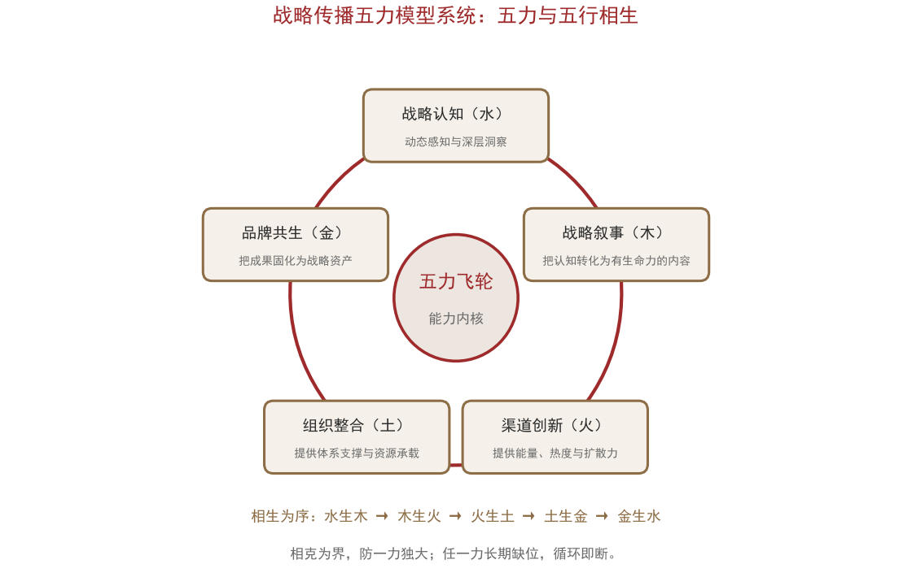
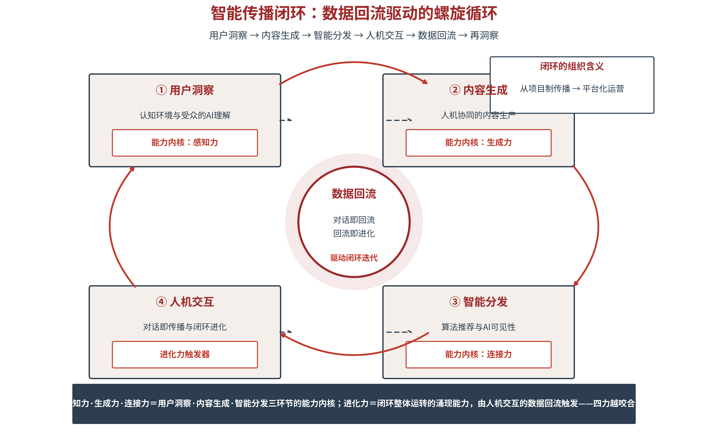
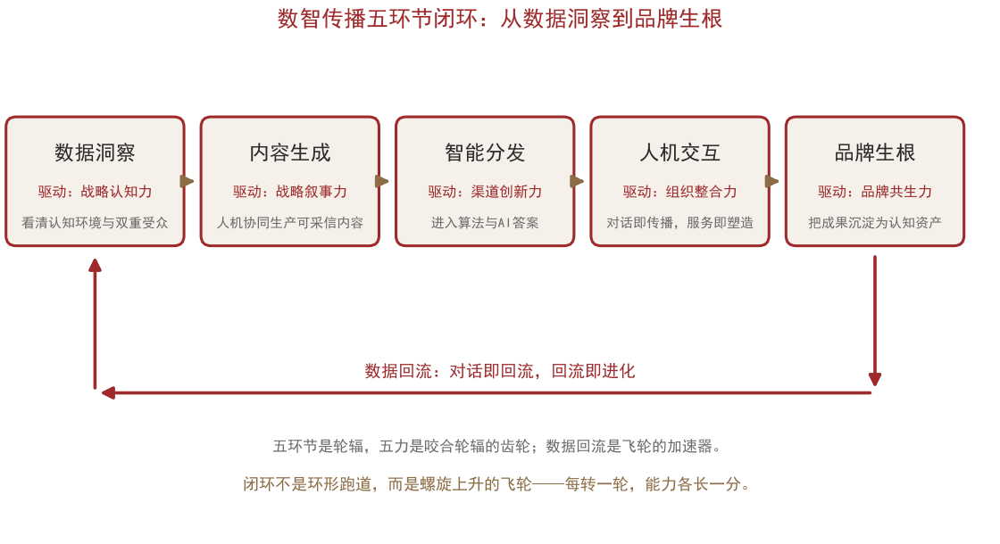
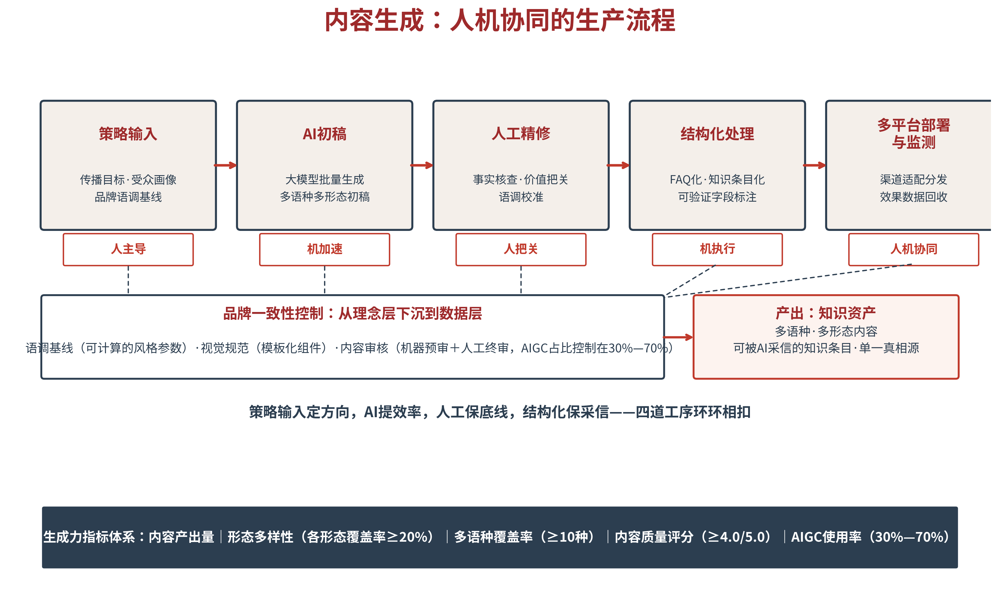

# 第三章 运行体系：AI战略传播的五力飞轮

第二章交出了理论图纸，清晰地展现了战略传播在AI时代的演进。本章把这张图纸装成一台能运转的机器。作为全书从立论走向立制的一章，本章完成五件事：先回到数字时代已经成型的战略传播五力系统，继而在五力系统中装进AI时代的数据洞察、内容生成、智能分发、人机交互、品牌优化五个环节形成闭环，使静态的能力变成转动的系统，形成AI时代特有的数据力、生成力、分发力、信任力、进化力构成的数智传播五力飞轮，说明五力如何各就其位、循环相生；AI三度的新评估口径，让运行结果可读、可查、可比对。读完本章，读者手中的不再是一份能力清单，而是一套可持续运转、可累积复利的AI战略传播运行体系。在全书的双∞共轭模型中，本章的五力飞轮是横向运行环——它与第一篇各章铺开的五维一体理论环互为表里：一环管运转，一环管解释。

## 3.1 运行体系——从战略传播五力系统到数智传播五力飞轮

**数字时代的战略传播五力系统——能力配置的学理起点**

在数字化浪潮席卷全球的时代背景下，国家、企业和组织的战略传播面临前所未有的挑战与机遇。面对信息环境的复杂多变与技术手段的迅速迭代，传统的传播策略已难以满足数字时代的需求。为此，基于南开大学战略传播研究中心的战略传播三角理论，并融合中华传统文化“五行相生”的哲学思想，系统整合战略认知、战略叙事、渠道创新、组织整合和品牌共生五大核心能力，形成了一个动态循环的整体体系，旨在实现战略传播效能的最大化。

其中，战略认知能力是战略传播的核心前提，体现为对“时、势、事”的精准把握，即把握时代脉搏、洞察发展大势、明晰事物本质。战略叙事能力是将战略认知转化为受众易于理解和接受的传播内容与形式的能力，核心在于通过有温度、有力量、有共鸣的叙事，构建认知共识、塑造良好形象、争取人心支持。渠道创新能力是战略传播在数字时代的核心基本功，指通过整合运用前沿数字技术，优化传播全流程、突破传播边界、提升传播精准度与影响力的能力。组织整合能力核心在于构建 “系统协同、资源整合、机制健全”的传播体系，实现多元主体的协同发力、各类资源的优化配置、各项机制的有效运转。品牌共生能力是战略传播中通过双向沟通与深度参与，建立品牌与受众情感连接、强化价值认同的关键能力。

战略传播的五项基本能力各有分工——战略认知负责“看得清”，战略叙事负责“说得好”，渠道创新负责“对得准”，组织整合负责“传得开”，品牌共生负责“信得过”。五项能力不是并列的五张能力卡，而是一个系统的五个构件，形成战略传播的闭环。战略传播五力系统，是本章一切讨论的学理起点——AI时代的五力飞轮和智能传播，正是从这套能力配置中生长出来的。

五力系统相生循环的结构，与系统论中的“增强回路”同构：每一环的产出都是下一环的输入，循环本身产生增量；这与“飞轮效应”的机理一致——启动费力，但一旦转起来，惯性会替系统省力。古人讲“生生之谓易”，今人讲“增强回路”，讲的是同一件事：不会循环的系统只会消耗，会循环的系统自己会生长。

**五行相生：五力系统的动态循环与协同进化**

战略传播系统中，战略认知（水）、战略叙事（木）、渠道创新（火）、组织整合（土）、品牌共生（金）五大基本能力，构成了一个有机统一、动态循环的战略传播能力体系。这一体系的深层逻辑，正是中华传统文化中五行相生相克的系统思维。

从相生关系看，五力系统形成了一个完整的增强回路：水生木——战略认知为战略叙事提供思想源泉和内容根基，没有深刻的认知就没有有力的叙事；木生火——优质的叙事内容为技术创新提供应用场景和传播燃料，内容的需求牵引技术的发展；火生土——渠道创新的成果沉淀为组织整合的基础设施和制度规范，技术推动组织变革；土生金——组织整合的效能孕育出品牌共生的战略资产，体系化的运作塑造品牌价值；金生水——品牌资产的积累反过来为战略认知提供更高的起点和更广阔的视野，品牌反馈优化认知。这一循环每转动一圈，整个系统的能力就提升一个层级，形成“越转越强”的飞轮效应。

从相克关系看，五力系统形成了相互制约的平衡机制：木克土——战略叙事的创新不断打破组织整合的僵化，防止体制机制的固化；土克水——组织整合的现实约束防止战略认知脱离实际、好高骛远；水克火——战略认知的方向感防止技术创新沦为无目标的“技术炫技”；火克金——技术迭代的压力迫使品牌共生持续革新、避免品牌老化；金克木——品牌资产的高标准要求战略叙事不断提升品质、避免内容平庸。这种相克关系确保了五力系统不会出现“一力独大”的失衡状态，始终保持整体协调和动态平衡。

图3-1　战略传播五力模型系统：五力与五行相生

**智能传播闭环——数据回流驱动的螺旋循环**

对应数字时代的战略传播五力系统，本书将AI时代的传播过程重构为智能传播五个环节的闭环：数据洞察→内容生成→智能分发→人机交互→品牌生根→数据回流→再洞察，五环节首尾相衔，数据回流穿针引线，构成一个螺旋上升的循环（见图3-2）。从传播体系维度的能力内核来讲，对应五个环节的是——数据力、生成力、分发力、信任力、进化力，最后形成五力飞轮。它与全面质量管理的PDCA循环形似而神不同：PDCA改进的是流程质量，转一圈，产品合格率提高一点；智能传播闭环累积的是认知资产——转一圈，AI知识库多一批可被采信的知识条目，受众画像多一层认知结构数据，信任证据链多一组可验证事实。前者的收益有上限，后者的复利无上限。

图3-2　智能传播闭环：数据回流驱动的螺旋循环

闭环之为闭环，在于三个特征。可持续运转——五环节不是五个项目，而是一台常开的机器，洞察不结项、生成不停更、分发不断流、交互不下线。可累积复利——每一次运转的产出都沉淀为知识资产，后来的传播站在前人的数据上起跳。可测量迭代——每一环都有指标、有仪表盘、有预警，偏差实时可见，策略随时可调。简言之：项目制传播花掉的是预算，平台化运营积累的是资产。

**闭环的组织含义——从项目制传播到平台化运营**

闭环不只是流程图，更是组织形态。从项目制传播转向平台化运营，意味着三重转变：组织结构上，从“项目组随任务聚散”转向“常设的传播中台”——数据团队管洞察，内容工厂管生成，渠道运营管分发，交互运营管对话，中台向各业务线输出能力。预算逻辑上，从“按项目拨付、花完即止”转向“按能力建设、资产入账”——预算购买的不再是一次曝光，而是一条可持续优化的知识条目、一套可复用的问答资产。人才结构上，从“创意人才为主”转向“创意×数据×算法的复合团队”——懂得向AI提问的策划师与懂得校验AI答案的编辑，同样不可或缺。

**五力飞轮——能力系统的完整声明**

从传播体系维度来看，智能传播的能力内核是五力——数据力、生成力、分发力、信任力、进化力。五力与五环节的关系，本书作如下严格声明：五力＝四环节能力＋一涌现能力。数据力、生成力、分发力，分别是用户洞察、内容生成、智能分发三个环节的能力内核，信任力是信任的沉淀，而进化力不是第五个环节的专属能力，而是闭环整体运转的涌现能力——由人机交互环节的数据回流触发，在闭环的整体咬合中实现，不由任何单一环节独占。换言之：人机交互是进化力的触发器，对话即回流，回流即进化。

五力飞轮的核心在于“咬合”——数据力发现机会，生成力生产内容，分发力传递信任，信任力积累资产，进化力形成飞轮。五力越咬合，传播的复利效应越显著。飞轮之喻，取其三义：启动费力——搭建闭环的前期投入远高于发一条新闻通稿；运转省力——系统转起来之后，单次传播的边际成本持续下降；越转越快——数据回流使每一环都比上一轮更聪明。许多组织的传播做成了“断轴的风扇”：单点能力强，五力不咬合，预算烧完，飞轮停摆——这是本章自检表要预防的病。五环节、五力与各自的核心产出，见表3-1。

表3-1　智能传播闭环：五环节×五力×核心产出

| 环节 | 能力内核 | 核心问题 | 核心产出 |
|---|---|---|---|
| ① 用户洞察 | 数据力 | 环境与受众发生了什么变化？ | 认知仪表盘·双受众画像·预警分级 |
| ② 内容生成 | 生成力 | 用什么内容回应变化？ | 多语种多形态内容·结构化知识条目 |
| ③ 智能分发 | 分发力 | 内容如何抵达人与AI？ | 算法适配内容·AI答案占位·跨渠道一致 |
| ④ 信任沉淀 | 信任力 | 信任资产如何沉淀？ | 形成可信关系与资产 |
| ⑤ 人机交互 | 进化力触发器 | 对话中触发了什么？ | 交互数据回流·知识资产累积·策略迭代 |

> **【通俗释义】五力飞轮**
> 飞轮就是老式蒸汽机上那个大铁轮子：启动时特别费劲，可一旦转起来，很小的力就能维持高速，而且转得越快越难停下来。五力飞轮同理——数据力是眼睛（看见机会），生成力是手（做出内容），分发力是腿（把内容送达该去的地方），信任力是心（沉淀信任关系），进化力是轮子本身（让每次传播都为下次蓄能）。前三个能力单点强没用，得咬合在一台机器上，轮子才转得起来；而轮子一旦转起来，后来者想追，光靠预算是追不上的。

回到全书的双∞共轭模型总图（见图2-6）：横向运行环的五节点与本章五环节一一对应——认知洞察，即①用户洞察环节（数据力）；内容生成，即②内容生成环节（生成力）；智能分发居于中枢（分发力）；人机交互与破圈传递，即⑤人机交互环节（进化力触发器）；品牌共生与信任成长，即④信任沉淀环节（信任力）。同一套运转结构，在模型图中读作节点，在本章读作环节，在闭环运转中读作飞轮。

**五环节闭环——能力的运转结构**

能力要落到运转，还需要一个运行结构。本书把传播过程重构为数智传播五环节闭环：数据洞察→内容生成→智能分发→人机交互→品牌生根→数据回流→再洞察，由此螺旋上升（见图3-3）。五环节是飞轮的轮辐，五力是咬合轮辐的齿轮：数据洞察环节由战略认知驱动，内容生成环节由战略叙事驱动，智能分发环节由渠道创新驱动，人机交互环节由组织整合支撑，品牌生根环节在闭环出口值守。五力在闭环中的这种运转形态，本书称之为“五力飞轮”——它不是五项静态的能力储备，而是一个循环增值的回路；数据回流是它的加速器，对话即回流，回流即进化。

图3-3　数智传播五环节闭环：从数据洞察到品牌生根

为什么恰好是五环？因为五环对应的是本篇导读为AI时代战略传播列出的五个追问——传播什么、对谁传播、如何传播、谁来传播、传播效果如何。追问不变，环节不散：数据洞察管“看清要传播什么、对谁传播”，内容生成与智能分发合起来管“如何传播”，人机交互管“谁来传播、以何种方式传播”，品牌生根管“传播效果如何结算”。五个追问是一条完整的工作线，五个环节就是这条线上的五个工位——多一环则冗，少一环则断。读者检验任何一个传播体系是否完整，用五追问逐一对表即可。

把五环放回第二章的三重空间坐标，运行体系的空间感便立起来了：数据洞察运作于信息世界——读取环境的语料与信号；内容生成运作于信息世界与认知世界的交界——把信息加工为影响认知的叙事；智能分发贯穿两个世界——让内容同时抵达人类的信息流与AI的答案；人机交互扎根物理世界——每一次真实的服务与体验，都在为叙事供给证据；品牌生根则把三个世界的成果同时固化为资产——信息世界里的知识条目、认知世界里的心智位置、物理世界里的可验证体验。第二章说过，根深才能叶茂；本章补上后半句：环环相扣，才能根深。

这里需要作一处命名说明，它是理解本书理论结构的一把小钥匙。五力的第五力叫“品牌共生”，五环节的第五环叫“品牌生根”——一词之差，各有所指：作为力，“共生”强调品牌与受众、生态、技术共同生长的关系状态；作为环节，“生根”强调把每一轮传播成果沉淀为认知资产。五力循环每转动一轮，认知更新的能力、叙事生长的能力、技术迭代的能力、体系支撑的能力与资产沉淀的能力就各增长一分；这些能力在时间维度上复合起来，就是“扎根”与“生长”。这正是复利的结构——每一轮的产出都成为下一轮的投入，能力不是被消耗，而是被累积。反过来讲，若五力之中任一力长期缺位，循环就会中断，生根力便无从积累：没有认知的传播是盲动，没有叙事的传播是哑火，没有渠道的传播是自语，没有组织的传播是散沙，没有共生的传播是流水账。力是能力，循环是复利；一力一环，一体两面，合起来正是本书所强调的——让传播在认知环境的土壤里真正生根。

五力的性格、所对应的环节、主要抓手与核心指标，汇总见表3-2。

表3-2　五力系统总览：力·性·环节·抓手·指标

| 五力 | 五行之性 | 对应环节 | 主要抓手 | 核心指标 |
|---|---|---|---|---|
| 战略 认知 | 水——智慧、流动、渗透 | 数据 洞察 | 趋势研判·本质洞察·政策领悟·风险预判 | 舆情覆盖率·议题发现时滞·弱信号捕捉率 |
| 战略 叙事 | 木——生长、生发、条达 | 内容 生成 | 叙事核心·话语体系·议程设置·叙事形式 | 多语种覆盖率·内容质量评分·AIGC使用率 |
| 渠道 创新 | 火——光明、热烈、上升 | 智能 分发 | 生成式AI·算法平台·大数据分析·沉浸传播 | AI可见度·跨圈层传播率·信任传递效率 |
| 组织 整合 | 土——承载、化育、包容 | 人机 交互 | 体系构建·跨部门协调·资源配称·机制保障 | 响应时延·口径一致率·交互转化率 |
| 品牌 共生 | 金——收敛、成型、淬炼 | 品牌 生根 | 数字战略资产·叙事互构·协同网络·声誉监测 | 知识资产累积量·策略迭代频率·复用率 |

## 3.3 数据洞察——认知环境与双重受众的机器理解

**洞察对象的扩展——从受众到认知环境与双重受众**

五环节的第一环是数据洞察，它由战略认知能力（水）驱动，回答的是“传播什么”。这一环的起点，是承认一个事实：洞察的对象已经变了。传统传播调研把目光锁定在“受众”身上——年龄、性别、地域、收入，画一张人口统计的像。第二章已经论证，AI时代的传播对象是双重受众——人类与机器；本节要把这一论断落到作业层：数据洞察的对象，是认知环境与双重受众。

为什么必须监测认知环境？因为在人—机—人传播结构中，传播效果不再由“传播者—受众”两点连线决定，而由整条链路决定：算法的推荐池决定你能否被看见，AI的答案决定你被如何转述，认知环境的整体温度决定你的叙事落在沃土还是冻土。只盯受众不看环境，就像农民只管撒种不看气候与土壤——种子没问题，收成没保证。环境的三个层次都要看：宏观气候——国际舆论场的大趋势与政策环境；中观生态——所在行业的议题格局与竞争者声量；微观土壤——目标受众所在平台的具体规则与偏好。三层合观，才有“环境”的完整图像。

**认知环境监测——四项基本作业**

认知环境监测包括四项基本作业。第一项，舆情覆盖——是否看全：监测的语种、平台与议题面是否完整，能否覆盖目标受众真实的信息环境；覆盖不全的监测，比不监测更危险，因为它制造“一切尽在掌握”的错觉。第二项，情绪识别——看清正负与强度：不仅判断情绪的正负极性，还要判断强度与分布，为响应级别提供依据。第三项，议题发现时滞——从信号出现到被发现的间隔：这是监测体系最诚实的指标，它直接决定你是在“表态”还是在“补课”。第四项，弱信号捕捉——尚未爆发但趋势明确的议题：量还很小、但性质在变、且可逆的信号，正是战略机遇或战略风险的先声。

四项作业各有工具与台账。舆情覆盖靠语种—平台—议题三维清单：覆盖多少语种、多少平台、多少议题类目，每季度盘点一次，缺口即建设清单；情绪识别靠分级标尺：正负极性之外，再按强度分档（强负面、弱负面、中性、弱正面、强正面），分布数据进入日报；议题发现时滞靠时间戳统计：每个议题在信源首发的时间与进入监测报告的时间之差，按月取中位数，中位数就是监测体系的“反应速度”；弱信号捕捉靠清单化管理：每周维护一张弱信号清单，每条信号注明“量小、质变、可逆”三项判断的依据，逐周复核升降级。四项作业的共同点是：都以台账落地——没有台账的监测，等于没有监测。

四项之中，时滞与弱信号最能体现能力差异。多数机构的失败不在“没看到”，而在“看到得太晚”——等舆情已经刷屏才启动响应，所有动作都成了追认。哈尔滨冰雪游的案例已经说明：弱信号即战机，“南方小土豆”的热度在爆发初期就被捕捉并接住，才有后来的四级跃迁。相反的教训同样多：一些国际议题在海外社交平台发酵数周，我方监测体系因语种覆盖不足而毫无感知，待主流媒体跟进时，叙事框架已被对方固化——此后无论投入多少资源，都在别人的框架里说话。时滞的每一小时，都是有价的；弱信号的每一条，都是带杠杆的。

**受众画像升级——从人口统计到认知结构**

受众画像则须升级：从人口统计特征（年龄、性别、地域、收入）升级到认知结构（联想网络、议题立场、信任偏好）。原因很简单：在算法与AI摘要把信息压缩成“标签”之后，真正决定传播效果的，不再是你面对的“谁”，而是“他在想什么、信什么”。两个人口统计特征完全相同的受众，认知结构可能天差地别——一个把某城市联想为“冰雪”、另一个联想为“工业衰退”，传播策略应当完全不同。

认知结构画像的三个构件，可操作化为三项作业。联想网络：目标受众提到你的名字时，会连带激活哪些概念——这是品牌的“心智地图”，可由搜索联想词、社媒共现词与AI答案的关联表述测得；议题立场：受众在关键议题上站在哪里、强度如何——决定你该说服谁、该联合谁、该回避在哪个议题上消耗；信任偏好：受众信谁、不信谁——决定你的证据链该由谁来背书：权威媒体、专业机构、还是他们自己的同侪。三项作业的共同特点是：数据源不是问卷，而是数字足迹——搜索、互动、引用与问答记录。画像由此从“静态档案”变为“动态仪表”。

画像升级还有一个常被忽视的维度：AI也是画像的使用者。过去画像服务于人的决策——策划人员翻看受众报告；今天画像越来越多地被机器直接消费——广告系统的定向、推荐系统的标签、对话系统的记忆，都在读取画像数据。这带来两个推论：其一，画像本身需要结构化——人类能读懂的散文式报告，机器读不了；其二，画像需要治理——哪些数据可以进入画像、画像可以被谁读取、画像错误如何修正，都要有制度安排。画像从“报告”变成“资产”，是数据洞察环节深度运营的标志。

**机器受众的三问——语料、实体与转述**

洞察的另一半对象是机器受众。第二章已经论证，机器不是渠道而是受众——它“阅读”你的内容、形成关于你的“认知”、并把它转述给人类。对机器受众的洞察，可以落实为三问。语料之问：AI的训练与检索语料里有没有你、覆盖多少、新旧如何——决定了AI是否“知道”你；实体之问：AI是否知道你是谁——名称、属性、类别是否消歧清晰，会不会把你与其他主体混淆；转述之问：AI引用你时说的是什么——口径与你是否一致，转述有没有走样。

三问各自有测量方法。语料之问，用收录盘点：把本组织的官网、白皮书、权威媒体报道的地址清单，与主流AI的检索可见情况对照，缺失项即补录清单；实体之问，用消歧测试：以标准化提问集（本组织名称＋别名＋易混实体）向主流AI提问，检查答案中的属性、类别与关系是否准确；转述之问，用一致率比对：把AI答案中涉及本组织的关键表述与单一真相源逐条比对，一致、偏差、错误三级分类，错误项进入修正清单。三问按季度循环，形成机器受众的“体检报告”。

三问之下，人类受众与机器受众的分工判然有别：人类受众看情感、态度与行为，机器受众看语料、实体与引用网络。前者决定传播是否动人，后者决定传播是否被采集；二者缺一，闭环即不完整。实践中最常见的失误，是把机器受众的洞察外包给技术部门了事——语料盘点、实体消歧、转述比对，本质上是传播判断而非技术作业：哪些口径必须统一、哪些属性必须优先进入语料，这些问题的答案在战略层，不在机房。

**指标体系与认知仪表盘**

战略认知环节的指标体系由此确立：舆情覆盖率、情绪识别准确率、议题发现时滞、弱信号捕捉率，加上机器受众侧的语料覆盖率、实体消歧准确率、AI转述一致率。指标的意义不在于考核，而在于暴露盲区——每一个指标都是一次自我盘问：我们看不见的地方有多大？看见的速度有多快？从洞察到决策，需要一个认知仪表盘与分级预警机制，把“看到了什么”直接转为“该做什么”。

分级预警的设计要点是阈值前置。常规议题进入周报——不惊动决策层，但留档可查；敏感议题触发即时通报——以小时计，通报到分管负责人；重大风险启动预案响应——以分钟计，预案里写明谁决策、谁发声、在哪发声。阈值定在事前，而不是事中：事中定阈值，每一次都会变成讨价还价。阈值之外还要定“演习”：每年至少一次以假想议题做全流程演练，把预警链路的每一环——发现、上报、决策、发声——都走一遍。仪表盘的价值不在屏幕，在预案。

这个环节有一个可以立刻执行的检验：随机抽取本单位上月的一份舆情周报，问三个问题——报告覆盖了哪些语种与平台？从议题出现到进入报告隔了几天？报告的结论有没有转化为任何一项动作？三问若有两问不合格，说明数据洞察环节仍停留在“看”的阶段，尚未进入“用”的阶段——这也正是下一环（内容生成）缺乏依据的根源。

**外部样本——算法环境中的公共外交监测**

数据洞察环节的专业化程度，可以从一个外部样本看清。美国国务院全球公共事务局2024年推出Northstar数字与社交媒体分析工具：以人工智能检索、翻译全球媒体内容并自动生成摘要，覆盖10万余家媒体来源、100余种语言，每日新增约100万条新闻与社交媒体内容；美国国务院估计，包括该工具在内的数字化项目每年节省超过18万工作小时。公共外交的老问题是“说了对方不听”，新问题是“说了对方看不见”——当海外受众的第一信息来源越来越多地是搜索引擎与AI助手，公共外交的信息是否进入对方的检索与问答链路，就成了一个技术问题，也成了战略问题。Northstar代表的，正是把这个问题交给机器来回答的努力。

这个样本与本章四项基本作业几乎逐项对位：舆情覆盖——10万余家媒体来源、100余种语言的覆盖面，正是语种—平台—议题三维清单的规模化实现；情绪识别与议题热度——算法识别情绪分布与议题热度，判断哪些话题正在上升、哪些叙事正在被误读；时滞——近实时的数据处理，把“发现”的间隔压到小时级；弱信号——上升期话题的自动标记，为抢占叙事先机提供候选。它把“监测”从人工读报升级为算法巡查，把洞察与决策的距离压缩到“一个平台”——全球信息环境的数据、分析与摘要集中一处，供一线外交与公共外交团队调取，认知仪表盘的形态清晰可见。

也必须记下这个样本的边界。其一，成效数据出自美方公开渠道，缺少独立第三方评估，引用时须注意其选择性呈现的可能。其二，工具不等于能力：算法能提高洞察效率，却无法替代战略判断——它回答“发生了什么”，不回答“该怎么办”。其三，竞争的对称性：对手在认知领域的技术投入越是成熟，我方在语料、知识图谱与引用链路上的自主建设就越紧迫。研究对手的方法，目的不是模仿其手段，而是看清新战场的规则——规则之一便是：监测的深度，正在成为公共外交的准入门槛。

## 3.4 内容生成——人机协同的内容生产

**范式转变——从人工创作到人机协同**

第二环是内容生成，由战略叙事能力（木）驱动，回答“传播什么内容、由谁来写”。这一环的范式转变，是从“人工创作”走向“人机协同创作”。转变的动因是产能结构的逆转：过去内容产能的瓶颈在“写”，现在瓶颈在“定”——AI能把初稿成本压到接近于零，于是决定传播质量的不再是写得多快，而是策略定得多准、把关把得多严。人机协同的标准流程为：策略输入→AI初稿→人工精修→结构化处理→多平台部署监测。

五个步骤可以逐步落实。策略输入：把叙事目标、目标受众、关键信息、口径边界写成简报——简报越清楚，AI初稿越可用；这一步是人的责任，不可下放给AI。AI初稿：按简报生成多版本，以量取胜，供人工拣选；初稿阶段的浪费是允许的——多写十版、选一版，成本仍远低于人工。人工精修：事实关、口径关、语调关三关过审，此环节的人力配置应当是全流程最重的。结构化处理：把定稿加工为可被AI采信的知识条目——这是五步中最容易被省略、又最不能省略的一步。多平台部署监测：一次生产、多态分发，按平台特性适配形态，发布后监测表现并回流数据。五步走完，内容才算完成了从“写出来”到“用起来”的全过程。

五个步骤中，最关键的是“结构化处理”——把内容加工为可被AI采信的知识条目：单一真相源、可验证字段、明确出处。这一步是数据力在内容环节的落地，也是“生根”的具体动作。单一真相源，指同一事实全平台只有一个权威表述，避免口径打架；可验证字段，指时间、地点、数据、主体等关键信息以结构化方式呈现，机器可直接抽取比对；明确出处，指每个论断都能回溯到权威来源。没有这一步，写得再好的内容也只是“给人看的”，AI读不懂、不敢引——人—机—人传播的链路，在第二环就断了。

真相源需要治理，否则会腐化。三项制度安排：指定维护者——每一条真相源记录有明确的owner，谁负责更新、谁负责核验；设定更新周期——数据类字段按数据源周期更新，表述类字段按季度复核，过时即标记；保留修订记录——每一次修改留痕，使“这条口径从哪天起是这样”有据可查。真相源腐化的标志是：两个部门引用同一事实给出不同数字。出现这种情况，问题不在口径，在治理。

**人机分工——AI写初稿，人定方向**

人机协同的分工原则可以概括为一句话：AI负责规模化，人负责判断力。AI擅长的是初稿生成、多语种改写、格式适配、摘要提炼——一切有模板可循的规模化作业；人不可让渡的是策略、判断与把关——说什么、对谁说、在哪个节点说、哪些话不能说。分工一旦颠倒——人写初稿、AI做判断——系统就会以极高的效率生产错误。

判断力的落点在三个关口。策略关：内容与战略意图是否对表——每一条内容都应能回答“它为哪个叙事目标服务”；事实关：数据、引语、出处是否经得起核验——AI的初稿可能包含似是而非的“幻觉”，凡进入正式渠道的事实表述，必须回到权威来源逐一核对；口径关：表述与单一真相源是否一致——尤其是数字、职务、名称、时间等易错点。三个关口，正是“人工精修”这一步的制度化内容。

三个关口之外，还有一道隐性关口：风格关。AI初稿的通病是“平均化”——语法正确、修辞平庸，像所有人都写得一样，也像谁都没写。品牌叙事需要“可辨认的声音”——读者不看署名也知道是谁在说话。声音从哪里来？从语调词典、句式偏好与叙事母题的坚持中来：哪些词鼓励用、哪些句式是品牌惯用、哪些母题反复出现，坚持越久，声音越清晰。风格关是AI最难替代的一关，也是人工精修最值得花时间的一关。

**双盘兼顾——内容策略的基本盘与重点盘**

内容策略需要双盘兼顾。基本盘内容指财经、科技、教育、文化、卫生、体育等意识形态色彩较淡的内容，注重客观性、实用性、趣味性；重点盘内容指重大政策解读、重大国际议题表态、涉华舆论回应，注重逻辑性、说服力、斗争性。双盘兼顾的意义在于：基本盘保障传播广度与日常浸润，重点盘保障传播深度与关键节点的定向穿透。只抓基本盘，关键议题会失声；只抓重点盘，日常语境会断供——而没有日常语境的铺垫，重点盘的说法很难被听见、更难被相信。

AI时代，双盘的差别进一步体现为“可采信结构”的不同。基本盘靠事实与数据——客观、实用、有趣的内容，只要结构化做得好，天然容易进入AI语料并在长尾问答中被引用；重点盘靠论证与出处——重大议题的表态必须以权威出处与严密论证支撑，因为这类议题在AI答案中的竞争，本质是权威性的竞争。一句话：基本盘拼结构，重点盘拼权威；两个盘的产能配比与人力配置，应依主体的战略任务而定，不存在通用比例。

双盘之外还要一层调度：双盘互喂。基本盘为重点盘蓄势——日常积累的信任与语境，决定重点盘发声时有多少人愿意听；重点盘为基本盘定调——重大议题的表态口径，会下沉为基本盘内容的表述边界。调度的机制是叙事日历：把重点盘的节点（重大会议、重要发布、敏感时点）提前标注，围绕节点排布基本盘的铺垫内容——节点前铺垫语境，节点中集中发声，节点后跟进解读。没有日历的双盘，是两张互不相干的表；有日历的双盘，才是一盘棋。

**一致性控制——从理念层下沉到数据层**

内容生产还须完成品牌一致性控制：语调、视觉规范与内容审核要从“理念层”下沉到“数据层”，即可被机器校验的规则。语调写成词典——哪些词鼓励用、哪些词禁用、称谓如何统一；视觉写成规范——色值、字体、版式可自动比对；审核写成清单——合规要点、风险词库、敏感场景的标准处理。只有成为规则，一致性才不会随人员更替而流失；也只有成为规则，AI才能参与校验——一致性控制从“老师傅的经验”变成“流水线的质检”。这正是“木”的性格：只要根在，年年都能长出新枝——体系在，内容就持续可预期。

下沉到数据层之后，一致性控制可以交给机器做第一道防线：发布前自动比对——数字与真相源是否一致、称谓与词典是否一致、风险词是否触发；触线即拦截，交人工复核。机器防错、人工防呆——机器拦得住“写错了的”，人拦得住“不该写的”。两道防线都不可少：只有机器，会把错误的规则执行到底；只有人工，会在疲惫时放行错误。

**多语种覆盖——语料赤字就是定义权赤字**

战略叙事环节的指标体系包括：内容产出量、形态多样性、多语种覆盖率、内容质量评分、AIGC使用率。五项之中，多语种覆盖率在AI时代获得了前所未有的战略权重。一组数据可以说明问题的严重性：截至2025年12月，在内容语言可识别的全球网站中，中文仅占约1.1%，而英文占约49.3%——与十几亿中文网民的规模、与全球第二经济体的体量严重不匹配。这组数字的深层含义是：中文语料在全球知识生态中的供给严重不足，而AI对世界的认知主要由语料塑造——语料赤字，就是定义权赤字。

语料赤字的后果，第二章已经从“AI采信”的角度论证过：中文世界真实发生的事情，如果只有中文记录，AI对国际用户作答时便可能“查无此事”；即便事情被外文记录，记录的框架也可能不是我们提供的。内容生成环节的应对是明确的：多语种内容不是翻译任务，而是叙事任务——不是把中文稿机翻一遍，而是以目标受众的认知结构为原点，用他们的语言与他们的证据习惯，把同一套战略叙事重新讲述一遍。AI把多语种生产的成本降了一个数量级，瓶颈从产能转为判断——这再次回到本节开头的命题：人负责定，AI负责写。

多语种叙事有三条纪律。不走样：核心口径在所有语种中保持同一——数字、事实、主张逐条对表，允许表达方式不同，不允许事实版本不同；接地气：按目标语言的媒介习惯重构表达——直接引语、案例选择、幽默分寸各从其俗，译文腔是叙事的减速带；留证据：所有语种版本都回到同一套权威出处——多语种不是多版本的事实，而是同一事实的多语种表达。三条纪律的背后是同一句话：多语种叙事的成败，不在于说了多少种语言，而在于说了多少种语言的真话。

**合规底线——把规则写进流程**

内容生成环节还必须把合规写进流程。以中文场景为例，《生成式人工智能服务管理暂行办法》已对训练数据的合法来源、生成内容的标识、服务提供者的责任作出明确规定；使用境外模型开展面向国际受众的内容生产，还须遵守目标市场的相应法规。合规不是成本，而是信任资产的一部分：一次合规事故对信任账户的冲销，可能超过一百条优质内容的积累。把规则写进流程——训练数据来源审查、生成内容标识、人工审核留痕——是内容生成环节不可省略的制度建设。

合规清单至少包括五项。来源合规：训练与参考数据来源合法，未经授权的爬取内容不入语料；标识合规：AI生成内容按规定标识，不冒充人工创作；审核合规：正式渠道内容经人工审核，留痕可查；版权合规：生成内容的引用与改编守住著作权边界；出境合规：涉及个人信息与重要数据的处理，遵守数据出境相关规定。五项各配责任人与检查点，纳入内容生产的流程卡——合规写在流程里，才不是写在墙上。

## 3.5 智能分发——算法推荐与AI可见性

**分发格局的三级演进**

第三环是智能分发，由渠道创新能力（火）驱动，回答“内容经何抵达”。分发格局经历了三级演进：人工编辑分发→算法推荐分发→智能体分发。前两者的差别是“谁决定排序”——编辑排的是版面，算法排的是信息流；后两者的差别是“排序给谁看”——算法把内容排给人类，智能体把内容“排”给AI自己：内容不再只呈现给人类，而是首先被智能体读取、比较、采纳，再由它转述给人类。分发竞争由此从“抢占信息流”升级为“进入答案”。

三级演进不是简单替代，而是层层叠加：人工编辑时代比拼的是关系与版面，算法推荐时代比拼的是内容与数据，智能体分发时代比拼的是资产与证据。三个时代的能力要求不是互相取代，而是累进叠加——今天的传播者必须同时打好三场仗：编辑逻辑的公共传播、算法逻辑的平台运营、答案逻辑的资产建设。渠道创新的难度因此显著上升，但竞争的回报也同步上升——因为在答案逻辑里建立的位置，比版面位置和信息流位置都更持久：版面一天一换，信息流一刻一刷，而AI答案里的位置，随资产存量而变——资产是慢变量，慢变量的竞争，恰恰是长期主义者的主场。

三场仗的资源分配，是渠道创新环节的第一个战略问题。常见的失衡有两种：全押平台运营——编辑逻辑的公共传播萎缩，失去权威背书的主阵地；全押资产建设——平台运营缺位，连“被看见”的第一级都过不去。健康的状态是三层互补：公共传播供给权威性与信任锚点，平台运营供给声量与互动数据，资产建设供给可采信的结构化证据——三者互相供血：权威背书提升平台内容的可信度，平台数据证明议题的真实热度，而这一切最终都沉淀为AI可引用的资产。

**GEO七步法——进入答案的操作体系**

生成式引擎优化（GEO）是应对智能体分发的主要方法。本章3.2节已经论证了GEO的学理基础与实证支撑，本节把它操作化为七步法：第一步，识别高频问答场景——目标受众会向AI问什么？把问题清单列出来；第二步，构建结构化答案——对每一个高频问题，准备口径统一、字段完整、出处明确的答案式内容；第三步，多平台部署——把内容部署到AI的检索链路可及的位置；第四步，证据链强化——补充引用、数据、权威背书，让AI“敢引用”；第五步，监测AI可见度与推荐表现——定期以标准化提问集测试；第六步，迭代优化——按监测结果调整内容与部署；第七步，效果归因——把可见性的变化与传播目标的变化建立对应关系。

七步之中，第一步“识别高频问答场景”决定方向：高频问答来自三类场景——身份类（“××是什么？”“××怎么样？”）、决策类（“该选哪个？”“值得去吗？”）、比较类（“××与××的区别？”）。三类场景的答案主导权不同：身份类拼实体信息的完整与准确，决策类拼证据链与口碑供给，比较类拼差异化事实的可比性。清单要按“受众真实会问的措辞”来写，而不是按官方语汇来写——用户问“值不值得去”，不会问“目的地的综合吸引力评估”。

七步之中，第四步“证据链强化”与第七步“效果归因”最易被忽视：前者决定AI“敢不敢引用”——没有证据链的结构化内容，AI只能“看到”而无法“采信”；后者决定优化“能不能复利”——不做归因的优化，无法区分哪种手段真正有效，投入便无法向有效手段集中。证据链的构造有四个件：权威引用——第三方权威来源的直接引用与链接；统计数据——可核验的数字，注明统计口径与时点；专家引语——实名、可查证的专家表述；出处标注——每个论断标注来源。归因的方法是对照组思维：同一时期、同类内容，做了优化与未做优化的两组对照，差异即归因。一句话，证据链决定下限，效果归因决定上限。

**中文场景的复测意识**

中文场景须有独立的复测意识。中英文平台在语料结构、权威源偏好、检索与生成策略上差异明显，英文实证结论不可直接移植——本章3.2节在引证GEO实验时已对此作出边界声明，本节把这一声明转化为操作指引：按本书附录九的复测协议，以国内主流大模型为对象，用标准化提问集做A/B对照，测量首推率与引用率的差异；在复测结论出来之前，一切英文环境的数字只作参考，不作依据。理论的诚实，比理论的漂亮更重要——这句在第二章说过的话，在分发环节同样成立。

复测之外，中文场景还有两个特殊性需要单独对待。其一，平台生态的多元化：中文信息环境的检索与问答分散在多个超级应用与搜索平台中，没有一个统一的“入口”，GEO的部署必须按平台分别适配，监测也要按平台分别记账；其二，权威源结构的差异：中文场景中政务媒体、机构媒体与市场媒体的权威结构与国际场景不同，证据链的“权威引用”一项要按中文权威结构来配。特殊性不是借口，而是作业参数——把参数搞对，方法才落地。

**跨圈层传播——算法环境的破圈作业**

渠道创新环节的指标体系包括：KOL合作、社群活跃度、跨圈层传播率、信任传递效率。其中“跨圈层传播率”在算法环境中尤为关键——算法天然倾向于圈层内强化，同温层里的传播会不断获得正反馈，直到与圈外的认知完全脱节；能否突破圈层，是分发环节渠道创新能力的试金石。破圈的作业路径至少有三条：议题嫁接——把本圈层议题接入更大公共议题，借公共议题的流量溢出；场景切换——把内容从一个平台的语境迁移到另一个平台，制造新的讨论起点；权威转译——引入圈外权威的背书与转述，让信任跨过圈层边界。火的性格是四处蔓延，但蔓延不等于照亮；真正有价值的，是让内容穿过圈层的边界。

跨圈层还有一个度量上的提醒：破圈不是把内容硬塞给圈外人群，而是让圈外人群愿意转述。度量跨圈层传播率，看的不是触达人数，而是“圈外自发转述占比”——转述是信任的投票，触达只是曝光的计数。KOL合作也应按这个逻辑选择：优先选“圈层间节点”——那些在多个圈层都有可信度、能把内容转译给不同受众的传播者，而非单圈层内的流量头部。信任传递效率的实质，就是节点质量乘以转译能力。

指标之外，分发环节还需一项制度安排：分发节奏与战略节奏的对表。算法奖励高频更新，战略要求节点精准——什么内容必须等节点、什么内容必须抢时效、什么内容宁可不发，需要一张事先商定的节奏表。让算法的节奏替代战略的节奏，是分发环节最常见的失控方式；失控的标志，是团队开始为数据好看而生产内容，而不是为战略目标生产内容。节奏表之上还要一条熔断线：当某条内容的表现与战略口径冲突时，有权立即停止投放——数据惯性不能压过战略判断。

## 3.6 人机交互——对话即传播与场景整合

**对话式传播的兴起**

第四环是人机交互，由组织整合能力（土）支撑，回答“谁来传播、以什么方式传播”。对话式传播的兴起，使AI助手、智能客服、数字人成为新的传播界面——传播不再只是“发布”，更是“应答”；受众不再等待你的下一次发布，而是随时向你的界面提问。每一次应答都是一次传播：答得准，是认知塑造；答得慢，是态度减分；答错了，是信任透支。对话即传播——这是第四环的第一原理。

对话界面有三类主体，制度要求各不相同。AI助手与对话引擎——用户向通用AI提问时，它代你作答，你无法控制会话，只能经营它读取的资产，此界面归3.5节的分发逻辑管辖；智能客服与业务问答——你自建的应答系统，口径可控，是“对话即传播”的主战场；数字人与虚拟形象——人格化的界面，情感负载高，伦理与合规要求也最高。三类界面的共同点是：它们都是“发布”之后的“第二次传播”——发布塑造期待，应答塑造信任；组织在应答上的投入，普遍落后于在发布上的投入，这正是交互环节失分的原因。

人机交互的信任机制有三个要点：即时响应——响应速度影响可信感，问而不答或久等才答，信任在等待中流失；个性化——相关性影响接受度，答非所问的应答，等于宣告“我没有在听”；可验证——能否给出出处与依据，决定信任能否建立。第三点尤其重要：对话界面天然是追问界面，人类用户与AI用户都会对回答溯源——给出处的回答才经得起追问。三维信任的逻辑在这里完全适用：即时响应与个性化建立善意，可验证建立能力，而长期的口径一致建立正直。

**从产品体验到组织能力**

这三条要求，表面是产品体验，实质是组织能力。即时响应依托跨部门的值守与响应机制——问题来了，谁在答、依据什么答、多快答，要有制度化的安排；个性化依托数据与权限的协同——用户的历史交互、偏好与状态要在合规前提下跨部门可见，否则每个触点都在从头认识用户；可验证依托口径统一与证据管理——所有界面对同一事实的表述必须同源，证据必须随取随用。三者都不是某一个部门的任务，而是“土”的能力：承载、化育、包容。这也解释了为什么许多组织在内容与分发上投入巨大，却在交互环节失分——前端再漂亮，后端不同步，每一次对话都会把不一致暴露一次。

把组织能力落到制度，交互环节至少需要四件配置。值守表：7×24的应答排班与升级路径，一线答不了的，多久升级到谁；知识库接口：应答系统与单一真相源直连——界面说的每句话都有出处，出处都指向同一套真相源；权限矩阵：哪些问题一线可答、哪些须请示、哪些一律不答，白纸黑字；口径更新通道：真相源更新后，所有界面的同步时限与验证方式。四件配置的共同点是：都不是技术问题，而是组织问题——技术只是把组织能力翻译成应答质量的中间件。

**传播场景的多元整合**

传播场景多元整合，是这一环节的另一半。所谓场景整合，指传播主体不再固守单一渠道与单一形态，而是把政务发布、媒体传播、平台运营、社群互动、线下场景、智能终端整合为同一个认知环境中的连续触达面：一次战略意图，可以在新闻发布会、短视频、AI问答、城市地标与产品体验中被同构地表达。场景整合的要义不是渠道叠加，而是语义一致——受众在任何场景中遇到的，都是同一个可信的叙事；任何一个场景的失信，都会透支全部场景的信任。

场景整合的检验标准可以很具体：一个普通用户（或一个AI系统）从任意一个场景进入，能否拼出与其他场景一致的完整图景？发布会上的数据、短视频里的说法、客服口中的口径、AI关于你的答案、线下服务的体验——五处一致，信任叠加；一处矛盾，全线打折。这正是组织整合之所以为“土”的原因：场景的表层是渠道，场景的底层是组织——没有跨部门的口径管理与数据共享，语义一致就是一句空话。

场景整合还有一个从第二章延伸过来的新维度：线下场景正在被AI“阅读”。游客的体验会被写成点评，城市的空间会被拍进短视频，产品的使用会被录成开箱——物理世界的每一次真实表现，都会转化为数字世界的语料与素材，进而影响AI对组织的“认知”。这再次印证了第二章三重空间模型的分析力：物理世界是根，信息世界是茎，认知世界是果——场景整合之所以必须“语义一致”，归根结底是因为物理体验、数字表达与AI认知本来就属于同一条传导链。

**交互数据的回流——三条被浪费的资产**

交互数据的回流，是闭环最容易被浪费的资产。“对话即洞察”——用户的每一次追问都是需求信号：问得最多的问题，就是你叙事的盲区；“服务即传播”——每一次有效的服务应答都是一次认知塑造：把服务做到位的过程，就是让受众体验你的主张的过程；“使用即优化”——每一次使用都在为知识资产贡献训练与检索样本：用户的提问方式、追问路径与满意信号，是内容迭代最真实的数据。三条之中，第一条常被当作客服成本，第三条常被当作技术细节，二者其实都是战略资产。

让回流真正发生，需要三个转化动作。归类：把交互问题按主题聚类，每月产出“提问热榜”——热榜上排名靠前而真相源缺失或含混的条目，就是内容生产的优先清单；入源：把高频问题的标准答案沉淀进真相源与问答库，让下一次应答直接复用；回灌：征得授权的交互样本，用于改进应答模型与内容策略——样本进得去，系统才会越用越聪明。三个动作的枢纽是“提问热榜”：它把散落的对话，变成一张按需求强度排序的建设清单。

**涌现机制——闭环进化的四步**

闭环进化的涌现机制可以描述为四步：交互数据回流→知识资产累积→策略迭代→复用率提升。四步走完，五力飞轮完成一次加速——品牌共生的资产沉淀经“金生水”反哺下一轮战略认知，五力循环由此闭合，这就是五力循环的复利效应。它的度量指标是：知识资产累积量、策略迭代频率、效果归因准确率、复用率。四者合起来，就是“传播复利”的度量——复用率尤其要紧：一份知识资产被多少次内容生产、多少次应答、多少次决策复用，决定了它的真实价值；不复用的资产，只是昂贵的库存。

**与智能体共处、协作、博弈**

更进一步，智能体正在成为新的传播节点。传播者需要学会与AI代理共处、协作、博弈：共处，是承认它是受众——它会形成关于你的“认知”，并转述给它的用户；协作，是把它作为分发与交互的伙伴——让你的知识资产接入它的检索与执行链路；博弈，是在它被外部叙事影响时，以优质资产争夺解释权——它转述谁的版本，取决于谁的资产更可采信。三者的边界会持续变化，但“机器也是对话方”这一意识，需要先确立。

博弈的策略层级值得展开。第一层，资产博弈：持续供给更完整、更结构化、出处更硬的事实，让“关于你”的最佳答案由你的资产构成——这是正和的博弈，做的是加法。第二层，纠偏博弈：发现AI转述错误时，以公开、可核验的更正材料引导修正——纠偏靠证据不靠抗议，抗议改变不了模型的采信权重，证据可以。第三层，反制博弈：面对以虚假资产污染AI认知的对手，以结构化的真实证据群对冲，并保留依法追责的选项——反制的底线是：绝不以假制假，那等于放弃了自己的规则定义权。三层博弈的共同前提，仍是本书反复强调的那句话：你呈现的是更好的真实，还是伪造的假象——这条线，也是优化与操纵的分界线。

多元主体的交互协同，并非无从借鉴。协同治理研究早已指出，跨主体协作的成败取决于起始条件、制度设计、领导力与协同过程；传播协同的特殊性在于：它产出的不是一般的公共产品，而是信任——信任比公共产品更难协同，因为它要求口径、节奏与证据的全面一致；也正因为难，协同成功之后的信任资产，才格外难以被对手复制。

人机交互环节的指标体系由此确立：应答时延（首次响应的速度）、意图识别准确率（听懂用户问什么）、口径一致率（答的与真相源是否一致）、交互转化率（对话是否通向了有效的行动）。四项指标合起来回答一个问题：你的组织在与受众对话时，是像一台协同精密的机器，还是像一群各说各话的人。指标之外，还应保留一条“人工兜底”的硬规则：凡涉重大事实、法律与伦理的提问，一律转人工处理——机器负责规模，人负责风险，这条分工在交互环节与在内容环节同样成立。

## 3.7 品牌生根——从传播成果到认知资产

**结算环节——为什么最后一环决定闭环生死**

五环节闭环的最后一环是品牌生根，由品牌共生能力（金）承载。它不是闭环的装饰，而是闭环之所以能持续运转的结算环节：前四环节的成果若不被沉淀为品牌资产，闭环每转一圈都要从零开始——洞察归零、内容归零、分发归零、交互归零；唯有沉淀，才可能复利。结算的判定问题只有一个：这一轮传播过去之后，留下什么？答案是具体的一张清单——结构化的知识条目、口径统一的真相源、可检索的信任证据、可复用的受众洞察。清单越长、越结构化，飞轮下一轮转得越快。

“留下什么”可以做成一张结算清单，逐项过账。知识条目：本轮新增了多少条结构化条目，覆盖了哪些高频问答；真相源：哪些口径被更新、哪些被新证据加固；信任证据：新增了哪些可检索的第三方背书、数据与案例；受众洞察：交互回流产生了哪些新认识，哪些假设被证实或证伪；算法品牌权益：AI可见度、可信度、推荐度的水位变化。五项过完，这一轮的账才算结清；结不清的账，下一轮要连本带利地还——还的方式，是从零开始。

**生根与共生——一力一环，一体两面**

这里把3.1节的命名说明再推进一层。“品牌共生”作为力，指向三重关系——与受众共生、与生态共生、与技术共生；“品牌生根”作为环节，指向一组动作——把定位、主张与证据结构化为可被机器读取的资产，让品牌在AI知识生态中扎下根去。力与环的关系，是状态与动作的关系：共生是生根追求的状态，生根是共生依赖的实践。本书以“生根”命名环节，正是要向读者强调本书的立场——传播的终极成果不是一场声量，而是一组在认知环境中存活、生长、可被反复采信的根系。根深，才能叶茂。

**三重共生关系**

与受众共生——品牌不是单向塑造的形象，而是在持续互动中被共同定义的认知契约：受众的每次提问、反馈、二次创作，都在参与品牌意义的书写；品牌方的任务不是控制意义，而是让共同书写的方向不偏离事实。与生态共生——品牌资产由多元主体共同供给：政府供给规则与背书，媒体供给议题，企业供给证据，用户供给口碑，AI系统供给可发现性与引用；五个供给者缺一不可，品牌共生能力的一部分，就是经营这张供给网络。与技术共生——品牌在AI知识生态中被识别、被引用、被推荐，形成“算法品牌权益”，即品牌在人机双轨认知环境中的可见与可采信状态：它像传统品牌资产一样可以积累、可以折旧，也需要被经营。

三重关系各有一个经营抓手。与受众共生，抓手是共创机制——把用户的反馈、问答与二次创作纳入内容循环，让“他们说的”成为“品牌说的”的一部分；与生态共生，抓手是供给网络台账——五个供给者各自供什么、多久供一次、断供怎么办，一页台账写清；与技术共生，抓手是资产适配——按AI的读取习惯持续优化知识条目的结构、时效与出处，让资产始终处于“可被采信”的状态。三个抓手共同服务于一个目标：让品牌成为认知环境的“原住民”，而不是每次都要重新入境的“游客”。

> **【通俗释义】算法品牌权益**
> 过去说品牌资产，想的是知名度、美誉度、忠诚度——记在人心里的账。算法品牌权益是AI时代的新账本：AI知不知道你（收录）、懂不懂你（实体清晰）、信不信你（来源权威）、推不推你（答案里排第几）。这本账的特点是：机器记账，全程留痕，涨跌都有据可查——你喂给AI多少真东西，它就替你说多少好话；你没喂，或者喂的是掺水的，它也不客气。经营这本账，就是品牌生根。

**操作化四件事**

品牌共生的操作化包含四件事。其一，品牌数字战略资产建设——把定位、主张与证据结构化为可被机器读取的资产：知识条目、实体档案、问答库、证据链，让品牌在AI眼中“看得见、读得懂、信得过、用得上”。其二，品牌叙事与战略叙事的互构——让日常品牌叙事为国家和城市的战略叙事供给具象证据与场景，让战略叙事为品牌叙事提供意义框架；二者互为表里，单向的“配合”做不成共生。其三，多元主体协同网络——与政府、媒体、平台、用户、智能体共建叙事生态，把五类供给者组织起来。其四，声誉监测与危机响应——以数据化方式守护资产存量：声誉是资产，就会折旧；监测是盘点，响应是止损。

四件事中，互构最需要解释。品牌叙事与战略叙事的互构，双向各有一条通路。向上供给：品牌的具体事实——产品的性能数据、服务的真实案例、用户的可验证口碑——是战略叙事最可靠的证据底座；宏大叙事若无品牌证据支撑，就只是修辞。向下赋能：战略叙事提供意义框架——品牌讲述自己的故事时，若能接入国家与时代的意义坐标，故事就从“我家的事”升维为“大家的事”。双向通路的枢纽是“具象证据”：抽象的理念需要具体的事来证明，具体的事需要抽象的理来安放——互构的本质，是让理与事互相成全。

**制度背景——数据要素与品牌资产**

品牌数字战略资产的建设，在中国有明确的制度依托。2022年12月发布的“数据二十条”围绕数据产权、流通交易、收益分配与安全治理构建数据基础制度，为数据资产的确权、流通与入表开辟了路径；对品牌而言，这意味着结构化的知识资产不仅是传播工具，还是可确权、可评估、可进入资产负债表的资产形态。把品牌数字战略资产当作“资产”而非“材料”来建设——有台账、有产权安排、有增值计划——是品牌共生能力区别于传统品牌管理的地方。

把资产当资产，还有一个治理含义：资产要有保全机制。知识资产的三种损耗——散佚（存在个人电脑里，人走资产丢）、失真（多个版本并存，不知哪个为准）、过期（数据过时，却还在被引用）——分别对应三项保全制度：集中存储与备份、版本管理与真相源唯一、定期复核与时效标记。三种损耗都不显眼，但日积月累，足以让一个组织在AI面前的“家底”名不副实。

**中国语境——多元主体协同的落点**

在中国语境中，这一环节还有一层特殊意义：品牌共生是政府、媒体、企业、公众、智能体多元主体协同的落点。中国特色战略传播强调“政府主导、媒体引领、企业支撑、公众参与”——这正是第二章所引构建具有鲜明中国特色的战略传播体系的要求在国家品牌层面的展开。政府发挥“领航员”作用，负责顶层设计与统筹协调；媒体发挥“放大器”作用，负责内容生产与议程设置；企业作为国家形象的“代言人”，以海外实践传递发展理念；公众发挥“毛细血管”作用，以个体分享形成自下而上的传播热潮。在AI时代，这一格局还需补上第五类主体——智能体，它既是工具，也是参与者：AI如何转述中国，本身就是国家品牌的一部分。

五类主体的协同，关键在“位差互补”。政府的权威性最高而灵活性最低，公众的灵活性最高而权威性最低，媒体与企业居中——协同的设计，就是让不同位差的主体各守其位、互相补台：权威议题由政府定调、媒体放大；市场议题由企业举证、公众接力；技术与数据议题则由智能体与专业机构协作供给。最忌讳的是位差错乱——政府去追热点玩梗，公众去代言政策，错位的发声不仅无效，还会互相消解。协同不是合唱一个声部，而是各声部在同一个乐谱上各唱各的音。

**环节与力的统一——反哺与复利**

品牌共生的独特地位在于：它同时是“环节”与“力”。作为环节，它在闭环出口把成果沉淀为资产；作为力，它通过“金生水”反哺战略认知——资产带来更准的位置感、更强的议题发言权与更新的受众洞察，飞轮由此闭合、自转、增值。这正是五力飞轮的完整意义：能力不是五项，而是一个循环。品牌生根也因此回答了“传播效果如何结算”这个问题——不是结在曝光量上，而是结在资产上。

品牌生根环节的指标体系包括：知识资产累积量、策略迭代频率、效果归因准确率、复用率，另加一项资产存量指标——算法品牌权益水位（AI可见度、可信度、推荐度的综合存量水平）。流量指标回答“这一轮有多响”，资产指标回答“这一轮留下什么”——运行体系若只配前者，团队会自然而然地追逐声量；把后者放进仪表盘，飞轮才有转起来的理由。

## 3.8 效果评估——从知名度到AI三度

**传统评估的局限**

评估体系是传播体系的指挥棒。传统评估盯住曝光、点击、知名度三件事，在AI时代至少三重失灵：其一，可刷量——曝光与点击的造假产业链成熟，数据繁荣与认知贫困并存。其二，不区分人机——机器流量被计入“传播效果”，报告里的百万阅读，可能一成来自真人。其三，无传导关系——曝光与信任、信任与选择之间没有测量桥梁，指标好看而增长乏力，无法定位断点。三重失灵的病根是同一个：传统KPI测量的是“人类看到没有”，而AI时代的传播效果，首先要问的是——AI看见没有、采信没有、推荐没有。

**AI三度评估体系**

本书提出AI三度评估体系（见图3-4）。评估坐标系为什么必须扩展？因为消费者行为学的经典框架——从AIDMA到科特勒的5A——测量的是人类受众的心理阶梯[9]，而AI时代的第一轮问答发生在用户与AI之间，机器受众的行为维度成了评估的空白区。第一度，AI可见度——AI能不能看见你，操作化承接第二章的四层模型：可发现、可解析、可采信、可引用，一层不达标，后面皆空谈。第二度，AI可信度——AI信不信你：来源权威性是否过硬，事实是否准确，多源交叉验证是否一致。第三度，AI推荐度——AI推不推荐你：首提率（用户问到相关品类时，AI首先提及你的概率）、引用率（你的内容在AI答案中被引用的频率）、转述准确率（AI转述与你核心主张的匹配度）。三度层层递进：可见是入场，可信是过关，推荐是登顶。若要一句话说透AI推荐度的分量：它是AI时代的新收视率——用户问AI、AI答用户，首提率即注意力，转述准确率即认知力。

图3-4　传播效果评估：从知名度到AI三度

**综合仪表盘与评估驱动迭代**

AI三度不取代此前的指标体系，而是补上最关键的一层。本书建议组织搭建三层同屏的综合仪表盘：目标层看四级跃迁指标——被看见、被理解、被采信、被选择（第二章）；能力层看五力指标——数据、生成、分发、信任、进化（本章各节）；AI层看AI三度——可见、可信、推荐。三层之间有明确的因果指向：AI三度的改善支撑四级跃迁，五力的咬合驱动AI三度。评估的形态也随之改变：不再是项目结束后的“期末考试”，而是每周每月的“日常仪表盘”——数据回流驱动策略迭代，形成“评估—优化—再评估”的循环。评估不是为了证明传播部门的功劳，而是为了找到闭环的下一处断点。

评估要立起来，还须解决组织化三个问题。谁来测——传播中台设立AI三度监测职能，或由数据团队按模板例行执行，测试过程须留痕、可复核，防止“自测自夸”。多久测——核心问答场景月度例行，重大发布与危机节点即时加测，行业大模型版本更新后追加一轮——因为模型一升级，AI的引用格局可能重新洗牌。测完怎么办——结果回流认知仪表盘，与四级跃迁、五力指标同屏复盘，月度AI三度例会把“数字变化”翻译成“动作决定”：首提率下滑，是答案结构退化还是竞对加码？转述失真，是口径混乱还是信源污染？评估一旦制度化，改善就有了节拍器——AI三度的评估模板，见表3-6。

表3-6　AI三度评估模板

| 维度 | 核心指标 | 测量方法 | 基准建议 |
|---|---|---|---|
| AI可见度 | 四层达标状态（可发现/可解析/可采信/可引用） | 爬虫收录检查＋结构化校验 | 四层全部达标 |
| AI可信度 | 来源权威性·事实准确率·跨源一致性 | 多模型交叉提问比对 | 口径一致率≥90% |
| AI推荐度 | 首提率·引用率·转述准确率 | 标准化提问集多平台测试 | 核心场景首提率≥30% |

## 3.9 本章小结——运行体系的行动要点

**本章逻辑链复盘**

本章完成五步推演。第一步，立系统——战略传播五力系统：战略认知、战略叙事、渠道创新、组织整合、品牌共生，五力各取五行之性，相生为序、相克为界。第二步，升飞轮——五力系统在AI时代升级为数据力、生成力、分发力、信任力、进化力构成的数智传播五力飞轮。第三步，装闭环——数智传播五环节闭环：数据洞察、内容生成、智能分发、人机交互、品牌生根，五环节是轮辐、五力是齿轮，数据回流是加速器；与五步走战略作业流程啮合，人的决策链与系统的执行链合成一台完整的机器。第四步，定口径——以AI三度（可见度、可信度、推荐度）为评估新指标，对接四级跃迁，把“是否被看到”升级为“是否被理解、被采信、被推荐”。第五步，标边界——四类反例、三条可证伪判据、五个失效探针，把检验意识嵌入日常运行。五步归结为一句话：AI时代的战略传播系统不是一条流水线，而是一个运行体系——环节之间以数据相连，能力以飞轮形式复利，效果以AI三度结算。

**行动清单与自检工具**

行动层面，本章交付三件工具：其一，智能传播闭环自检表（见表3-7）——环节×能力逐项体检，找出自己的断轴风险。其二，GEO七步法操作卡（见表3-4）——分发环节的完整作业指导。其三，AI三度评估模板（见表3-6）——把AI层效果纳入例行监测。三件工具的使用顺序建议是：先自检、再优化、后监测——先知道断在哪里，再决定修哪里，最后用数据验证修没修好。

三件工具用于三类主体，重心各有不同。国家主体的重心在洞察与评估的“全球版”——搭建覆盖多语种多平台的认知仪表盘，正如本章案例Northstar所示，看得准是传得对的前提。城市主体的重心在洞察与交互——文旅问答是天然的高频对话场景，“一问一答”既是服务窗口，也是城市叙事的播种机。企业主体的重心在GEO与归因——AI答案占位直接连接购买决策，首提率的每一个百分点，都能折算成留资与成交。主体不同、场景不同，但操作系统是同一套——这是本章作为“共同的运行框架”的本义。

表3-7　智能传播闭环自检表（环节×能力）

| 环节 | 能力 | 自检问题 | 不达标信号 |
|---|---|---|---|
| 用户洞察 | 数据力 | 我们能否在4小时内发现关于自己的新议题？ | 靠别人提醒才知道自己上了热搜 |
| 内容生成 | 生成力 | 我们的核心字段是否全网口径一致？ | 各渠道报价、表述互相打架 |
| 智能分发 | 分发力 | 核心问答场景中AI是否首先提及我们？ | 用户问AI得到的答案里没有自己 |
| 人机交互 | 进化力 | 高频问题是否沉淀进知识库并可复用？ | 同样的问题每年都从零回答 |

最后一句话，回到书名。本章把五种能力装成一台飞轮，飞轮转动的每一圈都在回答同一个问题：传播如何生根。数据洞察让根须摸清土壤，内容生成让枝叶向上生长，智能分发让阳光照进来，人机交互让树干立得住，品牌生根让年轮一圈圈厚起来。运行体系已经交付，下一章回答它在谁的土地上运转。

> **本章案例｜美国国务院Northstar：智能传播闭环的国家级应用**
> 【核心问题】如何让公共外交叙事在全球海量多语种信息中“看得准、传得对、评得出”，减少跨文化误读——这是摆在每一国外交系统面前的运行难题。
> 【模型工具】Northstar是美国国务院开发的AI驱动的全球媒体分析工具[10]：覆盖全球10万多个媒体机构、近200个国家和100多种语言，提供外国官员在主要社交媒体平台的母语信息，使驻外使团官员能在一处快速收集、分析、翻译和总结信息空间中的趋势性叙事。该工具由国务院内部开发人员基于业界领先的开源AI模型构建，2024年底在国务院全面推广。
> 【运行体系四环节的落地】用户洞察环节——Northstar把“认知环境监测”做到了国家级：舆情覆盖横跨百语种，情绪与议题分析替代人工读报，使团从“订阅摘要”升级为“实时仪表盘”。内容生成与分发环节——分析结果直接输入叙事优化：哪个市场、哪个语种、哪个渠道的叙事重点需要调整，数据说了算。效果评估环节——国务院以任务活动跟踪器（MAT）记录活动范围、频率与业绩，但审计也直言其局限：未能充分描述活动与结果之间的因果关系——评估体系本身仍待从“活动统计”升级为“效果归因”。运行数据（据美国国务院披露）：前副国务卿Liz Allen估计，该工具每年节省约18万工时；全面推广后服务超过8000名用户；各使团反馈，媒体摘要工作时间减少了60%。
> 【案例启示】机制上，Northstar是智能传播闭环在“用户洞察＋效果评估”两环的国家级应用——AI把原本专属大国使馆的情报能力，变成8000名外交官人人可用的日常工具，印证了“从项目制传播到平台化运营”的组织跃迁。条件上，它的成功依赖三个前提：高质量的多语种数据管道、内部开发团队对业务场景的深度理解、以及高层对“AI辅助决策”的制度性接纳——工具易得，组织难改。迁移上，该样本对各级主体皆有启发：国家的对外传播可循此搭建全球认知仪表盘，城市的文旅系统可复刻多语种舆情监测，企业出海更可直接对标——先把“看得准”做到位，再谈“传得对”与“评得出”。
> 【行动清单】①建立海外受众情绪与议题监测指标体系，先解决“看得准”。②用AI对多语种内容做效果归因，把评估从活动统计升级为效果测量。③按监测反馈动态调整叙事重点、语种与渠道。④把监测结果沉淀为对外传播的长期知识库——公共外交不是“发出去就结束”，而是闭环持续运转的动态系统。

## 本章参考文献

[1] 尚书·洪范//十三经注疏·尚书正义. 北京: 中华书局（影印阮刻本）.（“五行：一曰水，二曰火，三曰木，四曰金，五曰土”句出于此）

[2] 董仲舒. 春秋繁露·五行相生. 北京: 中华书局, 1975.（五行相生循环次序的系统表述）

[3] 习近平. 加强和改进国际传播工作　展示真实立体全面的中国——在中共中央政治局第三十次集体学习时的讲话[N]. 人民日报, 2021-06-02.

[4] GUZMAN A L. Human-Machine Communication: Rethinking Communication, Technology, and Ourselves[M]. New York: Peter Lang, 2018.

[5] MAYER R C, DAVIS J H, SCHOORMAN F D. An Integrative Model of Organizational Trust[J]. Academy of Management Review, 1995, 20(3): 709—734.

[6] ANSELL C, GASH A. Collaborative Governance in Theory and Practice[J]. Journal of Public Administration Research and Theory, 2008, 18(4): 543—571.

[7] AGGARWAL P, MURAHARI V, RAJPUROHIT T, et al. GEO: Generative Engine Optimization[C]//Proceedings of the 30th ACM SIGKDD Conference on Knowledge Discovery and Data Mining. New York: ACM, 2024.

[8] W3Techs. Usage Statistics of Content Languages for Websites[EB/OL]. https://w3techs.com/technologies/overview/content_language.（截至2025年12月数据）

[9] 国家互联网信息办公室, 国家发展和改革委员会, 教育部, 等. 生成式人工智能服务管理暂行办法[Z]. 2023-07-13公布，2023-08-15施行。

[10] 中共中央, 国务院. 关于构建数据基础制度更好发挥数据要素作用的意见[Z]. 2022-12-02.

[11] U.S. Department of State. Artificial Intelligence[EB/OL]. https://2021-2025.state.gov/artificial-intelligence.（Northstar工具官方介绍）

[12] U.S. Department of State. FY 2026 Congressional Budget Justification[R]. Washington D.C.: U.S. Department of State, 2025.（Northstar功能与覆盖数据）

[13] U.S. Department of State. Advisory Commission on Public Diplomacy (ACPD) Official Meeting Minutes[R]. Washington D.C., 2026-01-30.（Northstar于2024年上线及工时节省估计）
