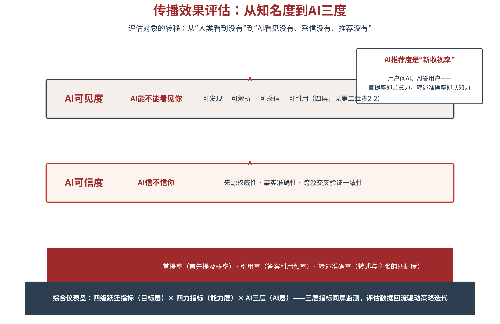

# 第三章 运行体系——从内容生产到智能传播闭环

第二章立起了理论总纲——谁在传播、怎么传播、为何传播；本章立制——传播系统如何运转。作为五维一体的第四维，本章把传播过程重构为“用户洞察—内容生成—智能分发—人机交互”四大环节构成的智能传播闭环：以四力飞轮为各环节能力内核，以数据回流驱动闭环迭代，以AI三度为效果评估新标准，形成一套可持续运转、可累积复利的传播操作系统。国家、城市、企业三类主体，都将在这套操作系统上运行各自的战略传播。

## 3.1 闭环升级——从内容生产链到智能传播闭环

**传统传播流程的局限——断裂式作业**

要看清闭环，先看清链条。传统传播的组织形态，是一条内容生产链：策划—生产—发布—反馈，四个部门接力，一个项目结项。这条链条的学理原型，可以追溯到香农—韦弗的通信模式与拉斯韦尔的5W[1]——信息从信源出发，经编码、渠道、解码，抵达信宿；传播研究的地图，也随之被画成一条从传者指向受众的直线。在渠道稀缺、节奏缓慢的大众媒介时代，这条直线运转良好：一支广告投放数月，一次调研回收千份问卷，节奏虽慢，环环尚能相扣。

信息过载与AI介入之后，直线链条在三个接缝处断裂。其一，反馈时滞断裂——传统反馈以月计：内容发布后，等调研、等报告、等复盘，等结论出来，议题热度早已退潮，认知偏差已经定型。其二，数据资产断裂——项目制传播随结项而归档：Campaign结束，数据沉入硬盘，经验存进个人脑中，下一个项目从零开始，组织为同一个认知错误重复付费。其三，组织协同断裂——策划部门管创意、生产部门管内容、渠道部门管投放、公关部门管舆情，四个部门四本账，谁也不对“受众最终信了什么”负责。链条断裂的后果，就是第一章诊断的“三重失效”：投入持续增加，认知资产原地踏步。

**智能传播闭环——数据回流驱动的螺旋循环**

本书将AI时代的传播过程重构为智能传播闭环：用户洞察→内容生成→智能分发→人机交互→数据回流→再洞察，四环节首尾相衔，数据回流穿针引线，构成一个螺旋上升的循环（见图3-1）。它与全面质量管理的PDCA循环形似而神不同：PDCA改进的是流程质量，转一圈，产品合格率提高一点；智能传播闭环累积的是认知资产——转一圈，AI知识库多一批可被采信的知识条目，受众画像多一层认知结构数据，信任证据链多一组可验证事实。前者的收益有上限，后者的复利无上限。

图3-1　智能传播闭环：数据回流驱动的螺旋循环

闭环之为闭环，在于三个特征。可持续运转——四环节不是四个项目，而是一台常开的机器，洞察不结项、生成不停更、分发不断流、交互不下线。可累积复利——每一次运转的产出都沉淀为知识资产，后来的传播站在前人的数据上起跳。可测量迭代——每一环都有指标、有仪表盘、有预警，偏差实时可见，策略随时可调。简言之：项目制传播花掉的是预算，平台化运营积累的是资产。

**闭环的组织含义——从项目制传播到平台化运营**

闭环不只是流程图，更是组织形态。从项目制传播转向平台化运营，意味着三重转变：组织结构上，从“项目组随任务聚散”转向“常设的传播中台”——数据团队管洞察，内容工厂管生成，渠道运营管分发，交互运营管对话，中台向各业务线输出能力。预算逻辑上，从“按项目拨付、花完即止”转向“按能力建设、资产入账”——预算购买的不再是一次曝光，而是一条可持续优化的知识条目、一套可复用的问答资产。人才结构上，从“创意人才为主”转向“创意×数据×算法的复合团队”——懂得向AI提问的策划师与懂得校验AI答案的编辑，同样不可或缺。

**四力飞轮归位——能力系统的完整声明**

进入分论之前，须先完成一项理论归位。第二章的五维框架中，传播体系维度的能力内核是四力飞轮——感知力、生成力、连接力、进化力。四力与四环节的关系，本书作如下严格声明：四力＝三环节能力＋一涌现能力。感知力、生成力、连接力，分别是用户洞察、内容生成、智能分发三个环节的能力内核；进化力不是第四个环节的专属能力，而是闭环整体运转的涌现能力——由人机交互环节的数据回流触发，在闭环的整体咬合中实现，不由任何单一环节独占。换言之：人机交互是进化力的触发器，对话即回流，回流即进化。

四力飞轮的核心在于“咬合”——感知力发现机会，生成力生产内容，连接力传递信任，进化力积累资产。四力越咬合，传播的复利效应越显著。飞轮之喻，取其三义：启动费力——搭建闭环的前期投入远高于发一条新闻通稿；运转省力——系统转起来之后，单次传播的边际成本持续下降；越转越快——数据回流使每一环都比上一轮更聪明。许多组织的传播做成了“断轴的风扇”：单点能力强，四力不咬合，预算烧完，飞轮停摆——这是本章自检表要预防的病。四环节、四力与各自的核心产出，见表3-1。

表3-1　智能传播闭环：四环节×四力×核心产出

| 环节 | 能力内核 | 核心问题 | 核心产出 |
|---|---|---|---|
| ① 用户洞察 | 感知力 | 环境与受众发生了什么变化？ | 认知仪表盘·双受众画像·预警分级 |
| ② 内容生成 | 生成力 | 用什么内容回应变化？ | 多语种多形态内容·结构化知识条目 |
| ③ 智能分发 | 连接力 | 内容如何抵达人与AI？ | 算法适配内容·AI答案占位·跨渠道一致 |
| ④ 人机交互 | 进化力触发器 | 对话中沉淀了什么？ | 交互数据回流·知识资产累积·策略迭代 |

> **【通俗释义】四力飞轮**
> 飞轮就是老式蒸汽机上那个大铁轮子：启动时特别费劲，可一旦转起来，很小的力就能维持高速，而且转得越快越难停下来。四力飞轮同理——感知力是眼睛（看见机会），生成力是手（做出内容），连接力是腿（把内容送达该去的地方），进化力是轮子本身（让每次传播都为下次蓄能）。前三个能力单点强没用，得咬合在一台机器上，轮子才转得起来；而轮子一旦转起来，后来者想追，光靠预算是追不上的。

## 3.2 用户洞察——认知环境与受众的AI理解

**认知环境监测——舆情、情绪、议题与弱信号**

闭环的起点是洞察。AI时代的用户洞察，从“监测舆情”升级为“监测认知环境”，四项基本功缺一不可。舆情覆盖管“面”——监测平台与关键词的覆盖度，决定你看得见多大的世界。情绪识别管“情”——对海量文本做正面、负面、中性的实时分类，把握舆论的温度。议题发现时滞管“时”——从议题出现到被识别的平均时间，时滞每缩短一小时，处置窗口就多一小时。弱信号捕捉管“深”——在小众平台与圈层中发现趋势的能力。哈尔滨冰雪游的启示在此格外醒目：出圈从来不是突然发生的，在“南方小土豆”刷屏之前，弱信号早已在评论区酝酿——弱信号即战机，看见得早，才有资格接得住。

**受众画像升级——从人口统计到认知结构**

传统受众画像画的是“人”：年龄、性别、地域、收入、职业——一套人口统计学变量。AI时代的画像，画的是“人对你的认知结构”，三要素构成新的坐标系。联想网络——提到你时，受众先想到什么：提到哈尔滨，是“冰天雪地”还是“宠客之城”，联想排序就是认知资产的资产负债表。议题立场——在争议议题上，受众以为你站在哪里：立场错位是误读的温床，也是危机的引信。信任偏好——受众信谁的话来了解你：信官方通报、信KOL、信“过来人”的攻略，还是信AI的总结——信任偏好决定你的传播该押注哪条渠道。画像对象的这一升级，与第二章的机器受众概念相接，共同指向一个结论：看见情绪是本能，看懂认知结构才是本事。

**双受众洞察——人类受众与机器受众**

第二章已立论：AI时代存在双受众——人类受众与机器受众。本节将其操作化为洞察任务。人类受众的洞察沿三条线展开：情感（好感度与情绪曲线）、态度（立场与认同）、行为（点击、搜索、到访、购买）。机器受众的洞察则是全新课题，本书归纳为三问：语料之问——AI的训练与检索语料里有你吗，覆盖多少、新旧如何。实体之问——AI知道你是谁吗，名称、属性、类别是否消歧清晰，同城同名会不会张冠李戴。引用之问——AI引用你时说的是什么，口径与你的一致，还是被二手信源带偏。三问的答案，直接对应第二章AI可见性四层模型的达标状态——机器受众画像，本质上是给你的AI可见性做体检。

从洞察到决策，中间需要一个枢纽：认知仪表盘（见图3-2）。仪表盘把四项监测与双受众画像整合为一张作战地图，并按风险等级做预警分级——红色预警即刻响应，橙色预警二十四小时处置，黄色预警纳入议题池，蓝色信号常规监测。分级的意义在于分配注意力：组织的响应资源永远稀缺，仪表盘保证把最敏感的神经，用在最要紧的信号上。

图3-2　用户洞察：认知环境监测与双受众画像

双受众画像的价值，在联动使用。人类画像定内容，机器画像定渠道——受众的联想网络告诉你叙事该从哪里切入，AI的引用网络告诉你战场该摆到哪里。两幅画像一旦对照，脱节无处遁形：若受众联想里你是“老工业城市”，而AI语料里你是“冰雪之城”，说明内容供给与AI认知已经错位——是传播叙事向AI口径靠拢，还是反向矫正AI的引用网络，正是策略决策点所在。再如信任偏好显示受众信“过来人攻略”，而AI引用网络里第三方游记寥寥——那么生产可被引用的游客故事，就是一石二鸟的优选动作。洞察环节的产出，就这样直接转化为下一环节的输入。

**感知力指标体系**

感知力作为用户洞察环节的能力内核，其操作化指标与基准值建议见表3-2。指标设计的立场是“可测可办”：舆情监测覆盖率以目标平台为分母，情绪识别准确率以人工标注为基准，议题发现时滞以系统日志为依据，弱信号捕捉率以每季度可验证的趋势识别为底线——每一条都能落进系统、算出数字、按月复查。

表3-2　感知力操作化指标

| 指标 | 定义 | 基准值建议 |
|---|---|---|
| 舆情监测覆盖率 | 监测平台数量与关键词覆盖度 | ≥90%目标平台 |
| 情绪识别准确率 | 正面/负面/中性分类准确度 | ≥85%（人工标注对比） |
| 议题发现时滞 | 从议题出现到被识别的平均时间 | ≤4小时 |
| 弱信号捕捉率 | 在小众平台/圈层中发现趋势的能力 | 每季度≥1条可验证趋势 |

## 3.3 内容生成——人机协同的内容生产

**人机协同的生产流程——五步法**

洞察发现机会，生成把机会变成内容。本书将人机协同的内容生产流程规范为五步：策略输入→AI初稿→人工精修→结构化处理→多平台部署监测（见图3-3）。五步之间，人机分工有一条清晰的红线：人主导方向——策略输入环节由人锁定传播目标、受众画像与品牌语调基线，方向错了，效率越高偏得越远。机加速生产——AI初稿环节由大模型批量生成多语种、多形态的初稿，把“从零到一”的成本压缩一个数量级。人守住底线——人工精修环节做三查：事实核查（数据、引语、时间线逐条对表）、价值把关（导向与合规的红线审查）、语调校准（与品牌语调基线的偏离度调整）。机保证采信——结构化处理环节把内容转写为FAQ化、知识条目化、字段可验证的形态，这是给AI看的格式。人机协同运营——部署与监测环节由人定渠道策略、机器做适配分发与数据回收。

图3-3　人机协同的内容生产流程

五步流程跑通之后，多语种与多形态生产从“奢侈选项”变为“标配能力”。出海传播的最大成本，曾是小语种人才与本地化制作——一门语言一个团队，一条视频一次重拍。AI把这道成本鸿沟填平了：一条门票政策说明，可以一夜之间生成英、日、韩、法、西五种语言的FAQ版本；一支产品视频的脚本，可以同步衍生出图文、播客与互动问答——这在五年前需要一个外包团队干一个月，如今是内容工厂的一次批处理。但必须清醒两点：其一，AI给的是及格线——语法正确、术语准确，而打动人心的本地文化质感，仍需人工精修环节里懂当地文化的人来把关；其二，多语种的真正瓶颈不在生产端而在采信端——小语种内容若无本地权威信源的引用与佐证，AI照样不敢采信。多语种生产的完整公式是：AI批量生成＋人工文化校准＋本地信源布局，三者缺一不可。

**品牌一致性控制——从理念层下沉到数据层**

传统品牌管理的一致性，靠品牌手册与员工培训维系，约束在理念层；AI时代的内容生产量大、形态多、语种广，理念层的约束力不够用了，一致性控制必须下沉到数据层。语调基线成为可计算的风格参数——句长、用词正式度、情感倾向都有量化区间，机器初稿先过风格检测。视觉规范成为模板化组件——字体、色彩、版式封装为组件库，生成内容自动套用。内容审核成为“机器预审＋人工终审”的流水线——机器筛查合规风险与事实硬伤，人复核机器拿不准的灰色地带。合规是底线中的底线：依据《生成式人工智能服务管理暂行办法》等规定[2]，AI生成内容须做显著标识，深度合成内容须可追溯——AIGC使用率因此宜控制在合理区间，本书建议30%—70%：过低，人机协同的效率红利无从兑现。过高，质量与合规风险将失控。

**从内容到知识资产——单一真相源**

内容生产的目标函数变了。传统生产追求“发出去的内容”——阅读量、播放量；AI时代的生产还要产出“可被AI采信的知识条目”——每一条内容同时是知识库的一块砖。这里有一条铁的纪律：单一真相源。每一个核心字段——产品价格、门票标准、营业时间、联系方式——只能有一个官方口径，通常落在官网；所有渠道的口径向它看齐，并按季度做多平台比对。一个真实的教训场景：某景区旺季全价票官方口径为120元，OTA平台挂出118元，某攻略站写着105元——三个渠道口径打架，AI交叉验证不敢采信，游客比价心生疑虑；统一整改后三渠道一致，AI引用的就是那一个准确的数字。内容即资产，口径即纪律——AI用“多源一致”判定真相，口径混乱的组织，等于亲手教AI怀疑自己。生成力作为本环节的能力内核，其操作化指标见表3-3。

表3-3　生成力操作化指标

| 指标 | 定义 | 基准值建议 |
|---|---|---|
| 内容产出量 | 日均/月均内容产出数量 | 视组织规模设定基线并持续爬坡 |
| 形态多样性 | 文本/图像/视频/音频比例 | 各形态覆盖率≥20% |
| 多语种覆盖率 | 覆盖语种数量 | ≥10种（出海组织酌增） |
| 内容质量评分 | 专家评审与用户反馈综合评分 | ≥4.0/5.0 |
| AIGC使用率 | AI生成内容占比 | 30%—70%（兼顾效率与合规） |

## 3.4 智能分发——算法推荐与AI可见性

**分发格局的三级演进**

内容生产出来，分发决定命运。中国乃至全球的分发格局，正处在三级演进的进行时：第一级，人工编辑分发——编辑部把关、版面与时段定生死，这是渠道稀缺时代的逻辑，受众被动等待。第二级，算法推荐分发——平台的兴趣图谱与社交图谱决定内容的命运，点击与互动是硬通货，这是信息过载时代的逻辑，受众被算法投喂。第三级，智能体分发——用户把选择权交给AI助手：替我问、替我选、替我总结，答案即渠道，这是生成式AI时代的逻辑，受众的注意力由AI代理分配。三级并存而重心下移：今天的传播者必须同时打好三级战争，而决定未来十年胜负的，是第三级。

先说正在主宰当前的算法推荐分发。平台逻辑千变万化，内容适配有三条通则：兴趣适配——内容标签与用户兴趣图谱的匹配度决定冷启动的生死，标题、封面、前3秒是匹配的钩子。社交适配——转发、评论、@构成的社交信号是平台加权的依据，内容要为“转发的那一刻”而设计。搜索适配——搜索是意图最明确的流量，关键词布局与问答化表达决定内容能否接住这泼意图。三条通则背后是同一个原则：为平台的分发逻辑生产内容，而不是生产完内容再求平台分发。

**生成式引擎优化（GEO）——七步操作法**

第二章已给出GEO的四条策略——内容工程化、第三方权威、引擎特定策略、破解大品牌偏见[3]；本节把策略落成可执行的七步操作法。支撑它的实证基础来自Chen等人的对照实验：AI搜索对第三方权威来源存在系统性偏好，引用添加可将来源可见性提升高达41%[4]。七步法如下（见表3-4）：第一步，识别高频问答场景——盘点目标用户会向AI提出的问题，按频次与商业价值排序。第二步，构建结构化答案——每个场景产出要点化、可引用、带出处的标准答案。第三步，多平台部署——官网、百科词条、行业媒体、问答社区，让答案出现在AI的检索路径上。第四步，证据链强化——为每条答案配第三方权威背书、统计数据与引语，对接第二章的信任证据链。第五步，监测AI首提率——定期在多个AI平台测试核心问答，记录被首先提及与被引用的频率。第六步，迭代优化——按监测结果调整答案结构、部署位置与证据配置。第七步，效果归因——把AI可见性的变化与留资、到访、成交等业务指标关联，算清GEO的投入产出。

七步法的灵魂在第五步与第七步之间：监测让优化有据，归因让投入有账。GEO不是一次性的技术改造，而是“部署—监测—迭代—归因”的循环运营——这本身就是智能传播闭环在分发环节的缩影。过去十年，组织争夺的是搜索结果的第一页；未来十年，组织争夺的是AI答案的第一句。第一页尚有十个位置，第一句只有一个名额。

表3-4　GEO七步法操作卡

| 步骤 | 关键动作 | 产出与检验 |
|---|---|---|
| ① 识别问答场景 | 盘点用户向AI提出的高频问题，按频次与价值排序 | 问答场景清单 |
| ② 构建结构化答案 | 每场景产出要点化、可引用、带出处的标准答案 | 结构化答案库 |
| ③ 多平台部署 | 官网·百科·行业媒体·问答社区同步部署 | 检索路径覆盖率 |
| ④ 证据链强化 | 第三方权威背书＋统计数据＋引语 | 可验证证据配比 |
| ⑤ 监测AI首提率 | 多AI平台定期测试核心问答 | 首提率·引用率月报 |
| ⑥ 迭代优化 | 按监测结果调整答案结构与部署 | 首提率环比改善 |
| ⑦ 效果归因 | AI可见性变化与业务指标关联分析 | GEO投入产出账 |

**中文场景复测指引**

必须诚实地说明实证边界：41%的可见性提升来自英文语境的大规模对照实验，中文场景的模型生态、检索机制与语料分布均有差异，实验数据不可直接外推。本书为此在附录九给出中文复测协议：选取文心一言、通义千问、Kimi、豆包、DeepSeek等主流中文模型，编制标准化提问集，对“优化前/优化后”两组内容做A/B对照，实测首提率与引用率差异，以本土数据校准策略权重。理论的态度与方法的态度应当一致：既不因数据来自英文世界而弃用，也不因一句“中国特色”而免检——复测，是让GEO在中文土壤里长出自己根系的唯一办法。

**智能体分发与跨渠道一致性**

第三级分发——智能体分发——的本质，是从“人类看到”到“AI采纳并转述”。用户问AI助手“周末去哪儿玩”“哪家的设备靠谱”，AI从语料中检索、比对、综合，给出一段带立场的答案——你的信息若不在它的答案里，就等于不存在。这带来两个直接要求：其一，内容要“可被转述”——结论清晰、要点规整、出处可查，AI才容易原样带给你潜在用户。其二，跨渠道口径要一致——多平台部署不是复制粘贴，而是同一真相源的多格式表达，各渠道表述可以不同，口径必须归一，否则AI的多源交叉验证会把你判定为不可信来源。分发环节的能力内核是连接力——连接人，也连接机器；穿透圈层，也穿透算法。

> **【通俗释义】智能体分发**
> 过去你在报纸登广告，路过的人看到；后来你在App投信息流，刷到的人看到；现在和将来，你的信息要争取进入AI的答案——用户问AI，AI替他“看”了全网的资料，然后只把一段总结递给他。这段总结里有没有你、把你排在第几、怎么说你，就是智能体分发要争夺的位置。简单说：以前是“让人看见你”，现在是“让AI替人看见你，并且替你说好话”。

## 3.5 人机交互——对话即传播与闭环进化

**对话式传播的兴起**

传播的界面正在从“页面”变为“对话框”。AI助手、智能客服、数字人，构成人机交互的三大界面：AI助手接住用户的开放式提问，智能客服承接服务场景的确定性需求，数字人把组织的叙事人格化。人机传播研究早已预言这一刻——Gunkel早在2012年即指出，当机器成为传播的参与者而非单纯的工具，传播学必须把“与机器的交流”纳入理论视野[5]。Guzman进一步阐明，人机传播是一种“与文化技术的意义生成”，人与机器互为传播主体[6]。而更早的技术哲学给出了诗意的注脚：Weiser在1991年预言，最深刻的技术是那些“消失的技术”——它们把自己编织进日常生活的织物，直到与生活无从区分[7]。对话式传播正是这一预言的传播学实现：当提问与回答成为习惯，传播就消失在服务里。

**人机交互的信任机制**

对话界面是信任的放大器，也是信任的粉碎机。人机交互的信任机制有三根支柱：即时响应——秒级回应本身就是能力证明，用户对“已读不回”的容忍度趋近于零。个性化——基于用户画像的“千人千面”回答让每个人感到被理解，冷冰冰的标准话术则让每个人感到被敷衍。可验证——答案给出处、承诺给凭证、进度可查询，每一次可追溯都是信任证据链上的一环[8]。三根支柱共同指向第二章“三层五真”的落地：即时响应是真行，个性化是真懂，可验证是真值——交互界面，就是组织真诚度的显微镜。

**交互数据回流——对话即洞察**

人机交互环节最宝贵的产出，不是单次对话的满意，而是数据回流。三句话概括：对话即洞察——用户问什么，就是想要什么；高频问题清单是最诚实的需求调研，无需问卷，答案自己上门。服务即传播——每一次客服交互都是品牌体验的现场直播，答得好，一次交互胜过十条广告；答得差，负面截图当晚传遍社交网络。使用即优化——交互数据反哺知识库：答不上来的问题提示知识盲区，答错的问题暴露口径漏洞，答得慢的环节指向流程冗余。实践已在验证这条回流管道：杭州“杭小忆”文旅智能体整合城市数据，为游客提供“千人千面”的个性化推荐。杭州西湖景区的“数字导游”使游客平均停留时间延长至5小时，景区二次消费收入增长30%（据项目方披露，缺少对照组设计）。新加坡星耀樟宜机场的AI聊天机器人将人工查询成本降低70%以上（据项目方披露）——数字或有出入，方向毋庸置疑：对话的每一秒，都在同时完成服务、传播与数据积累。

**进化力的涌现机制与传播复利**

现在可以完整回答“进化力从哪里来”。进化力经四步涌现：交互数据回流→知识资产累积→策略迭代→复用率提升。回流提供原料，累积形成资产，迭代把资产变成更好的策略，复用让每一次迭代的成本被摊薄——四步咬合，闭环每一圈的产出都高于上一圈。必须再次强调本章的理论声明：进化力不属于任何单一环节，正如健康不属于任何器官而属于整个机体——它是闭环整体运转的涌现属性。这也解释了为什么进化力只能由人机交互“触发”而不能由其“独占”：触发只须数据回流开闸，实现须靠全链条的咬合。

进化力的长期效果，就是传播复利。第一年建库——知识条目从零到千，投入大于产出；第二年提效——重复问题的应对成本断崖式下降，内容复用率爬坡；第三年复利——AI答案占位稳固、口径全网一致、知识资产自我增值，后来者用十倍的预算也难以追赶。与金融复利同理，传播复利的魔力在时间：早一年启动闭环，就早一年进入复利区间。与此同时，智能体正从“界面”进化为“节点”——越来越多的传播对象是代表人类行动的AI代理：它们检索你、引用你、转述你，也可能忽略你、误传你。与智能体共处、协作、博弈，是传播者的新必修课——这一课的完整考卷，将在第十四章的科技信任场景中展开。进化力的操作化指标，见表3-5。

表3-5　进化力操作化指标

| 指标 | 定义 | 基准值建议 |
|---|---|---|
| 知识资产累积量 | 结构化知识库条目数 | 持续增长（月度净增为正） |
| 策略迭代频率 | 季度/年度策略更新次数 | ≥1次/季 |
| 效果归因准确率 | 能准确识别传播效果的归因比例 | ≥70% |
| 复用率 | 过往内容/数据被再次使用的比例 | ≥30% |

## 3.6 效果评估——从知名度到AI三度

**传统评估的局限**

评估体系是传播体系的指挥棒。传统评估盯住曝光、点击、知名度三件事，在AI时代至少三重失灵：其一，可刷量——曝光与点击的造假产业链成熟，数据繁荣与认知贫困并存。其二，不区分人机——机器流量被计入“传播效果”，报告里的百万阅读，可能一成来自真人。其三，无传导关系——曝光与信任、信任与选择之间没有测量桥梁，指标好看而增长乏力，无法定位断点。三重失灵的病根是同一个：传统KPI测量的是“人类看到没有”，而AI时代的传播效果，首先要问的是——AI看见没有、采信没有、推荐没有。

**AI三度评估体系**

本书提出AI三度评估体系（见图3-4）。评估坐标系为什么必须扩展？因为消费者行为学的经典框架——从AIDMA到科特勒的5A——测量的是人类受众的心理阶梯[9]，而AI时代的第一轮问答发生在用户与AI之间，机器受众的行为维度成了评估的空白区。第一度，AI可见度——AI能不能看见你，操作化承接第二章的四层模型：可发现、可解析、可采信、可引用，一层不达标，后面皆空谈。第二度，AI可信度——AI信不信你：来源权威性是否过硬，事实是否准确，多源交叉验证是否一致。第三度，AI推荐度——AI推不推荐你：首提率（用户问到相关品类时，AI首先提及你的概率）、引用率（你的内容在AI答案中被引用的频率）、转述准确率（AI转述与你核心主张的匹配度）。三度层层递进：可见是入场，可信是过关，推荐是登顶。若要一句话说透AI推荐度的分量：它是AI时代的新收视率——用户问AI、AI答用户，首提率即注意力，转述准确率即认知力。

图3-4　传播效果评估：从知名度到AI三度

**综合仪表盘与评估驱动迭代**

AI三度不取代此前的指标体系，而是补上最关键的一层。本书建议组织搭建三层同屏的综合仪表盘：目标层看四级跃迁指标——被看见、被理解、被采信、被选择（第二章）；能力层看四力指标——感知、生成、连接、进化（本章各节）；AI层看AI三度——可见、可信、推荐。三层之间有明确的因果指向：AI三度的改善支撑四级跃迁，四力的咬合驱动AI三度。评估的形态也随之改变：不再是项目结束后的“期末考试”，而是每周每月的“日常仪表盘”——数据回流驱动策略迭代，形成“评估—优化—再评估”的循环。评估不是为了证明传播部门的功劳，而是为了找到闭环的下一处断点。

评估要立起来，还须解决组织化三个问题。谁来测——传播中台设立AI三度监测职能，或由数据团队按模板例行执行，测试过程须留痕、可复核，防止“自测自夸”。多久测——核心问答场景月度例行，重大发布与危机节点即时加测，行业大模型版本更新后追加一轮——因为模型一升级，AI的引用格局可能重新洗牌。测完怎么办——结果回流认知仪表盘，与四级跃迁、四力指标同屏复盘，月度AI三度例会把“数字变化”翻译成“动作决定”：首提率下滑，是答案结构退化还是竞对加码？转述失真，是口径混乱还是信源污染？评估一旦制度化，改善就有了节拍器——AI三度的评估模板，见表3-6。

表3-6　AI三度评估模板

| 维度 | 核心指标 | 测量方法 | 基准建议 |
|---|---|---|---|
| AI可见度 | 四层达标状态（可发现/可解析/可采信/可引用） | 爬虫收录检查＋结构化校验 | 四层全部达标 |
| AI可信度 | 来源权威性·事实准确率·跨源一致性 | 多模型交叉提问比对 | 口径一致率≥90% |
| AI推荐度 | 首提率·引用率·转述准确率 | 标准化提问集多平台测试 | 核心场景首提率≥30% |

## 3.7 本章小结——运行体系的行动要点

本章逻辑链复盘：一条链的瓦解——传统“策划—生产—发布—反馈”的断裂式作业退出主战场。一个闭环的确立——用户洞察、内容生成、智能分发、人机交互四环节首尾相衔，数据回流驱动螺旋上升。一套能力的归位——感知力、生成力、连接力为三环节能力内核，进化力为闭环涌现能力。一组标准的升级——AI可见度、AI可信度、AI推荐度构成效果评估的AI三度。至此，五维一体的第四维“传播体系”完整落地：它与第二章的理论总纲共用一套概念血脉，又为第四章的分层架构提供共同的运行框架——国家、城市、企业，无论哪一层主体，其AI战略传播都在这台操作系统上运转，差别只在装载的应用与运行的场景。

行动层面，本章交付三件工具：其一，智能传播闭环自检表（见表3-7）——四环节×四力逐项体检，找出自己的断轴风险。其二，GEO七步法操作卡（见表3-4）——分发环节的完整作业指导。其三，AI三度评估模板（见表3-6）——把AI层效果纳入例行监测。三件工具的使用顺序建议是：先自检、再优化、后监测——先知道断在哪里，再决定修哪里，最后用数据验证修没修好。

三件工具用于三类主体，重心各有不同。国家主体的重心在洞察与评估的“全球版”——搭建覆盖多语种多平台的认知仪表盘，正如本章案例Northstar所示，看得准是传得对的前提。城市主体的重心在洞察与交互——文旅问答是天然的高频对话场景，“一问一答”既是服务窗口，也是城市叙事的播种机。企业主体的重心在GEO与归因——AI答案占位直接连接购买决策，首提率的每一个百分点，都能折算成留资与成交。主体不同、场景不同，但操作系统是同一套——这是本章作为“共同的运行框架”的本义。

表3-7　智能传播闭环自检表（四环节×四力）

| 环节 | 能力 | 自检问题 | 不达标信号 |
|---|---|---|---|
| 用户洞察 | 感知力 | 我们能否在4小时内发现关于自己的新议题？ | 靠别人提醒才知道自己上了热搜 |
| 内容生成 | 生成力 | 我们的核心字段是否全网口径一致？ | 各渠道报价、表述互相打架 |
| 智能分发 | 连接力 | 核心问答场景中AI是否首先提及我们？ | 用户问AI得到的答案里没有自己 |
| 人机交互 | 进化力 | 高频问题是否沉淀进知识库并可复用？ | 同样的问题每年都从零回答 |

> **本章案例｜美国国务院Northstar：智能传播闭环的国家级应用**
> 【核心问题】如何让公共外交叙事在全球海量多语种信息中“看得准、传得对、评得出”，减少跨文化误读——这是摆在每一国外交系统面前的运行难题。
> 【模型工具】Northstar是美国国务院开发的AI驱动的全球媒体分析工具[10]：覆盖全球10万多个媒体机构、近200个国家和100多种语言，提供外国官员在主要社交媒体平台的母语信息，使驻外使团官员能在一处快速收集、分析、翻译和总结信息空间中的趋势性叙事。该工具由国务院内部开发人员基于业界领先的开源AI模型构建，2024年底在国务院全面推广。
> 【运行体系四环节的落地】用户洞察环节——Northstar把“认知环境监测”做到了国家级：舆情覆盖横跨百语种，情绪与议题分析替代人工读报，使团从“订阅摘要”升级为“实时仪表盘”。内容生成与分发环节——分析结果直接输入叙事优化：哪个市场、哪个语种、哪个渠道的叙事重点需要调整，数据说了算。效果评估环节——国务院以任务活动跟踪器（MAT）记录活动范围、频率与业绩，但审计也直言其局限：未能充分描述活动与结果之间的因果关系——评估体系本身仍待从“活动统计”升级为“效果归因”。运行数据（据美国国务院披露）：前副国务卿Liz Allen估计，该工具每年节省约18万工时；全面推广后服务超过8000名用户；各使团反馈，媒体摘要工作时间减少了60%。
> 【案例启示】机制上，Northstar是智能传播闭环在“用户洞察＋效果评估”两环的国家级应用——AI把原本专属大国使馆的情报能力，变成8000名外交官人人可用的日常工具，印证了“从项目制传播到平台化运营”的组织跃迁。条件上，它的成功依赖三个前提：高质量的多语种数据管道、内部开发团队对业务场景的深度理解、以及高层对“AI辅助决策”的制度性接纳——工具易得，组织难改。迁移上，该样本对各级主体皆有启发：国家的对外传播可循此搭建全球认知仪表盘，城市的文旅系统可复刻多语种舆情监测，企业出海更可直接对标——先把“看得准”做到位，再谈“传得对”与“评得出”。
> 【行动清单】①建立海外受众情绪与议题监测指标体系，先解决“看得准”。②用AI对多语种内容做效果归因，把评估从活动统计升级为效果测量。③按监测反馈动态调整叙事重点、语种与渠道。④把监测结果沉淀为对外传播的长期知识库——公共外交不是“发出去就结束”，而是闭环持续运转的动态系统。

## 本章参考文献

[1] SHANNON C E, WEAVER W. The Mathematical Theory of Communication[M]. Urbana: University of Illinois Press, 1949.

[2] 国家互联网信息办公室, 等. 生成式人工智能服务管理暂行办法[Z]. 北京: 国家互联网信息办公室, 2023.

[3] AGGARWAL P, MURAHARI V, RAJPUROHIT T, et al. GEO: Generative engine optimization[C/OL]. 2024.

[4] CHEN Y, et al. GEO实证：引用添加对AI可见性的提升效应[R/OL]. 2025.

[5] GUNKEL D J. Communication and artificial intelligence: Opportunities and challenges for the study of communication[J]. Communication+1, 2012, 1: 1-25.

[6] GUZMAN A L. Human-Machine Communication: Rethinking Communication, Technology, and Ourselves[M]. New York: Peter Lang, 2018.

[7] WEISER M. The computer for the 21st century[J]. Scientific American, 1991, 265(3): 94-104.

[8] MAYER R C, DAVIS J H, SCHOORMAN F D. An integrative model of organizational trust[J]. Academy of Management Review, 1995, 20(3): 709-734.

[9] KOTLER P, KARTAJAYA H, SETIAWAN I. Marketing 4.0: Moving from Traditional to Digital[M]. Hoboken: John Wiley & Sons, 2017.

[10] U.S. Department of State. Northstar: AI-Powered Global Media Analytics Tool[R]. Washington, D.C.: Office of Global Public Affairs, 2024.
