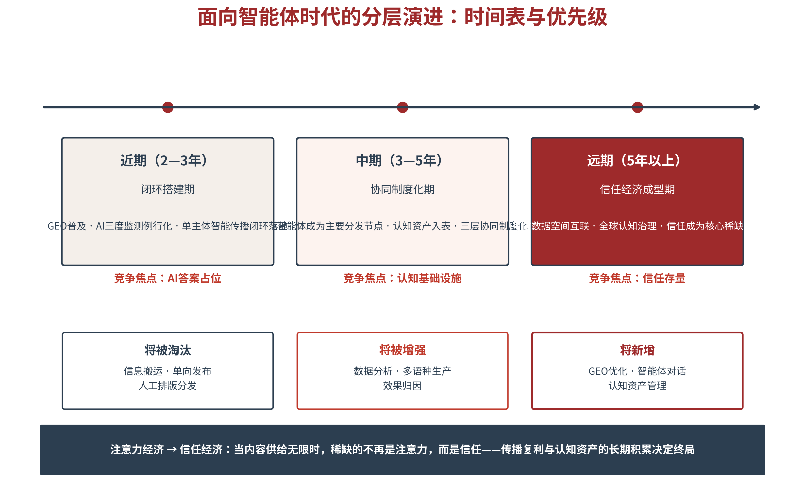

# 第四章 分层架构——国家、城市、企业的传播协同

第三章交付了三类主体共同的运行操作系统；本章立架，回答“在哪些层面传播”——这是五维一体的第五维，也是全书应用篇的理论地图。国家层聚焦认知主权与国际话语权，城市层聚焦城市品牌与认知定义权，企业层聚焦信任资产与增长引擎；三层不是行政层级的复制，而是传播职能的分工，并通过信任力协同模型形成合力。本章末节研判智能体时代的分层演进趋势，为全书提供前瞻视野，并完成理论篇向应用篇的转场。

## 4.1 分层逻辑——为何国家、城市、企业各答一问

**为何分层——宏观—中观—微观的传播结构**

战略传播的主体谱系，天然分为三层：国家是宏观层，对应治理体系，掌握着价值叙事与规则供给；城市是中观层，对应产业体系与生活空间，掌握着场景叙事与体验供给；企业是微观层，对应市场体系，掌握着产品叙事与证据供给。三层不是简单的“大小之分”，而是三种不同性质的传播单元：国家的传播对象是国际社会与国民全体，时间尺度以十年计；城市的传播对象是游客、人才与投资者，时间尺度以年计；企业的传播对象是客户与合作伙伴，时间尺度以季度计。尺度不同、对象不同、节奏不同，传播的命题与工具必然不同——用一套打法包打三层，是战略传播最常见的失败原因。

分层的必要性，因AI而凸显。回望传播史：大众媒介时代，三层各安其位、少有交集——国家层靠外交辞令与外宣体系，城市层靠形象广告与节庆事件，企业层靠广告投放与媒体公关，各玩各的渠道，各算各的账。互联网时代，三层开始共享社交平台，但打法依旧各异——国家开账号、城市做话题、企业投信息流，同台而不协同。AI时代，格局发生质变：三层第一次共享同一个认知基础设施——大模型与知识图谱把国家叙事、城市口碑与企业产品编入同一张语义网络；三层第一次面对同一批“机器受众”——AI在生成答案时，天然把三层的表述放进同一个语境做交叉验证。于是出现了双重趋势：分层的必要性因专业分工而加剧，协同的必然性因认知基础设施的一体化而凸显——这是本章立论的时代底色。

**三层的共性与差异化命题**

分层的前提是共性：三层主体都运行在同一个AI认知环境中，都面临“被看见、被理解、被采信、被选择”的四级跃迁（第二章），都可套用第三章的智能传播闭环。但在同一考卷上，三层各自回答的是不同的考题。国家层求“合法性”——在激烈的国际话语权竞争中，让自身制度、道路与贡献被准确理解，核心概念是认知主权与国际话语权[1][2]。城市层求“吸引力”——在千城一面的同质化竞争中，让自己被记住、被向往、被选择，核心概念是认知定义权与场景体验。企业层求“可信性”——在供给过剩的买方市场中，让产品与服务被长期采信，核心概念是信任资产与增长引擎。简言之：国家给合法性、城市给吸引力、企业给可信性——三层各答一问，缺一层，故事就讲不圆。三层的命题、核心概念与应用篇章节地图，见表4-1。

值得强调的是，三层之间不是彼此孤立的“三层楼”，而是相互透支与相互充值的“一个账户”。国家的负面事件会连累城市招商与企业出海——投资者与消费者并不细分“这是哪一层的问题”；反过来，一家硬核企业的全球成功、一座城市的现象级出圈，也在为国家叙事持续充值。三层在受众心智中共享同一个品牌账户——这是后文信任力协同模型的直觉基础。

表4-1　三层传播架构总表

| 主体层 | 差异化命题 | 核心概念 | 传播对象与节奏 | 应用篇地图 |
|---|---|---|---|---|
| 国家层 | 求合法性 | 认知主权·国际话语权 | 国际社会与国民·以十年计 | 第5—7章 |
| 城市层 | 求吸引力 | 认知定义权·场景体验 | 游客·人才·投资者·以年计 | 第8—11章 |
| 企业层 | 求可信性 | 信任资产·增长引擎 | 客户与伙伴·以季度计 | 第12—15章 |

**分层与分众——主体分层与受众分层的双维结构**

须辨明两组容易混淆的概念。“分层”说的是传播主体——谁在传播；“分众”说的是传播受众——传给谁。二者构成双维结构：国家既向国际社会传播，也向本国民众传播；企业既面向消费者，也面向监管者与所在城市。主体分层决定“用什么身份、讲什么故事”，受众分层决定“用什么渠道、用什么语态”。常见的管理误区是把两者混为一谈——城市传播只盯着游客，忘了投资者与人才也是受众；企业传播只盯着客户，忘了自己同时也是城市叙事的参与者。本书应用篇各章的展开，都以这两个维度的交叉定位为起点。

**三层贯通的组织基础——数据、叙事、信任三重纽带**

三层如何贯通？靠三重纽带。数据纽带——三层共享认知仪表盘：国家监测全球舆情，城市监测区域认知，企业监测品类口碑，数据在授权与合规前提下互通，形成对认知环境的共同感知。叙事纽带——统一议程下的差异化表达：同一价值主张，国家以政策语言表达，城市以场景语言表达，企业以产品语言表达，三层口径互证、互相放大。信任纽带——信任证据链互补：国家的承诺、城市的体验、企业的产品，共同构成受众可验证的证据闭环。三重纽带之中，信任是最终的目的，数据与叙事都是通向信任的桥（见图4-1）。

图4-1　分层架构：国家、城市、企业的传播分层与协同

> **【通俗释义】分层不是行政层级**
> 传播分层听起来像“上下级”，其实更像一支交响乐团：国家是作曲家兼指挥——定下主旋律（价值叙事）和总谱（议程）；城市是各个声部——把主旋律演绎成观众听得懂的乐章（场景叙事）；企业是乐器与演奏家——用真实的音色兑现每一个音符（产品证据）。没有作曲家，乐团只是热闹的杂音；没有声部，乐谱只是纸上的符号；没有演奏家，一切停留在想象里。三层之间不是谁领导谁，而是谁也离不开谁——这是“分层不是行政层级的复制，而是传播职能的分工”的含义。

## 4.2 国家层——认知主权与国际话语权

**国家层的传播命题——叙事建构、认知安全与话语权竞争**

国家层的传播命题有三个。战略叙事建构——国家以历史、现实与未来相统一的叙事，回答“中国是谁、向何处去”，让世界在中国与机遇、中国与责任之间建立稳定的语义连接。认知安全治理——在算法分发与AIGC量产的信息环境中，防范虚假信息、认知操纵与“AI幻觉”对国家形象的系统性扭曲，守住认知环境的底线安全。国际话语权竞争——在“议题设置权、规则制定权、叙事定义权”的争夺中，让中国主张进入全球AI知识库的“默认答案”。三个命题共同指向第一章提出的核心概念：认知主权——对认知自主性、知识生产条件与叙事能力的控制权[3][4]。AI时代，网络主权与数据主权之后，认知主权成为主权概念的第三层，也是国家层传播的纲。

**四层机制模型——国家叙事的运转结构**

国家叙事如何运转？本书构建四层机制模型：文本层——战略文件与领导人讲话，是叙事的“宪法”，规定国家自我认知的基准表述。想象层——社会技术想象，即社会集体对“好未来”的想象，决定叙事能否唤起共鸣。制度层——治理机构与准则，把叙事固化为可执行、可追责的制度安排。平台层——AIGC、数字人、社交平台与AI问答，是叙事抵达受众的最后一公里。四层循环咬合：文本生产想象，想象指导制度，制度通过平台传播，平台反馈又重塑文本。AI给四层都装上了新引擎——文本层多了结构化知识资产，平台层多了智能问答与知识图谱。这一模型的完整展开，见第五章。

**对内宣传与对外传播的双轮统一**

国家层传播的一个经典难题，是对内宣传与对外传播的“两张皮”：对内一套话语，对外一套话语，口径冲突时国际公信力反受其害。AI时代，双轮统一从“应然要求”变成“必然选择”——原因很简单：AI不分内外。大模型把中英文语料、官方通报与社交媒体、国内报道与海外评论一并纳入训练与检索，任何内外口径的矛盾都会被交叉验证捕获，成为可信度的扣分项。双轮统一的要义不是话语的完全同一，而是事实底座的完全同一——数据、事件、承诺必须一致，差异只在表达方式与受众语境的适配。内外两套话术、一套事实，这是AI给国家传播立下的新规矩。

**认知主权的防御与建设**

认知主权既是防御命题，也是建设命题。防御一翼——抵御外部认知操纵：建立认知影响评估制度，对重大信息操作的事前风险与事后影响做系统评估；完善跨境AI服务的合规框架，防止境外模型对本国形象的系统性扭曲；培育公众的AI素养，让“被操纵的免疫力”成为社会基础设施。建设一翼——构建自主认知能力：发展自主可控的大模型与高质量中文语料，建设可信数据集与知识图谱，推进知识资产确权，让中国故事首先在中国自己的认知基础设施上被准确讲述。防御守住底线，建设赢得未来——两手都要硬。

认知安全治理须细看两层新风险。一是认知操纵的算法化：利用AIGC与推荐算法批量制造同质化信息，可以低成本营造“虚假共识”——操纵目标已从改变受众对某一具体议题的看法，升级为塑造其理解世界的底层认知图式，这比谣言更隐蔽、也更难对冲。二是AI幻觉的误伤：大模型可能“一本正经”地生成关于一国的虚假事实，且幻觉一旦进入语料循环便自我强化——国家形象可能在自己毫不知情时被AI“写错”。两层风险共同决定了国家层传播的新常态：认知安全与网络安全、数据安全并列为国家安全的新支柱，监测与治理的对象不只是“有害信息”，更包括“错误认知”的生成、扩散与固化机制。

**本层的理论地图**

第五章“国家建构”展开战略叙事与四层机制；第六章“国际传播”讨论跨文化传播的语态转换与平台布局；第七章“危机治理”研究公信力受损后的信任修复。三章合读，即是国家层从“建构—传播—治理”的完整闭环。哈尔滨冰雪游将作为主案例贯穿国家篇——它承接“冰雪经济也是金山银山”的国家叙事，展示国家战略如何为城市破圈提供价值底座与政策背书。

## 4.3 城市层——城市品牌与认知定义权

**城市层的传播命题——定位、转化、治理**

城市层的传播命题同样有三个。定位——千城一面的同质化时代，城市要在AI知识网络中确立自己的核心语义坐标：提到“数字之城”想到杭州，提到“冰雪之城”想到哈尔滨，定位就是城市在AI认知空间的锚点。转化——认知必须兑现为发展：文旅到访、人才落户、投资落地，传播的终点不是点赞而是转化。治理——城市认知是公共资产，需要常态化的监测、维护与更新，而非一次性营销运动。三个命题串联成一条认知价值链：认知锚定—认知分发—认知转化—认知变现。

**认知主权三层次的城市落地**

认知主权在城市层如何落地？本书将其操作化为递进的三层权利[3]。存在权——城市的历史、地理、文化实体被AI准确收录，不被遗忘、不被错认：对长尾城市而言，最大的危机不是被批评，而是被遗忘——用户问起，AI无言以对。解释权——城市形象的定义权在谁手里：是本地权威信源在自主定义，还是被外部叙事贴上标签。优先权——在特定搜索意图下被首提置顶：用户问“冬天去哪儿玩”，AI第一个说的是谁。三权递进，存在权是入场券，解释权是话语权，优先权是竞争力（见表4-2）。

表4-2　认知主权三层次的城市落地

| 权利层次 | 判断问题 | 典型风险 | 建设动作 | 评估指标 |
|---|---|---|---|---|
| 存在权 | AI问答中被提及、不被错认吗？ | 长尾城市“消失” | 结构化地方知识库·开放数据 | 实体识别准确率 |
| 解释权 | 城市形象框架由谁设定？ | 被外部叙事标签化 | 权威信源布局·多语种叙事 | 情感框架正负向比例 |
| 优先权 | 特定意图下被首提吗？ | 被同类城市长期压制 | GEO语义锚定·场景绑定 | 首提置顶率 |

**认知价值链——从锚定到变现**

认知价值链四个环节环环相扣。认知锚定——城市通过战略定锚与文化解码，确立在AI知识网络中的核心语义坐标，这是定位环节。认知分发——通过GEO、多语种信源布局与权威语料建设，让这一坐标在AI生成的答案中稳定复现，这对应第三章的智能分发。认知转化——通过沉浸式场景、智能体服务与AIGC内容，把认知转化为到访、消费与二次传播。认知变现——通过产业智能体与精准匹配，把城市认知资产转化为招商线索、项目落地与产业集聚。四环之中，前两环是“被知道”，后两环是“被选择”——城市传播的全部秘密，就是让认知资产在价值链上顺畅流动。

中国城市已在价值链上走出三种典型模式。事件驱动型——以重庆、河南为代表，以文化事件引爆认知：8D魔幻地形与唐风宋韵的视觉奇观，先声夺人完成“认知分发”。服务嵌入型——以杭州、深圳南山为代表，把AI服务嵌入城市治理与产业服务，让体验本身成为叙事：杭州的“杭小忆”文旅智能体、南山的“i南山”企业服务平台（据项目方披露，其产业智能体使填报错误率降低80%以上），都是“用服务说故事”。认知基建型——以新加坡、合肥为代表，直接建设城市级认知基础设施：合肥的智能产业服务平台资源库纳入49万余家企业，累计推动近410个项目签约落地（据当地公开披露）——认知基建直接兑现为“认知变现”。三种模式对应价值链的不同侧重：事件驱动重分发、服务嵌入重转化、认知基建重锚定与变现，殊途同归于认知资产的真实积累。

**城市AI认知体检与中文语料的紧迫性**

城市层传播有一项必须立即启动的基础工作：AI认知体检。三项指标定期体检——首提置顶率（核心问答场景中被首先提及的比例）、实体识别准确率（AI对城市名称、地标、产业特征的理解正确度）、情感框架正负向比例（AI描述城市时的叙事倾向）。体检之所以紧迫，是因为一个结构性事实：全球主流大模型的训练数据中，中文语料占比仅约1.3%[3]——这意味着海量的中国城市知识，在源头上就未被纳入全球AI的认知版图。中文语料的“结构性稀薄”，让存在权与解释权的建设不再是锦上添花，而是时不我待的认知基建。

**本层的理论地图**

第八章“城市定位”讲认知锚定的方法；第九章“文旅转化”讲从认知到到访的转化机制；第十章“招商传播”讲产业智能体与认知变现；第十一章“城市治理”讲认知资产的常态化治理。四章合读，即是城市层“定位—转化—治理”的完整链条。

## 4.4 企业层——信任资产与增长引擎

**企业层的传播命题——信任构建、转化闭环、声誉管理**

企业层的传播命题也有三个。信任构建——在供给过剩、比价透明的市场中，信任是唯一的差异化剩余：产品参数可以被AI瞬间对比，但“信不信你”无法被对比。转化闭环——从“让用户找到你”到“让AI推荐你”，传播必须接入增长引擎，算得清投入产出。声誉管理——负面信息在AI时代有更长的“记忆半衰期”：一次危机可能长期驻留在AI的答案里，声誉的修复与防御成为日常功课。三个命题汇成一句话：企业传播的目标函数，从“知名度”改写为“信任资产存量”。

**信任证据链与AI-5A旅程**

企业层的核心工具，是第二章信任力内核的两件操作化落地。其一，信任证据链——产品证据（技术指标、性能数据、认证资质）、用户证据（用户评价、案例故事、口碑传播）、第三方证据（权威媒体报道、学术研究、国际组织认可）三类证据的可验证组合，让“信不信”有据可查。其二，AI-5A旅程——AI感知（AI-Aware）：AI知道你。AI吸引（AI-Appeal）：AI觉得你值得推荐。AI问答（AI-Ask）：核心问答场景中你被准确转述。AI行动（AI-Act）：用户循AI答案完成留资与购买。AI倡导（AI-Advocate）：用户与AI形成对你的正向互证。五步旅程的完整方法论，见第十三章——此处只需记住其要义：购买决策的第一问已经从“百度一下”变成“问一下AI”。

**四大战略资产与三重护城河**

AI时代的企业传播资产，可归为四类：品牌资产——AI答案中的可信标签与首提地位；数据资产——结构化知识库与用户行为数据；渠道资产——多元平台的覆盖与协作关系；智力资产——对AI推荐机制的理解与传播方法论。四类资产沿“智力→品牌→渠道→数据→智力”的协同飞轮循环增值。资产之上，竞争壁垒呈三重结构，并与波特的通用战略形成对话[5]：产品护城河——提供独特价值，让AI有“值得推荐”的理由（对应差异化）。资产护城河——四大资产的协同，摊薄获客与传播成本（对应成本领先）。认知护城河——在特定品类场景中成为AI与用户的“默认选择”（对应聚焦）[6][7]。三重护城河的关系一句话说透：产品护城河决定你值得被推荐，资产护城河决定你能够被推荐，认知护城河决定你优先被推荐（见表4-3）。

四类资产的运转，靠“协同飞轮”驱动：智力资产驱动品牌资产——对AI推荐规则的深入理解，使企业精准优化内容结构、提升首提率。品牌资产激活渠道资产——品牌热度换来更优的渠道资源位与更低的获客成本。渠道资产积累数据资产——多元渠道的运营沉淀下AI问答记录、转化与复购等独有数据。数据资产反哺智力资产——对渠道数据的分析深化对推荐机制的理解，方法论随之迭代。四步循环，每转一圈，资产增殖一圈。飞轮的转速决定增长的速度——同一起跑线的两家企业，一家把飞轮转成复利，一家把预算花成费用，一个冰雪季的时间就足以拉开身位。

表4-3　企业层：四大战略资产与三重护城河

| 结构 | 构成/机制 | 对应经典战略 | 一句话定位 |
|---|---|---|---|
| 四大资产 | 品牌·数据·渠道·智力（协同飞轮增值） | —— | 传播资产的存量清单 |
| 产品护城河 | 独特产品价值，AI“值得推荐”的理由 | 差异化战略 | 值得被推荐 |
| 资产护城河 | 四大资产协同，摊薄获客与传播成本 | 成本领先战略 | 能够被推荐 |
| 认知护城河 | 品类场景中的“默认选择”地位 | 聚焦战略 | 优先被推荐 |

**企业传播的战略位置——从支持职能到“信任操作系统”**

由此，企业传播的战略位置发生根本迁移：从“支持职能”——市场部的一个科室、产品发布的配套服务，升级为“信任操作系统”——企业经营的平台层能力。操作系统之喻有三层含义：底层调度——统一管理全渠道的口径、数据与知识资产，各业务线像应用一样调用；常驻运行——信任的构建与维护不间断，不随项目结项而停摆；生态接口——向上对接国家叙事与城市叙事，向下支撑销售、招聘与投资者关系。当信任成为操作系统，传播就不再是成本中心，而是资产的账本。

**本层的理论地图**

第十二章“企业战略”讲传播战略与企业战略的对齐；第十三章“AI营销”展开AI-5A闭环的完整方法论；第十四章“科技信任”讨论科技企业的信任特殊性与人机信任机制；第十五章“声誉管理”研究负面飞轮的防御与三段式应对。四章合读，即是企业层从战略到运营的完整栈。

## 4.5 三层协同——信任力协同模型

**为何必须协同——单一主体的传播极限**

前四节分而述之，本节合而论之。三层为何必须协同？因为在信息过载与注意力稀缺的双重约束下，单一主体的传播已难以形成有效的认知沉淀与信任积累——国家的宏大叙事缺少场景与证据就流于空洞，城市的场景叙事缺少价值背书就流于琐碎，企业的产品叙事缺少语境与合法性就流于自夸。三层各持一种信任资源：国家有权威、城市有场景、企业有证据——唯有协同，才能产生信任力的乘数效应：国家叙事为城市与企业提供信任底座，城市为国家与企业提供场景载体，企业为国家与城市提供可信证据。信任会“转移”——国家形象是一种公共产品，国家在国际社会享有较高信任度时，其城市与企业随之受益；信任也会“连坐”——任何一层失信，三层俱损。

**协同的理论基础与传播协同的特殊性**

三层协同的学理基础，是协同治理理论与战略叙事框架。Ansell与Gash提出的协同治理框架识别了起始条件、领导力、制度设计、协作过程与成果等关键要素[8]。Emerson与Nabatchi进一步提出“有原则的参与、共享动机、联合行动能力”三条件[9]。Miskimmon等人的战略叙事框架，则阐明政治行为体如何以叙事投射塑造受众理解[10]。但传播领域的协同治理有三点特殊性，决定了不能照搬公共管理的协同模板：其一，协同的成果是认知与信任，而非公共政策或公共服务——认知与信任不可指令，只能生长。其二，参与主体除政府外，还包括企业、市民、游客、平台乃至AI系统——协同的桌子旁坐着“非人类”。其三，制度设计必须考虑算法可见性与AI推荐机制——协同的产物若不被AI采信，等于没有协同。

**四大协同机制**

据此，本书提出信任力协同模型的四大机制。数据共享——三主体在合规前提下共享传播数据、用户画像与效果评估结果，实现对认知环境的共同感知，这是协同的技术基础，对接第三章的感知力。叙事协同——统一议程下的差异化表达，三层各按各的语态讲同一个故事，共同生产多层次、多语种的叙事内容，这是协同的内容核心，对接生成力。危机联动——舆情危机中的快速响应、口径协调与立场一致，维护信任网络的稳定性，这是协同的风险保障，对接连接力。生态共建——共同培育可持续的传播生态，实现认知资产的长期积累，这是协同的长期目标，对接进化力（见表4-4、见图4-2）。四大机制与四力飞轮的对接逻辑十分清晰：四力飞轮描述单一主体的传播能力，信任力协同模型描述多主体如何放大彼此的四力——数据共享放大感知力，叙事协同放大生成力，危机联动放大连接力，生态共建放大进化力。四力咬合越紧，协同的乘数效应越显著。

表4-4　四大协同机制与四力飞轮的对接

| 协同机制 | 协同内容 | 放大的能力 | 对接四级跃迁 |
|---|---|---|---|
| 数据共享 | 认知仪表盘与效果数据互通 | 感知力 | 共同感知，预警前置 |
| 叙事协同 | 统一议程下的差异化表达 | 生成力 | 共同构建叙事框架（认知力） |
| 危机联动 | 快速响应·口径协调·立场一致 | 连接力 | 维护信任网络（信任力） |
| 生态共建 | 传播生态与认知资产培育 | 进化力 | 协同转化认知资产（竞争力） |

图4-2　信任力协同模型：三层分工×四大机制×四级跃迁

**协同分工——三段叙事咬合成完整信任链**

协同不是三层做同样的事，而是三层做各自最擅长的事。分工的公式只有三句话：国家回答“为什么值得信任”——以价值叙事供给合法性与信任背书；城市回答“在哪里可以体验”——以场景叙事供给可感知的载体；企业回答“具体有什么产品”——以产品叙事供给可验证的证据。三段叙事咬合成一条完整的信任链：少了国家，故事缺高度；少了城市，故事缺温度；少了企业，故事缺证据。哈尔滨冰雪游的验证留在国家篇再细说，此处先记结论——“政府引导—企业执行—市民参与—游客扩散”的四级联动，让三层叙事在同一议程下各得其所，才有从产品IP到城市IP、再到国家叙事的四级跃升。

**协同与五维框架的对接**

信任力协同模型回到全书五维框架的位置：协同制造声量，推动注意力跃迁；协同构建叙事框架，推动认知力跃迁；协同积累信任证据，推动信任力跃迁；协同转化认知资产，推动竞争力跃迁。换言之，第三章的闭环是单主体的操作系统，本章的协同是多主体的组网协议——二者叠加，才有“传播力即竞争力”的完整图景。

**本层的理论地图**

第十六章“重大事件”研究国家、城市、企业在赛事、展会等高光时刻的协同传播；第十七章“海外协同”研究企业出海中的三方叙事互补。两章合读，即是协同模型在两大关键场景的实战检验。

> **【通俗释义】信任的“转移”与“连坐”**
> 国家形象像一个人的信用评级：评级高，他名下的“账户”——城市与企业——贷款都容易，这叫信任转移；评级低或某个账户违约，整个家庭的信用都受牵连，这叫信任连坐。所以三层协同不是“帮别人做嫁衣”，而是“共同维护一个信用池”：城市办砸一场大会、企业爆出一次造假，透支的是整个池子；反之，一个城市的出圈、一家企业的硬核，也会给整个池子充值。算总账，协同永远划算。

## 4.6 分层演进——面向智能体时代的升级

**从内容传播到认知基础设施竞争**

把视线投向未来五到十年，三层架构的底座正在换轨：传播竞争的核心，将从内容数量与创意质量，转向认知基础设施的竞争。所谓认知基础设施，包括五件套：可信数据集——高质量、可验证、结构化的语料底座。知识图谱——实体、关系与事件的语义网络。语义标准——跨平台一致的口径规范。AI可见性工具——让内容可被AI发现、解析、采信、引用的技术手段。认知监测系统——对认知环境的实时感知与预警。三层主体都要在自己的层级上建设这五件套：国家建国家级的，城市建城市级的，企业建企业级的——基础设施的差距，将成为未来传播能力的最大代差。

沿分层看演进，三层各有各的要点。国家层的要点是语义治理——从内容管理升级为对AI知识库中本国语义坐标的治理：本国核心概念的口径、实体消歧、多语种对应，都要有人建、有人管、有人更新，这是认知主权在智能体时代的具体形态。城市层的要点是城市智能体——城市服务智能体将成为城市传播的“常驻大使”，政务咨询、文旅推荐、招商问答，一问一答皆是城市叙事，服务质量即传播质量。企业层的要点是智能体商务——当AI代理替用户完成比价、下单与售后，传播的对象从“人”进一步转向“人的代理”：信任资产的账本必须同时向人类与机器开放，让AI“看得懂、查得到、信得过”。三层要点各异，底层逻辑相同：谁先把认知基础设施建起来，谁就占据下一阶段的认知生态位。

**传播能力存亡清单**

底座换轨，能力重新洗牌。本书给出一份传播能力存亡清单（见图4-3）。将被淘汰的：信息搬运——AI的检索与综合能力使其失去价值；单向发布——不倾听、不交互的“广播式传播”将被受众与算法双双抛弃；人工排版分发——机器做得多快好省。将被增强的：数据分析——从报表技能升级为洞察能力；多语种生产——AI把语言门槛降为零之后，跨文化理解成为新的稀缺；效果归因——算清传播与增长因果关系的本事越来越值钱。将新增的：GEO优化——面向AI答案的内容工程；智能体对话——与AI代理共处、协作、博弈的能力；认知资产管理——把传播产出当资产来记账、运营与增值。对个人，这是职业规划的参考；对组织，这是人才盘点与培训的清单。

图4-3　智能体时代的分层演进：时间表与优先级

**注意力经济向信任经济的迁移**

能力洗牌的背后，是经济逻辑的迁移：注意力经济向信任经济迁移。注意力经济的边际效益递减——内容供给无限，注意力被稀释，买量越来越贵；信任经济的边际效益递增——信任是AI难以量产的稀缺品，一旦建立便自我强化、随复用而增值。一句话说透这个时代转折：当内容供给无限时，稀缺的不再是注意力，而是信任。传播复利与认知资产的长期积累，将决定三层主体在智能体时代的终局位置——近期（2—3年）拼闭环搭建与AI答案占位，中期（3—5年）拼智能体节点布局与认知资产入表，远期（5年以上）拼信任存量与认知基础设施的互联互通。

**全球治理与中国方案**

分层演进的终局之问，是全球认知治理的走向。当前全球AI治理面临“规则碎片化”挑战：欧盟以《人工智能法案》推动硬法监管[11]，美国事实上采取创新优先的软约束，中国坚持发展与安全并重——规则不统一，认知环境就可能被“认知铁幕”割裂，全球互信沦为割据的牺牲品。中国提出的应对思路可以概括为“三个可信”：可信数据空间——数据跨境流动中主权与共享的平衡；可信AI——透明、公平、可控、合规的技术底座；可信传播——以真实、可验证为底线的信息秩序。三个可信的背后，是同一个立场：认知环境的治理，要开放不要隔阂，要共建不要垄断——这也是本书以“信任”立论的全球语境。

## 4.7 本章小结——分层架构的行动要点

本章逻辑链复盘：一个分层的逻辑——三层对应治理、产业与市场三体系，各答一问（合法性、吸引力、可信性）。三层的架构——国家层以认知主权立纲，城市层以认知定义权立目，企业层以信任资产立基。一个协同的模型——信任力协同模型以数据共享、叙事协同、危机联动、生态共建四大机制放大四力，推动四级跃迁。一张演进的地图——从内容传播到认知基础设施竞争，从注意力经济到信任经济。至此，五维一体的理论框架全部落地：主体（第二章）、机制（第二章）、目标（第二章）、体系（第三章）、分层（本章）——理论篇收官，应用篇的十七章地图已在三层架构中一一标注。

行动层面，本章交付四件工具：其一，三主体传播问题定位法（分层诊断）——先问自己“我在哪一层、答的哪一问”，再对照表4-1检查命题错位（企业操国家的心、城市讲企业的话，都是常见病）。其二，信任力协同成熟度评估表（见表4-5）——四维机制逐项打分，定位协同短板。其三，传播能力存亡清单（见4.6节与图4-3）——对照个人与组织的能力资产，开列学习与培训计划。其四，战略传播力趋势研判模板（见表4-6）——按技术、政策、竞争、信任四栏，每半年更新一次，让战略保持与时代同频。

表4-5　信任力协同成熟度评估表

| 协同维度 | 自检问题 | 成熟度分级（1—4级） |
|---|---|---|
| 数据共享 | 三层数据在合规前提下互通了吗？ | 1无共享→2点对点→3定期互通→4共同仪表盘 |
| 叙事协同 | 三层在统一议程下差异化表达了吗？ | 1各说各话→2偶尔呼应→3议程统一→4互相放大 |
| 危机联动 | 危机中三层口径协调、行动一致吗？ | 1各自为战→2事后通气→3预案联动→4联合指挥 |
| 生态共建 | 认知资产在共建共享中累积吗？ | 1无沉淀→2单方沉淀→3部分共享→4生态复利 |

表4-6　战略传播力趋势研判模板（每半年更新）

| 研判维度 | 关键问题 | 近期观察示例 |
|---|---|---|
| 技术趋势 | AI交互形态与采信机制有何变化？ | 主流模型版本更替对首提率的影响 |
| 政策趋势 | 数据、算法、AIGC监管有何新规？ | 生成内容标识与跨境数据规则更新 |
| 竞争趋势 | 同行在认知基础设施上有何动作？ | 竞对的GEO布局与知识资产建设 |
| 信任趋势 | 受众与AI的信任偏好如何迁移？ | 核心场景AI转述的口径漂移监测 |

本章亦是理论篇的收官。四章合璧：第一章立题——传播环境的三重失效与理论重建的必要性；第二章立论——主体、机制、目标构成的理论总纲；第三章立制——四环节闭环的运行体系；第四章立架——三层的分层架构与协同模型。五维一体的理论大厦至此封顶。从第五章起，全书进入应用篇：国家、城市、企业三层的十七章实战地图，以本章的架构为经、以第三章的闭环为纬。理论的价值终须在应用中检验——现在，让我们下楼，走进现场。

> **本章案例｜杭州第19届亚运会：分层协同的解码样本**
> 【核心问题】一场“智能亚运”中，国家、城市、企业三层如何各司其职、形成合力，完成城市能级与国家形象的双重跃升。
> 【模型工具】三层各持其器：国家层以“绿色、智能、节俭、文明”办赛理念与体育强国叙事，供给价值合法性。城市层以“数字之城”定位完成认知锚定——智能亚运一站通、云上转播、数字火炬手，把抽象的城市定位转译为亿万人可参与的数字体验。企业层以阿里云（云上亚运核心系统支撑）、支付宝（境外游客移动支付服务）、智能安防企业的技术叙事，供给可验证的信任证据。政府—企业—市民多主体协同，数字火炬手活动吸引超1亿人参与，创大型赛事线上互动纪录（据杭州亚组委官方发布[12]）。
> 【三层协同的解码】国家层的合法性叙事，为亚运提供了“为什么值得办、为什么值得看”的意义框架——体育强国与人类命运共同体的叙事在此交汇。城市层的场景叙事，把杭州“数字之城”的定位具象为一连串可体验的智能服务。企业层的产品叙事，则以云上转播的稳定、移动支付的便利、智能安防的可靠，为“智能”二字提供了看得见、摸得着的证据。三层咬合的传播效果清晰可见：全球观众通过“云上亚运”认识杭州的数字能力，境内外游客借支付便利体验中国的基础设施，参赛的45个国家和地区代表团，则把第一手的杭州印象带往世界各地（据杭州亚组委官方发布）。
> 【案例启示】机制上，杭州样本验证了分层架构的现实解释力：国家叙事给“合法性”、城市叙事给“吸引力”、企业叙事给“可信性”，智能亚运的每个传播亮点——数字火炬手、云上转播、智能支付——背后都是三层咬合：城市定位提出命题，企业技术兑现证据，国家叙事放大意义。条件上，三层协同的前提是各自的专业化——国家叙事不空转、城市定位不悬空、企业证据不注水，任何一层的短板都会成为协同的漏点。迁移上，“分层不是行政层级的复制，而是传播职能的分工”这一原则，可迁移至一切重大活动传播——赛事、峰会、展会皆然；反之，只靠行政动员、层层转发而无职能分工的“伪协同”，声量再大也难以沉淀认知资产。
> 【行动清单】①以三层次框架诊断重大活动传播的层级缺口——合法性、吸引力、可信性哪块短板。②为每层预设叙事资产与信任证据清单，赛前完成结构化部署。③打通三层数据共享与危机联动机制，赛时共用一张认知仪表盘。④以AI三度评估复盘分层协同成效，把事件声量沉淀为长期认知资产。

## 本章参考文献

[1] ANHOLT S. Competitive Identity: The New Brand Management for Nations, Cities and Regions[M]. Basingstoke: Palgrave Macmillan, 2007.

[2] NYE J S. Bound to Lead: The Changing Nature of American Power[M]. New York: Basic Books, 1990.

[3] 逄培. AI认知主权理论概述——生成式AI时代国家与城市的新型战略资源竞争[R/OL]. 2026.（工作论文）

[4] IENCA M, et al. 论认知主权的概念界定[R/OL]. 2022.

[5] PORTER M E. Competitive Strategy: Techniques for Analyzing Industries and Competitors[M]. New York: Free Press, 1980.

[6] KELLER K L. Conceptualizing, measuring, and managing customer-based brand equity[J]. Journal of Marketing, 1993, 57(1): 1-22.

[7] AAKER D A. Managing Brand Equity: Capitalizing on the Value of a Brand Name[M]. New York: Free Press, 1991.

[8] ANSELL C, GASH A. Collaborative governance in theory and practice[J]. Journal of Public Administration Research and Theory, 2008, 18(4): 543-571.

[9] EMERSON K, NABATCHI T. Collaborative Governance Regimes[M]. Washington, D.C.: Georgetown University Press, 2015.

[10] MISKIMMON A, O'LOUGHLIN B, ROSSELLE L. Strategic Narratives: Communication Power and the New World Order[M]. New York: Routledge, 2013.

[11] European Parliament and Council. Regulation (EU) 2024/1689 (Artificial Intelligence Act)[Z]. Strasbourg: Official Journal of the European Union, 2024.

[12] 杭州第19届亚运会组委会. 杭州亚运会赛事运行与传播数据发布[R/OL]. 杭州: 杭州亚组委, 2023.
