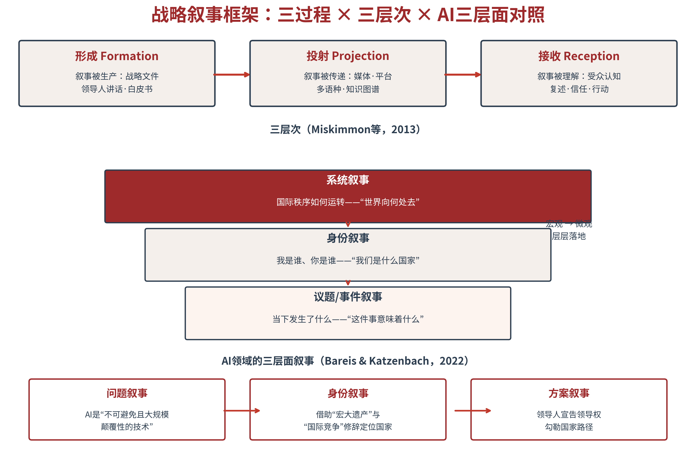

# 第五章 国家建构——用一致叙事塑造可信国家形象

从本章起，全书进入应用篇。国家层的核心命题是认知主权与国际话语权，而一切命题的起点，是叙事——国家以什么故事定义自己、又让世界如何记住。本章引入战略叙事、社会技术想象、交织叙事与表演性政治四组理论资源，构建国家叙事“文本—想象—制度—平台”的四层机制模型。讨论战略叙事的AI重构，从宣传文本到可被机器采信的知识资产。并以中国“人工智能+”叙事的连续性与央视网《AI我中华》为样本，回答一个问题：国家如何用一致的叙事，塑造可信的形象。

## 5.1 叙事框架——国家叙事的结构与方法

**战略叙事框架——三过程与三层次**

国家叙事不是新闻发布的堆叠，而是有结构的战略工程。Miskimmon、O'Loughlin与Roselle系统提出的战略叙事框架给出了解剖刀：战略叙事是“政治行为体通过叙事投射来塑造国内外受众理解、管理预期、构建联盟与开展地缘政治竞争的工具”，它包含三个核心过程——形成（叙事被生产）、投射（叙事被传递）、接收（叙事被理解），以及三个层次——系统叙事（国际秩序如何运转）、身份叙事（我是谁、你是谁）、议题叙事（当下发生了什么）[1]。三过程环环相扣：形成环节定调，投射环节落地，接收环节见效——任何一环断裂，叙事就只是文件柜里的文本。三层次由宏观到微观层层落地：系统叙事回答“世界向何处去”，身份叙事回答“我们是什么国家”，议题叙事回答“这件事意味着什么”（见图5-1）。

图5-1　战略叙事框架：三过程×三层次×AI三层面对照

落到AI领域，各国战略叙事呈现出高度相似的三个层面，Bareis与Katzenbach对此有一针见血的概括[2]。问题叙事——先把AI描述为“不可避免且大规模颠覆性技术”，制造“必须行动”的紧迫感。身份叙事——再借助“宏大遗产”与“国际竞争”的修辞，把AI接入国家的历史荣光与现实竞争，回答“我们凭什么赢”。方案叙事——最后由国家领导人宣告领导权与干预路径，勾勒“我们怎么走”的国家方案。三层面与三层次遥相呼应（见表5-1）：问题叙事对应系统叙事（时代判断），身份叙事对应身份叙事（国家定位），方案叙事对应议题叙事（行动议程）。凡成体系的国家AI叙事，概莫能外。

表5-1　战略叙事三层次与AI领域三层面的对照

| 框架层次 | 回答的问题 | AI领域对应 | 叙事功能 |
|---|---|---|---|
| 系统叙事 | 国际秩序如何运转？ | 问题叙事：AI是颠覆性技术 | 确立时代判断与紧迫感 |
| 身份叙事 | 我们是什么国家？ | 身份叙事：宏大遗产×国际竞争 | 锚定国家定位与合法性 |
| 议题叙事 | 这件事意味着什么？ | 方案叙事：领导权与国家路径 | 给出行动议程与路线图 |

**中国叙事的基本结构——历史、现实与未来相统一**

具体到中国，国家叙事的基本结构是历史、现实与未来的统一。历史叙事供给纵深——五千年文明与近代以来的奋斗历程，构成“从哪里来”的意义底座。现实叙事供给说服力——科技自立自强、全面小康、高质量发展，构成“在哪里”的事实证据。未来叙事供给感召力——中国式现代化与人类命运共同体，构成“向何处去”的愿景召唤。三者缺一：缺历史则叙事失根，缺现实则叙事失据，缺未来则叙事失魅。AI时代对这一结构提出了新的要求：三个时段的叙事必须口径一致——AI在做交叉验证时，不分历史与现实、对内与对外，任何时段之间的自相矛盾，都会成为可信度的扣分项。

**国家符号、国家价值与国家行为的一致性**

叙事一致性的最后一公里，是符号、价值与行为三者对表。符号一致——长城、高铁、航天、大模型，同一批国家符号在不同语种、不同平台、不同文本中的表述应可互证。价值一致——“发展与安全并重”“共商共建共享”等核心价值主张，不应在某个语境下悄然变形。行为一致——最要紧也最艰难：叙事承诺与国家行为之间不能出现系统性落差，受众或许记不住一份数据，但一定记得住一次“说的与做的不一样”。国家形象是长期积累的复利资产，也是经不起反复透支的脆弱资产——一致性，是这份资产的记账纪律。

AI时代还给三过程装上了新的刻度。形成环节多了“可计算”的约束——叙事的关键词、实体与口径必须机器可读，否则后面的投射与接收都无从谈起。投射环节多了“机器渠道”——叙事不再只经媒体抵达公众，还须经知识库、百科与智能问答抵达AI。接收环节多了“转述”的度量——受众是否理解，不再只靠民调问“你怎么看”，还可以测AI“怎么替你说”。三个新刻度合成的结论是：战略叙事框架在AI时代不仅没有过时，反而第一次获得了全过程可测量的落地——形成有词频与语义网络可析，投射有收录与引用可查，接收有转述准确率可评。理论框架还是那把刀，切的对象已从报纸版面换成了知识图谱。

> **【通俗释义】战略叙事**
> 国家叙事就像给自己写剧本：剧本要有大纲（系统叙事——这是个什么世界）、人设（身份叙事——我们是怎样的国家）、情节（议题叙事——当前这件事怎么讲）。好剧本的标志不是词藻华丽，而是台上台下相信同一个故事：演员（国家）按人设行事，观众（世界）按剧情期待。最怕的是“人设崩塌”——剧本里写的是主角，演出来的是路人，观众自然弃剧。

## 5.2 AI重构——从媒体叙事到算法叙事

**生产与分发逻辑之变——算法议程设置与AI框架控制**

第二章已立论：议程设置的主体正从媒体扩展到平台算法与AI助手，“媒体议程→公众议程”扩展为“媒体议程→算法议程→公众议程→AI知识库”。这一转移对国家叙事的生产与分发提出了重构要求。生产端之变——传统国家叙事以媒体文本为载体，讲究版面、时段与通稿；AI时代，叙事的第一落点必须同时是“可被机器处理的文本”：结构化、语义清晰、字段可验证。分发端之变——传统分发争夺编辑部的注意力，AI重构后的分发争夺三样东西：搜索结果的首提位、智能问答的引用权、知识图谱的节点位置。简言之：国家叙事的AI重构，本质是从“说服编辑部”转向“说服知识库”。

**文本层重构——从宣传文本到结构化知识资产**

文本层重构的要义，是把宣传文本升级为知识资产。第一步，单一真相源——国家叙事的核心事实（政策文号、规划目标、统计数据）建立官方唯一口径，全语种、全渠道向它看齐，这是第三章内容生成环节纪律在国家层的翻版。第二步，可验证字段——把宏大叙事拆解为可核验的知识条目：“三步走”的年份与目标、“六大行动”的名称与内容、备案大模型的数量与用户规模，每个字段都能溯源到权威文件。第三步，多语种结构化——不是简单翻译，而是按目标语种的检索习惯重组语义结构。宣传文本追求感染力，知识资产追求采信度——AI时代，后者是前者的地基。

**平台层重构——从媒体渠道到智能问答与知识图谱的语义布局**

平台层重构，是把叙事的阵地从媒体渠道延伸到AI的语义空间。三项布局：权威信源卡位——确保国家叙事的官方文本被主流AI平台作为可信来源收录，官方机构的站点、词条与数据接口对爬虫与检索友好。知识图谱占位——在国家、政策、科技、文化等核心实体的语义网络中，让中国的定义与表述有节点、有边、有出处。智能问答适配——预判国际用户会向AI提出哪些关于中国的问题，把结构化答案部署在AI的检索路径上。第三章GEO七步法在此完全适用，只是操作对象从企业与城市上升为国家叙事。

**国际镜鉴——新加坡“NAIS 2.0＋SG Digital”的四层样本**

平台层重构的国际样本，首推新加坡。2023年12月，新加坡发布第二版国家人工智能战略（NAIS 2.0），愿景是“AI for the Public Good, for Singapore and the World”，围绕卓越与赋能两大目标、十项使能因素展开[3]。其四层咬合堪称教科书：文本层——NAIS 2.0战略文本清晰稳定。想象层——“治理枢纽”的社会技术想象鲜明——小国以治理信誉换全球认知枢纽地位。制度层——国家AI委员会由总理主持，智慧国执行机构与制度安排落到实处。平台层——SG Digital平台与IMDA年报持续供给权威数据，全民AI素养计划把叙事下沉为国民参与。四层联动，使一个城市国家的AI叙事获得了远超体量的全球能见度（来源等级：新加坡政府文件与IMDA年报，A级）。

**中国对照——从《新一代人工智能发展规划》到“人工智能+”的叙事连续性**

以同样的四层透镜看中国，最突出的特征是叙事的连续性（见图5-3）。2017年7月，国务院印发《新一代人工智能发展规划》，提出三步走战略目标，开篇即是“抢抓人工智能发展的重大战略机遇，构筑我国人工智能发展的先发优势”[4]。2025年8月，国务院印发《关于深入实施“人工智能+”行动的意见》，部署科学技术、产业发展、消费提质、民生福祉、治理能力、全球合作六大重点行动，并设定2027年、2030年、2035年三阶段目标[5]。从“发展规划”到“行动意见”，从技术叙事到应用叙事，节奏在升级，内核未变。产业底座同步增厚：截至2025年12月，748款生成式人工智能服务完成备案，生成式AI用户规模达5.15亿人[6]——叙事的每一句承诺，背后都有可验证的数据在兑现。

图5-3　中国AI叙事的连续性：从发展规划到“人工智能+”行动

**战略叙事AI重构的操作要点**

综合文本层与平台层的重构，操作要点三条。语义锚定——为国家叙事的核心概念确定官方中英文本，并在所有权威渠道保持一致，让AI检索到的每个版本都指向同一含义。多语种结构化——按“单一真相源＋可验证字段”的格式生产多语种内容，先保证采信，再追求文采。AI可见性布局——把官方文本、百科词条、权威报道部署到主流AI的检索路径上，定期以标准化提问集体检国家叙事的首提率与转述准确率。三条要点合为一句：让国家叙事在AI的知识网络里，有位置、有定义、有出处。

## 5.3 四层机制——社会技术想象如何塑造国家形象

**社会技术想象——国家希望AI带来何种未来**

叙事的深层，是想象。Jasanoff与Kim提出“社会技术想象”概念：技术发展深受社会集体对“未来好社会”的想象所塑造——想象不只是愿景口号，它决定资源流向、制度设计与公众接受度[7]。各国AI战略中的想象差异，构成叙事分野的底层逻辑：中国想象国家主导的智能社会，AI服务于经济发展、社会安全与全球竞争力。美国想象自由市场创新与全球领导。欧盟想象价值观驱动的“欧洲AI”。日本想象“超智能社会”。新加坡想象治理枢纽。阿联酋想象后石油经济与文化身份保护。想象不同，同样的技术被讲成完全不同的故事——这就是为什么“技术事实”无法替代“战略叙事”。

**国家AI战略作为“政策与话语的混合体”**

Bareis与Katzenbach的研究给出第二个理论支点：国家AI战略是“政策与话语的混合体”——它既提供政策工具，也建构技术想象，简言之，国家战略文件同时是治理方案与叙事装置[2]。由此引出“表演性政治”的三机制：预期管理——通过宣告目标管理国内外对国家AI发展的预期；身份动员——通过叙事把AI接入国家认同，动员社会力量；制度合法化——通过话语先行，为后续制度安排铺垫合法性。这里蕴含着一个传播学的深刻命题：叙事不仅是描述现实，更在言说中建构现实——说出来的未来，正在变成被相信的未来。

**四层机制模型——文本—想象—制度—平台**

综合战略叙事框架与社会技术想象，本书构建国家叙事的四层机制模型（见图5-2）。文本层——战略文件、白皮书与领导人讲话中的关键词、主题与修辞，是叙事的“宪法”。想象层——社会技术想象，即国家希望AI带来何种未来社会，是叙事的灵魂。制度层——治理机构、伦理准则、投资计划与国际合作平台，把叙事固化为可执行、可追责的安排。平台层——AIGC、数字人、社交平台、AI翻译与短视频，是叙事抵达受众的最后一公里。四层之间循环咬合：文本生产想象，想象指导制度，制度通过平台传播，平台反馈又重塑文本——国家叙事不是一个文件，而是一台持续运转的再生产机器。

图5-2　国家叙事的四层机制模型：文本—想象—制度—平台

**四层机制的跨国验证**

四层模型经得起跨国比较的检验（见表5-2）。文本层：中国强调“抢抓机遇”“先发优势”，美国《赢得竞赛：美国人工智能行动计划》强调“赢得竞赛”“全球标准”[8]，欧盟强调“可信AI”“欧洲AI”。想象层：中国想象国家主导的智能社会，美国想象自由市场创新，欧盟想象价值观驱动的AI治理。制度层：中国以“人工智能+”行动与备案制度落地，美国设AI特别委员会，欧盟以AI法案分阶段实施，新加坡设国家AI委员会。平台层：中国的“AI看两会”从三万余字发言文本中提取763个关键数据，美国白宫试验AI视频叙事，欧盟推进AI大陆行动计划。Radu的治理研究补充了另一重印证：各国战略既是治理工具，也是叙事工具，二者的配比折射出不同的国家能力路径[9]。

表5-2　主要经济体国家AI叙事的四层比较

| 四层 | 中国 | 美国 | 欧盟 | 新加坡 |
|---|---|---|---|---|
| 文本层 | “抢抓机遇·先发优势” | “赢得竞赛·全球标准” | “可信AI·欧洲AI” | “AI为公共善” |
| 想象层 | 国家主导的智能社会 | 自由市场创新与领导 | 价值观驱动的欧洲AI | 全球治理枢纽 |
| 制度层 | “人工智能+”·备案制 | AI特别委员会 | AI法案分阶段实施 | 国家AI委员会 |
| 平台层 | AI看两会·数字人 | 白宫AI视频实验 | AI大陆行动计划 | SG Digital·素养计划 |

**中国样本的四层解读**

以四层模型解读中国样本：文本层，从国发〔2017〕35号到国发〔2025〕11号，战略文本一脉相承。想象层，国家主导的智能社会想象，锚定发展与安全并重。制度层，六大行动与备案制度让叙事有了抓手与账本。平台层，“AI看两会”、数字人主播、《AI我中华》等实践让宏大叙事落为可感的日常文本。四层咬合的意义在于：任何一层脱节，叙事就会出现“文件很宏大、社会无感知”或“平台很热闹、制度无承接”的断层——四层诊断表（见表5-4）正是为此而设。

四层循环之所以重要，在于它揭示了叙事的“再生产动力学”。文本层不会自动生产想象——战略文件若无打动人心的愿景表述，社会技术想象便无从生长。想象层不会自动指导制度——愿景若无治理机构与投资计划承接，就只是挂在墙上的标语。制度层不会自动通过平台传播——再好的制度安排，若无AIGC与社交平台的日常转译，公众便无从感知。平台层的反馈更不会自动重塑文本——舆论场的真实反应，若无制度化的回收机制，文本层便会固执地自我重复。四层之间每一处传动，都需要主动的设计与持续的能量输入；所谓叙事能力，说到底就是维持这台机器不熄火的组织能力。

## 5.4 可理解叙事——从对外宣传到认知对话

**政策锚点——讲好中国故事的根本遵循**

本章以“讲好中国故事、传播好中国声音，展示真实、立体、全面的中国”为根本遵循。从“对外宣传”转向“可理解叙事”，正是落实加强国际传播能力建设的具体路径——宣传思维的终点是“我说完了”，叙事思维的起点是“你听懂了”。这一转向包含三重自觉：对象自觉——传播的对象不是被动的靶子，而是带着自身认知框架主动解码的受众；效果自觉——衡量标准从“发出去多少”变为“被理解多少”；方式自觉——从单向宣告转向可验证、可对话、可参与的叙事供给。

**宣传话语的接受度鸿沟与误读风险**

宣传话语与国际接受度之间，横着一道结构性鸿沟。其一，语态鸿沟——成就式的宏大表达，在本土语境是自信，在异文化语境可能被解码为“宣传”，说服力折损。其二，框架鸿沟——同一事实在不同认知框架中意义相反：强调“国家主导”，国内读者读到效率与担当，部分海外读者读到的却是另一种联想。其三，语境鸿沟——缺少历史语境的单一事实，极易被断章取义。误读的风险不在于受众“不听”，而在于受众“用自己的框架听了”——所以跨文化传播的第一课，不是加大音量，而是理解对方的解码框架。

**用可感故事承载国家价值**

弥合鸿沟的路径，是用可感的故事承载国家的价值。价值是抽象的，故事是具体的：“科技自立自强”是一个价值主张，DeepSeek引发全球开发者关注是一个故事；“人民至上”是一个价值主张，哈尔滨街头为南方游客搭起的暖亭是一个故事。好故事的三要素：具体——有时间、地点、人物，可以被复述而不失真；共情——情感是人类通用的解码器，善意与服务不需要翻译；可验证——故事背后有数据与出处，经得起AI的交叉检验。国家叙事的最高境界，是让世界通过千万个可感的故事，自己得出你想说的结论。

可感故事不会从天上掉下来，须有组织的采集与运营——这就是国家故事库的建设。故事从哪里来：一线实践（工程师、医生、快递员与AI协作的日常）、地方经验（一座城市政务服务的智能化改造）、用户证言（外国博主、留学生、跨国企业家的第一人称讲述）——源头在民间，不在机关。故事怎么管：分级审核——事实核查、口径对表、隐私与授权把关，确保每个故事都经得起AI的交叉检验；结构化入库——按主题、地域、语种、适用场景打标签，让故事可检索、可复用。故事怎么用：宏大叙事的每个抽象主张，都配若干可感故事做“落地注脚”；对外传播的多语种内容，优先从故事库取材而非临时采写。故事库的意义，一句话：让“讲好中国故事”从口号变成一条可持续运转的内容供应链。

**交织叙事与“AI衣橱”——各国如何组合全球叙事库存**

Singh等人的“交织叙事”研究为这一定位提供了数据支撑：对54个国家和地区221份AI战略文本的计算分析显示，全球AI叙事并非铁板一块，而是聚类分化——中美日等科技先行者聚焦基础科学，德国瑞士等侧重社会对话治理，欧盟关注经济社会议题，英联邦集群具有创业导向，多数其他国家聚焦“3C”（能力、关切、性能）[10]。研究者给了这个现象一个传神的比喻：“AI衣橱”——各国都从全球叙事库存中挑选相似的衣料，再剪裁出自己的风格；没有谁从零做衣服，但穿出来各不相同。中国叙事的定位由此清晰：科技先行者集群中的基础科学聚焦者，发展与安全并重的应用深化者——不抢“衣橱”里不属于自己的衣服，把自己的风格穿到极致。

> **【通俗释义】“AI衣橱”**
> 全球的AI叙事像一家共享衣橱：大家用的布料都差不多——都在讲“AI是机遇”“要抓紧”“我们能赢”（这就是3C：能力、关切、性能）。但各国穿出来的效果截然不同：美国穿成“竞赛冠军”的样子，欧盟穿成“规则卫士”的样子，新加坡穿成“治理达人”的样子。衣橱是共享的，穿搭是自己的——国家叙事的功夫，不在发明新布料，而在剪裁出别人一眼认得出的风格。

## 5.5 长期治理——国家形象的声誉经营

**国家声誉资产的存量管理**

国家形象不是一次campaign的烟花，而是声誉资产的存量账户。存量管理三原则：只增不减的记账纪律——每一次可验证的履约（承诺的目标如期达成）都是存款，每一次公开的失信都是提款，且提款的利息远高于存款。跨周期的耐心——国家声誉以十年为单位积累，却可能因一次危机显著缩水，治理必须超越任期与年度。全球分布的账户结构——在不同区域、不同语种、不同社群中的声誉应分账监测、均衡经营，避免“总体好评、局部透支”的结构性风险。声誉资产的核心指标，正是第二章的信任力跃迁：受众在负面信息出现时，倾向于“相信这个国家”还是“相信负面”——这就是存量是否丰厚的试金石。

**多部门协同与叙事的“事实、立场、温度”**

长期治理的另一面，是治理结构的协同。国家叙事天然是“多部门出品”：外交、宣传、科技、商务、文旅各执一词时，叙事就会精神分裂。协同的要害不是成立一个机构，而是立一套规则：核心口径单一真相源、重大叙事跨部门会签、敏感议题统一授权。规则之上，还须平衡叙事的三味调料——事实、立场与温度：只有事实没有立场，叙事失魂；只有立场没有事实，叙事失信；而缺了温度，事实与立场都难以抵达人心。三者的配比因场合而异，但一味都不能少。

**国家可信数据集建设与AI认知体检**

落到AI时代的操作面，国家形象治理新增两项基础设施。其一，国家可信数据集——把国家叙事所依赖的核心事实（政策文号、统计数据、重大项目进展）建成结构化、可验证、多语种的官方数据资产，为AI采信供给权威语料，这是数据力逻辑在国家层的落实。其二，国家AI认知体检——定期以标准化提问集在主流AI平台测量国家叙事的呈现状态：核心概念是否被准确解释、关键事实是否被正确引用、整体情感倾向是否与事实相符。体检的意义在于把“国家形象”从不可测的模糊概念，变为可跟踪、可归因、可干预的指标序列。

**叙事与制度相互构成——欧盟与韩国的镜鉴**

国家叙事与制度安排相互构成——叙事为制度铺路，制度为叙事背书。欧盟的样本最具代表性：《人工智能法案》2024年8月生效，分三个阶段适用——2025年2月起禁止特定AI系统条款适用，2025年8月起通用AI模型规则适用，2026年8月起绝大多数条款全面适用[11]——“可信AI”的叙事由此获得了制度的时间表与问责的锚点，规则先行者的话语权随之兑现。韩国同样以立法呼应叙事：《人工智能发展与信任基本法》把“发展与信任”的双重承诺写入法律[12]。镜鉴的启示：说出来的价值，要用立起来的制度兑现——叙事的可信度，最终由制度的执行力背书。

长期治理还须备好“修复预案”。国家声誉的受损难以完全避免——突发事件、误报误读、恶意操作都可能造成资产缩水，治理的成熟度不在永不出事，而在受损后的修复能力。修复的次序有讲究：先事实——以最快速度供给可验证的权威事实，抢占AI与舆论的“第一定义权”；再态度——对确有其责的失误坦承并公布整改，坦诚本身就是信任的存款；后叙事——待事实与态度站稳，再重构叙事框架，把危机教训转化为制度改进的故事。切忌次序颠倒——事实未清就急于“讲故事”，只会加重“掩饰”的嫌疑。修复的完整方法论，第七章危机治理将系统展开。

## 5.6 对内传播——主流叙事如何赢得公众信任

**从单向灌输到认知对话**

国家叙事的对内一翼，正经历同样的范式之变。传统对内宣传依托权威媒体的单向触达，“播出即到达、到达即接受”在算法环境中已不成立：受众的信息食谱由推荐算法配给，主流叙事若不在算法的推荐池中，就等于不存在；若只在推荐池中而缺共鸣，就只是背景音。AI时代进一步把挑战升级为“认知对话”——公众不再被动接收叙事，而是带着疑问主动向AI求证：“这个政策对我有什么影响”“这个说法是真的吗”。AI的回答成为主流叙事与公众之间的新中介——对内宣传的新命题由此变为：既要在人类受众的舆论场中可见可感，也要在AI答案中可查可证。

**主流叙事在算法推荐中的可见性**

提升主流叙事的算法可见性，须同时打好“三级分发”的阵地战（承接第三章）：人工编辑分发一翼，权威媒体的议程设置力仍是压舱石。算法推荐分发一翼，主流内容要按平台逻辑适配——议题的社交属性、表达的网感、互动的设计，一样不能缺。智能体分发一翼，政务问答、政策解读的知识条目要结构化部署，让公众向AI提问时得到的答案准确、权威、可溯源。三级阵地，一个逻辑：主流叙事必须学会“在什么山头唱什么歌”，但唱的必须是同一首歌。

**国内共识建构——把AI发展转化为国家共同目标**

对内叙事的最终目标，是国内共识——把AI发展从“国家战略”转化为“共同目标”。共识建构的四渠道协同发力：战略文件——以规划与行动意见确立“我们在做什么”的共同认知。领导人讲话——以权威定调凝聚“为什么做”的价值认同。媒体报道——以持续的成就叙事与问题讨论维持议题热度与参与感。教育计划——以AI素养与技能培训让公众从旁观者变为参与者。四渠道的合力，正是四层机制模型在对内场域的运转：文本生产想象（智能社会的愿景），想象指导制度（素养计划与培训制度），制度通过平台传播（两会报道与AI解读），平台反馈重塑文本（公众关切反哺政策表述）。对内叙事与对外叙事在此汇流：一套事实底座，两种表达方式——内外两张皮的旧病，AI时代再无藏身之地。

对内传播的信任构建，还有两个AI时代的新抓手。一是政务新媒体的人格化运营——受众信任的是“人”而非“机构账号”：文旅局长出镜、政务主播养成、评论区有问必答，人格化的持续互动把机构叙事转译为关系叙事；哈尔滨文旅局局长的亲民互动成为城市口碑的加分项，正是此理。二是AI辅助的对话治理——用AI工具做谣言的早期识别与自动对冲：谣言在算法分发中的扩散速度以分钟计，人工辟谣的响应速度以天计，唯有以AI对AI——机器识别疑点、人工核实定性、多平台同步澄清——才能把辟谣的时间差压缩到可接受的范围。两个抓手共同的底层逻辑：对内宣传的终点不是“发布”，而是“被相信”——从灌输到对话，信任是唯一的目的地。

## 5.7 向下传导——国家叙事对城市与企业的启示

国家层的叙事方法论，对城市与企业皆可迁移。对城市——承接国家叙事是城市品牌的捷径与责任：国家叙事供给价值底座与政策背书，城市以其场景转译——哈尔滨承接“冰雪经济”的国家叙事，把宏观政策落为“宠客之城”的具身体验，即是教科书式的承接。城市承接的要诀：找到国家叙事与本地资源的接口，用城市的语言讲国家的故事。

对企业——出海传播须与国家形象同频而不冲突：企业的全球叙事若与国家叙事打架，两败俱伤——企业被质疑“代表谁”，国家叙事被拖累“连坐”（第四章的信任连坐效应）。同频的要诀：企业的产品叙事供给可验证证据，呼应国家叙事的宏观主张，但不越位代言；在敏感议题上与国家口径一致，在日常传播中保持企业的独立人格。

三层贯通的方法论内核只有一条：叙事一致性。国家的一致在历史与现实的对表，城市的一致在定位与体验的对表，企业的一致在承诺与产品的对表——层级不同，纪律相同。贯通的通道也已就绪：价值通道——国家叙事的价值主张，经由城市场景获得具象，经由企业产品获得证据。数据通道——三层共享的认知仪表盘（第四章数据纽带）让国家叙事的落地效果可测可评。场景通道——重大事件（赛事、峰会、展会）为三层叙事提供同台展演的舞台（第十六章展开）。第五章立起国家叙事的建构之法，第六章将带着这套方法走向更凶险的现场：全球舆论场，看中国叙事如何被世界理解、误读与重估。

## 5.8 本章行动——国家建构的落地要点

本章交付三件工具。其一，国家叙事一致性评估表（见表5-3）——从符号、价值、行为、内外口径四个维度给叙事做对表体检。其二，国家叙事四层机制诊断表（见表5-4）——逐层检查文本、想象、制度、平台的咬合状态，找出断层。其三，战略叙事AI重构自检表（见表5-5）——从文本层、平台层、证据层三个维度评估叙事的AI适配度。三件工具的使用顺序：先查一致性（对不对）、再查四层（全不全）、后查AI重构（通不通）。

表5-3　国家叙事一致性评估表

| 维度 | 诊断问题 | 常见病灶 |
|---|---|---|
| 符号一致 | 核心符号各语种表述可互证吗？ | 同一成就多种口径，AI交叉验证存疑 |
| 价值一致 | 核心价值主张各语境无变形吗？ | 对内一套表述、对外悄悄变调 |
| 行为一致 | 叙事承诺与国家行为对表吗？ | 说的与做的出现系统性落差 |
| 内外口径 | 内外文本共享同一事实底座吗？ | 内外两套数据，被AI一并检索 |

表5-4　国家叙事四层机制诊断表

| 层次 | 自检问题 | 断层信号 |
|---|---|---|
| 文本层 | 战略文本的关键词与主题稳定吗？ | 每份文件各说各话，无连续主线 |
| 想象层 | 社会技术想象鲜明且一以贯之吗？ | 只有指标没有愿景，叙事失魂 |
| 制度层 | 叙事有制度承接与问责锚点吗？ | 文件宏大，制度无配套承接 |
| 平台层 | 平台实践与官方文本同频吗？ | 平台热闹与文件口径两张皮 |

表5-5　战略叙事AI重构自检表

| 维度 | 自检问题 | 达标标志 |
|---|---|---|
| 文本层 | 核心事实是否单一真相源＋可验证字段？ | 每个关键数据可溯源到官方文件 |
| 平台层 | 官方文本是否进入主流AI检索路径？ | 标准化提问测试中被准确引用 |
| 证据层 | 多语种叙事是否有本地权威信源佐证？ | 核心场景转述准确率≥90% |

本章逻辑链复盘：一套框架——战略叙事的形成、投射、接收与系统、身份、议题三层次。一组理论——社会技术想象、表演性政治、交织叙事三支学术资源。一个模型——文本、想象、制度、平台的四层机制及其循环。一条主线——从宣传文本到知识资产的AI重构，从对外宣传到可理解叙事的范式转向。国家叙事的建构之法至此立起：以一致的叙事塑造可信的形象，以可信的形象积累国家的声誉资产。

> **本章案例｜央视网《AI我中华》：国家文旅叙事的AI转译**
> 【核心问题】如何把34个省级行政区的文化符号，统一为可全球传播、可被AI检索的国家文旅叙事，并回应国家AI战略的整体叙事定位。
> 【模型工具】2024年，央视网推出AI文生视频作品《AI我中华》，以AI文生视频、AI配音与语义视觉化技术，把各省的文化符号——从江南水韵到塞北风光、从敦煌飞天到现代都市——转译为统一的视觉语言与叙事母题，全网传播形成现象级刷屏（据央视网发布[13]）。作品同时承接国家AI战略的叙事框架：从《新一代人工智能发展规划》的“先发优势”叙事，到“人工智能+”行动的产业应用叙事，再到文化场域的AI创意转译，构成“国家文旅＋AI创意”的爆款样本。
> 【四层机制的样本解读】文本层——作品呼应国家战略文本的连续叙事，AI既是内容主角也是生产工具，与“人工智能+”六大行动中“科学技术”与“民生福祉”的行动议程互文。想象层——“科技与人文共生”的智能社会想象落为可感的视觉体验。制度层——国家级媒体的制作与传播体系为内容可信度背书。平台层——短视频平台与社交媒体的裂变传播，让统一的国家文旅叙事抵达亿级用户，并为后续的AI检索沉淀了结构化的视觉资产与话题资产。
> 【案例启示】机制上，国家叙事的“一致性”不在口号统一，而在底层符号体系与战略定位的统一：《AI我中华》证明，AIGC可以把分散的区域文化符号转译为统一的国家叙事资产，实现“一省一景、一国一调”。条件上，成功依赖三重前提——权威制作主体的信用背书、AI技术对文化符号的精准转译、与国家战略文本的叙事互文；三者缺一，爆款就只是流量烟花。迁移上，该样本对城市文旅（区域符号的统一转译）、企业品牌（产品叙事的AI视觉化）皆有直接参考价值——用AI把“各自讲述”转译为“一个故事”，是三层主体共同的叙事课题。
> 【行动清单】①提炼国家文旅的统一符号与叙事母题，先立“一个故事”的骨架。②用AIGC把区域文化转译为统一视觉资产，形成可复用的内容基座。③对接国家AI战略的权威文本与数据（规划文号、备案规模），让文化叙事与技术叙事同频。④构建跨平台、可被AI检索的结构化内容，让一次爆款沉淀为长期认知资产。

## 本章参考文献

[1] MISKIMMON A, O'LOUGHLIN B, ROSSELLE L. Strategic Narratives: Communication Power and the New World Order[M]. New York: Routledge, 2013.

[2] BAREIS J, KATZENBACH C. Talking AI into Being: The Narratives and Imaginaries of National AI Strategies and Their Performative Politics[J]. Science, Technology, & Human Values, 2022, 47(5): 855-881.

[3] Singapore Government. National Artificial Intelligence Strategy 2.0[R]. Singapore: Smart Nation Singapore, 2023.

[4] 国务院. 新一代人工智能发展规划（国发〔2017〕35号）[Z]. 北京: 中华人民共和国国务院, 2017.

[5] 国务院. 关于深入实施“人工智能+”行动的意见（国发〔2025〕11号）[Z]. 北京: 中华人民共和国国务院, 2025.

[6] 国家互联网信息办公室. 大模型备案与用户规模数据通报[R]. 北京: 国家互联网信息办公室, 2025.

[7] JASANOFF S, KIM S H. Containing the Atom: Sociotechnical Imaginaries and Nuclear Power in the United States and South Korea[J]. Minerva, 2009, 47(2): 119-146.

[8] The White House. Winning the AI Race: America's AI Action Plan[R]. Washington, D.C.: The White House, 2025.

[9] RADU R. Steering the governance of artificial intelligence: National strategies in perspective[J]. Policy and Society, 2021, 40(2): 178-193.

[10] SINGH J P, SHEHU A, DUA M, et al. Entangled Narratives: Insights from Social and Computer Sciences on National Artificial Intelligence Infrastructures[J]. International Studies Quarterly, 2025, 69(1).

[11] European Parliament and Council. Regulation (EU) 2024/1689 (Artificial Intelligence Act)[Z]. Strasbourg: Official Journal of the European Union, 2024.

[12] 韩国国会. 人工智能发展与信任基本法[Z]. 首尔: 韩国国会, 2024.

[13] 央视网. AI我中华：AI文生视频作品[EB/OL]. (2024)[2026-10-02]. https://www.cctv.com.
