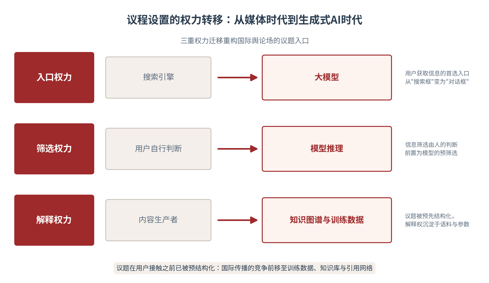
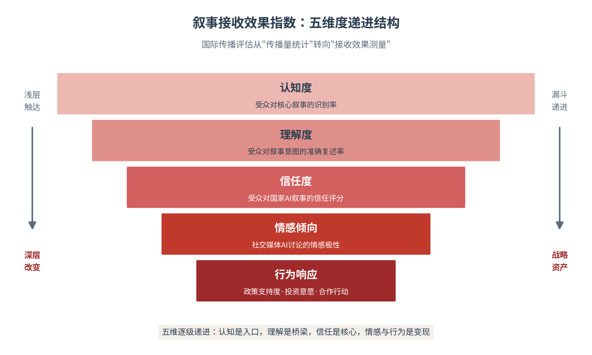

# 第六章 国际传播：让中国故事被世界准确理解

国家叙事投射出边界，便进入全球舆论场——这里是国际传播的主战场。本章讨论一个长期困扰对外传播的命题：为什么投入巨大，世界对中国故事的接收却常常变形、衰减甚至反转？答案不在输出端而在接收端。本章引入交织叙事与叙事接收研究，沿议题设置—受众理解—AI可见性—效果评估—全球南方五步展开，提出以“叙事接收效果指数”取代传播量统计作为国际传播的核心评估体系，并把“可信、可爱、可敬”的官方标尺落为可测量的操作指标，回答一个问题：中国故事如何从“被听见”走向“被准确理解、被验证、被信任”。

## 6.1 议题设置——全球舆论场的议程争夺

**议题入口的权力转移——从编辑议程到算法议程**

国际传播的第一战场不是观点，而是议题——决定“讨论什么”，往往比决定“怎么讨论”更能左右舆论走向。议程设置研究的经典命题早已揭示：媒体虽不能决定人们怎么想，却能有效决定人们想什么。在全球舆论场中，这一命题的国家版本更为尖锐：谁设置议题，谁就掌握解释的先手；被迫在他人的议题里辩解，几乎注定被动[1]。而生成式AI的普及，正在把议题入口的权力结构整体重写——认知被前置，AI系统在用户接触任何信息之前，已经通过知识图谱、模型参数与训练数据完成了对议题的预结构化（见图6-1）。国际传播的议题竞争，由此从“说服编辑、争取版面”前移至“布局语料、定义实体”。

图6-1　议程设置的权力转移：从媒体时代到生成式AI时代

**国际热点与国家叙事窗口**

国际热点是注意力的聚焦时刻，也是国家叙事的放大窗口。重大科技成果发布、国际会议、全球治理倡议、突发公共事件——每一次全球性关注，都是叙事资源向议题集中的过程，窗口期通常只有数日至数周。议题生命周期可分四段：潜伏期（议题酝酿，可低成本布局）、爆发期（注意力峰值，须第一时间进入）、延续期（解读深化，供给深度内容）、消退期（议题沉淀，转化为长期认知资产）。多数传播主体的失误在于两个极端：或在窗口关闭后才开始解释——传播变成无效自言自语；或只追爆发期的流量狂欢，不在潜伏期布局、不在消退期沉淀——热度过境，认知资产为零。窗口经营的要义是“半程准备”：一半的功课在热点到来之前完成。

近期案例印证了窗口经营的价值。DeepSeek在2025年初的全球出圈，是一次教科书级的议题引爆：技术突破的事实经国际开发者社区验证后，主流媒体自发跟进，社交媒体二次放大，最终反哺为“中国AI实力”的议题级认知更新——官方几乎未做传播动作，叙事却完成了一次全球抵达。其机制值得复盘：第三方验证先于自我宣告（开发者社区的实测背书），产品体验先于话语阐释（全球用户下载即体验），技术叙事先于政治叙事（以开源与性能说话）。这提示议题设置的第四种形态——议题自设（让事实本身成为议题）：以工程成就与产品体验为“叙事本体”，官方话语退居注释位，反而获得更高的可信度溢价。

**主动设置议题与被动回应议题**

议题操作存在两种模式，其战略代价天差地别。主动设置：以我为主定义议程——人类命运共同体、全球治理倡议、“人工智能+”行动，都是中国主动设置议题的代表作；其优势是掌握框架解释权、掌握节奏主导权，成本前置而收益长期。被动回应：在他人设置的议题中辩解——辟谣、澄清、否认，其成本高昂而收益微薄，且每一次回应都在为对方的议题“续费”关注度。国际传播的经验法则是：能用设置解决的，不用回应解决；必须回应时，也应力求“以设代应”——不在对方的框架内纠缠细节，而以一个新议题转移战场（见表6-1）。

被动回应的最大陷阱，是防御性传播的认知成本。心理学上，重复辟谣本身会强化谣言的记忆可及性——“越描越黑”有其认知机制基础。高水平的议题操作，往往把危机转化为重设议程的契机：不回应质疑的具体条文，而是发布更具分量的发展事实，让新议题的注意力覆盖旧议题。这不是回避，而是对注意力规律的尊重——舆论场的注意力总量恒定，新议程的亮度决定旧议程的暗度——这是舆论场注意力竞争的底层逻辑，也是大国传播的必修课。

表6-1　主动设置与被动回应议题模式对照

| 比较维度 | 主动设置议题 | 被动回应议题 |
|---|---|---|
| 议程主导权 | 以我为主定义议程与框架 | 在对方框架内辩解，解释权外置 |
| 资源投入 | 成本前置，系统布局 | 成本集中且被动，随时应变 |
| 效果持续性 | 长周期，沉淀为认知资产 | 短周期，注意力随事件消退 |
| 典型风险 | 议题与受众关切脱节 | 为对方议题“续费”，越描越黑 |
| 最优策略 | 持续供给，形成议程矩阵 | 以设代应，转移战场 |

**议题背后的价值竞争**

议题选择本身就是价值表达。AI议题的全球争夺，表面是技术话语，底层是价值主张的竞争：美国以“AI民主阵营”叙事划分技术世界，欧盟以“可信AI”规则叙事占据伦理高地，中国以“智能向善”发展叙事强调普惠与治理并重——三套叙事竞争的，是让本方价值成为全球AI议题的评价标准。软实力理论的开创者早已指出，国际竞争的最高形态是让他人“想你所想”，议程与标准的输出正是这一逻辑的当代形态[2]。战略传播研究同样把议题管理列为核心职能：识别议题、定义议题、联结议题，是组织影响认知环境的基本功[3]。对中国而言，议题价值竞争的抓手是把“智能向善”“发展权”“普惠包容”塑造为全球AI治理的通用语汇——当国际讨论不自觉使用你的概念，价值竞争已在深层得分——议题之争的最高形态，是定义之争。

**算法议程设置——叙事在AI推荐与知识图谱中的可见性**

AI时代出现了新的议程设置者——算法。推荐系统决定哪些叙事被推送，知识图谱决定哪些关联被呈现，大模型决定哪些事实被采信，可称之为算法议程设置。其后果是传播对象的结构性扩展：国际传播的受众不再只是海外公众，还包括平台、算法、知识图谱与AI助手——共五类认知主体，其中四类是非人的“机器受众”[1]。叙事若不能在算法议程中占据位置，就根本不会出现在人类受众面前；人类的“怎么想”与“想什么”，都越来越取决于机器的“看见什么”。

操作层面的转变同样深刻：议题设置从“说服编辑”变为“结构化数据布局”。AI系统对信息的采信遵循可观察的机制，传播者必须在训练数据、知识库、检索索引、引用网络四个环节同时布局，让叙事以机器可采信的形态存在。生成式引擎优化（GEO）研究提供了量化证据：在大规模对照实验中，引用添加可使内容可见性提升高达41%，统计数据与权威引语同样显著提升被采信概率[4]。这意味着议题设置的技术门槛在提高，但规则在透明化——懂得为机器组织证据的国家，将在算法议程中获得不对称的可见性。

## 6.2 受众理解——海外受众如何解码中国叙事

**接收框架决定叙事命运**

国际传播效果的最终裁决权在接收端。同一则中国叙事，在不同文化背景的受众那里，经过不同认知框架的过滤，会产生完全不同的解码结果——传播学称之为“编码/解码”的必然偏差。国家品牌研究早已表明，国民对一国的既有印象构成“认知滤镜”，新信息总是被既有印象重新加工后才被接受[5]。理解海外受众“如何理解”，比增加传播投放更为根本：不诊断接收框架，投放越多，误读越多。

**文化差异与认知框架**

文化差异首先表现为语境差异。高语境文化（如东亚）依赖共同背景传递意义，低语境文化（如英美）要求信息的显性完整——中国叙事中习以为常的留白、意会与集体记忆指涉，在低语境受众那里常常丢失意义。其次是框架错位，中国叙事面临三重错位：历史语境错位（百年屈辱与复兴叙事在无此经历者看来难以共情）、政治语境错位（政府主导的发展模式在不同政体受众中唤起截然不同的联想）、媒介语境错位（官方信源在部分海外受众中被预设为“宣传”而遭初始折扣）。三重错位提示：中国出海叙事需要做“框架翻译”——不仅是语言翻译，更是语境重建。

**海外媒体、社交平台与社区传播**

海外受众对中国叙事的接收，经过一个三级传播结构：国际大媒设置框架——路透、BBC、彭博等的报道基调构成第一层滤镜。社交平台放大扩散——X、YouTube、TikTok上的二次传播决定叙事的流量命运。社区圈层完成转化——海外华人圈层、本地精英社群、专业共同体构成“最后一公里”的信任中介。三级结构各自独立又相互喂养：大媒定调、平台扩散、圈层背书。中国传播的常见短板是中间层——不熟悉海外平台的内容逻辑与算法偏好，导致好内容止步于圈内传播。平台运营能力（账号矩阵、达人不只合作、社群维护）恰是国际传播中最具操作性、也最被低估的环节。

代际维度正在成为接收框架的最大变量。全球Z世代（1997年后出生）对中国的接收呈现与父代显著不同的特征：他们通过TikTok、YouTube与游戏世界接触中国，而非通过国际大媒的时政报道。他们对“国家叙事”的官方形态天然免疫，却对真实、具体、有审美的内容高度开放——一段中国城市的夜景骑行视频、一次非遗手作的沉浸记录、一款国产游戏的东方奇幻世界，其说服力远超社论。对这一代受众，“可信”来自真实感，“可爱”来自审美共鸣，“可敬”来自专业实力；代际传播的策略含义是：把叙事的载体从“关于中国的内容”换成“中国创造的内容产品”——游戏、短剧、音乐、潮玩，产品即叙事，体验即说服。

**从宏大叙事到具体场景**

宏大叙事有认知门槛：抽象概念（复兴、共同体、现代化）缺乏跨文化的具象锚点，难以在陌生语境中落地。场景化转译是解法——把“人类命运共同体”翻译为一个非洲村庄的离网光伏电站、一个东南亚青年的跨境电商创业、一次跨国远程医疗会诊；把“高质量发展”翻译为具体产品的性能参数与用户体验。国产AI为此提供了新工具：逄培指出，DeepSeek类大模型以低门槛、高体验、强互动的生成能力，为中华文明的国际传播开辟了新路径——多语种内容生成成本大幅下降，文化符号可以低成本转译为海外受众可感的场景叙事[6]。宏大叙事定方向，具体场景做触达，二者是“纲与目”的关系。

**交织叙事与叙事集群——世界如何给AI叙事分类**

理解海外受众，还需理解各国叙事在“全球叙事库存”中的位置。Singh等发表于2025年的大规模研究提供了迄今最完整的地图：借助机器学习与自然语言处理，对54个国家和地区221份AI战略文本进行计算文本分析，识别出七个国家集群——中美日等科技先行者聚焦基础科学，德瑞侧重社会对话治理，欧盟关注经济社会议题，英联邦集群具有创业导向，多数其他国家聚焦“3C”（能力、关切、性能）[7]。中国属于科技先行者集群，叙事重心是基础科学与安全发展并重（见表6-2）。这项研究的深意在于：全球AI叙事并非单一的地缘政治对抗故事，而是一个多主题、多集群的生态——每个国家都在从共同库存中选择、组合、改造，形成反映自身历史制度背景的独特组合。

交织叙事框架对国际传播的启示有两层。其一，中国叙事不必“另起炉灶”：全球叙事库存（所谓“AI衣橱”）中的元素——技术乐观、治理审慎、发展优先、文化认同——人人可取，关键在组合方式；中国的组合（发展优先＋安全并重＋文明叙事）本身即具独特性，独特性来自组合而非孤立。其二，技术产品正在成为叙事的新载体：沈悦指出，DeepSeek引发的全球讨论，使中国叙事首次以“技术产品”而非“官方话语”的形态进入全球认知——用户下载一个模型的过程，就是接收一次国家叙事的过程[8]。这是国际传播史上罕见的“非宣传形态”叙事抵达，其可信度优势值得深挖。

表6-2　七国叙事集群特征与中国叙事定位

| 叙事集群 | 代表经济体 | 叙事焦点 | 对中国的启示 |
|---|---|---|---|
| 科技先行者 | 中国·美国·日本 | 基础科学·技术领先· 安全并重 | 集群内正面竞争，比拼成果与可信度 |
| 社会对话治理 | 德国·瑞士 | 伦理规制·社会共识 | 借对话框架回应治理关切 |
| 经济社会议题 | 欧盟整体 | 包容增长·数字主权 | 发展议题存在交集，可合作叙事 |
| 创业导向集群 | 英国及英联邦 | 创新生态·市场活力 | 以企业故事补充国家叙事 |
| 3C跟随群 | 发展中国家 | 能力·关切·性能 | 全球南方合作的叙事接口 |

**中国在国际受众中的接收框架**

综合受众研究，国际受众接收中国叙事存在四种典型框架。发展成就框架：以经济科技事实认可中国，高铁、移动支付、新能源与AI应用是最强触发点。文化魅力框架：以历史文化与生活方式亲近中国，汉服、美食、科幻作品与国潮是其语言。制度差异框架：以政体滤镜解读一切，事实经由偏见再加工。威胁制衡框架：以地缘竞争视角放大警觉，任何成就都成为“威胁论”的注脚。四种框架的分布因国别、代际、教育程度而异，且可相互转化。传播策略相应为四句话：借势发展成就框架（用事实说话），放大文化魅力框架（用美感与生活打动），转化制度差异框架（用治理成效的具体证据替代制度辩论），稀释威胁制衡框架（用开放合作的行为改变预期）。框架诊断应成为国别传播方案的前置步骤。

## 6.3 AI可见性——国际传播的新入口

**国际AI搜索成为国家形象的新入口**

生成式AI正在成为海外公众了解一国的首选入口。当一个外国用户向AI助手提问“中国的AI技术怎么样”“中国是什么样的国家”，模型生成的答案——而非任何一篇具体报道——构成了这个人对中国的第一印象。这份“AI名片”的质量，取决于训练数据、检索内容与知识图谱中关于中国的语料质量。国际可见性由此成为数字时代的传播基础设施：一个国家若在国际AI搜索中不可见、被误述或不被引用，其对外传播无论多么活跃，都等于在新的主战场上缺位。

**权威信源、多语种内容与知识图谱**

AI系统如何决定“相信谁”？研究揭示了一套可观察的采信机制：来源权威性评估、事实一致性校验、跨源交叉验证、时效性判断、引用归因——五重机制共同决定一条信息能否进入答案。其中最关键的变量是第三方权威信源：AI搜索对权威媒体的引用远超机构自述内容，引用添加可使可见性提升高达41%[4]。这提示国际传播的路径重构：让中国的叙事以第三方权威信源的形态出现在AI可及的语料中——国际学术期刊、权威媒体、多边组织报告，比自我陈述更有可能成为AI答案的来源。

知识图谱是另一条主线。实体识别（“中国”这个实体关联哪些属性）、关系抽取（中国与哪些技术、机构、价值相关联）、事实标注（哪些陈述被标记为可信）共同构成AI对中国的“结构化理解”。国家层面的功课是把核心叙事沉淀为结构化知识：权威成果带引文标注、关键数据带口径出处、重大倡议带多语种释义——让知识图谱采集中国时，读到的是一份完整、准确、可验证的档案，而不是碎片化、甚至被污染的信息。

**海外传播中的数据与语料建设**

国际可见性的根基是语料建设——这是一项慢变量工程。其构成包括：权威成果的多语种数字化（政策文本、白皮书、统计数据、司法与治理案例）、内容的结构化建模（面向机器可扫描与可论证的格式标准）、带出处的引用体系（每项关键陈述可溯源）、以及向国际主流AI问答与搜索场景的主动部署。语料建设的特征是“复利”：前期投入缓慢，一旦形成规模，AI的每次引用都在为零边际成本地传播中国叙事；反之，语料缺位意味着认知定义权拱手让给他者的语料——包括那些带有偏见的语料。中文语料在全球公开语料中占比极低的现实，使这项工程具有战略紧迫性。

多语种内容生产管线的建设要点，在于区分“翻译”与“转译”。翻译解决语言对等，转译解决语境对等：同一份AI治理白皮书，面向欧洲市场应链接GDPR的规制语言，面向东盟市场应衔接数字经济合作议程，面向非洲市场应突出能力建设与可及性——一稿多发是效率幻觉，一稿一境才是转译实质。AI技术已使管线工程化成为可能：机器翻译初稿＋领域术语库约束＋母语审校把关＋文化适配复核，四道工序使多语种产出的边际成本降至可承受区间。真正稀缺的是术语库与文化适配规则这类“管线资产”——它们决定转译质量的下限，应作为国家层的知识工程立项建设。

**阿拉伯语大模型的文化主权叙事——Jais与Falcon**

国际可见性竞争中，阿联酋提供了一个极具启发性的样本。2023年，阿联酋技术创新研究院推出Falcon系列大语言模型，以开源策略切入全球模型竞争。同年，G42、穆罕默德·本·扎耶德人工智能大学与美国Cerebras联合推出Jais——开源的阿拉伯语-英语双语大模型，训练于3500亿token数据集，其中阿拉伯语720亿、英语2320亿，支持代码与阿英混合内容，参数规模覆盖5.9亿至700亿，在阿拉伯语生成任务上实现当时的最先进性能。2025年，Falcon Arabic以7B轻量架构发布，延续阿语主权路线[9][10]。

Jais与Falcon的深层意义不在技术指标，而在叙事定位：AI不仅是效率工具，更是语言、宗教、历史与身份的保护装置——这是典型的文化主权叙事。全球有数亿阿拉伯语使用者，但通用大模型以英语为中心的训练格局，使阿语长期处于“数字语言贫困”状态；阿联酋以一个主权行为体的身份，把“让AI说阿拉伯语、说好阿拉伯语”上升为国家工程。其启示超越中东：语言即主权的边界，语料即身份的载体——每一个非英语母语的文明，都面临“在AI时代如何存续自身认知方式”的问题。中国的多语种语料建设（包括面向全球南方的小语种覆盖），因此不仅是传播工程，更是文明工程——多语种语料的广度，决定中国故事在世界认知中的纵深。

> **术语释义｜技术栈主权**
> 技术栈主权指一个国家对AI技术栈各层级——应用、模型、框架、算力、语料——的自主掌控程度。它是对数据主权、数字主权的递进深化：数据主权关注“数据存于谁的服务器”，数字主权关注“数字基础设施归谁所有”，技术栈主权则追问“AI的认知能力建立在谁的资产之上”。其三层含义：基础设施主权（芯片、算力、云的供给安全）；语料主权（语言、文化、知识在训练数据中的存续权）；认知主权（对自身形象的AI呈现拥有定义权）。技术栈主权是认知主权的物质基础——没有栈层资产，认知定义无从谈起。

**技术栈主权叙事——从国家是否需要AI到能拥有哪一层**

战略问题的提法正在发生历史性转变：从“国家是否需要AI”转变为“国家能拥有技术栈的哪一层”，叙事焦点从“AI将带来什么”转向“谁控制AI基础设施”。技术栈五层——应用、模型、框架、算力、语料——构成国家位势的坐标系：美国谋求全栈主导，中国以模型开源与应用纵深建立体系能力，欧盟以规则与主权云切入，阿联酋以开放模型与阿拉伯语语料实现分层突破，印度以数字公共产品走应用普惠路线（见图6-2）。三类位势策略对应三类叙事：全栈主导者讲“体系与标准”叙事，分层切入者讲“非对称优势”叙事，规则借力者讲“治理与普惠”叙事。

图6-2　AI技术栈主权分层与主要经济体竞争位势

对中国而言，技术栈主权叙事有两层资产：其一，体系能力——从芯片、框架到模型、应用的完整布局，使“技术追赶者”的旧标签失效，中国叙事的身份定位应更新为“体系竞争者”。其二，开放生态——DeepSeek等开源模型以开源许可向全球输出能力，每一次海外部署都是一次“非宣传形态”的主权叙事抵达[8]。技术栈的每一层都可以讲出战略故事，而语料层与开源生态，是中国最能主动定义的两层。

## 6.4 效果指数——从传播量到接收效果

**从传播量统计到接收效果测量**

国际传播最大的浪费，是投入不可测量——发稿量、曝光量、点击量统计的是“发出”，而非“抵达、理解、相信”。传统评估把输出当效果，如同只统计炮弹发射数而不问命中与毁伤。本章提出以叙事接收效果指数作为国际传播的核心评估体系，把测量重心从输出端整体移到接收端：受众识别了吗（认知度）、理解对了吗（理解度）、信任了吗（信任度）、情感倾向如何（情感倾向）、行为有无改变（行为响应）——五维递进，逐级变现（见图6-3）。

图6-3　叙事接收效果指数：五维度递进结构

**五维度指数体系**

五维度的操作定义如下。认知度：受众对核心叙事的识别率——能否在无提示条件下提及并正确识别中国的关键叙事元素。理解度：受众对叙事意图的准确复述率——用自己的话复述中国叙事时，语义偏差在容许范围内。信任度：受众对国家AI叙事的信任评分——对叙事所含主张的可信度评级。情感倾向：社交媒体AI讨论的情感极性——涉及中国的AI议题讨论中正面与负面情绪的比例结构。行为响应：政策支持度与投资意愿——对中国AI产品、合作项目、政策主张的实际支持行为。五维由浅入深，认知是入口，理解是桥梁，信任是核心，情感与行为是变现（见表6-3）。

指数的生命力在于实施机制。监测节奏上，认知度、理解度、信任度依托年度跨国追踪调查（样本量与国别覆盖需保持稳定以保证可比性），情感倾向依托周度社媒监测（捕捉议题波动），行为响应依托季度市场与政策数据更新——三个时间尺度嵌套，兼顾敏感性与稳定性。责任架构上，建议实行“一个指数、一个基线、一个部门”：由对外传播主管部门牵头建立国家叙事接收效果基线库，各地各机构共享基线、对标管理，避免各单位自设口径、数据无法横向比较。样本治理上，须警惕三大陷阱：幸存者偏差（只统计触达人群而忽略未触达者）、社会期许偏差（受访者迎合性作答）、平台依赖偏差（社媒人群不能代表整体人口）——三类偏差的校准方法应写入指数方法论文档，随首轮调查一并发布。

**皮尤2025全球态度调查的镜鉴**

跨国受众数据为接收效果测量提供了基线参照。皮尤研究中心2025年春季全球态度调查覆盖25个国家、超过28000名成年人，于2025年1月至6月实施、10月发布。核心发现有三：其一，更多人对AI表示担忧而非兴奋——担忧中位数达34%，主要感到兴奋者仅16%。其二，监管信任存在明显分野——受访者更信任本国政府和欧盟（而非美国或中国）来有效监管AI。其三，国别差异显著——印度、肯尼亚等国担忧程度明显较低[11]。

三点启示值得深读。第一，担忧情绪是全球AI叙事的默认底色——中国AI出海面对的不是“空白画布”，而是“警惕滤镜”，传播起点应是回应关切而非展示成就，先安人心再谈领先。第二，监管信任的分野意味着“技术成就宣称”难以直接兑换“信任”：公众担心的不是AI好不好，而是谁在管、怎么管——治理证据（备案制度、安全评估、伦理规范）比性能参数更具信任转化力。第三，国别差异证明分众策略的必要：对高担忧市场讲治理与安全，对低担忧市场讲发展与机会，一刀切的全球叙事必然顾此失彼。

皮尤类调查的另一重价值是标定“自建基线”的必要性。此类调查测量的是公众对AI技术的总体态度，而非对中国AI叙事的接收效果——两把尺子刻度不同。中国的国际传播需要自建专项追踪：以皮尤的国别框架为参照系，围绕中国叙事的核心元素（如“人工智能+”、智能向善、AI治理方案）设计认知度与理解度的国别问卷，与本土机构或国际民调网络合作执行，形成可与皮尤数据对照阅读的中国叙事接收基线。自建基线的成本远低于事后纠偏的成本——没有基线的国际传播，如同没有体检指标的慢病管理，问题暴露时已是晚期。

**从输出统计到接收测量**

接收测量的方法论组合：跨国抽样调查测量认知度、理解度与信任度（需建立国别基线并形成时间序列）；社交媒体计算分析测量情感倾向（多语种情感模型＋议题聚类）；市场与政策数据测量行为响应（产品采用率、合作签约量、民调政策支持度）。制度设计上，应从“项目制评估”（一个活动一次评估）走向“资产制评估”——把接收效果当作需要持续监测、逐年增值的资产组合管理，如同监测外汇储备。效果数据的唯一所有权属于国家的长期认知战略，而非某次传播活动。

接收效果指数的价值不止于“打分”，而在三个应用场景的战略闭环。场景一：战略校准——当信任度长期低于认知度（“知道中国AI但不信”），说明叙事供给存在“成就过剩、信任不足”的结构失衡，应把治理叙事的比重上调；当认知度与理解度同步低迷，则说明触达通道存在障碍，优先解决渠道而非内容。场景二：资源配置——按“指数缺口×市场权重”排序传播投入，把有限的国际传播预算从声量导向转为缺口导向，投向指数落后而战略权重高的市场。场景三：危机预警——情感倾向的周度波动是国际舆情的前置信号，指数的异常波动（单周负面情绪占比跳升超过阈值）应触发议题归因与响应预案，与国际传播的危机机制（详见第八章）直接衔接。

表6-3　叙事接收效果指数五维度定义与测量

| 维度 | 操作定义 | 测量方法 | 数据来源 |
|---|---|---|---|
| 认知度 | 核心叙事元素的无提示识别率 | 跨国抽样调查 | 年度国际民调 |
| 理解度 | 叙事意图的准确复述率 | 语义一致性编码 | 深访与问卷 |
| 信任度 | 对国家AI叙事的信任评分 | 量表评分（0-10） | 跨国追踪调查 |
| 情感倾向 | AI议题讨论的情感极性 | 多语种情感分析 | 社交媒体数据 |
| 行为响应 | 政策支持度与投资意愿 | 行为数据与市场指标 | 贸易·投资·民调 |

## 6.5 话语重构——全球南方的传播新空间

**国际传播格局的多极转向**

全球南方的群体性崛起，正在改写国际传播的权力地图。过去半个世纪的传播格局是“南北单向”——北方生产叙事，南方接收叙事；今天，全球南方以集体身份进入全球议程，话语权重构进入窗口期。对中国而言，全球南方不仅是传播的对象，更是叙事的共创者——这是软实力研究的新命题：软实力不再是大国对边缘的单向吸引，而可以在南南互动中共同生产[12]。

**全球南方国家的认知合作**

全球南方国家的共同处境，构成认知合作的情感与利益基础：它们在国际主流媒体的议程中长期边缘化，在AI训练语料中严重欠代表——全球南方的数十亿人口，在英语主导的语料世界里是“沉默的大多数”。认知合作可在三个层次展开：议题共设（把发展权、数字鸿沟、智能红利分配纳入全球AI议程）、平台共建（联合通讯社、共享内容池、多语种语料联盟）、标准共研（AI治理规范的南方方案）。中国与全球南方的传播合作，最忌“以大博大”的单向输出姿态；平等相待的共创，才是话语权重构的可持续路径。

**人类命运共同体叙事**

人类命运共同体是中国面向世界的最高价值叙事，其传播力恰恰在于“共同性”而非“独特性”——它不要求他人接受中国的特殊经验，而是提出各方都能进入的共同想象。在AI语境下，这一叙事需要具体化为三大命题：智能红利共享（AI生产率的提升不应只属于技术领先国）、数字鸿沟弥合（算力、语料、人才的可及性是全球公共议题）、AI治理共商（南方国家在全球AI规则制定中不应缺席）。当中国以“让AI成为发展中国家的能力放大器”为叙事主线，人类命运共同体便从哲学理念落地为可感的发展方案——命运共同体不是修辞，而是一张可参与、可受益、可验证的合作清单。

**可信、可爱、可敬——官方标尺的体系化**

“可信、可爱、可敬的中国形象”是国际传播效果的官方标尺，其价值在于可体系化地转译为操作指标。三词各有对应的认知层次与测量维度：可信对应信任力跃迁——事实层，说到做到、言行一致，测量对应信任度。可爱对应情感倾向——情感层，亲和、有趣、可亲近，测量对应社交媒体情感极性。可敬对应信任度与行为响应——价值层，被尊重、被需要，测量对应政策支持度与投资意愿。三大维度纳入叙事接收效果指数后，官方标尺即完成从政治要求到测量体系的转化：形象目标不再停留在倡导层面，而成为可分解、可监测、可考核的指标结构（见表6-4）。

表6-4　“可信可爱可敬”标尺与叙事接收效果指数的对应

| 标尺维度 | 认知层次 | 指数对应 | 测量重点 |
|---|---|---|---|
| 可信 | 事实层：言行一致 | 信任度 | 承诺兑现的证据链 |
| 可爱 | 情感层：亲和有趣 | 情感倾向 | 社交媒体情感极性 |
| 可敬 | 价值层：被尊重被需要 | 信任度＋行为响应 | 政策支持度·投资意愿 |

**数字公共产品叙事与南南合作**

印度为“南方叙事”提供了完整样本。2018年6月，印度政府智库NITI Aayog发布国家AI战略#AIForAll，这是印度首个跨部门AI国家战略，主打“包容性先行”。2024年，印度内阁批准“印度AI使命”，围绕卓越中心、数据集平台、国家数据管理局、未来设计、技能教育、计算基础设施、半导体芯片组七大支柱构建AI生态。其叙事定位最具巧思之处是“人工智能库”（AI Garage）：印度开发的AI解决方案优先适用于其他发展中国家——把自身定位为全球南方的AI供应商，叙事融合了发展主义、南南合作与数字公共产品三大理念[13]。这一叙事使印度在全球AI治理讨论中以“发展中国家代言人”身份出现，获得了与其技术体量不相称的话语能见度。

中国与全球南方的叙事合作已有可观的场景存量。中国—东盟方向：数字经济合作年、智慧城市合作与跨境电商基础设施，使“数字丝绸之路”在东南亚具备最密集的项目载体，AI叙事可嵌入智慧港口、语言模型本地化等具体合作展开。中非方向：从信通院合作到鲁班工坊的数字技能培训，能力建设叙事契合非洲“工业化＋数字化”双议程。中拉方向：卫星导航、 深海港口智能化等合作提供技术互信的实物证据。叙事方法论上，三类场景共享同一条铁律：让合作项目本身成为叙事——项目讲不清的地方，话语讲得再好也无人相信；项目可感的地方，一次参访胜过百篇通稿。

中国的对应路径是数字公共产品叙事的升级：从“援助叙事”转向“共同发展叙事”——技术援助、能力建设、开源共享、语料联盟，把全球南方从传播的“洼地”变为叙事的“共创者”。具体的抓手包括：面向南方的多语种大模型能力输出（阿拉伯语之外，覆盖东南亚、非洲、拉美主要语言）、与南方国家共建本地语料库与文化数字化项目、在全球AI治理平台（如联合国层面）推动南方关切的主流化。话语权重构的最终检验标准：当全球南方讨论AI未来时，使用的是谁的概念、引用的是谁的方案、信任的是谁的承诺。

## 6.6 本章行动——国际传播的落地要点

本章提供四张操作表，构成国际传播的完整作业闭环：国际传播受众分析表（见表6-5）解决“对谁说”——诊断目标市场的接收框架与平台生态。海外内容本地化检查清单（见表6-6）解决“怎么说”——确保内容完成语境重建而非止步语言翻译。国际AI可见性优化清单（见表6-7）解决“在哪被找到”——布局AI时代的认知基础设施。叙事接收效果指数评估表（见表6-3）解决“效果如何”——以五维指标替代传播量统计。四表的作业顺序即传播的因果顺序：先懂受众，再做叙事，后建资产，持续测量。

三类主体各有侧重。外交与外宣部门：以议题矩阵替代单点发声，建立“设置—回应—评估”的闭环，把皮尤类跨国调查数据纳入年度基线管理。地方城市：以文化IP出海为切口，按分众市场设计传播分层，用接收效果指数（认知/理解/信任/情感）评估每个目标市场的深化程度。科技企业：技术叙事与产品出海同频——产品的每一次海外落地都是国家叙事的微观抵达，企业语料的规范出海（多语种文档、可验证参数）即是对国家可见性的直接贡献。四表建议纳入年度工作日历：一季度更新受众分析，二季度完成内容本地化改造，三季度推进可见性部署，四季度以接收效果指数复盘定盘。

使用四张表时须避开三个常见误区。误区一：把分析表做成“填完即止”的一次性作业——受众分析的价值在于随议题滚动更新，静态画像会在三个月后失效。误区二：把本地化清单当成文案部门的专属工具——本地化是战略决策（讲什么、不讲什么、先对谁讲），文案只是最后一环；清单应由传播负责人与区域专家共同签核。误区三：把可见性优化理解为“对AI做手脚”——GEO的伦理边界已在第三章言明，操纵引用网络的短期技巧会触发反操纵机制并透支信任；本清单的全部操作，都以“提供更完整、更可验证的事实”为前提，让AI更容易说真话，而不是诱导AI说假话。

表6-5　国际传播受众分析表

| 分析维度 | 关键问题 | 数据来源 | 输出物 |
|---|---|---|---|
| 接收框架 | 四种框架（发展/文化/制度/威胁）的分布比例 | 跨国民调·深访 | 国别框架画像 |
| 平台生态 | 主流平台分布·算法偏好·达人不只结构 | 平台数据·社媒监听 | 平台运营地图 |
| 议题关切 | 当地热点议题与中国的关联度 | 舆情监测·搜索指数 | 议题机会清单 |
| 信任基线 | 对本国与对主要大国的监管信任度 | 皮尤类调查 | 信任缺口报告 |

表6-6　海外内容本地化检查清单

| 检查项 | 合格标准 | 常见失分 |
|---|---|---|
| 语境重建 | 背景信息完整，无依赖中国集体记忆的指涉 | 意会与留白丢失意义 |
| 价值通约 | 主张以普适价值语汇表达，可被非中文语境理解 | 自说自话的概念直译 |
| 场景具体 | 每个观点配有当地可感的具体场景或案例 | 宏大概念无具象锚点 |
| 信源第三方 | 关键事实有当地权威第三方信源佐证 | 仅引用本国官方来源 |
| 平台适配 | 格式·长度·发布时间符合当地平台逻辑 | 境内内容原样搬运 |

表6-7　国际AI可见性优化清单

| 优化项 | 操作要点 | 验证方式 |
|---|---|---|
| 多语种知识资产 | 核心成果多语种数字化＋结构化建模 | 多语种检索测试 |
| 权威信源布局 | 国际期刊·权威媒体·多边组织报告的覆盖 | AI答案信源审计 |
| 引用网络建设 | 关键陈述带出处，可溯源可验证 | 交叉引用完整性检查 |
| 知识图谱档案 | 实体属性·关联·标注的完整准确 | 实体查询一致性测试 |
| 场景部署监测 | 主流AI问答与搜索场景的持续监测 | 月度AI可见性报告 |

> **本章案例｜河南文化数字IP国际传播工程**
> 【核心问题】如何让文物、非遗与典籍突破“文化隔阂”，被海外分众市场理解与接受——把中原文化富矿转化为世界可感、AI可检的传播资产。
> 【模型工具】依托本土大模型对文物、非遗、典籍进行数字化建模与结构化整理，形成“文化数据资产池”——每件文物带多语种释义、出处与知识关联。再通过多语种AI生成与智能分发，面向不同市场做分众传播：对东南亚市场强调华人文化纽带，对欧洲市场突出博物馆与美学对话，对“全球南方”市场讲述文明互鉴故事。并以叙事接收效果指数（认知度/理解度/信任度/情感倾向）持续评估各市场的深化程度。河南此前的AIGC城市共创实践已覆盖全省18个城市、产出5400余篇AI内容（据项目方披露），验证了AI内容生产的规模化能力。
> 【案例启示】文化出海的底层是数据力与认知主权：只有把文化资源转化为可被AI提取、检索、引用的结构化数据，才能实现跨语种、跨圈层的精准到达——文物不再只是展柜里的展品，而是知识网络中的活体节点。交织叙事的智慧在于：中国文化不必以“他者叙事”的姿态进入世界，而是以自身符号与全球议题的独特组合，在世界叙事库存中占据一个不可替代的位置——少林功夫与身心健康的全球议题结合，甲骨文与文字文明的共同记忆结合，组合即定位。
> 【行动清单】①对文化资源做结构化数据建模，形成带出处、多语种的文化资产池；②建立多语种AI生成与本地化流程，完成语境重建而非语言直译；③按海外分众市场设计传播分层，一市场一策略；④用叙事接收效果指数监测各市场的理解度与接受度，逐年滚动优化。

## 本章参考文献

[1] MISKIMMON A, O'LOUGHLLIN B, ROSSELLE L. Strategic Narratives: Communication Power and the New World Order[M]. New York: Routledge, 2013.

[2] NYE J S. Bound to Lead: The Changing Nature of American Power[M]. New York: Basic Books, 1990.

[3] HALLAHAN K, HOLTZHAUSEN D, VAN RULER B, et al. Defining Strategic Communication[J]. International Journal of Strategic Communication, 2007, 1(1): 3-35.

[4] CHEN M, CHEN K, WANG X, et al. Generative Engine Optimization: How to Dominate AI Search[EB/OL]. arXiv preprint arXiv:2509.08919, 2025.

[5] ANHOLT S. Competitive Identity: The New Brand Management for Nations, Cities and Regions[M]. Basingstoke: Palgrave Macmillan, 2007.

[6] 逄培. DeepSeek类人工智能赋能中华文明国际传播：机遇、挑战与路径[J]. 中国发展, 2026.

[7] SINGH J P, SHEHU A, DUA M, et al. Entangled Narratives: Insights from Social and Computer Sciences on National Artificial Intelligence Infrastructures[J]. International Studies Quarterly, 2025, 69(1).

[8] 沈悦. 数智时代中国国际传播效力提升的韧性机理与调适路径——兼论DeepSeek何以重构全球舆论生态[EB/OL]. 爱思想, 2026.

[9] Inception Institute of Artificial Intelligence. Jais and Jais-chat: Arabic-Centric Foundation and Instruction-Tuned Open Generative Large Language Models[EB/OL]. arXiv, 2023.

[10] Technology Innovation Institute. Falcon LLM Technical Report[R]. Abu Dhabi: Technology Innovation Institute, 2023.

[11] Pew Research Center. How People Around the World View AI[R]. Washington, D.C.: Pew Research Center, 2025.

[12] ROSELLE L, MISKIMMON A, O'LOUGHLIN B. Strategic Narrative: A New Means to Understand Soft Power[J]. Media, War & Conflict, 2014, 7(1): 70-84.

[13] Niti Aayog, Government of India. National Strategy for Artificial Intelligence #AIForAll[R]. New Delhi: NITI Aayog, 2018.
