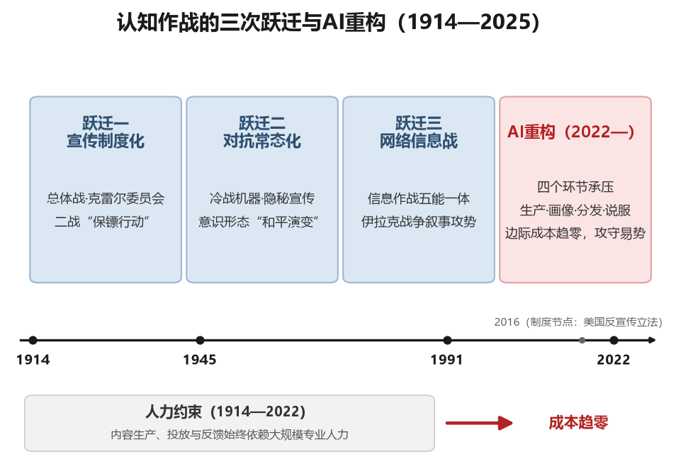
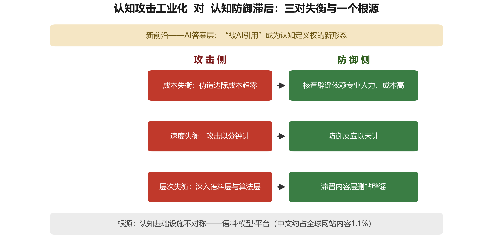

# 第七章 认知域作战：混合战中的主要作战样式

【内容摘要】国家层传播必须直面的最后一个问题，是战略传播对抗。当叙事成为武器、算法成为战场，国家如何认识认知域作战，又如何应对它？本章先厘清认知域作战的概念源流与学理界定，说明它与宣传战、心理战、舆论战、信息战、网络战的边界；再回答一个更根本的问题——为什么在AI条件下，认知作战从辅助手段跃升为混合战争的主要作战样式；随后把镜头对准技术本身，拆解智能技术如何改造认知作战的生产、画像、分发与交互四个环节；继而对认知战的现实逻辑与态势进行分析，最后给出反制之道。本章的落脚点与全书一致：认知作战的最好防御不是筑墙，而是把本国的叙事能力、信任资产与认知基础设施，经营成对手攻不动的体系。

## 7.1 概念界定——认知域作为独立作战域

**认知作战的学理基础**

认知作战的理论预设，可以回溯到传播学的奠基性成果。李普曼在《公众舆论》中提出“拟态环境”：人并非对真实环境直接作出反应，而是对头脑中经媒介建构的环境图景作出反应——谁控制了图景的建构，谁就在事实上控制了反应。拉斯韦尔对第一次世界大战宣传的系统研究进一步揭示，现代国家已把“调动符号以影响集体态度”发展为一门可分析、可操作的技艺。霍夫兰领衔的耶鲁说服研究以实验方法证明，信源可信度、信息结构与情绪唤起的特定组合，能够稳定地改变人的态度。卡尼曼关于“快思考”与“慢思考”的双系统理论则提示：人的绝大多数日常判断由依赖直觉与捷径的快系统完成，这为认知操纵提供了心理机制层面的入口。四块学理基石共同指向一个结论：决策依赖认知，而认知可以被建构——这正是认知作战得以成立的逻辑起点。

**三重空间——认知作战的作用域定位**

传播学与战略学的既有成果，为定位认知作战的作用域提供了更完整的空间框架。理论界与实务界已共同提出认知构建的三重空间模型，即物理世界、信息世界和认知世界，三者构成一个紧密联系、相互依存的有机整体：物理世界是人类的现实存在基础，涵盖真实的环境、实体及其物理属性，构成一切认知经验的根基；信息世界是数字技术造就的动态信息环境，涵盖信息的生成、传播、存储及管理的全过程，是连接物理世界与认知世界之间的重要中介平台；认知世界则指向个体和群体内部的认知结构、认知偏差及其动态演变，涵盖了人们对信息的感知、理解、记忆和态度形成等核心心理机制，更是传播内容内化与意义生成的关键所在。三者的传导链条是：物理世界通过产生信息，经由我们的感官和各类媒介构成信息世界；个体则基于自身的发展阶段、知识图式、思维方法和社会文化背景，对信息世界进行主动的加工和建构，最终在内心形成独特的认知世界。认知作战的定位由此明晰：其直接战场在第三重空间——认知世界；其武器部署于第二重空间——信息世界（媒介、算法与平台）；而其最终后果落回第一重空间——经由认知改变而发生的行为选择与实力对比变化。正是在这个意义上，舆论战之要害，不在让人“听不到”，而在让人“信你所塑、疑其所信”，即其战场已从物理域、信息域推进到认知域。

**认知战的概念界定**

就概念所指而言，“思想战”与“观念战”已先行把矛头对准观念领域：“9·11”事件后，美国军方正式提出“战略传播”构想，并将其作为打赢“思想战”和“观念战”的有力武器加以运用。荷兰学者乔治·迪米特留等人在研究阿富汗战争时进一步指出，在信息时代的冲突中，军事力量的成功运用“更少依赖于战场上的战术行动，更多地取决于国内及战区公众舆论对战争目的、过程和行为的认知”，西方盟军在伊拉克和阿富汗从事的“不仅是物理战争，更是观念战争”。

就概念的条令化程度而言，美军与北约提供了最完整的官方样本。美军把心理战界定为通过传播特定信息、实施心理操纵，影响敌方军队和民众的情绪、信念及心理状态，以达到瓦解敌方士气、分化敌方联盟、动摇敌方意志的目的；信息战则偏重对敌方信息系统与认知机制的侵扰、干扰与破坏。北约盟军转型司令部则将认知战界定为“与其他权力工具同步开展的活动，通过影响、保护或扰乱个人、群体或人口层面的认知，来影响对手态度和行为，从而获得相对于对手的优势”；北约首席科学家研究报告进一步指出，认知战“利用先进技术和科学知识来影响目标人群的思维和行为方式”。

合而观之，认知作战谱系的演进方向可以一言蔽之：作用对象由外在态度下沉至内在认知过程。认知作战是以影响、塑造乃至控制目标对象的认知为目标，综合运用信息内容、心理暗示与技术手段，作用于感知、判断与意志三个层面，服务于政治与战略目的的对抗性传播活动。中国学者曾庆香、刘苏仪认为，认知战是“以形塑认知为目标，运用神经科学、认知科学、行为科学等多学科知识，综合运用人工智能、大数据、生物技术等前沿技术手段，通过长期的意识形态渗透和短期的真假信息轰炸，对目标群体进行精准传播，以改变他们的知识体系、价值体系、思维方式和行为方式，侵蚀支撑目标社会的信任，加深其对立，使其无法抵抗、阻止或转移”。

**概念谱系与相关概念辨析**

现代认知域作战的边界，需要在与心理战、文化战、宣传战、舆论战、电子战、情报战等相近概念的辨析中进一步厘清。就区别而言，可从五个维度加以区分把握。其一，作战域不同：宣传战、舆论战主要活动于信息世界的符号层面，心理战指向敌方军民的士气与意志，文化战依托文化产品与价值观念实施长期浸润而生产文化上的吸引力，电子战在电磁频谱域展开硬对抗，情报战则围绕信息的获取与反获取展开，认知战则直接以人的感知、判断、意志为作用对象，战场在认知世界展开。其二，作用机理不同：宣传战讲“说服”，心理战讲“攻心”，舆论战讲“正义”，文化战讲“涵化”，电子战讲“压制”，情报战讲“窃取”，认知战讲“建构”——通过信息投喂、框架预设与身份动员，重构目标对象的认知结构本身。其三，时间尺度不同：文化战以十年计，宣传战、舆论战以战役和事件计，心理战伴随军事行动展开，电子战、情报战以实时对抗为常态，认知战则兼具长线渗透与短促突击两种节奏。其四，军民属性不同：电子战、情报战以军队和国家情报机构为主，宣传战、舆论战、心理战军民两用，文化战与认知战的行动主体则高度弥散——政府、平台、企业、媒体乃至个人皆可成为作战节点。其五，对抗层次不同：电子战、情报战尚在“信息的传递与获取”层面，宣传战、舆论战、心理战推进到“信息的意义”层面，认知战则深入“认知的结构”层面。

就联系而言，它们共同构成“认知对抗”的连续谱系：宣传战、舆论战是认知战的传统前身与现成工具，心理战是认知战在军事领域的近亲形态，文化战为认知战提供价值底色与长期土壤，电子战、情报战为认知战提供频谱通道与信息原料。在AI时代，这一谱系正被认知战收摄于同一个认知域框架之内，从“各打各的”走向“体系作战”：认知战以感知、判断、意志为总目标，把宣传的符号、心理的机制、文化的涵养、电子的通道、情报的原料统合为一场战争的有机部分——这正是本章将认知作战确立为独立作战样式、并以认知主权为其攻防所系的依据所在。

就认知战与战略传播的关系，笔者认为，认知战是战略传播在数字时代和智能化条件下的高级形态，是战略传播在军事冲突和对抗性语境下的特殊表现形态。二者之别有三：作用机制上，一般战略传播主要作用于信息接收层与态度形成层，认知战则直接作用于认知过程与思维方式，作用深度远超一般传播活动；技术依赖上，前者的技术是手段，后者的神经科学、人工智能、脑机接口等前沿技术本身就是作战能力的核心组成部分；伦理边界上，前者大体仍在国际传播规范与新闻专业伦理框架内运作，后者则大量运用虚假信息、深度伪造、信息污染等手段，伦理争议与安全风险远大于传统战略传播。

在数字技术革命与大国竞争的双重推动下，战略传播与认知战的边界正日益模糊，认知战亦正从战时的极端形态向和平时期的常态化竞争延伸。 究其本质而言，认知作战与战略传播是一体两面：战略传播是常态的建构，认知作战是对抗的形态；建构能力不足者无以言对抗，对抗意识阙如者建构亦难持久。

**认知作战的三层作用对象**

就其作用对象而言，认知作战可以解析为三个层次。感知层解决“让人看到什么”：通过信息的投喂与遮蔽，塑造对象的感官经验；判断层解决“让人相信什么”：通过框架的预设与议题的引导，左右对象的意义加工；意志层解决“让人选择什么”：通过情绪的激发与身份的动员，最终改变对象的行为取向。三层由浅入深、逐级递进：感知层的突破是前提，判断层的建构是核心，意志层的改变才是认知作战的完成时。曾庆香据此指出，认知战“是指根据认知原理，利用种种手段干扰、改变敌人的认知过程，控制敌人的知识获取，以扭曲敌人的文化价值观和思维方式，并最终影响决策，阻碍有利于敌人的行动”。我国军事学者李海明亦将认知域作战界定为以人的认知为直接作用域的对抗活动。正是据此，认知空间被公认为继陆、海、空、天、网之后的“第六维战略疆域”，认知域“正成为未来智能化混合战争主战场”。

**认知主权——认知作战的攻防所系**

认知作战的攻防所系，可以用一个概念收束：认知主权。本书第一章提出，战略传播新范式的核心命题是认知主权（Cognitive Sovereignty）——它以网络主权、数据主权的官方话语为上位、以学术概念为延伸，与国家主权话语一脉相承，是主权体系在认知域的自然延伸与深化。学理上，伊恩卡（Ienca）等学者将认知主权界定为“我们理解和认知自身及环境的能力”所要求的控制权与自主性；本书则将认知主权限定为对认知自主性、知识生产条件与叙事能力的控制权，核心分析对象是国家、城市、企业在AI知识生态中的结构性位置。以作战视角观之，认知作战与认知主权互为镜像：攻击方所侵蚀的，正是目标方的认知主权——使其国民误信假象，使其形象被误解，使其叙事被解构；防御方所守住的，也正是认知主权。质言之，认知作战的实质，是对认知主权的体系化争夺；认知防御的目标，一言以蔽之，是在对抗条件下守住认知主权。本章以下的历史演进、矛盾分析与应对框架，均在这一主权坐标上展开。

这一概念有其主权谱系的内在逻辑，并非凭空而来。本书第一章提出，中国实践已经完成了主权体系的“两级跳”：第一级，网络主权：《网络安全法》2017年施行、《国家网络空间安全战略》2016年发布，以及在世界互联网大会上提出的网络主权主张，确立了国家在基础设施与互联互通层面的主权地位；第二级，数据主权：《数据安全法》2021年施行、《数据二十条》2022年发布，加上中国提出的《全球数据安全倡议》，把主权延伸到数据要素与跨境流动层面。在此基础上的第三级，就是认知主权——对认知与知识生产的控制权，它以官方话语为上位、以学术概念为延伸，构成“网络主权—数据主权—认知主权”三位一体的递进序列（见本书第一章1.4.2节及图1-3）。这一序列昭示了一个趋势：主权的边界，正在跟随技术演进的脚步，从有形的疆土、无形的网络，一路推进到最无形的认知空间。

需要指出的是，网络主权与数据主权属信息空间的治理权，其物理底座以“连接与存储”为主；认知主权直接支配的是认知加工与知识生产，其直接物质基础正是算力与算法 —— 算力供给自芯片与智算中心，决定“谁主导信息生产”；算法凝结为模型与知识生产工具，决定认知加工与分发规则；语料则构成知识底座。认知世界的物理设施失守，认知的建构与守护便无从谈起。因此，认知主权的攻防绝不限于话语层面，而必然延伸至设备、设施与产业层面；认知作战的对抗纵深，也因此从认知世界到信息世界，并一直回溯到物理世界——三重空间的传导逻辑，于此再次得到印证。

> **【通俗释义】认知作战与认知主权**
> 认知作战不炸桥梁、不占城市，它改的是对手头脑里的“地图”——地图错了，装备再好也会走错路。过去改地图要靠电台、传单和大批人力；AI时代，任何人都能以近乎零成本印制以假乱真的“地图”，还能按每个人的喜好私人定制。防御的根本出路，不是烧掉所有假地图，而是让自己的地图更准、更可信、更容易被找到。一句话：认知战要夺的不只是“地图”，更是“画地图的权利”——这份权利，就是认知主权。

## 7.2 历史逻辑——认知作战的四次跃迁

“认知作战”一词进入军事话语确是近年之事；本节按实践发生的年代展开，“作用于认知的作战”作为一种实践，自宣传制度化的那一天起便已存在——名起于近，实贯于史，本节所叙，是其实的演进。现代意义上的认知作战演进史，本质上是媒介技术不断降低“影响认知”之成本的历史。其间发生四次跃迁，而始终受制于一个约束。三次跃迁的节点分别是1945年、1991年与2022年。

**总体战与宣传的制度化——第一次跃迁（1914—1945）**

第一次世界大战使宣传首次成为国家机器的标准配置。美国克雷尔公共信息委员会以现代公关手法动员全民参战，拉斯韦尔1927年出版《世界大战中的宣传技巧》，标志着宣传研究进入学术殿堂。第二次世界大战中，纳粹德国以国民教育与宣传部实施全方位的思想控制，盟军则以“保镖行动”实施人类战争史上规模最大的战略欺骗——通过虚构军团、双重间谍与无线电佯动，使德军统帅部对诺曼底登陆方向产生致命误判。 此一阶段，认知作战完成了从“宫廷谋略”向“国家制度”的跃迁。

**冷战与意识形态对抗的常态化——第二次跃迁（1947—1991）**

冷战把认知对抗从战时手段变为平时常态。美国新闻署、自由欧洲电台构成制度化的传播机器；英国宣传专家克罗斯曼的名言“好的宣传，就是让人看起来根本不是在作宣传”，道出了此一时期认知战的隐秘化转向。1983年里根开启对苏认知战总攻，国家民主基金会成立，意识形态渗透获得“民主援助”的制度外壳。军事领域，信息心理战被视为“区别于陆战、海战、空战的第四种作战形式”。此一阶段，认知作战完成了从“战时配合”向“全谱系对抗”的跃迁。

**网络时代与叙事战争——第三次跃迁（2001—2022）**

冷战结束后，信息技术革命重塑认知作战的形态。“9·11”事件后，小布什政府在反思“他们为什么如此恨我们”的过程中认识到，仅凭武力难以终结恐怖主义的根源，必须通过思想战场争夺人心，由此提出“思想战”（War of Ideas）理念并在全球推行，战略传播由理念上升为国家行动。美国国防部将信息作战定义为综合运用电子战、计算机网络战、心理战、军事欺骗和作战保密五种核心能力，以影响、扰乱、破坏或夺取对手的人工和自动决策。 2003年伊拉克战争是这一形态的巅峰：美军以嵌入式新闻控制战场叙事，以“暴君形象”塑造瓦解伊军抵抗意志，共和国卫队“不战而亡”；但战后“大规模杀伤性武器”开战理由的崩塌，也使其叙事攻势遭遇信誉反噬。

**人力约束——三次跃迁的共同边界**

**AI时代认知域战争——第四次跃迁（2022—）**

前面三次跃迁均由媒介革命驱动，却都未能挣脱同一个约束：内容的生产、投放与效果反馈，始终依赖大规模专业人力。伊拉克战争的叙事机器再精密，仍是“手工作坊的巅峰”。2022年11月30日，ChatGPT发布，生成式人工智能首次以公共产品的形态交付到普通人手中，两个月内月活用户即破一亿，创下当时消费级应用的最快扩散纪录。 从认知过程来看，这些跃迁改变的都是“影响认知”的代价。1945年之前，动员认知需要国家机器的全部组织力；1991年之后，网络把门槛降到机构；2022年之后，门槛降至个人。2022年的技术突破没有经历漫长的采用周期，而在数月之内被嵌入既有的认知作战体系——技术的闸门一旦打开，人力约束这道三次跃迁共同的边界，便随之瓦解（见图7-1）。

图7-1　认知作战的三次跃迁与AI重构（1914—2025）

## 7.3 技术逻辑——生成式AI重构认知作战

**物理、信息、认知三重空间的传导**

物理世界的事件，经由信息世界的即时传导，同步塑造认知世界的判断——物理域的行动与信息域的攻防与认知域的建构，在同一时间轴上共振展开，从而出现三重空间的同步传导。

2025年5月的印巴冲突，为此提供了迄今最完整的样本：冲突甫起，伪造印度外长苏杰生“为空袭道歉”的深度伪造视频即在社交平台疯传；作为“回击”，一则“巴基斯坦军方发言人承认损失两架战机”的伪造视频在X平台被转发近70万次后，方被调查机构Bellingcat揭露为赝品。

更值得深思的是主流媒体的失守：印度多家全国性电视台播出“摧毁卡拉奇港”“击落两架巴方战机”等子虚乌有的“捷报”，以致《纽约时报》慨叹“以前可信的记者和主要媒体直接报道了虚假新闻”。应对层面，印度政府下令封禁8000余个账号，新闻信息局事实核查中心辟谣60余条，并由信息与广播部牵头设立跨部门“战情室”；巴基斯坦则在冲突当日解除对X平台长达15个月的封禁，以动员民间声音进入国际舆论场。此战印证了观点之二：认知域攻防已与物理域行动同频共振，“真相是战争的第一个伤亡者”这句老话，在AI时代获得了全新的技术含义。

**四个环节——生产函数之变**

生成式AI对认知作战的改造，本质上是把“内容生产—受众画像—分发投放—互动说服”四个环节的边际成本同时压向趋零。数字技术带来的“瞬时冲击”“精准画像”“跨域联动”三重赋能，在生成式AI条件下被同一套生成能力重新赋能：瞬时冲击因量产而频密，精准画像因语义理解而下沉到个体，跨域联动因多语种与多模态生成而无缝。

就内容生产环节而言，生成式模型使文本、图像、音频、视频的机器量产成为可能：大型语言模型按提示词即时产出通顺文本，扩散模型据此生成逼真影像，语音克隆只需数秒真人样本——单位内容的边际成本，由专业团队的人月计价降至普通用户的分钟级算力开销，伪造的专业技能门槛随之消失，此一环节之变可概括为量产化。

就受众画像环节而言，平台沉淀的行为数据与生成式模型的语义理解能力相结合，把目标颗粒度从群体压至个体：微定向投放据此实现“千人千面”的说服定制，认知攻击可以精确到一个人的立场、情绪与偏见，此一环节之变可概括为颗粒化。

就分发投放环节而言，自动化账号体系与推荐算法的放大机制相结合，使内容的触达摆脱人工投放：账号的注册、养号、发布、互动均可全流程脚本化，机器人农场昼夜运转，叙事的扩散速度取决于算法权重而非人力多寡，此一环节之变可概括为自动化。

就互动说服环节而言，对话式AI使人机交互成为说服的新界面：聊天机器人可以扮演任何身份，与目标展开长期、私密的对话式陪伴说服——图灵测试在认知域的实际含义，已从“机器能否冒充人”变为“人能否识破机器”，此一环节之变可概括为伴随化。

量产化、颗粒化、自动化、伴随化，四环叠加，认知作战的生产函数被整体改写：攻击的发起不再依赖组织规模，小团队乃至个体即可运营一场战役级的认知行动；而防御方仍须以组织对个体、以制度对算法，攻守的不对称由此内生。

**AI赋能的限度——学理上的冷思考**

然而，把AI神化为认知战的“决胜武器”，同样不符合事实。OpenAI于2024年5月发布首份影响力行动报告，披露了俄罗斯、伊朗、以色列等国背景行动者滥用其模型的五起案例，但同时明确评估：这些行动并未因使用AI而显著扩大其受众触达或影响力。Graphika首席情报官据此指出，“我们对人工智能支持的影响力操纵和人工智能支持的虚假信息的一些最大担忧尚未成为现实”。美国新闻素养项目的统计亦显示，2024年全球选举虚假信息中，断章取义、错误标注之类“廉价伪造”的使用频次约为AI生成内容的七倍。这些证据提示我们：AI重构的是认知作战的成本、速度与颗粒度，而非认知作用的基本原理。技术优势必须嵌入叙事战略与组织体系，方能转化为认知战果；脱离了叙事能力与传播体系，AI不过是效率更高的“传单印刷机”——这一判断，恰是战略传播学的题中之义（见表7-1）。

表7-1　AI时代前后认知作战对照表

| 维度 | AI时代之前（—2022） | AI时代之后（2022—） |
|---|---|---|
| 内容生产 | 专业团队手工制作，产能有限 | 机器批量生成，边际成本趋零 |
| 造假门槛 | 伪造音视频需专业技能与设备 | 文本生成音视频一键可得 |
| 受众颗粒度 | 群体画像、粗放投放 | 个体画像、千人千面 |
| 分发渠道 | 媒体购买与人工水军 | 算法放大与机器人农场 |
| 交互深度 | 单向灌输为主 | 人机对话、伴随式说服 |
| 攻防速度 | 以天、周计 | 以分钟、小时计 |
| 可溯源性 | 相对可查 | 深度伪造加大归因难度 |
| 防御重心 | 内容层删帖辟谣 | 语料层、算法层、答案层综合治理 |

**认知主权的基础设施之维——语料、模型与平台**

AI时代的“认知生产资料”是语料、模型与平台：W3Techs统计显示，中文内容仅占全球网站内容的约1.1%，而英文约占49.1%。与此形成鲜明对照的是，中国互联网络信息中心报告显示，截至2025年6月我国生成式人工智能用户规模达5.15亿人、普及率36.5%。全球最大的AI用户市场与全球占比仅约百分之一的中文语料供给之间的反差意味着：全球AI系统在“谈论中国”时，其知识底座主要由非中文语料浇筑。这正是“反差”“落差”“逆差”困局在智能时代的延伸。谁掌握了语料、模型与平台，谁就握有对世界的定义权。这一格局直指本书的核心命题：认知主权。当认知的“生产资料”集中于语料、模型与平台，认知主权便从话语命题深化为基础设施命题——对华认知作战所侵蚀的，已不只是某一议题上的舆论得失，而是我国在AI知识生态中的知识生产条件与叙事能力；相应地，守住认知主权，也就从守住“讲什么故事”深化为守住“由谁的语料讲故事、谁的故事被AI采信”。

由此衍生出认知攻防的新前沿：AI答案层。公众获取信息的方式正从“搜索—筛选”转向“提问—采信”，大模型的回答日益成为认知的“默认信源”。“被AI引用”正在取代“被搜索引擎收录”，成为定义权的新形态——这一变量将贯穿本书后续章节：第六章的知识资产体系解决的是“有没有可被引用的资产”，第八章的权威信源可见性解决的是“危机时刻资产能否被AI优先调用”，而本章的课题是如何防止对手的叙事污染这一答案层（见图7-2）。

图7-2　AI时代认知作战主要矛盾结构图

## 7.4 现实态势——主要矛盾与认知作战

**攻守失衡——上升为主要矛盾的三对失衡**

把普遍机理收拢为态势判断，可以提炼出AI时代认知作战的主要矛盾：认知攻击的工业化供给与认知防御的制度性滞后之间的结构性失衡。这一主要矛盾外化为三对失衡。其一，成本失衡：伪造内容的边际成本趋零，而核查辟谣依赖专业人力、成本高昂，攻守成本曲线已经交叉——防御者每澄清一条谣言所耗费的资源，远超攻击者生产一百条谣言的成本。其二，速度失衡：攻击以分钟计、防御以天计，斯洛伐克案的攻击者正是算准了法定静默期使辟谣机制失能，罗马尼亚案的攻击者则把全部火力压缩在投票前的最后窗口。其三，层次失衡：各国防御体系至今仍以内容层的删帖辟谣为主轴，而攻击已深入语料层（污染训练数据）与算法层（操纵推荐权重）——防其流而未防其源。

**结构性扩散——国际认知攻击不限于任何一方**

AI时代的认知攻击是结构性的，而非地域性的——问题的根源在于技术条件与激励结构，任何行为体只要具备动机与能力，都可能成为攻击方。2023年6月，俄罗斯关联行动者“风暴-1679”发布伪造纪录片《奥运崩坏》，以AI合成好莱坞影星汤姆·克鲁斯的配音，并通过Cameo平台诱骗美国名人录制视频、恶意剪辑为该片“背书”；微软威胁分析中心认定其专业程度超过其日常观察到的大多数影响力行动。  2024年7月9日，美国司法部查封两个域名并搜查968个X平台账号，摧毁由今日俄罗斯电视台副总编辑主导开发、俄联邦安全局运营的Meliorator机器人农场——该软件以AI批量生成“逼真美国人设”，自动传播克里姆林宫叙事；联邦调查局局长称之为“首次挫败生成式AI增强的社交媒体机器人农场”。同年9月4日，美国司法部再查封“多佩尔甘格”行动使用的32个仿冒域名。

美国在进行认知战防御同时，也在推进认知战的进攻。2022年8月，Graphika与斯坦福互联网观察站联合发布《无声的声音》（Unheard Voice）报告，披露美国Twitter与Meta于同年7—8月移除的两批重叠账号，在近五年间以欺骗性手段在中东与中亚推广亲西方叙事、同时对抗俄罗斯、中国、伊朗等国——Twitter将该活动的推定来源国列为美国和英国，Meta确认其来源国为美国；这些账号使用生成式对抗网络（GAN）合成的假人脸、假扮独立媒体，其中假媒体“因特加泽塔”（Intergazeta）集中炒作涉疆议题、散布所谓“种族灭绝”叙事，部分账号还与美国国防部“跨地区网络倡议”（Trans-Regional Web Initiative）存在关联；报告评估其为开源研究者迄今分析过的最广泛的秘密亲西方影响力行动。报告发布后，《华盛顿邮报》披露，美国国防部负责政策事务的副部长卡尔下令对美军心理作战中的社交媒体使用展开审查。2024年，Meta在其季度威胁报告中又移除了包括源自美国在内的协调性造假行为网络。这些证据与俄方案谱共同指向观点之一：

**多元主体的同频共振**

复旦学者沈国麟、易若彤在考察俄乌冲突时提出，西方战略传播呈现出“同频共振”的特征：互联网平台对俄罗斯声音的屏蔽与钳制，媒体界、企业界、文体界对俄罗斯的抵制，并无统一机构在背后指挥，却在短时间内在全球舆论场形成合围之势——这种协调一致，是在触发了西方“共识机制”（安全共识、战略共识与价值观共识）的情形下自发形成的。就其学理而言，“共振”一词源于力学中的强迫振动——当驱动力的频率与系统的固有频率相合时，振幅达到最大；引申到精神领域，即思想、意识、言论和行为处于同一频率时的共鸣与协调一致。

这里讲到了多元主体的同频共振，是“主体与主体的共振”，描述政府、平台、企业、媒体乃至个人在价值共识驱动下的自发合唱。二者在俄乌冲突与印巴冲突中相互叠加——物理域的冲突触发信息域的同步传导（世界共振），共识机制又调动多元行为体自发参与（主体共振），共同把认知域推向大国竞争的第一战场。对防御方而言，复旦学者的洞见尤其值得记取：认知攻击未必总有一个看得见的指挥中枢，共识机制本身就可以充当协调机制；防御因而不能只盯着“作战平台”，还要防“价值共识被借力”。

**选举政治成为认知攻击最集中的冲击面**

2024年11月24日罗马尼亚总统选举首轮投票，名不见经传的极右翼候选人杰奥尔杰斯库在宣称“零竞选开支”的情况下爆冷领先；随后解密的情报显示，一场由国家行为体支持、在Telegram与Discord频道协调、经TikTok付费网红与账号网络放大的助选行动，被指违反选举立法并利用算法加速提升其人气，选举前后罗选举网站更遭受逾7.5万次网络攻击；12月6日，罗马尼亚宪法法院宣布整个总统选举无效——这是现代欧洲史上首次因认知域干预而被推翻的全国选举。

2024年1月美国新罕布什尔州初选前夕，约2.5万名选民接到AI仿声的“拜登总统”来电劝阻投票，幕后政治顾问被联邦通信委员会处以600万美元罚款并遭刑事起诉。2023年9月斯洛伐克议会选举投票前两天，一段伪造在野党领导人谈论“操纵选举”的AI音频在法定静默期内病毒式传播，该党最终在民调领先的情况下败选。2024年2月印尼大选，专业集团党以AI“复活”已故独裁者苏哈托为党籍候选人助选。韩国中央选举管理委员会在2024年4月国会选举期间查处深度伪造内容129件。

**7.5  国别图谱——美国、俄罗斯、日本的认知战特征**

把散见于上述观点的案例按国别收拢，可以更清楚地看出，大国的认知作战各有其“作战基因”：美国以体系化建制与话语权主导见长，俄罗斯以工业化供给与进攻性搅动著称，日本以历史叙事投毒为长期工程。三国特征，既是观点一“结构性扩散”的具体化，也为观点四“对华体系化演进”提供了注脚。

**美国的体系化建制与话语权主导**

美国方向，其特征是体系化建制与话语权主导。一是立法授权、预算保障、机构执行的体系化运作：以全球接触中心为代表的对华认知作战机构，获得了完整的法律与预算支撑；二是平台与话语权的双重主导：凭借对全球社交平台、搜索引擎与主流媒体的支配地位，美国既能动员平台生态配合其叙事，也能借助假媒体网络渗透他国舆论场；三是多边机制的协调外溢：机构收缩不等于职能退场，跨国叙事协调机制正外溢为盟伴网络，继续承担对华认知作战的组织功能。以下案例即为上述特征的实证。

美国方向，对华认知作战早已不是零散行为，而是立法授权、预算保障、机构执行的体系化运作。全球接触中心的法定职责是“领导、同步和协调联邦政府的努力，以识别、理解、揭露和打击旨在破坏美国国家安全利益的、来自外国（政府）和非国家（主体）的宣传与虚假信息”。2020年7月，美国国务院《全球信息治理报告》更直陈其目标为“减轻并消除中国、俄罗斯等国通过全球社交平台散布虚假信息给自由世界所带来的负面影响”。 拜登政府时期，全球接触中心持续扩权，成为“美国对俄、对华信息战的核心枢纽”；2022年12月，美国国务院成立“中国事务协调办公室”（俗称“中国屋”）。 操作层面，“新疆棉”事件中接受美国国际开发署资金的瑞士良好棉花发展协会（BCI）暂停涉疆项目并渲染“强迫劳动”谣言。2022年3月2日，欧盟理事会禁止今日俄罗斯与卫星通讯社在欧盟境内传播，主要社交平台相继封禁、限流。美方出台“2022—2026年对华竞争战略”，以“债务陷阱”“胁迫外交”“民主对抗威权”等标签化叙事实施框架预设。

就机构动向而言，须作分层研判，切忌以“机构撤销”推导“职能退场”。2024年12月，美国国会不再延长全球接触中心的授权，其改组为“反外国信息操纵与干预中心”（R/FIMI）；2025年4月16日，国务卿鲁比奥宣布关闭该中心，理由是该机构逾越职责、审查美国公民言论；2025年9月，国务院进一步宣布终止《反制外国信息操纵框架》及其相关机制。其一，机构层确已收缩，此已证实；其二，法律层并未动摇——2016年反宣传立法的制度遗产仍在，国防部信息作战体系、中情局中国任务中心照常运转；其三，网络层已然外溢——2024年6月由全球接触中心帮助发起、总部设于华沙的“乌克兰传播小组”，已把跨国叙事协调机制转移给二十余国政府、北约与欧盟对外行动署组成的盟伴网络。更须警惕的是话语层的翻转：“反虚假信息即审查”正被锻造为新的话语武器，把认知防御污名化为压制言论，本身即是一场抢占道德高地的认知作战。

**俄罗斯的工业化供给与进攻性**

从以今日俄罗斯电视台为代表的官方媒体矩阵，到“风暴-1679”以AI合成名人配音的伪造纪录片，再到由曾任今日俄罗斯电视台副总编辑者主导开发、俄联邦安全局运营的Meliorator机器人农场，以及“多佩尔甘格”仿冒域名网络，俄罗斯形成了一条“官方媒体造势—情报机构操盘—AI工具放大”的工业化生产线；其攻击节奏以搅动式进攻为主，尤其擅长在选举窗口期集中发力——罗马尼亚首轮总统选举被宣布无效，即系一场由国家行为体支持、经Telegram与TikTok账号网络放大的助选行动所致。归纳起来：工业化供给、进攻性搅动、低成本迭代。

**日本认知战的四重特征**

日本方向，认知作战的第一重特征，是建制的专门化。2013年2月，安倍内阁在内阁官房设立“领土主权对策企划调整室”，统筹钓鱼岛及其附属岛屿（日方称尖阁诸岛）、竹岛与北方四岛议题的国内外宣传战略与历史资料整理，2013年度相关宣传预算约为上年度的两倍。2014年1月，文部科学省修改教科书审定标准，要求涉及近现代史的表述尊重政府统一见解，把历史叙事的统一强行纳入国家规制。2023年9月《读卖新闻》披露，日本政府拟在2024年度预算中列支3亿日元加强领土主张宣传：定期向海外知名国际法学者定向发送包含日方见解的电子邮件，修缮东京千代田区的“领土主权展示馆”，并引入虚拟现实技术渲染相关议题——这一布局的直接依据，正是2022年12月修订的《国家安全保障战略》中“加强对领土、主权问题理解的努力”的条款。

第二重特征，是教科书审定工程的持续推进。2015年审定中，南京大屠杀相关表述由“杀害了多数俘虏和居民”改为“波及了俘虏和居民”，遇难者数量亦被刻意模糊；2020年3月24日审定的中学社会科教科书，全部明确记载钓鱼岛（日方称尖阁诸岛）与竹岛为“日本固有领土”；2022年3月审定的239款高中教科书中，多款将朝鲜半岛劳工的“强制押送”改为“动员”或“征用”，12款社会科教科书载明竹岛为日本固有领土，更有大量教科书删除或淡化“战时慰安妇”表述；2023年3月审定的小学社会科教科书，则全部将上述岛屿称为“固有领土”。教科书以国民教育为管道，把经过审定的历史观植入一代人的认知底座——这正是认知作战作用于“知识生产条件”的经典形态，也是认知主权之争最不容回避的现场。

第三重特征，是对外认知操作的长期经营。2017年1月，英国《星期日泰晤士报》揭露：日本驻英国大使馆每月出资一万英镑，收买英国智库“亨利·杰克逊协会”，唆使官员和记者在英国主流媒体和政界渲染“中国威胁论”。同月曝光的APA酒店案中，该连锁酒店在6万余间客房长期放置集团代表元谷外志雄撰写的右翼书籍，公然否认南京大屠杀与日军强征“慰安妇”；元谷外志雄还发起“真正的近现代史观”有奖征文，首届最高奖即授予否认侵略历史的论文《日本是侵略国家吗》（作者为时任航空自卫队幕僚长田母神俊雄）。政府层面，日本在2017财年预算案中列支5亿多日元，资助智库围绕领土主权与历史认识开展对华对韩“舆论攻势”；2016年《外交蓝皮书》明确部署加大培养“亲日派”“知日派”力度，积极邀请“对舆论和决策有很大影响力的各国要人”。

第四重特征，是智能化升级。这一升级首先体现为国家战略的顶层设计：2022年12月16日，日本内阁会议通过新修订的《国家安全保障战略》等三份安保文件，明确提出加强应对包括散布虚假信息在内的认知战领域作战能力，在政府内部构建收集和分析外国虚假信息情报的新机制，强化对外信息发布；《国家防卫战略》进一步要求，2027年前建立应对包括认知战领域在内的信息战情报能力。其次是机构的实体化：防卫省2022年设立“全球战略信息官”职位，加强信息监控与认知战机制建设；日本政府宣布在内阁官房新设“战略交流室”并列入2024年度机构编制计划，统筹涉日负面舆论与虚假信息的监测搜集、分析发布与跨部门协作——这一机构将成为日本国家层面认知战的中枢，对防卫省、自卫队等力量形成战略指导；防卫省还计划在陆上自卫队新设专门的认知战部队，于2027年前编成。其三是技术与预算的双重加码：外务省自2022年引入以人工智能分析社交媒体舆情的大数据监测系统，重点跟踪与日本外交相关议题的解读动向及恶意帖文的扩散；2023年8月24日福岛核污染水排海当日，日本广播协会（NHK）披露，外务省拟在2024财年预算中列支701亿日元，用于应对所谓“虚假信息”、制定“战略性”对外传播政策，并明确将“引入人工智能收集和分析信息”——这笔预算约为核污染水排海工程预算的20倍。历史叙事的认知投毒，由此进入智能化阶段。

智能化阶段最深的变化，是投毒对象的位移：不再只是读者，而是训练语料本身。右翼史观文本一旦进入大模型的训练数据，便会以“客观中立”的机器口吻流向全球数以亿计的用户——投毒者甚至无须再与受众见面。客房里的书只能等客上门，语料里的毒却能自动登门。防御历史虚无主义的战场，因此从出版物与客房，延伸至每一个大模型的知识底座。

**7.6  攻守兼备——以认知主权为纲的战略布局**

面对主要矛盾与现实逻辑，应对之道不能止于内容层的删帖辟谣，也不能止于消极防御。认知主权的完整内涵，本就包含建构与守护两重向度：对认知自主性、知识生产条件与叙事能力的控制权。既要在攻击下守得住，更要在平时建构得起来。据此，本章提出以认知主权为纲的攻守兼备战略布局——抓主要矛盾、固认知资产、筑伦理防线、强攻守巡查、兼长短节奏，五路并进，守中有攻、攻守相济。

认知主权之“守”，可以分解为三个层面：在社会认知层面，守住社会主流价值、社会共识与公众判断力，使其免受系统性干扰与侵蚀；在国际传播层面，守住自主的叙事能力与知识资产，确保国家“被正确理解”而非“被任意定义”；在基础设施层面，守住语料、模型与AI答案可见性这一认知生产条件。7.4的三对失衡，正是这三个层面的失守风险图谱。认知主权之“立”，则要求在守住之外更进一步——主动供给议题、规则与知识，使中国的认知生态在世界范围内更具吸引力与可信度。

**抓住主要矛盾，抢占算力算法的制高点**

认知主权的争夺，在AI时代首先表现为算力与算法的竞争：谁拥有更强的基础算力、更优的模型算法，谁就握有认知生产与认知防御的主动权。语料存于数据中心、算力供给自芯片、交互承载于平台——认知主权的物质基础一旦失守，认知的建构与守护便无从谈起。因此，应对布局的第一要务，是在算力、算法与基础模型上抢占制高点，确保认知基础设施的自主可控；唯有制高点在握，防御体系才有“主场作战”的底气，进取布局才有“客场破防”的依托。

**建设语料库与认知资产，固认知之本**

认知主权的竞争，说到底也是语料与知识的竞争：大模型以语料为食，谁供给语料，谁就在事实上参与塑造模型的“世界观”。当前最紧迫的结构性短板，是中文语料在全球AI知识底座中的占比过低——全球AI系统在“谈论中国”时，其知识底座主要由非中文语料浇筑。改变这一格局，一要按第六章的部署，把权威内容沉淀为结 构化、多语种、可被机器调用的知识资产，从根本上改善中文语料的供给结构；二要建立权威历史语料库的多语种供给机制，针对日本方向的历史叙事投毒，对主流大模型涉南京大屠杀、日军强征“慰安妇”等问答实施定期抽检、记录与纠偏交涉；2015年10月《南京大屠杀档案》列入联合国教科文组织《世界记忆名录》，为历史真相的国际确权提供了法理支点；三要按第八章的逻辑，提升权威信源在AI系统中的可见性，确保危机时刻“AI答案里的中国声音”不缺位。知识资产线、答案可见线双线并举，方能在源头上扭转认知基础设施的不对称。

**筑牢科技伦理防线，坚决斗争语料投毒**

语料既是建设的资源，也是攻击的入口。认知投毒的直接对象，已从读者位移至训练语料本身：右翼史观文本一旦进入大模型的训练数据，便会以“客观中立”的机器口吻流向全球数以亿计的用户——投毒者甚至无须再与受众见面。对这一方向的失守，有识之士忧之甚深：若放任语料投毒与算法偏差蔓延，大模型将把偏见系统化、把错误常态化，认知主权将从源头溃堤。因此，必须把科技伦理纳入攻防体系。一要建立覆盖主要平台与主流大模型的认知攻击常态化监测，把深度伪造检出时延、涉华议题AI问答偏差纳入预警指标，力争“发现在病毒式传播之前”，对人工智能的错误战略方向保持常态化监测；二要与语料投毒进行坚决斗争，对历史虚无主义与涉华偏见的大模型输出，坚持发现一起、纠偏一起，绝不姑息；三要完善规则标识体系，落实国家网信办等四部门发布的《人工智能生成合成内容标识办法》，对AI生成合成内容添加显式与隐式标识，并在国际上推动落实《全球人工智能治理倡议》，把内容标识与深度伪造治理纳入多边规则议程。

**加强认知安全巡查，攻守兼备、形成战略指引**

认知防御不能只守不攻，攻守兼备的要义，一是巡查，二是反制。就巡查而言，溯源执法要刚性化：从罗马尼亚首轮总统选举因认知域干预而被宣布无效，到美国司法部以查封域名、搜查账号、联合盟友发布技术通报的方式处置Meliorator与“多佩尔甘格”，都表明法律工具与跨国协作是打击机器人农场的有效路径——我国亦应完善相应执法机制与平台协作规则。

就反制而言，要对敌人的认知投毒行为主动纠错、主动出击：对主流大模型涉华高频议题的历史表述作制度化体检，抽检有据、纠偏有档，对涉南京大屠杀、日军强征“慰安妇”等问答的偏差，坚持记录存证、提交纠偏；同时把认知战场推进到对方一侧——从“被定义—回应”的被动处境转向“设置—塑造”的主动位置，围绕人工智能治理、深度伪造规制等新兴议题率先提出规则方案、占领道义与规则高地，并深耕与全球南方国家及国际组织的事实核查、媒体合作与研究共享网络，避免在单一舆论场内被围堵孤立。主动纠错与主动出击并举，方能打到对方家门去，形成战略牵制——让对手的每一次投毒都付出代价，让对手的每一轮进攻都面临反制。

**长期认知构建与中短期舆论战相结合，把握攻守节奏**

认知战既是战役，更是战争。长期维度上，认知主权的根基在国民的认知素养与国家的叙事能力：我国自2003年将舆论战、心理战、法律战纳入《中国人民解放军政治工作条例》，2024年4月调整组建信息支援部队，“防御性威慑与认知控制”的理念日渐清晰；学界亦提出渠道层、技术层、内容层三位一体的认知战防御体系，为攻守框架提供了策略底座。毛泽东关于“自从中国人学会了马克思列宁主义以后，中国人在精神上就由被动转入主动”的论断，早已揭示了精神主动的历史逻辑，习近平总书记2021年5月31日关于构建具有鲜明中国特色的战略传播体系的重要论述，则为认知域的攻守转换指明了方向。把AI素养与历史素养教育纳入国民教育与社会宣传，把叙事能力（第五章）、传播能力（第六章）建设作为最深层次的认知防御，是为长期之“建”。中短期维度上，舆论战的响应仍以战役级的速度展开：议题设置、辟谣纠错、危机处置，讲究的是“小时级”反应，是为当下之“战”。两者不可偏废：只有长期构建夯实了认知底座，中短期舆论战才有兵源与弹药；只有中短期舆论战守住每一场战役，长期构建才能赢得时间与空间。归结起来，以认知主权为纲的攻守兼备布局，最终落脚于“建战结合”——守住认知主权，靠的不是“堵”，而是叙事能力与传播能力本身之“建”。

## 7.7 本章行动——认知防御的落地要点

本章交付三件工具。其一，认知攻击监测预警指标表（见表7-2）——回答“看什么”，把深度伪造、AI问答偏差、异常账号、跨境传导与信源可见性五类信号纳入统一的预警框架，给出可校准的处置阈值。其二，涉华历史叙事AI抽检要点表（见表7-3）——回答“查什么”，对主流大模型涉南京大屠杀、日军强征“慰安妇”、钓鱼岛、新疆等高频议题的历史表述作制度化体检，抽检有据、纠偏有档。其三，认知防御体系建设责任清单（见表7-4）——回答“谁来干”，把国家、平台、专业与社会四层主体的任务分工一次排定。三张表的作业顺序即认知防御的因果顺序：先监测发现，再抽检纠偏，后责任到人——顺序颠倒，防御便退回事后救火。

四类主体各有侧重。外交与外宣部门：以监测预警指标表为总抓手，建立“发现—会商—处置—复盘”的闭环，把涉华AI问答偏差纳入对外交涉与议程设置的证据库。平台与大模型企业：落实生成合成内容标识与伪造检出的主体责任，配合抽检纠偏，同步开展语料治理，守住模型的“知识底座”。主流媒体、智库与史学研究机构：承担权威语料的多语种供给与事实核查，为抽检表提供专业裁量基准。教育机构与社会组织：把AI素养与历史素养教育纳入国民教育与社会宣传，夯实认知固本的社会根基。

使用三张表时须避开三个常见误区。误区一：把预警表做成“事后登记”——指标的价值在于前置，深度伪造的处置时延一旦以天计，辟谣已经输给传播，预警阈值须随攻击手法滚动校准。误区二：把抽检表做成“一次性核查”——大模型的训练语料与算法版本持续更新，一次纠偏不等于长期稳定，抽检须常态化、留痕化，形成可比对的偏差档案。误区三：把责任清单做成“层层挂名”——认知防御的时效性要求跨层级、跨部门的并联响应，各主体的任务边界须清晰到“谁在几小时内做什么”，否则清单再完备也只是纸面分工。

表7-2　认知攻击监测预警指标表

| 监测维度 | 核心指标 | 预警阈值（示例） |
|---|---|---|
| 深度伪造 | 涉华深伪内容检出时延 | 超过6小时未处置即升级 |
| AI问答偏差 | 主流模型涉华敏感议题问答抽检偏差率 | 单次抽检偏差超过三成即启动纠偏 |
| 异常账号集群 | 同叙事账号批量注册与协同发布 | 24小时内超阈值增长即溯源 |
| 跨境叙事传导 | 境外议题向境内舆论场的传导速度 | 小时级传导即启动会商 |
| 权威信源可见性 | 涉华权威内容在AI答案中的引用率 | 持续下降即启动语料补给 |

表7-3　涉华历史叙事AI抽检要点表

| 抽检对象 | 抽检内容 | 处置方式 |
|---|---|---|
| 主流大模型涉南京大屠杀问答 | 事实表述、遇难人数、定性措辞 | 记录存证，偏差即提交纠偏 |
| 主流大模型涉“慰安妇”问答 | 强征性质、史实依据 | 同上 |
| 主流大模型涉钓鱼岛、南海问答 | 主权依据、历史脉络 | 同上 |
| 主流大模型涉新疆、西藏问答 | 事实核查与叙事框架 | 同上 |
| 社交平台涉华历史话题 | 否认主义内容的标识与传播 | 平台交涉与依法处置 |

表7-4　认知防御体系建设责任清单

| 层级 | 主体 | 核心任务 |
|---|---|---|
| 国家层 | 宣传、网信、外交、安全、军队相关部门 | 顶层立法、监测预警、跨境执法协作 |
| 平台层 | 社交平台、大模型企业 | 标识落实、伪造检出、语料治理 |
| 专业层 | 主流媒体、智库、高校、史学研究及档案机构 | 权威语料供给、事实核查、抽检纠偏 |
| 社会层 | 教育机构、行业组织、公众 | 媒介素养教育、理性用网、随手举报 |

> **【本章案例】罗马尼亚：一场被算法改写的选举**
> 【事实】2024年11月24日，宣称“零竞选开支”的极右翼候选人杰奥尔杰斯库在罗马尼亚总统选举首轮投票中爆冷领先。12月4日解密的情报显示：一场由国家行为体支持的助选行动在Telegram与Discord频道协调，经TikTok付费网红与账号网络放大其内容，利用算法“加速提升其人气”；选前罗选举系统还遭受逾7.5万次网络攻击。12月6日，宪法法院宣布整个总统选举无效、择期重选。
> 【机制】这不是一次传统意义上的舆论造势，而是认知域干预对民主程序的直接击穿：付费网红制造“草根自发”的假象，算法放大替代组织动员，跨境协调隐蔽资金流向，全部火力压缩在投票前的最后窗口，令防御方来不及反应。
> 【启示】其一，认知域干预已具备实质改变一国政治结果的能力，防御必须前置到平台算法与资金流向层面；其二，“事后推翻选举”是代价极高的非常手段，常态化的监测预警才是正道；其三，平台治理已无国界，跨国协作与规则共建刻不容缓。

本章逻辑链复盘：一组概念——宣传、心理战、信息战、影响力行动与认知作战的百年谱系，以及认知作战与战略传播、认知主权的两重关系。一条主线——认知作战的演进史是“影响认知”的成本下降史：三次跃迁都未能挣脱人力约束，生成式AI使边际成本趋零。一组观点——现实逻辑由四个观点统摄：认知攻击的工业化是结构性的而非地域性的，认知域攻防已与物理域行动同频共振，攻守失衡构成当前的主要矛盾，对华认知作战沿建制化、长期化、智能化演进；其中主要矛盾是认知攻击的工业化供给与认知防御的制度性滞后之间的结构性失衡，其失守风险在认知主权的基础设施之维。一张国别图谱——美方以立法授权、预算保障、机构执行成其体系，俄方以官方媒体与情报机构双轮驱动行其工业化，日方以历史叙事投毒为长期工程；智能化升级正把投毒对象从“客房里的书”推进到“语料里的毒”。一套布局——以认知主权为纲的攻守兼备布局：抓主要矛盾，抢算力算法之巅；固认知资产，扭转语料之匮；筑伦理防线，坚拒投毒之害；强攻守巡查，成战略牵制之势；兼长短节奏，建战结合以固本。守住认知主权，最终靠的不是“堵”，而是叙事能力与传播能力本身之“建

## 本章参考文献

[1] COOMBS W T. Protecting Organization Reputations During a Crisis: The Development and Application of Situational Crisis Communication Theory[J]. Corporate Reputation Review, 2007, 10(3): 163-176.

[2] HALLAHAN K, HOLTZHAUSEN D, VAN RULER B, et al. Defining Strategic Communication[J]. International Journal of Strategic Communication, 2007, 1(1): 3-35.

[3] 沈悦. 数智时代中国国际传播效力提升的韧性机理与调适路径——兼论DeepSeek何以重构全球舆论生态[EB/OL]. 爱思想, 2026.

[4] 国务院. 关于深入实施“人工智能+”行动的意见（国发〔2025〕11号）[Z]. 北京: 中华人民共和国国务院, 2025.

[5] CHEN M, CHEN K, WANG X, et al. Generative Engine Optimization: How to Dominate AI Search[EB/OL]. arXiv preprint arXiv:2509.08919, 2025.

[6] 国家互联网信息办公室. 大模型备案与用户规模数据通报[R]. 北京: 国家互联网信息办公室, 2025.

[7] 国家互联网信息办公室等. 生成式人工智能服务管理暂行办法[Z]. 北京: 国家互联网信息办公室, 2023.

[8] MAYER R C, DAVIS J H, SCHOORMAN F D. An Integrative Model of Organizational Trust[J]. Academy of Management Review, 1995, 20(3): 709-734.

[9] 逄培. DeepSeek类人工智能赋能中华文明国际传播：机遇、挑战与路径[J]. 中国发展, 2026.

[10] SINGH J P, SHEHU A, DUA M, et al. Entangled Narratives: Insights from Social and Computer Sciences on National Artificial Intelligence Infrastructures[J]. International Studies Quarterly, 2025, 69(1).

[11] IENCA M, POLLICINO O, LIGUORI L, et al. Machine Learning, Cognitive Sovereignty and Data Protection Rights with Respect to Automated Decisions[M]// Cambridge Handbook of Information Technology, Life Sciences and Human Rights. Cambridge: Cambridge University Press, 2022.

[12] Pew Research Center. How People Around the World View AI[R]. Washington, D.C.: Pew Research Center, 2025.
