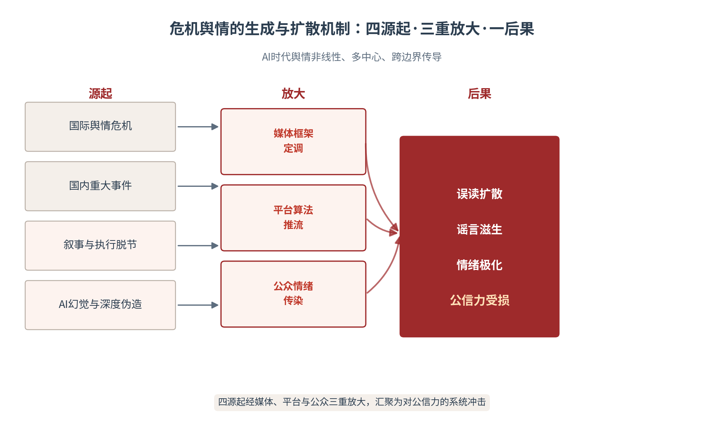

# 第八章 危机治理：重大舆情中的国家公信力修复

第五、六、七三章讨论了国家如何建构叙事、如何让世界准确理解、如何在认知域开展攻防，本章处理的是在危机极限状态中的叙事。当突发事件、谣言与情绪同时涌来时，国家公信力面对的是最严苛的压力测试。本章引入情境危机传播与信任修复理论，把危机治理拆解为生成机制—权威发布—信任修复三段，并提出贯穿全章的核心命题：国家公信力的核心不是“消除负面”，而是在事实、态度与行动中重建可信度。AI时代，危机治理多出一个决定性变量——权威信源在AI系统中的可见性：谁在AI答案里被引用，谁就掌握信任修复的主动权。本章亦为第二篇收官之章——建构、传播、对抗、修复四力合一，方成可信之国家。

## 8.1 生成机制——危机舆情从何而来

**AI时代危机舆情的三重新特征**

危机传播研究的经典框架，把危机理解为“对组织声誉的重大威胁”[1]；战略传播研究则把危机应对列为核心职能——它不仅关乎一次事件的处置，更关乎组织长期可信度的存续[2]。进入AI时代，危机舆情的形态发生了三重变化。其一，非线性：传统“发布—接收”的线性传播模型失效，信息沿社交网络多点并发、交叉传染，传播路径无法预测。其二，多中心：议程设置权从少数权威媒体分散到无数账号、社群与AI生成者手中，人人都是潜在的信源。其三，跨边界：一起地方性事件可在数小时内演变为国际议题，国内舆情与境外叙事相互喂养、彼此放大。三重变化叠加，使危机从“可预见的偶发”变为“常态化的压力”，危机治理能力由此成为国家传播体系的基础能力而非应急能力（见图8-1）。

图8-1　危机舆情的生成与扩散机制：四源起·三重放大·一后果

**国际舆情危机的扩散路径与国内重大事件的舆情发酵**

国际舆情危机的扩散，通常遵循“议题跨国传导—污名化标签—认知战升级”的路径：一个国内议题被境外媒体重新框架化，贴上一个便于传播的负面标签，再经平台算法放大，最终固化为对国家的整体认知污染。沈悦在分析DeepSeek引发的全球舆论时指出，中国叙事进入全球认知的形态正在重构，但同时也暴露于更复杂的跨国舆情博弈之中[3]。国内重大事件的舆情发酵则有另一套节奏：突发事件触发短视频扩散，平台推流形成情绪聚集，线下回应与线上讨论相互印证或相互矛盾，若权威信息供给滞后，事件就会在信息真空中被反复“再创作”——每一次再创作，都是一次偏离事实的漂移。

两条路径的交汇点在于“污名化标签”的生成机制。一个负面标签一旦形成，就会沿三条通道自我强化：媒体在报道中反复引用（框架固化），公众在讨论中自动关联（认知捷径），AI在语料中学习并复制（算法沉淀）。标签的可怕之处在于其不可逆性——辟谣可以澄清事实，却难以抹去标签留下的认知痕迹，因为标签已成为AI语料与公众记忆的一部分。这意味着危机治理的窗口不在标签形成之后，而在标签形成之前——抢占定义权越早，去标签化的成本越低。

国际与国内两个舆情场域并非彼此隔绝，而是构成一个相互强化的“双循环”。外循环：境外叙事经平台与翻译管道倒灌国内，与国内情绪合流，为国内舆情火上浇油；内循环：国内情绪外溢为国际议题，被境外媒体截取、放大后再倒灌，形成“内热外炒、外炒内热”的共振。双循环的存在意味着危机治理不能内外分治——对外只做舆情监测、对内只做情绪疏导，都会漏掉循环的另一半。有效的应对须内外同频：境外叙事倒灌时，及时以权威事实切入口径；国内情绪外溢时，主动以准确信息参与国际叙事，把双循环的放大器效应转化为澄清事实的传播通道。

**媒体、平台与公众情绪的互动**

危机舆情的放大，是媒体、平台、公众三方互动的结果。媒体提供框架——它决定事件被放在哪个叙事里被理解，是“孤立的个案”还是“体制的象征”。平台提供放大器——推荐算法偏好高情绪唤起的内容，越极端的表达越容易被推送，形成“情绪越界—流量奖励”的恶性循环。公众提供情绪能量——在群体讨论中，个体情绪经由相互印证走向极化，理性声音被情绪声浪淹没。三方互动的结果是情绪的自我强化：平台因流量而奖励情绪，公众因情绪而获得表达快感，媒体因公众情绪而调整框架，危机在循环中被不断放大。

情绪极化的生成有其可识别的机制。一是回音室效应：算法把人圈在观点相似的群体里，内部反复强化使极端观点显得“主流”。二是情绪共振：危机中的恐惧、愤怒具有极强的传染性，个体在群体氛围中放大情绪表达，理性讨论被“站队”取代。三是不对称发声：极端情绪者表达意愿最强，理性沉默者成为“沉默的大多数”，舆论场呈现出比真实民意更极端的失真镜像。理解这套机制的意义在于：危机处置的目标不是与极端情绪缠斗，而是把沉默的大多数重新激活为理性的讨论主体——回应其真实关切，而非迎合极端声量。

**危机中的误读、放大与网络谣言传播**

谣言是危机舆情的伴生物，其生成有三个必要条件：信息真空（权威信息缺位，公众只能以猜测填补）、认知偏差（人们倾向于相信符合既有预期的信息）、传播便利（AI使批量生成与快速扩散的边际成本趋近于零）。三者叠加，谣言便获得了“先发优势”——在真相尚未抵达前，谣言已经完成了数轮扩散。AI进一步加剧了这一态势：大模型的“幻觉”问题可能生成看似权威的虚假信息，深度伪造技术则可制造以假乱真的图像与音视频，谣言的“技术可信度”被显著抬高。

谣言的治理难点，恰在于其“合理性外壳”。现代谣言很少以赤裸的谎言形态出现，而是真假掺杂——用一个真实细节锚定可信度，再夹带一个虚假推断。这种“七分真、三分假”的结构使辟谣变得困难：全部否认等于否认了那七分真实，只否认三分假又容易让公众误以为“官方避重就轻”。破解之道在于改变辟谣的粒度——不是笼统地“辟谣”，而是逐条拆解：哪些是真实、哪些是误读、哪些是捏造，把“真假掺半”的模糊指控还原为可验证的事实清单。

**叙事与执行脱节引发的信任危机**

有一种危机并非源于外部攻击，而源于内部的承诺落差。国家叙事越宏大，公众对落地的期待越高；当“人工智能+”行动的宏大蓝图[4]遭遇基层执行的具体困难时，若叙事与执行脱节，公众就会产生“说得漂亮、做得不实”的落差感——这种落差是信任危机的深层根源。宏大叙事提供的是愿景与合法性，基础设施落地提供的是体验与兑现；两者一旦长期背离，每一次承诺的落空都会成为下一次危机的引信。

治理承诺落差的关键是“承诺管理”。其一，叙事的颗粒度要与执行能力匹配——讲愿景时敢于宏大，讲进度时敢于具体，二者分开表达、避免混同。其二，建立“承诺—兑现”的公开台账，让公众能够对照检验，把抽象的信任转化为可核查的记录。其三，对阶段性未达成的承诺主动说明原因与修正路径，主动解释的成本永远低于被揭穿的代价。承诺管理的本质，是把信任从“感情”变成“制度”。

承诺落差在现实中通常表现为三种情形。进度落差：目标宏大、路径清晰，但阶段性进度落后于公开的时间表，公众的耐心在等待中被消耗。体验落差：顶层设计的愿景美好，基层落地的体验参差，公众以亲身感受否定宏大叙事。口径落差：不同层级、不同部门对同一目标的表述反复变动，公众从“听其言”转向怀疑“观其行”。三种落差有一个共同的病根——叙事的供给与执行的供给没有同步校准。治理之道不在降低叙事，而在提高执行的透明度：让进度可查、体验可感、口径可溯，落差自然消解。

**安全话语分级——必须厘清的术语体系**

讨论危机治理时，一套术语的混用会带来战略层面的混乱。本书在第一章学科史中引述北约语境时使用了“认知域作战”这一军事术语，此后全书须按安全话语的四级口径统一使用，避免混用：意识形态安全，属党的舆论工作范畴。网络意识形态安全，属网信工作范畴。认知安全，属学术概念，讨论认知领域的攻防演变。认知域作战，属军事术语，仅用于引述外部语境。四级话语各有其适用领域与责任主体，混用不仅会造成学术不严谨，更可能在实际工作中引发职责边界的误判（见表8-1、术语释义）。

厘清安全话语的四级口径，不仅是学术规范问题，更是战略防御问题。在认知领域的博弈中，概念的精确性就是防线的精确性：若把“认知安全”这一学术概念与“认知域作战”这一军事术语混用，既会在国际话语场上授人以柄，也会让国内的治理实践失去清晰的边界感。口径统一的价值在于：对外，用准确的学术与政策语言参与国际讨论，避免被污名化；对内，用清晰的分级明确各主体的责任边界，避免职能错位。术语体系的每一级，都对应着一套可以落地的治理安排。

> **术语释义｜安全话语四级口径**
> 意识形态安全：党的舆论工作范畴，关乎主导意识形态的巩固；网络意识形态安全：网信工作范畴，关乎网络空间意识形态阵地的治理；认知安全：学术概念，关乎个体与集体认知能力的自主与防护；认知域作战：军事术语，仅限引述北约等外部语境时使用。四级口径的责任主体、适用场景与政策边界各不相同，全书按此统一，不混用、不泛化。

表8-1　安全话语四级口径对照

| 话语层级 | 所属范畴 | 责任主体 | 适用场景 |
|---|---|---|---|
| 意识形态安全 | 党的舆论工作 | 宣传部门 | 主流意识形态的巩固与引导 |
| 网络意识形态安全 | 网信工作 | 网信部门 | 网络空间意识形态阵地治理 |
| 认知安全 | 学术概念 | 学界与研究者 | 认知领域的攻防演变与自主防护 |
| 认知域作战 | 军事术语 | 仅限外部语境引述 | 引述北约等话语时的界定 |

## 8.2 权威发布——事实核验与信任重建

**第一时间发布：抢占定义权**

危机的第一战场是信息真空。研究表明，公众对事件的第一印象一旦形成便具有强大的“首因效应”——后到的信息即使更准确，也要付出数倍成本才能纠正先入为主的认知。因此，“第一时间发布”不是效率问题，而是定义权问题：谁先提供权威框架，谁就定义了事件的性质、边界与后续讨论的坐标。发布的速度要求应理解为“抢在谣言定型之前”，而非机械的“越快越好”——一条未经核验的仓促发布，其纠错成本可能远超延迟发布。

第一时间发布的“度”需要把握三条原则。说已知的，不说猜测的：只发布已核实的事实，对尚在核实的信息明确标注“正在核实”，用确定性守住可信度。说过程的，不说结论的：先交代处置进展与工作机制，把结论留给事实核验完成之后。说持续的，不说终局的：明确后续发布的时间与渠道，让公众对信息供给形成稳定预期。三条原则的共同指向，是把权威发布从一个“动作”升级为一条“持续供给的信息流”。

“第一时间”的具体尺度，取决于谣言的生命周期。谣言在信息真空中的扩散呈指数形态：前几小时是扩散的黄金期，一旦错过，辟谣就需要数倍于谣言传播的成本去追平。因此权威发布的黄金窗口，通常以“小时”计而非“天”计——能在谣言定型前进入舆论场，权威信息就是“首发”而非“辟谣”；一旦让谣言先行，权威信息的角色就沦为被动的“纠错者”。这是“第一时间发布”的深层逻辑：不是争分夺秒的表演，而是与谣言赛跑的战略必然。

**多部门协同的事实核验机制**

重大舆情往往横跨多个部门，各自发布极易造成口径打架——而口径的不一致本身就是二次危机的导火索。多部门协同的事实核验机制，核心是建立“统一入口、统一口径、统一出口”：由牵头部门统筹信息汇总，用事实核验流程对关键信息做多源交叉验证，形成经权威背书的统一口径后，再由统一渠道对外发布。核验流程可归纳为三关：事实关（信息是否真实、完整、可溯源）、口径关（表述是否统一、不产生歧义）、价值关（发布是否体现责任与担当）。

事实核验机制在制度设计上要解决三个问题。一是权责明确：核验由谁发起、由谁背书、由谁担责，须在危机预案中预先界定，避免危机来临时临时拼凑。二是专业支撑：涉及技术、医疗、法律等专业事实时，须引入专业机构背书，避免外行核验内行。三是容错机制：核验不等于永不犯错，对已发布信息的修正要有一整套“更正—说明—致歉”的规范动作，把纠错本身也纳入可信度建设。

多部门协同在现实中的最大障碍是信息孤岛。条块分割的体制下，各部门的数据、口径、处置进度各成体系，危机来临时难以在短时间内打通；即便建立了协调机制，也可能因“谁都负责、谁都不拍板”而空转。破解之道在平时：以统一的数据标准与共享机制打通信息孤岛，以明确的牵头与授权机制解决“谁来拍板”，以常态化的联合演练磨合跨部门协作。协同能力的本质是制度能力——它不是危机中临时喊出来的“一盘棋”，而是平时就建好的、随时可启动的协作网络。

**权威信源在AI环境中的可见性**

危机治理在AI时代多了一个必须占领的新阵地：AI问答与AI搜索。公众查证信息的第一入口正在从搜索引擎变为AI助手——人们不再点开链接列表自行判断，而是直接接受模型生成的答案。这意味着“权威信源可见性”成为公信力修复的关键变量：谁在AI答案里被引用，谁就掌握信任修复的主动权。研究已证实，AI搜索系统性偏好第三方权威来源，引用添加可使可见性提升高达41%[5]。危机中的权威信息若不能以机器可采信的形态进入AI系统，就会在AI答案中缺位，让谣言占据空位。

权威信源在AI环境中的部署，是一项须在平时完成、在危机时见效的基础工程。平时：把权威发布平台、官方辟谣栏目、政府信息公开渠道纳入AI可检索的结构化语料，确保机器能准确识别“权威来源”并优先采信；危机时：第一时间将权威口径以结构化格式（带出处、带时间戳、带分级标注）发布，使AI的答案更新速度跟上事态。这一工程与前文第六章与第七章反复强调的“可信数据资产”一脉相承——平时的语料建设，就是危机时的信任储备。

权威信源在AI环境中之所以能主导信任修复，靠的是一种“信任迁移”机制。当AI系统在答案中引用某个权威来源时，它实际上完成了一次信任的背书——AI以自身的“客观”形象，为被引用的来源提供了可信度的担保，用户的信任经由AI这一中介，从“AI可信”迁移到“AI引用的来源可信”。这一机制的双刃剑属性必须正视：若AI引用的是谣言，谣言也会获得同等的信任背书。因此，确保权威信源在AI语料中的高可见性，本质上是争夺“信任迁移”的通道——把AI这个最大的信任中介，变成权威信息的放大器而非谣言的传声筒。

**对内网络舆情的分级响应与信息披露**

对内网络舆情治理须建立分级响应机制：依据事件的性质、规模与敏感度，将舆情划分为不同响应等级，对应不同的响应主体、响应时限与处置流程。分级的目的不是“大事化了”，而是把有限的治理资源精准配置到最需要的环节，避免“小事大动、大事误动”。与之配套的是信息披露的节奏：及时（不让信息真空出现）、准确（不发未经核验的信息）、坦诚（不回避问题、不推卸责任），三原则贯穿分级响应的全过程（见表8-2）。

分级响应必须配以动态调整机制。舆情的等级不是一成不变的——一起“一般”事件可能因某个意外变量在数小时内升级为“重大”，一起“重大”事件也可能因处置得当而快速降级。因此分级响应的制度设计要包含升降级通道：升格条件（扩散速度、敏感度、跨域蔓延的信号）与降格条件（信息供给稳定、情绪回落、焦点转移的指标）都要预先界定，避免“一锤定音”的静态分级。动态调整的目标是让响应强度始终与事态匹配——响应不足会失控，响应过度同样会造成次生伤害。

表8-2　对内网络舆情分级响应表

| 响应等级 | 判定标准 | 响应主体 | 时限要求 | 处置要点 |
|---|---|---|---|---|
| 一级（重大） | 涉及重大公共安全与公信力 | 省级统筹·多部门联动 | 2小时内首发布 | 统一口径·持续供给 |
| 二级（较大） | 涉及面广·情绪聚集明显 | 市级牵头·部门协同 | 4小时内首发布 | 分级核验·及时跟进 |
| 三级（一般） | 局部议题·扩散可控 | 县级处置·线上引导 | 8小时内回应 | 属地化解·防升级 |
| 四级（苗头） | 潜在风险·尚未扩散 | 属地监测·研判预警 | 24小时内研判 | 前置干预·防发酵 |

**AI生成内容对国家叙事真实性的挑战与核验**

AI生成内容是一把双刃剑：它既提高了权威信息的生产效率，也制造了真实性的新风险。当前我国已有748款生成式人工智能服务完成备案、生成式AI用户规模达5.15亿人[6]，AI生成内容已成为信息生态的常态构成；《生成式人工智能服务管理暂行办法》等制度文本，则对内容标识、安全评估、溯源管理提出了明确要求[7]。危机的语境下，这一挑战具象化为三个问题：如何识别AI幻觉生成的虚假信息？如何核验深度伪造的音视频？如何在AI辅助生产中守住“人类在环”的最终把关？

核验的技术工具链正在形成。溯源核验：通过内容水印、元数据与哈希比对，追溯信息的生成来源与传播路径；真伪鉴别：利用深度伪造检测模型识别合成音视频的痕迹特征；存证核验：以区块链等技术对权威信息做不可篡改的存证，为事后核查提供可信底账。但技术只是核验的下限，制度才是上限——核验的最终裁决权必须保留给负责任的人，“人类在环”不是技术手段，而是治理原则。

AI生成内容的真实性治理，可落回本书“三层五真”的信任力模型：真实（信息不虚假）、真诚（态度不敷衍）、真懂（理解受众）、真行（言行一致）、真值（提供真价值）。危机语境下，这五真对应着五道核验关口：发布的内容须真实，回应的姿态须真诚，对公众关切的把握须真懂，整改的承诺须真行，供给的信息须对公众有真价值。AI可以加速生产的每一道环节，却无法替代这五真背后的责任判断——技术处理的是“是不是”，人回答的是“该不该”与“信不信”。

## 8.3 信任修复——从危机到声誉重建

**信任修复的三阶逻辑——事实、态度、行动7**

危机处置的真正标的不是事件，而是信任。信任研究的经典模型把信任分解为能力、善意、正直三个维度[8]——公众对国家的信任，既看其处置危机的“能力”，也看其面对公众的“善意”，更看其言行一致的“正直”。危机对信任的伤害往往是三维并发的：处置失当伤能力，冷漠推诿伤善意，前后不一伤正直。因此信任修复也必须三维并进，其操作逻辑可归纳为三个阶段：以事实回应抢占定义权，以态度表达传递责任担当，以行动兑现完成信任闭环（见图8-2）。

图8-2　信任修复三阶段模型：事实—态度—行动

信任三维度在危机中的受损，各有其典型表现。能力受损：处置迟缓、专业失当、协调失灵，公众怀疑“你们管不管得住”；善意受损：推诿塞责、冷漠回应、避重就轻，公众寒心于“你们在不在乎”；正直受损：前后矛盾、口径反复、兑现落空，公众失望于“你们值不值得信”。三者的修复难度依次递增——能力可以靠资源快速补齐，善意需要态度的持续积累，而正直只能靠一次次言行一致的兑现来重建。危机治理的评估，因此不能只看事件是否平息，更要看三个维度各恢复了多少。

**危机回应中的事实、态度与行动**

三阶段各有其不可替代的功能。事实：回答“发生了什么、原因是什么”——这是回应的地基，事实不清，一切后续表态都悬空。态度：表达“我们对此的关切与责任”——这是回应的温度，公众在危机中首先寻求的是被重视、被回应，其次才是具体解决方案。行动：落实“将采取什么措施、如何防止再发生”——这是回应的信用，行动的可查证、可兑现，才是信任修复的最终落点。情境危机传播理论（SCCT）对危机应对策略的分类——否认、淡化、重建——本质上正是三阶段逻辑在不同情境下的权重组合[1]。

SCCT对危机类型的区分，为策略选择提供了情境依据。受害者型危机（国家或组织本身是受害方，如遭受外部攻击或自然灾害）宜以“重建+否认不当归因”为主，重在还原事实、争取同情。事故型危机（因疏忽或意外导致）宜以“重建+淡化”为主，重在承担责任、展示补救。可预防型危机（因明知风险而未防范导致）则须以最重的“重建”策略应对，全盘承认、彻底整改，任何淡化都只会火上浇油。把危机类型判断清楚，才能避免“小事故用重拳、大事故用淡化”的策略错配。

三阶段不可跳步、不可倒置。跳过事实直接表态，会被质疑“避实就虚”；跳过态度直接谈整改，会被认为“缺乏温度”；只谈行动不跟进兑现，则前两阶段的努力都会因一次落空而前功尽弃。实践中最大的误区是把“行动”理解为一次性表态——真正的行动是一条可被持续验证的证据链：措施—进度—结果—复查，每个环节都可公开可核验。危机回应的最高标准，是让公众在事后能够说：这件事，他们说到了，也做到了。

**谣言治理与反叙事策略**

谣言治理采取“疏堵结合”策略。疏，是权威辟谣与信息供给——用真实、完整、及时的信息填平谣言赖以生长的真空；堵，是平台治理与法律手段——对恶意造谣、传谣依法追责，对平台算法放大谣言的行为施加治理。反叙事则是更主动的策略：不满足于逐一辟谣，而是构建与虚假叙事相对抗的正面叙事。逄培指出，DeepSeek类AI为这种叙事对抗提供了技术自主的可能——以本土AI能力支撑反虚假信息的识别与权威信息的生成[9]。反叙事的资源来自叙事库存：从全球AI叙事的丰富组合中，选取与本国真实相符的叙事元素，构建有据可查、可被采信的对抗性叙事[10]。

反叙事必须守住一条边界：不能“以谣治谣”。反叙事的合法性建立在事实之上——它的目标是用更真实、更完整的事实叙事，取代虚假叙事占据的认知位置；一旦反叙事自身掺入不实信息，就会与谣言同流合污，透支本就受损的可信度。因此反叙事的每一条主张，都要经得起事实核验与时间检验；反叙事的力量不在于嗓门大，而在于经得起问。

**危机后的长期信任修复**

危机是信任资产的“压力测试”，也是一次深度暴露问题的机会。危机后的长期修复，要从“事件善后”转向“系统改进”：把危机中暴露的制度漏洞、协同短板、能力缺口，转化为具体的整改措施与制度安排。信任的建立与摧毁遵循不对称规律——建立靠日积月累，摧毁往往只需一次失范；同样，修复也遵循不对称规律——一次成功的危机处置未必能重建信任，但一次失败的处置足以把多年积累的信任清零。

长期信任修复的抓手是“信任证据链”建设。把危机处置过程中形成的可信记录——权威发布、核验过程、整改措施、兑现结果——沉淀为可追溯、可公开、可引用的证据链，它既是向公众交代的底账，也是向AI系统提供可信语料的资产。信任证据链的价值在“累积”：每一次危机都往链上添加一段记录，经年累月，这条链便成为国家公信力最有力的证明——它不依赖任何单次的漂亮表态，而依赖一以贯之的言行一致。

信任修复的长期性，与本书“传播复利”的概念一脉相承。传播复利指每一次传播都为下一次传播降低边际成本、提高边际收益。信任修复同样具有复利属性——每一次兑现的承诺、每一份可核验的证据、每一段真诚的回应，都沉淀为信任资产的本金，在后续的传播中产生利息。反之，每一次失信都在消耗本金，甚至透支未来的信任红利。把危机治理放在复利视角下审视，结论是清晰的：修复不是一次性的“危机公关”，而是对信任资产的长期经营；那些看似“慢”的真诚积累，恰恰是危机来临时最快兑现的信任储备。

**对内网络舆论场的信任重建与认知安全**

对内信任重建聚焦于制度性的信任供给：政务透明（让决策过程与依据可查）、回应机制（让公众诉求有稳定、可预期的回应通道）、网络生态治理（让理性讨论不被极端情绪驱逐）。与之并行的是认知安全的建设——它关乎国家与公众抵御外部认知操纵的能力。认知主权研究强调，认知安全既是防御命题（抵御外部认知操纵），也是建设命题（构建自主认知能力），其治理须建立在透明度、可解释性与人类控制权之上[11]。

认知安全的防御体系，需要制度化的支撑。认知影响评估制度：对重大政策、重大事件可能引发的认知影响做前置评估，预判风险、预置口径。认知复议机制：为公众提供对认知操纵、算法不公的申诉与复议通道，把“防御”从被动应对转为主动纠偏。结构化认知摩擦：在信息环境中保留“魔鬼代言人”式的异见机制，防止群体思维与虚假共识。这一体系的底层原则是“人类在环—规则在场—语境主权”——技术越强大，越需要制度为认知安全兜底。

**叙事接收效果评估——情感分析、主题建模与传播路径追踪**

危机修复的效果需要被测量。三类计算方法构成效果评估的组合：情感分析，对社交媒体相关讨论做情感极性分类，追踪公众情绪的总体走向与拐点。主题建模，用LDA等方法识别公众讨论的主题分布，找出受众关注焦点与官方叙事之间的“叙事缺口”。传播路径追踪，还原关键叙事的跨平台传播路径与变异过程，识别谣言源头与扩散网络。三者结合，可回答危机治理的三个关键问题：情绪是否平复、焦点是否被回应、谣言是否被抑制。

效果评估的操作要点有三。一是基线先行：危机前的常态数据构成基线，修复效果是相对基线的改善而非绝对数值。二是高频监测：危机期按小时、修复期按天追踪指标变化，捕捉拐点与反复。三是叙事口径对齐：把官方叙事的关键词、关键主张作为监测的锚点，衡量公众讨论与官方叙事之间的“叙事缺口”是收窄还是扩大。评估结果直接反哺修复策略的迭代（见表8-3）。

三类评估方法可与信任的三个维度建立映射，使修复效果的测量落到信任本身。情感分析对应善意维度——公众情绪的冷暖，是“你们在不在乎”的直接读数。主题建模对应能力维度——公众关注的议题是否被有效回应，是“你们懂不懂、管不管得住”的检验。传播路径追踪对应正直维度——谣言是否被抑制、权威叙事是否稳定传播，是“言行是否一致”的观测。三维映射的意义在于：把抽象的信任修复，转化为可测量、可归因、可改进的指标体系，让危机治理的复盘不再是“感觉还不错”，而是“数据说了算”。

表8-3　叙事接收效果监测指标表

| 监测方法 | 监测内容 | 回答的问题 | 监测频率 |
|---|---|---|---|
| 情感分析 | 讨论的情感极性分类（正/负/中） | 情绪是否平复、有无拐点 | 危机期每小时 |
| 主题建模 | LDA主题分布与叙事缺口 | 焦点是否被回应、有无偏移 | 每日 |
| 传播路径追踪 | 叙事跨平台传播路径与变异 | 谣言源头与扩散网络是否被抑制 | 实时 |

**皮尤数据的启示**

跨国数据为理解危机中的公众情绪提供了宏观参照。皮尤2025年全球态度调查显示，25国受访者中，中位数34%对AI明确担忧、仅16%主要兴奋，且公众更信任本国与欧盟而非美国或中国来监管AI[12]。这一数据对危机治理的启示在于：AI担忧情绪是当代公众的“默认底色”，危机中的信任修复不是在空白画布上作画，而是在警惕滤镜下重建可信。这意味着危机治理不能止于“消除表象”，而要回应公众对AI的深层不安——失控的担忧、监管的缺失、被算法操纵的恐惧——把每一次危机处置，都转化为一次向公众证明“技术是可控的、治理是可信的”机会——这是危机治理的最高价值所在。

从“担忧”到“信任”的转化，需要具体的抓手。其一，可解释：把AI系统的能力边界、风险与治理机制讲清楚，用透明化解“失控”的恐惧；其二，可参与：让公众在AI治理中有参与通道，用共治化解“被操纵”的不安；其三，可受益：让公众真切感受到AI带来的便利与收益，用获得感对冲“被替代”的焦虑。三个抓手对应担忧的三种来源——对未知的恐惧、对失控的恐惧、对失权的恐惧。危机治理若能同时回应这三重恐惧，就不仅修复了当前的信任，更为技术时代的国家公信力打下长远根基。

## 8.4 本章行动——危机治理的落地要点

本章提供四张操作表，构成国家危机治理的完整工具箱。国家危机传播流程模板（见表8-4）回答“危机来临时按什么节奏走”，覆盖对外国际舆情与对内网络舆情两大主战场。舆情响应分级与责任清单（见表8-5）回答“谁在何时做什么”，把分级响应落到责任人。信任修复证据链建设表（见表8-6）回答“如何证明我们说到做到”，把修复沉淀为可核验的证据。国内网络舆情治理自查清单（见表8-7）回答“平时该备什么”，把功夫下在危机到来之前。

工具表的落地依赖三项配套制度。预案演练：分级响应、流程模板不能停在纸面，须通过常态化演练检验其可操作性，让每个责任主体在危机来临前就熟悉自己的位置与动作。责任追究：响应不及时、口径不一致、整改不兑现的，须有明确的责任认定与追究机制，让“责任清单”成为真正的硬约束而非软倡导。能力建设：核验、发布、回应、监测四支能力需要日常储备与持续训练，危机不是练兵场，能力的真空无法在危机中临时填补。

四表的使用遵循“平时建链、危机用表、事后补链”的逻辑：平时以自查清单与证据链建设夯实信任底座，危机时以流程模板与责任清单快速响应，事后以证据链补充完成信任修复的闭环。三类主体各有侧重：宣传部门统筹对外口径与效果评估，网信部门负责对内舆情的分级响应与平台治理，职能部门落实本领域的事实核验与整改兑现。

使用四表时须注意三个边界。时间边界：分级响应与流程模板是“最快响应”的底线，不是“越慢越好”的借口，抢在谣言定型之前仍是第一原则。协同边界：多部门协同不等于多头发布，统一入口与统一出口是协同的前提。伦理边界：核验与监测须在个人信息保护与数据合规框架内运行，舆情监测不等于无界的数据抓取，认知安全的建设也不能以牺牲透明度为代价。

四张表与本书的信任力内核一脉相承。危机治理的工具表，本质上是“三层五真”信任力模型在危机场景的操作化：流程模板保障“真行”（言行一致的响应节奏），分级责任清单保障“真懂”（对事态与公众的准确把握），证据链建设保障“真值”（可核验的真实价值），自查清单保障“真实”（底座的稳固）。工具是术，信任是道——再完备的表，也替代不了处置者面对公众时的真诚。危机治理的最终检验，永远在人心。

表8-4　国家危机传播流程模板（对外＋对内）

| 阶段 | 对外（国际舆情） | 对内（网络舆情） | 关键动作 |
|---|---|---|---|
| 发现 | 国际舆情监测·议题预警 | 网络舆情监测·分级研判 | 第一时间锁定信源与定性 |
| 响应 | 权威口径·多语种发布 | 分级响应·统一入口 | 抢在谣言定型前发布 |
| 核验 | 多源交叉·专业背书 | 事实核验·统一口径 | 三关核验：事实/口径/价值 |
| 修复 | 反叙事·长期信任修复 | 信任重建·认知安全 | 事实—态度—行动闭环 |
| 复盘 | 效果评估·叙事缺口分析 | 证据链沉淀·制度改进 | 把危机转为信任资产 |

表8-5　舆情响应分级与责任清单

| 响应等级 | 牵头单位 | 协同单位 | 响应时限 | 责任事项 |
|---|---|---|---|---|
| 一级（重大） | 省级宣传部门 | 网信·公安·职能部门 | 2小时 | 统一口径·跨部门调度· 持续发布 |
| 二级（较大） | 市级宣传部门 | 网信·属地部门 | 4小时 | 分级核验·跟进回应·防升级 |
| 三级（一般） | 县级处置主体 | 属地网信·职能部门 | 8小时 | 属地化解·线上引导 |
| 四级（苗头） | 属地监测主体 | 平台协同 | 24小时 | 研判预警·前置干预 |

表8-6　信任修复证据链建设表

| 证据环节 | 证据内容 | 公开形式 | 更新要求 |
|---|---|---|---|
| 权威发布 | 首次发布与后续跟进口径 | 官方平台·带时间戳 | 随事态滚动更新 |
| 核验过程 | 多源核验记录与专业背书 | 情况说明·可溯源 | 核验完成即公开 |
| 整改措施 | 问题整改与制度安排 | 整改台账·可查证 | 逐项闭环 |
| 兑现结果 | 措施落实与复查结论 | 结果通报·第三方佐证 | 完成后公布 |

表8-7　国内网络舆情治理自查清单

| 自查项 | 合格标准 | 常见缺口 |
|---|---|---|
| 监测覆盖 | 主要平台舆情监测覆盖与关键词库 | 监测盲区·关键词滞后 |
| 预案完备 | 分级响应预案与责任人明确 | 预案空转·责任虚置 |
| 口径储备 | 高频议题的权威口径预案 | 危机临时组织·口径不一 |
| 信源部署 | 权威信源在AI系统的可见性 | AI答案中权威信源缺位 |
| 队伍能力 | 核验·发布·回应队伍常态化演练 | 能力临时拼凑·缺乏演练 |

作为第二篇的收官之章，本章与前三章构成完整的国家层传播闭环：第五章回答了国家如何用一致叙事塑造可信形象，第六章回答了国家如何让世界准确理解自身叙事，第七章回答了国家如何在认知域识别与反制体系化攻击，本章则回答了当叙事遭遇危机时如何修复公信力——建构、传播、对抗、修复，构成国家传播能力的完整闭环。四者共享同一条底层逻辑：可信度的经营是一项长期资产，危机不是可信度的终点，而是可信度的试金石。以此收官国家层，全书随之转入第三篇——城市层传播，把国家叙事的能力体系下沉到城市这一更具操作性的战场——那里，认知定义权的争夺，将以看得见的方式展开。

> **本章案例｜重大公共舆情的国家公信力修复**
> 【案例背景】重大突发事件往往在数小时内同时引爆国际舆情与国内网络舆情两大场域：境外媒体快速框架化、平台算法放大极端情绪、AI问答中权威信息缺位、谣言趁虚而入。此刻国家公信力面对的是多线并发的压力——事实核验的速度、权威发布的口径、AI系统的可见性、公众情绪的安抚，任何一个环节的滞后都会放大危机的连锁反应。
> 【核心问题】如何在重大突发事件与谣言面前，快速稳定权威信息供给，重建公信力——让真相跑赢谣言，让权威信源在信息生态中重新占据主导。
> 【模型工具】以AI舆情监测实现第一时间发现——用关键词监测、情感分析与传播路径追踪，在负面信息大规模扩散前捕捉预警信号。用多部门协同的事实核验机制生成权威口径，确保“统一入口、统一口径、统一出口”。以结构化格式（带出处、时间戳、分级标注）发布权威信息，确保权威信源在AI问答与搜索环境中的可见性。以叙事接收效果评估（情感分析、主题建模、传播路径追踪）指导“事实—态度—行动”的披露节奏，并借鉴皮尤2025数据把握公众AI担忧情绪（34%担忧、16%兴奋）这一背景底色。
> 【案例启示】国家公信力的核心不是“消除负面”，而是在事实、态度与行动中重建可信度。AI让“权威信源可见性”成为公信力修复的关键变量——谁在AI答案里被引用，谁就掌握信任修复的主动权；叙事效果评估让修复从“经验判断”走向“数据驱动”——情绪是否平复、焦点是否回应、谣言是否被抑制，都可以被测量、被追踪、被优化。危机的真正考验不在事件本身，而在处置过程中展示出的能力、善意与正直。
> 【案例复盘】复盘本案例可提炼出危机治理的三条底线。速度底线：抢在谣言定型前发布，用权威信息的“首发”地位夺回定义权；可信底线：口径统一、事实可核验，让每一次发布都为信任加分而非减分；闭环底线：以“事实—态度—行动”贯穿全程，以证据链沉淀修复成果。三条底线之上，是贯穿全书的方法论自觉——把每一次危机处置，都转化为国家公信力的一份可积累、可复利的信任资产。
> 【行动清单】①建立AI舆情监测与分级预警机制，抢在谣言定型前发现。②构建跨部门事实核验与统一口径流程，杜绝口径打架。③确保权威信息在AI系统的高可见性，让真相占据AI答案。④用“事实—态度—行动”三阶段节奏持续修复信任。⑤用叙事接收效果指标（认知/理解/信任/情感）监测修复成效，沉淀信任证据链。

## 本章参考文献

[1] COOMBS W T. Protecting Organization Reputations During a Crisis: The Development and Application of Situational Crisis Communication Theory[J]. Corporate Reputation Review, 2007, 10(3): 163-176.

[2] HALLAHAN K, HOLTZHAUSEN D, VAN RULER B, et al. Defining Strategic Communication[J]. International Journal of Strategic Communication, 2007, 1(1): 3-35.

[3] 沈悦. 数智时代中国国际传播效力提升的韧性机理与调适路径——兼论DeepSeek何以重构全球舆论生态[EB/OL]. 爱思想, 2026.

[4] 国务院. 关于深入实施“人工智能+”行动的意见（国发〔2025〕11号）[Z]. 北京: 中华人民共和国国务院, 2025.

[5] CHEN M, CHEN K, WANG X, et al. Generative Engine Optimization: How to Dominate AI Search[EB/OL]. arXiv preprint arXiv:2509.08919, 2025.

[6] 国家互联网信息办公室. 大模型备案与用户规模数据通报[R]. 北京: 国家互联网信息办公室, 2025.

[7] 国家互联网信息办公室等. 生成式人工智能服务管理暂行办法[Z]. 北京: 国家互联网信息办公室, 2023.

[8] MAYER R C, DAVIS J H, SCHOORMAN F D. An Integrative Model of Organizational Trust[J]. Academy of Management Review, 1995, 20(3): 709-734.

[9] 逄培. DeepSeek类人工智能赋能中华文明国际传播：机遇、挑战与路径[J]. 中国发展, 2026.

[10] SINGH J P, SHEHU A, DUA M, et al. Entangled Narratives: Insights from Social and Computer Sciences on National Artificial Intelligence Infrastructures[J]. International Studies Quarterly, 2025, 69(1).

[11] IENCA M, POLLICINO O, LIGUORI L, et al. Machine Learning, Cognitive Sovereignty and Data Protection Rights with Respect to Automated Decisions[M]// Cambridge Handbook of Information Technology, Life Sciences and Human Rights. Cambridge: Cambridge University Press, 2022.

[12] Pew Research Center. How People Around the World View AI[R]. Washington, D.C.: Pew Research Center, 2025.
