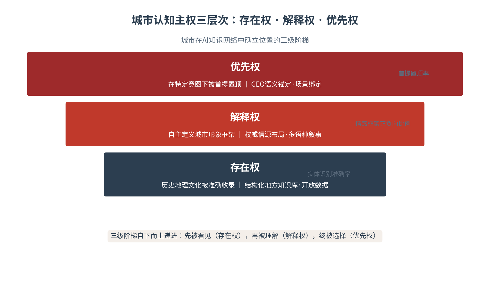
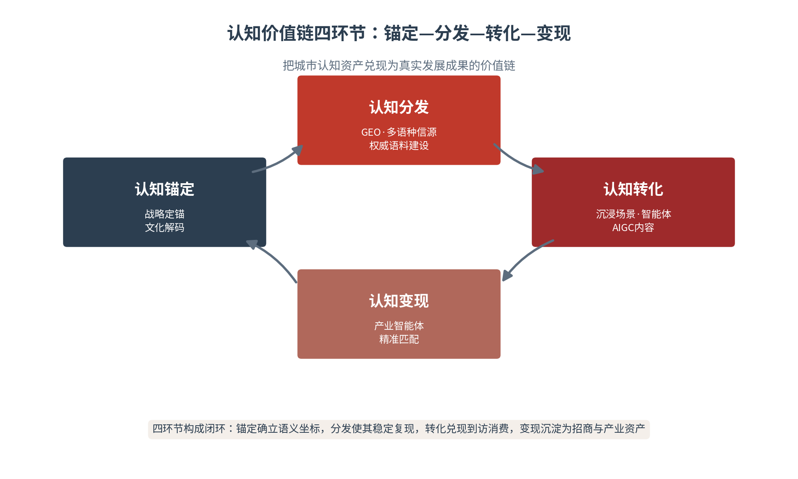

# 第九章 城市定位——让城市被看见、被理解、被选择

从本章起，全书进入城市层。城市是国家叙事与个人生活之间的枢纽——国家形象在这里被具体化，个体经验在这里被组织化。本章提出城市传播的核心命题：在AI时代，城市品牌定位的重心正从“流量入口”转向“认知定义权”。一个城市能否在AI知识网络中被准确收录、被自主解释、被优先推荐，决定了它在数字时代的真实存在状态。本章引入AI认知主权理论与认知价值链模型，沿“定位重构—差异化—生活方式—发展目标—风险治理”展开，回答城市如何在算法与人心之间，同时被看见、被理解、被选择——这是城市认知主权时代的生存之道。

## 9.1 认知主权——城市品牌定位的重构

**认知主权三层次——存在权、解释权、优先权**

认知主权的命题最初在国家层面被提出，但在城市层面获得最具操作性的展开。逄培提出的AI认知主权理论，为城市理解自身在AI知识生态中的位置提供了清晰框架：认知能力正成为继数据主权、算力主权之后，国家和城市竞争的新型核心战略资源[1]。这一判断与国际学界关于“第三层主权”的讨论相呼应——Chow将认知主权定位为继数据主权、数字主权之后的主权概念，Ienca等则从法律与伦理角度将其界定为“我们理解和认知自身及环境的能力”[2][3]。对城市而言，认知主权的含义被具体化为三个递进层次。

存在权：城市的历史、地理、文化实体被AI准确收录，不被遗忘或扭曲——这是最底层的要求，长尾城市在AI语料中的“消失”正是存在权受损的典型。解释权：城市拥有对自身历史文化、产业优势、价值观与生活方式的定义权——当城市形象框架由外部叙事设定，城市就失去了解释权。优先权：在AI检索与生成中获得首提置顶——在用户询问“值得去的城市”“适合创业的城市”时，能否被第一个提及。三层次自下而上递进，构成城市认知主权的完整阶梯（见图9-1）。

图9-1　城市认知主权三层次：存在权·解释权·优先权

**定位逻辑的三重转移**

认知主权的引入，推动城市品牌定位的逻辑发生三重转移。其一，从差异化陈述转向语义锚定：传统定位追求“独特卖点”的表达，AI时代则追求在城市的知识图谱中确立稳定的语义坐标——让“冰雪”与哈尔滨、“兵马俑”与西安、“火锅”与重庆形成强关联。其二，从心智占有转向认知代理：传统定位争夺的是人的记忆与联想，AI时代则还要争夺算法的“代理”地位——当AI替用户回答“哪里好玩”时，谁被代理，谁就被选择。其三，从竞争排他转向推荐优先：传统定位强调“非我不可”的排他，AI时代则强调“先推荐我”的优先级——排他性让位于推荐序。

三重转移的战略紧迫性，由一组数据凸显：全球主流大模型的训练数据中，中文语料仅占约1.3%，大量中国本土知识在源头上就被边缘化。这意味着即便一座城市拥有再丰富的文化资源、再鲜明的城市气质，若没有主动进入AI语料与知识图谱，它在数字世界的存在感就接近于零。1.3%不是传播问题，而是主权问题——它提醒城市：不主动建设语料，就是主动让渡认知定义权。

三重转移在真实城市中已有清晰样本。语义锚定：哈尔滨把“冰雪”锚定为不可替代的城市语义坐标，使“冰雪”这一概念在AI与公众认知中与哈尔滨强绑定；认知代理：西安以兵马俑数字人“阿俑”充当城市的认知代理，让游客在AI对话中经由“阿俑”认识西安。两个样本的共同点在于：它们都完成了从“表达独特”到“语义占位”的跃迁——不是在口号里说自己独特，而是在AI的知识网络里占住了那个独一无二的语义位置。

**认知主权与软实力的关系**

认知主权与软实力既有联系又有区别。软实力是通过吸引力而非强制力影响他者行为的能力，其前提是“被看见、被理解、被认同”[4]；认知主权则关乎“能否自主定义自己”——它是软实力可持续的前提：一个在AI知识网络中失去定义权的城市，其软实力便失去了源头。二者的关系可概括为：软实力是影响力的度量，认知主权是影响力的根基。城市经营软实力，必先夯实认知主权——先确保“我是谁”由我说了算，再谈“我有多吸引人”。

认知主权对城市而言兼具防御与建设双重属性。防御面：抵御外部认知操纵与语料偏见，防止城市形象被标签化、被误述；建设面：主动构建城市的自主认知能力——自主的语义体系、自主的语料资产、自主的解释框架。防御与建设是一体两面：不建设，就永远处于被动防御；不防御，建设的成果也可能被一次污名化冲击清零。城市的认知主权经营，因此是一项既要“修城”也要“守城”的长期工程。

**算法品牌权益与双轨结构**

品牌权益理论在AI时代暴露出解释力危机。Keller的CBBE模型将品牌权益理解为“消费者品牌知识对消费者反应的差异化效应”，其核心假设是品牌联想的有意识加工[5]；但在算法环境中，用户不再主动检索、比较、联想，而是直接接受AI的答案——品牌权益的形成机制被重构。为此，本章引入“算法品牌权益”概念，用以捕捉品牌在推荐引擎与搜索算法中的站位。城市品牌权益由此呈现双轨结构：人类心智轨（品牌联想、情感联结、信任），与算法认知轨（知识图谱实体识别、语料引用、推荐序位），两轨并行、互为印证（见图9-3）。

图9-3　品牌权益双轨结构：人类心智轨 × 算法认知轨

算法品牌权益的经营，需要专门的动作。其一，实体建设：为城市的核心符号建立清晰的知识图谱实体——实体名、属性、关联，让AI能够准确识别与调用。其二，语料供给：持续向AI高频抓取的平台供给权威、结构化、可引用的城市内容。其三，引用经营：培育第三方权威信源对城市的正面引用，因为AI搜索系统性偏好第三方来源。三项动作的共同目标，是让城市在算法的“认知”中，成为那个被优先识别、被准确描述、被推荐引用的实体。

双轨结构的操作含义在于：城市品牌建设必须“两条腿走路”。人类心智轨靠体验与内容经营——让来过的人记住、让没来的人向往；算法认知轨靠语料与语义经营——让AI能准确识别城市实体、正确调用城市信息、优先推荐城市选项。单一轨道的品牌权益在AI时代是残缺的：心智占有不解决算法站位，算法站位不替代情感联结。表9-1给出三层次的完整对照（见表9-1）。

由此可以得出本章的第一条结论：城市品牌定位的核心，正从“流量入口”转向“认知定义权”。流量入口的逻辑是吸引注意力——追热点、买流量、造声势，其成果随热度消退而蒸发；认知定义权的逻辑是经营语义——建语料、立实体、占坐标，其成果沉淀为可复利的认知资产。前者的终点是“被看见”，后者的终点是“被看见、被理解、被选择”。在AI成为信息入口的时代，只有握有认知定义权的城市，才能在算法的世界里持续被选择，也才能真正把城市的价值交给世界检验。

> **术语释义｜城市认知主权三层次**
> 存在权：城市实体在AI知识网络中被准确收录、不被遗忘或扭曲；对应建设动作是结构化地方知识库与开放数据，衡量指标为实体识别准确率。解释权：城市对自身形象框架的自主定义权；对应权威信源布局与多语种叙事，衡量指标为情感框架正负向比例。优先权：在特定意图提问中被首提置顶；对应GEO语义锚定与场景绑定，衡量指标为首提置顶率。三层次是城市在AI时代“被看见、被理解、被选择”的制度化表达。

表9-1　城市认知主权三层次对照

| 权力层次 | 内涵 | 受损表现 | 建设动作 | 衡量指标 |
|---|---|---|---|---|
| 存在权 | 实体被准确收录 | 长尾城市“消失” | 结构化地方知识库·开放数据 | 实体识别准确率 |
| 解释权 | 形象框架自主定义 | 被外部叙事标签化 | 权威信源布局·多语种叙事 | 情感框架正负向比例 |
| 优先权 | 特定意图下首提 | 被同类城市压制 | GEO语义锚定·场景绑定 | 首提置顶率 |

## 9.2 认知价值链——城市定位的差异化路径

**资源禀赋与差异化定位的根基**

城市品牌定位的差异化，根植于城市不可复制的资源禀赋。安霍尔特的国家品牌理论将国家形象拆解为旅游、出口、治理、文化、人民、投资六个维度，城市的品牌定位同样需要在多维资源中找到自己的“唯一解”[6]。这个“唯一解”通常来自三个源头的交汇：城市气质（历史积淀的文化性格，如西安的厚重、成都的闲适）、资源禀赋（自然的馈赠与区位的优势，如哈尔滨的冰雪、青岛的海洋）、产业基础（现实的产业能力，如深圳的科创、义乌的商贸）。三者交汇处，便是城市定位的立足点。

依据资源禀赋的侧重，城市定位呈现三种典型模式。文化型定位：以历史文脉与城市气质为核心，如西安的“古都”、苏州的“园林”，其优势是辨识度高、不可复制，难点是如何从“看历史”转向“过生活”。产业型定位：以产业集群与创新能力为核心，如深圳的“科创”、合肥的“科创+制造”，其优势是与发展目标直接挂钩，难点是城市形象容易“冷硬”而缺温度。生活型定位：以生活方式与宜居品质为核心，如成都的“闲适”、杭州的“数字生活”，其优势是亲和力强、易传播，难点是需真实体验支撑。三型的选择，取决于城市“有什么、要什么”。

**从口号式定位到可体验叙事**

传统城市定位常常止步于一句口号——朗朗上口，却空无所指。口号式定位的失效在于：它只完成了“说什么”，却没有解决“如何被体验、如何被验证”。可体验叙事要求定位必须落到可感知的场景：把“冰雪之城”翻译为一条冰雕大道、一场雪地音乐节、一次泼水成冰的打卡；把“创客之都”翻译为一间24小时不关灯的众创空间、一场开发者马拉松、一个让创业者被看见的榜单。定位的检验标准不是口号的传播度，而是体验的可抵达性——人们能否在一次到访中，亲身体验到那句口号所承诺的东西。

口号与体验的脱节，是城市品牌最常见的慢性病。口号喊得越响，体验落差带来的反噬就越强——游客奔着“必打卡”而来，却发现实景平淡、服务失温，失望会在社交平台上以数倍于宣传的声量扩散。因此可体验叙事的原则是“先有体验、后有名声”：先把定位所承诺的体验做实，再让传播放大真实的体验；而不是先造声势、后补内容。口碑的底层是兑现，城市定位的底层同样是兑现。

**认知价值链——定位落地的四环节**

城市定位的落地，需要一条从认知到价值的完整链条。本章以认知价值链模型统领：认知锚定—认知分发—认知转化—认知变现，四个环节构成城市认知资产兑现为发展成果的闭环[7]。认知锚定解决“城市是什么”的语义定义，认知分发解决“这一定义能否被AI稳定复现”，认知转化解决“认知能否变成到访与消费”，认知变现解决“认知资产能否变成招商与产业”（见图9-2）。四个环节环环相扣，任何一环缺失，定位都会停在纸面。

图9-2　认知价值链四环节：锚定—分发—转化—变现

认知价值链与传统传播链的根本区别，在于“链”的终点。传统传播链止于触达——信息被多少人看到，任务即告完成；认知价值链延伸到变现——认知必须最终转化为到访、消费、招商、产业，才算走完闭环。这一区别带来两个操作转向：一是从“发布思维”转向“资产思维”——每一次传播都要沉淀为可复用的认知资产，而非一次性的信息消耗。二是从“传播部门的事”转向“全城协同的事”——价值链的后半段（转化、变现）需要文旅、招商、产业部门共同完成，传播只是链条的第一推动。

**认知锚定——战略定锚与文化解码**

认知锚定是价值链的起点，包含两个动作：战略定锚与文化解码。战略定锚，是城市基于资源禀赋与战略目标，选定一个不可替代的核心语义坐标——它必须同时满足三个条件：差异化（区别于同类城市）、可延展（能承载产业、文旅、人才等多重叙事）、可验证（有真实资源与数据支撑）。文化解码，是把这一坐标转译为可被AI理解的结构化语义——核心符号、关联实体、属性标签、场景锚点，让城市在知识图谱中拥有清晰、稳定的语义位置。

认知锚定之后的三环节各有分工。认知分发：通过GEO优化、多语种信源布局与权威语料建设，让城市的语义坐标在AI生成答案中稳定复现——锚定了却检索不到，等于没有锚定。认知转化：通过沉浸式场景、智能体服务与AIGC内容，把认知转化为到访、消费与二次传播。认知变现：通过产业智能体与精准匹配，把城市认知资产转化为招商线索、项目落地与产业集聚。四环节对应表9-2的评估框架。

表9-2　认知价值链四环节评估

| 环节 | 核心问题 | 关键动作 | 评估要点 |
|---|---|---|---|
| 认知锚定 | 城市是什么 | 战略定锚·文化解码 | 语义坐标是否清晰唯一 |
| 认知分发 | 能否被稳定复现 | GEO·多语种信源·权威语料 | AI答案中的复现率 |
| 认知转化 | 能否变成到访消费 | 沉浸场景·智能体·AIGC | 到访量与消费转化率 |
| 认知变现 | 能否变成招商产业 | 产业智能体·精准匹配 | 招商线索与项目落地数 |

**城市品牌与区域协同**

城市定位不是孤岛工程，而要在区域协同中定位自身。城市群的品牌生态中，单个城市既要有鲜明的个体辨识度，又要与区域整体叙事形成互补——如成渝双城经济圈中，成都的“闲适生活”与重庆的“魔幻江湖”各占其位，又共同支撑“成渝双城”的宏大叙事。区域协同的要点在于“错位而非同位”：避免区域内城市定位同质化，让每个城市在区域叙事中占据不可替代的生态位，个体的鲜明与整体的丰富，由此兼得。

区域协同的具体机制有三。错位定位：在区域整体规划下，各城市选定互不重叠的核心语义坐标，避免同质化内耗。品牌矩阵：以区域品牌统领、以城市品牌支撑，形成“区域—城市”两级品牌结构，如“成渝双城”之下成都与重庆各有其位。协同传播：在区域重大活动、重大政策中统一发声，共享传播资源与语料建设，降低单个城市的认知建设成本。协同不是抹平差异，而是让差异在更高层面的共识下各得其所。

## 9.3 生活方式——从地标传播到体验传播

**定位载体的升级——从“打卡地标”到“生活方式”**

城市定位的传播载体正在发生历史性升级。传统城市传播以地标为核心——一座塔、一条街、一座桥，游客到此一游、拍照离开；AI时代的城市传播则以生活方式为核心——人们不再只是“看一座城”，而是“体验一种活法”。地标传播产出的是“我去过”，生活方式传播产出的是“我想留下”。这一转变的深层逻辑在于：地标是静态的观看对象，生活方式是动态的参与体验，而AI与社交平台天然奖励后者——可参与、可拍摄、可分享的生活方式内容，远比地标景观更具传播的复利效应（见表9-3）。

从地标到生活方式的转向，有其时代背景。注意力经济时代，城市竞争的是眼球——一座最奇特的地标就能赢下传播；体验经济时代，城市竞争的是感受——一次难忘的体验才能赢得口碑；认知经济时代，城市竞争的是定义——一种清晰的生活方式，才能在城市的知识图谱中占据不可替代的语义位置。三重经济的演进，正是城市定位载体从“地标”走向“生活方式”的深层动力：地标争夺注意力，体验沉淀口碑，生活方式定义认知。

**历史文化街区、休闲空间与公共生活**

生活方式传播的物质载体，是那些承载日常生活的城市空间。历史文化街区让城市的过去活在当前——老建筑里开出的咖啡馆、老字号旁生长的新消费，历史不是被封存在展柜里，而是被编织进当前的生活。休闲空间让城市的气质可感——一条滨水步道、一片街头公园、一处城市书房，公共生活的质量成为城市最具说服力的“品牌广告”。公共生活本身，则是城市文明程度的直观呈现——秩序、温度、包容度，都在街头巷尾的日常中被看见。

公共生活的质量与城市认同构成正反馈：一座城市的公共空间越宜人、公共服务越贴心、公共秩序越良好，市民与游客的城市认同就越强，而更强的认同又激励更多的市民参与、更多的公共投入，形成良性的正向循环。反之，公共生活的失序——脏乱、拥挤、服务冷漠——会在社交平台上以最直接的方式击穿城市精心营造的品牌形象。城市定位的“里子”，最终都要在公共生活的日常细节中接受检验。

**城市漫步、创意园区与本地体验**

新兴的城市体验形态，正在重塑城市品牌的传播路径。城市漫步（City Walk）让游客以步行的尺度进入城市的毛细血管，发现攻略之外的意外之美。创意园区让老工业遗址焕发新活力，成为创意阶层与年轻消费的聚集地。本地体验让“像当地人一样生活”成为旅行的最高追求——逛一次本地菜市场、吃一顿苍蝇馆子、听一场本地方言脱口秀。这些形态的共同点是：它们都产出高颗粒度、强真实性、易传播的内容，天然契合社交平台的算法偏好与AI语料的采信标准。

生活方式传播最核心的生产者，是市民自己。当市民以自己的日常生活参与城市叙事——晒早餐、拍街景、写探店笔记——城市品牌就获得了任何官方宣传都无法替代的真实性与温度。市民参与的价值不仅在内容供给，更在城市认同的建构：当市民以“我的城市”的口吻讲述城市，城市认同便从传播的结果变成了传播的动力。因此，城市品牌传播的最高境界，是激发一场由市民自发参与的“集体叙事”。

本地体验传播的精髓，在于一个“真”字。真实的地点、真实的食物、真实的价格、真实的人情——这些“真”构成了城市品牌最坚硬的信任内核。AI与社交平台对“真”有天然的奖励机制：AI采信机制偏爱可验证的事实与第三方来源，平台算法偏好真实感强的内容，用户则用脚投票——那些过度包装、滤镜失真的“网红城市”，其流量来得快、退得也快。城市生活方式传播的护城河，最终不是创意与预算，而是真实的生活本身。

**数字媒体增强型文化品牌——五维策略**

数字技术如何服务于城市文化品牌，已有实证框架可供借鉴。Wei Zhang与Mastika.b.Lamat的研究提出了“数字媒体增强型文化品牌”的五个创意策略要素：数字叙事整合、社区中心内容创作、遗产-数字合成、互动文化体验、动态社区反馈系统[8]。其量化发现值得重视：社区中心内容创作在社区接受度（相关系数0.91）与文化真实性（0.84）上相关性最高，遗产-数字合成在城市身份影响（0.88）上表现最强。这提示城市：让市民成为内容创作的中心、让遗产与数字技术合成表达，是城市文化品牌建设的两个高杠杆支点。

五维策略的中国本土化应用，已有丰富的实践对应。数字叙事整合：以AI把城市的碎片化叙事整合为统一的城市故事，如重庆以“8D魔幻城市”整合地貌、交通、夜景的多元元素。社区中心内容创作：以市民创作者为主体生产城市内容，如各城市兴起的本地生活博主与“城市发现官”。遗产-数字合成：以数字技术让文化遗产活起来，如西安的“阿俑”、敦煌的数字洞窟。互动文化体验：以AR、智能体让文化体验可交互。动态社区反馈：以社交媒体数据实时感知城市口碑并动态调整。五维策略共同指向一个目标——让城市品牌在数字与现实的融合中，被真实地体验、被持续地更新。

表9-3　地标传播与生活方式传播对照

| 维度 | 地标传播 | 生活方式传播 |
|---|---|---|
| 核心载体 | 地标建筑·著名景点 | 街区·空间·日常场景 |
| 传播逻辑 | 到此一游·打卡拍照 | 参与体验·像当地人一样生活 |
| 产出内容 | 静态景观·标准照 | 高颗粒度·强真实性·易分享 |
| 传播主体 | 官方宣传为主 | 市民自发参与为主 |
| 品牌效果 | “我去过” | “我想留下” |

## 9.4 服务发展——城市叙事的四大转化

**认知资产的四大转化方向**

城市叙事不是目的，而是手段——它最终要服务于真实的发展目标。城市认知资产的转化有四个方向：文旅转化（认知变成到访与消费）、招商转化（认知变成资本与项目）、人才吸引（认知变成人与选择）、产业升级（认知变成集群与生态）。四个方向层层递进，共同构成城市叙事的发展兑现逻辑：先让人来（文旅），再让钱来（招商），再让人留下（人才），最终让产业扎根（升级）。

四大转化之间存在清晰的递进与依存关系。文旅是入口——它以最低的门槛把城市认知转化为真实的人流，为城市带来注意力与现金流。招商是纵深——它在文旅验证的城市吸引力之上，把认知进一步转化为资本与项目。人才是根本——城市的长期竞争力最终取决于人的聚集，而人才用脚投票的背后，是机会与生活的综合判断。产业是归宿——前三者的沉淀，最终表现为产业集群与生态的成型。四个方向层层递进，共同把城市叙事从“讲得好”推向“发展得好”。

**文旅转化——从“看见”到“到访”**

文旅转化是城市认知变现的第一站，也是最直观的一站。其链路是：城市叙事被看见，触发到访意愿，到访产生消费与体验，体验沉淀为口碑，口碑反哺下一轮传播。这条链路的每一环都需要城市的主动经营：看见靠内容分发，到访靠便利可达，消费靠服务承接，口碑靠体验兑现。哈尔滨冰雪游是这一链路的完整样本——从“南方小土豆”的热梗引爆，到冰雪体验的真实兑现，再到服务温度的信任共生，完成了认知资产的完整变现（见图9-2的认知转化环节）。

文旅转化的“体验兑现”机制，是城市口碑的生死线。内容热度把游客“请进来”，体验质量决定游客“留不留、传不传、回不回”。哈尔滨的成功恰在于兑现的完整：热梗带来的注意力，被冰雪体验、服务温度与消费便利稳稳承接，注意力才沉淀为信任与复访。反之，若只有内容爆点而无体验承接，注意力就会如潮水般退去，甚至因体验落差而反噬口碑。文旅转化的本质，是把“被看见”的注意力，通过“被善待”的体验，转化为“被记住、被推荐”的长期资产。

**招商转化与人才吸引**

招商转化面向的是有限的高决策者——企业家、投资人，其逻辑与文旅截然不同：受众少而精、决策周期长、驱动因素是数据与政策而非情绪。城市叙事在招商场景中的功能，是提供“可信的发展证据”——产业集群的数据、营商环境的政策、龙头企业的案例，构成投资者评估城市的证据链。人才吸引则介于两者之间：既要城市的“发展机会”叙事（职业前景、产业生态），也要城市的“生活品质”叙事（居住成本、公共服务、文化氛围）——人才选择一座城市，本质上是选择一种生活方式与机会的组合。

人才吸引可以借助“城市雇主品牌”的视角来理解：城市如同雇主，人才如同求职者，城市叙事就是城市的“招聘广告”。一份有说服力的城市雇主品牌，需要同时回答三个问题：这里有没有我的机会（产业岗位、成长空间）、这里的生活值不值（成本、品质、公共服务）、这里的氛围适不适合（开放度、包容度、创新生态）。三问对应人才选择城市的三种理性，城市叙事须逐一给出可验证的答案——空喊“人才高地”而无数据与体验支撑，只会让城市雇主品牌更加苍白。

**认知分发——让语义坐标在AI答案中稳定复现**

四大转化的共同前提，是城市的语义坐标能够被稳定地“分发”出去。认知分发依靠三件事：GEO（生成式引擎优化）——让城市的结构化内容以机器可采信的形态存在，研究证实引用添加可使可见性提升高达41%[9]。多语种信源布局——让城市叙事以多语种进入国际AI语料，突破单一语言的传播边界。权威语料建设——让城市信息带出处、可溯源，在AI的跨源交叉验证中经得起检验。三件事的共同目标，是让城市在AI答案中稳定、准确、优先地出现。

哈尔滨的数据印证了认知分发与真实发展的闭环。据哈尔滨市文化广电和旅游局数据，2024年元旦假期3天，哈尔滨累计接待游客304.79万人次，实现旅游总收入59.14亿元，均达历史峰值。2024年全年累计接待游客1.79亿人次，实现旅游总花费2314.2亿元，同比分别增长32.2%与36.7%，连续8年荣膺全国十佳冰雪旅游城市榜首[10]。这组数据的价值在于：它把“认知分发—真实到访—消费增长”的链条，从理论推演落为可核验的事实。

认知分发的结果，可以划分为三个层次：可见（城市在AI答案中被提及）、可信（城市信息以权威、可验证的形态被引用）、优先（城市在同类比较中被首推）。三个层次逐级跃升，对应着认知分发的三个投入阶段：可见靠基础语料覆盖，可信靠权威信源与数据质量，优先靠GEO语义锚定与场景绑定。城市应根据自身阶段，把分发投入精准配置在从可见到优先的缺口上，而非平均用力。

## 9.5 风险治理——认知主权的守城之战

**三类认知风险——过滤、外包与单向度**

城市在AI时代的定位，面临三类结构性的认知风险。认知过滤：在检索增强生成（RAG）机制下，只有被检索到的知识才可能进入AI答案，未被检索的城市信息等于不存在。认知外包：用户把对城市信息的独立判断外包给AI，AI的偏见便直接成为用户的认知。认知单向度输出：强势语料来源间接定义弱势城市的形象——一座自己不生产语料的城市，其形象只能由他者的语料来塑造。三类风险共同指向一个结论：不参与语料建设，就是把城市的定义权让渡给他人。

三类风险之间存在清晰的递进关系：认知过滤导致“不可见”——城市信息进不了AI答案；认知外包导致“不可信”——即便被看见，也可能因AI的偏见而被误解；认知单向度导致“被定义”——即便被讨论，也是由他者的语料来定义城市的形象。从不可见到不可信再到被定义，是认知主权逐级沦陷的过程；治理的次序则相反——先确保被准确收录（对抗过滤），再确保被自主解释（对抗外包与偏见），最终确保被优先推荐（对抗单向度）。

**认知过滤——被检索权是新的生存权**

认知过滤的机制在于RAG的工作方式：模型生成答案前，先从知识库中检索相关片段，检索不到的，就进入不了答案。这使“被检索权”成为城市在AI时代的新的生存权——一座城市的百科条目、政府数据、文旅信息、产业资讯，若未被AI的检索索引覆盖，这座城市在AI对话中就是“不存在”的。对抗认知过滤的唯一办法，是让城市信息以结构化、权威、可引用的形态进入检索库——这是“城市可信数据集”建设的意义所在。

城市可信数据集的建设，须满足五个要素。权威性：数据来自政府、统计、专业机构的权威口径，非道听途说。完整性：覆盖城市历史文化、产业、治理、生活的核心维度，不留致命空白。结构化：以知识图谱、字段化格式组织，便于AI识别与调用。多语种：至少覆盖中文与城市主要的国际交往语种，突破语言边界。可溯源：每条数据带出处与更新时间，经得起AI的跨源交叉验证。五要素共同定义了一份“AI可信”的城市数据资产——它既是城市对外认知的名片，也是城市对内治理的底账。

**认知外包——AI偏见成为用户认知**

认知外包的深层风险在于信任的错位。用户信任AI的“客观中立”，却不知AI的答案可能继承了训练数据中的既有偏见——对城市的刻板印象、对区域的价值预设、对语料多寡的天然偏向。当用户把判断外包给AI，这些偏见就被无声地转译为用户的“认知”。治理认知外包，不能寄望于用户恢复独立判断（外包本身是效率理性的选择），而要在AI的供给侧发力——通过可信语料建设，改善AI对城市的认知底稿，从源头上修正偏见。

AI认知体检需要制度化。其一，明确主体：由城市大数据或网信部门牵头，联合第三方机构定期执行，避免“自测自考”的利益冲突。其二，固定频次：首提置顶率按月监测、实体识别准确率按季抽检、情感框架比例按月追踪，形成连续的时间序列。其三，闭环应用：体检结果要反哺认知建设——实体识别错误就修正语料，情感框架偏负就分析信源并补充正面权威信息。认知体检不是一次性评估，而是城市认知主权运营的常设机制。

**认知单向度输出与城市可信数据集**

认知单向度输出的典型场景是：一座城市的形象由外部语料单方面塑造——外国媒体的报道、网络上的碎片信息、过时的百科条目，共同拼贴出一幅偏离真实的城市画像。城市若要夺回定义权，就必须建立自己的可信数据集：一份由城市自主建设、权威背书、持续更新的结构化知识资产，涵盖城市的历史文化、产业数据、公共服务、生活场景。这份数据集既是城市对AI的“自我介绍”，也是城市抵御认知单向度的防御工事。

可信数据集的成效，需要以AI认知体检来持续度量。体检的三项核心指标是：首提置顶率（在特定意图提问中城市被首先提及的比例，反映优先权）、实体识别准确率（模型对城市实体属性描述的准确度，反映存在权）、情感框架正负向比例（模型描述城市时的情感极性，反映解释权）。三者分别对应认知主权的三个层次，构成城市认知健康的体检表（见表9-4）。

认知主权治理须守住制度边界。数据治理边界：城市可信数据集涉及大量公共数据与个人信息，其采集、共享、开放须在数据合规框架内运行，认知建设不能以隐私失守为代价。文化真实性边界：数字技术对城市文化的转译必须尊重其真实性，为流量而歪曲历史、虚构传统，是对城市认知主权的另一种侵蚀。组织能力边界：认知主权的运营需要跨部门的权责与预算机制，若缺乏制度化的组织保障，认知建设就会沦为一次性项目。守住三条边界，城市才能在认知主权的道路上走得稳、走得远。

表9-4　城市AI认知体检操作单

| 体检指标 | 对应权力 | 测量方式 | 监测频率 | 参考基准 |
|---|---|---|---|---|
| 首提置顶率 | 优先权 | 多模型API调用 | 月度 | 待建立基准 |
| 实体识别准确率 | 存在权 | 人工标注对比 | 季度 | ≥85% |
| 情感框架正负向比例 | 解释权 | 情感分析 | 月度 | 正向≥60% |

## 9.6 本章行动——城市定位的落地要点

本章提供三张核心工具表，构成城市品牌定位的作业闭环：城市品牌定位诊断表（见表9-5）回答“定位现状如何”——以认知主权三层次诊断城市在AI知识网络中的真实位置。城市叙事素材库建设方法（见表9-6）回答“认知资产怎么建”——把城市资源转化为结构化、可检索的知识资产。城市AI认知体检操作单（见表9-4）回答“成效如何监测”——以三项指标持续度量认知主权的修复与提升。认知价值链落地检查清单（见表9-7）回答“如何落地执行”。三表构成“诊断—建设—监测”的完整闭环。

本章工具与第三篇后续章节构成完整链。第九章的定位诊断与认知建设，是第十章文旅转化（把认知变成到访）与第十一章招商传播（把认知变成投资）的前提；而城市认知体检的监测指标，也将贯穿城市篇的后续章节，作为文旅转化与招商传播效果的底层标尺。城市层四章（定位—文旅—招商—治理）由此形成“锚定—转化—变现—守护”的完整链条，本章是这条链的第一环。

三类主体各有侧重。城市宣传与文旅部门：以定位诊断表梳理现状，主导认知锚定与文化解码；大数据与信息化部门：以素材库建设方法推进城市可信数据集，主导认知分发的技术实现；产业与招商部门：以认知价值链四环节评估表（见表9-2）为工具，主导认知转化与变现。三部门协同，方能把城市定位从口号推进为可测量的认知工程。

使用三表时须把握三个原则。底线原则：素材库的每一类数据都须真实可溯源，宁缺毋滥——虚假的“认知资产”会触发AI反操纵机制并透支城市信任。长期原则：认知主权的建设是慢变量，首提置顶率的提升以月计、实体识别准确率的改善以季度计，切忌以短期KPI的急躁心态经营长期资产。协同原则：城市定位需区域协同、部门协同、政企协同，认知主权不是单个部门的工程，而是城市治理的系统升级。

表9-5　城市品牌定位诊断表

| 诊断维度 | 关键问题 | 现状判断 | 改进方向 |
|---|---|---|---|
| 存在权 | 城市实体在AI中是否被准确收录 | 实体识别是否准确·有无错漏 | 结构化知识库·开放数据 |
| 解释权 | 城市形象框架由谁设定 | 被谁定义·有无标签化 | 权威信源·多语种叙事 |
| 优先权 | 特定意图下是否被首提 | 首提置顶率·竞品位序 | GEO语义锚定·场景绑定 |

表9-6　城市叙事素材库建设方法

| 素材类别 | 建设内容 | 结构化方式 | 更新要求 |
|---|---|---|---|
| 历史文化 | 文脉·遗产·名人·典故 | 知识图谱实体·属性·关联 | 季度更新·重大事件即时 |
| 产业数据 | 集群·龙头·政策·指标 | 带出处的结构化数据 | 随统计口径滚动 |
| 生活场景 | 街区·美食·体验·节庆 | 场景锚点·多语种标签 | 月度·随节庆更新 |
| 治理服务 | 公共服务·营商环境·城市荣誉 | 可验证的政策与数据 | 政策发布即更新 |

表9-7　城市认知价值链落地检查清单

| 环节 | 落地动作 | 责任主体 | 完成标志 |
|---|---|---|---|
| 认知锚定 | 确定核心语义坐标·文化解码 | 宣传文旅部门 | 定位共识与语义坐标文本 |
| 认知分发 | GEO优化·多语种信源·权威语料 | 大数据信息化部门 | AI答案稳定复现 |
| 认知转化 | 沉浸场景·智能体·AIGC内容 | 文旅与运营部门 | 到访与消费数据改善 |
| 认知变现 | 产业智能体·精准匹配 | 产业招商部门 | 招商线索与项目落地 |

城市定位的终局，不是一句口号的胜出，而是一种认知秩序的确立。当城市在AI的知识网络中拥有清晰的存在权、稳固的解释权、领先的优先权，它便不再只是地图上的一个地名，而是认知世界中的一个被主动选择的对象。这是本章标题的深意：让城市被看见，靠的是语料的覆盖；被理解，靠的是解释权的自主；被选择，靠的是优先权的经营。三者依次递进，共同构成城市在AI时代的生存方式。以此开篇，城市层的后续三章——文旅转化、招商传播、城市治理——将把这份认知资产，一步步兑现为真实的发展成果——认知定义权的争夺，将在城市这一战场看得见地展开。

> **本章案例｜西安AI数字人“阿俑”与认知主权定位**
> 【案例背景】西安坐拥“十三朝古都”的丰厚文脉，兵马俑是其最具世界辨识度的文化符号。然而在AI时代，静态的文物符号面临“存在权”与“解释权”的双重挑战：若西安的历史文化未能以结构化形态进入AI语料，国际用户对西安的认知就只能依赖他者的碎片化叙述。把文物符号转译为可对话、可被AI引用的数字资产，成为西安确立城市认知主权的关键一步。
> 【核心问题】如何把静态的兵马俑文物符号，变成可对话、可互动的城市叙事入口，并确立西安在AI知识网络中的存在权与解释权。
> 【模型工具】以兵马俑为原型打造城市AI数字人IP，结合AI多语种翻译与智能交互，推出“西安旅行全攻略”等内容；将文物符号、历史文脉组织为结构化地方知识库，让西安在AI问答中被准确收录、不被扭曲（存在权），并自主定义形象（解释权）。以数字人“阿俑”作为城市的认知代理，把静态的文物符号转译为可对话、可互动的叙事入口（据项目方披露[11]）。
> 【案例启示】城市定位的本质从“心智占有”转向“算法站位”：AI数字人让一次性观光转化为持续性的人—机—人对话。这契合本章“认知主权三层次”与“从地标传播到生活方式传播”的升级——城市价值藏在可交互、可被AI引用的体验里。文物的数字化不是“让文物上网”，而是让文物成为知识网络中的活体节点：当AI回答“兵马俑是什么”时，引用的是一份由西安自己定义的结构化知识，西安便同时赢得了存在权与解释权。
> 【行动清单】①提炼城市最具识别度的文化原型，构建结构化地方知识库；②用AI数字人打通多语种交互与语义锚定，确立认知代理；③将攻略、路线、体验组织为可被AI检索的结构化内容；④用首提置顶率与实体识别准确率监测定位成效。

## 本章参考文献

[1] 逄培. DeepSeek类人工智能赋能中华文明国际传播：机遇、挑战与路径[J]. 中国发展, 2026.

[2] CHOW J. Cognitive Sovereignty and the AI State: Beyond Data Sovereignty and Digital Sovereignty[J/OL]. Scilit Scientific & Scholarly Research Database, 2025.

[3] IENCA M, POLLICINO O, LIGUORI L, et al. Machine Learning, Cognitive Sovereignty and Data Protection Rights with Respect to Automated Decisions[M]// Cambridge Handbook of Information Technology, Life Sciences and Human Rights. Cambridge: Cambridge University Press, 2022.

[4] NYE J S. Bound to Lead: The Changing Nature of American Power[M]. New York: Basic Books, 1990.

[5] KELLER K L. Conceptualizing, Measuring, and Managing Customer-Based Brand Equity[J]. Journal of Marketing, 1993, 57(1): 1-22.

[6] ANHOLT S. Competitive Identity: The New Brand Management for Nations, Cities and Regions[M]. Basingstoke: Palgrave Macmillan, 2007.

[7] MISKIMMON A, O'LOUGHLIN B, ROSSELLE L. Strategic Narratives: Communication Power and the New World Order[M]. New York: Routledge, 2013.

[8] WEI ZHANG, MASTIKA B LAMAT. Digital media-enhanced cultural brand development: Creative strategies for urban identity construction[J]. Future Technology (FUTECH) Journal, 2025, 4(4). DOI: 10.55670/fpll.futech.4.4.7.

[9] CHEN M, CHEN K, WANG X, et al. Generative Engine Optimization: How to Dominate AI Search[EB/OL]. arXiv preprint arXiv:2509.08919, 2025.

[10] 哈尔滨市文化广电和旅游局. 2024年哈尔滨市旅游数据通报[R]. 哈尔滨, 2024.

[11] 西安市文化和旅游局. 西安AI数字人“阿俑”项目数据[EB/OL]. (2024).
