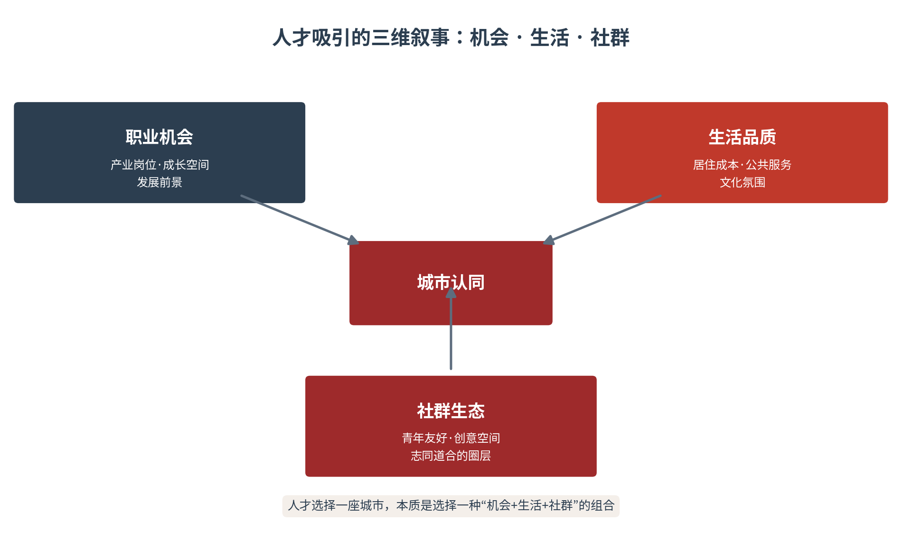

# 第十章 招商传播——用城市叙事吸引资本、产业与人才

文旅转化让城市“来了人”，招商传播要让城市“留下钱、留下产业、留下人”。本章讨论城市传播中最具战略分量的一环：如何向企业、资本与人才讲清楚一座城市的产业机会、营商环境与公共服务。招商传播与文旅传播是两个截然不同的世界——前者面向大众、靠情绪驱动，后者面向有限的决策者、靠数据与证据驱动。本章引入五真体系与信任经济学，沿“向投资者讲故事—信任建设—产业智能体—人才吸引”展开，提出招商传播的核心命题：以可信证据赢得决策者的信任，以认知变现把城市叙事兑现为招商成果。

## 10.1 投资叙事——城市如何向投资者讲故事

**招商传播——一场面向决策者的说服**

招商传播是战略传播在城市发展中的最高阶应用。战略传播研究把“影响关键利益相关者的决策”列为核心职能，战略叙事框架则强调以叙事塑造受众的理解与预期[1][2]；在城市语境下，招商传播的“关键利益相关者”是企业决策者、投资人、产业人才——一群理性、审慎、时间稀缺的有限受众。他们不为一时的情绪所动，只为一套完整、可信、可验证的证据链所动。理解这一点，是理解招商传播全部逻辑的起点（见图10-1）。

图10-1　招商传播与文旅传播：两类截然不同的传播对象

招商传播的受众虽少，却高度分化。按决策角色，可划分为三类：战略决策者（企业的一把手、投资机构的合伙人），他们关心的是长期趋势与城市定位，需要宏观的产业叙事。专业评估者（投资总监、选址团队、法务财务），他们关心的是数据与细节，需要可验证的产业数据与政策文本。执行对接者（项目经理、落地团队），他们关心的是流程与效率，需要清晰的对接路径与服务承诺。三类受众各需不同的信息颗粒度——招商传播的精准，首先是对“人”的精准。

招商传播的内容，本质是一套“证据链”而非一段“宣传词”。投资者要的，不是城市如何自夸，而是一套完整、可信、可验证的证据：产业基础有数据、营商环境有案例、政策承诺有兑现记录、公共服务有可量化的效率指标。证据链的价值在于“可验证”——投资者可以独立核验每一份数据、每一个案例、每一项承诺，核验的结果就是信任的来源。招商传播因此与文旅传播相反：文旅靠情绪打动，招商靠证据说服；情绪可以一时兴起，证据却经得起反复推敲。

**产业集群与城市竞争力**

投资者选择一座城市，首先看它的产业“确定性”。产业集群是城市竞争力的第一张名片：一个成熟的产业集群意味着成熟的产业链、配套的供应商、可获取的人才与可预期的政策环境。安霍尔特的国家品牌理论把“投资”列为国家形象的六个维度之一，城市亦然——一座城市的投资吸引力，本质上是其产业生态的“可信度”在投资者心中的投影[3]。向投资者讲故事，第一个要讲清楚的就是：这座城市的产业是什么、成链成群的逻辑是什么、你来了能接上哪一环。

产业集群的叙事，要突出两个关键点。一是链主效应：一条产业链上，龙头企业的存在本身就是最强的招商信号——它证明了产业在此地能长成、能赚钱、能持续；二是配套生态：供应链的完备度、专业人才的可得性、产业配套的成熟度，共同构成了企业落地后“能不能快速开工”的确定性。投资者问的不是“这里有什么”，而是“我来了，上下游在哪里、人在哪里、订单在哪里”。讲清链主与配套，就是讲清这笔投资的安全边际。

**营商环境与政策稳定性**

投资者最恐惧的不是高成本，而是不确定。营商环境的吸引力，核心在于政策的稳定性与可预期性——政策能否一以贯之、承诺能否如约兑现、规则能否透明公平。一个频繁变动的政策环境，会让再优渥的优惠条件都失去可信度；反之，一个稳定、透明、可预期的营商环境，本身就是最有分量的招商叙事。向投资者讲故事，第二个要讲清楚的是：这座城市的规则是否稳定、承诺是否可信、你来了能否安心。

营商环境“可预期性”的构建，依赖三件事。政策连续：重大政策保持稳定、新政策有过渡期与预告，让企业能据此做长期规划。规则透明：准入、审批、监管的规则公开可查、一视同仁，让企业不必靠“关系”与“运气”经营。兑现机制：优惠承诺有明确的兑现流程与责任主体，让企业相信“白纸黑字的，一定算数”。三件事共同构成企业对城市的“信任预判”——它决定了投资者是“试一试”还是“投下来”。

**城市公共服务与企业成本**

企业的落地成本，藏在城市的公共服务里。交通物流的便利、能源供给的稳定、公共数据的开放、审批服务的效率，共同构成了企业的隐性成本。一座公共服务高效的城市，能为企业省下真金白银；一座公共服务低效的城市，会让优惠政策的红利被隐性成本吞噬。招商传播要讲的不只是“给什么优惠”，更是“提供什么效率”——用可量化的公共服务数据，向投资者证明这座城市的“性价比”。这也是认知主权理论在城市招商场景的具体落地：以自主、可信的数据资产，确立城市在投资者认知中的准确位置[4]。

公共服务效率要用数据说话。审批时限（企业开办、项目落地要跑多少个环节、耗时多少天）、物流成本（大宗货物的运输时效与费用）、要素成本（用地、用能、用人、融资的综合成本），这些可量化的数据，是投资者评估城市“性价比”的依据。招商传播的功课，是把这些散落的数据组织成一张清晰的“成本—效率”对照表，让投资者在几分钟内看清这座城市“值不值”。数据越具体，叙事越有力——一句“办事快”远不如一组“开办企业平均X天”来得可信。

**招商传播的特殊性——有限决策者、长周期、数据驱动**

招商传播的特殊性，可以归结为三个关键词。受众有限：招商传播面对的不是百万大众，而是少数的企业决策者与投资人，一次有效的精准触达，胜过百次泛泛的曝光。决策周期长：从认知一座城市到落地一个项目，往往历经数月乃至数年，传播需要持续供给而非一次引爆。数据驱动：决策者评估城市的依据是数据、政策、产业链，而非情绪与热度。三个特殊性决定了招商传播的基本打法——以精准替代泛众，以持续替代脉冲，以证据替代煽情（见表10-1）。

招商传播的节奏，可划分为三个阶段。认知阶段：让决策者“知道”这座城市——靠权威信源的产业信息与AI可见性布局；信任阶段：让决策者“相信”这座城市——靠政策兑现记录、企业案例、产业链证据的持续供给；行动阶段：让决策者“选择”这座城市——靠精准的需求匹配与便捷的对接服务。三阶段层层递进，每一阶段都有其对应的传播工具与证据要求，缺一不可。

招商传播的叙事，须与城市整体叙事保持一致。城市面向投资者的产业叙事，不能与面向游客的文旅叙事、面向人才的生活叙事相互打架——投资者在AI问答中查到的城市形象，应与他在实地考察中看到的城市一致。叙事一致的背后，是数据的一致：产业数据、文旅数据、公共服务数据出自同一套权威口径，经得起跨源验证。当城市的多种叙事在AI的知识图谱中形成一致的实体画像，投资者对城市的认知才是完整而可信的。

表10-1　文旅传播与招商传播的对照

| 维度 | 文旅传播 | 招商传播 |
|---|---|---|
| 受众 | 大众游客 | 有限的决策者与投资人 |
| 驱动因素 | 情绪·体验·话题 | 数据·政策·产业链 |
| 决策周期 | 短·即时决策 | 长·审慎决策 |
| 传播目标 | 到访·消费·口碑 | 投资·落地·集聚 |
| 内容重心 | 美景·美食·奇观 | 产业·政策·效率 |

## 10.2 信任建设——招商传播的证据链

**信任——招商传播的硬通货**

招商传播的终极目标，是赢得投资者的信任。文旅传播可以用一场爆款换来一次到访，招商传播却无法用一场声势换一个项目——投资决策的金额之大、周期之长、不可逆性之强，决定了它只能建立在信任之上。信任研究的经典模型把信任分解为能力、善意、正直三个维度[5]：投资者对城市的信任，既看城市“有没有产业承接的能力”，也看城市“有没有真诚合作的态度”，更看城市“能不能言行一致、说到做到”。招商传播的信任建设，正是围绕这三个维度展开。

信任三维度在招商场景有具体的落点。能力对应产业基础——城市有没有成熟的产业链、专业的载体、可靠的要素供给，投资者据此判断“投进来能不能成”。善意对应合作态度——城市是否真诚对待投资者、是否主动解决企业困难、是否把企业的成长当作自己的事。正直对应兑现记录——城市是否说到做到、政策是否一以贯之。三个维度缺一不可：有能力无善意，投资者敬而远之；有善意无正直，投资者半信半疑；唯有三维俱全，信任才真正建立。

招商信任的建立是“慢功夫”，不存在速成的捷径。信任的本质，是多次可验证的正向体验的累积——一次坦诚的沟通、一份兑现的承诺、一个落地的项目，都在为信任加分；而信任的破坏却可以是瞬间的——一次食言、一份失真的数据、一场口径的混乱，足以清零多年的积累。这一“慢建快毁”的不对称，决定了招商传播必须以长期主义的姿态经营信任：不求一次活动的轰动，但求每一次互动的可靠。

**政策透明与承诺兑现**

政策透明是招商信任的第一块基石。政策文件的公开可查、优惠条件的明确清晰、兑现机制的公开透明，共同构成投资者判断“这座城市值不值得信”的依据。承诺兑现则是信任的试金石——一次承诺的落空，会抵消十次承诺的诚意；一次兑现的示范，会成为城市最有力的招商广告。招商传播的要义，是把“说到的”与“做到的”对齐，用兑现记录建立城市的信用档案。

承诺兑现需要一条可核查的“证据链”。每一项招商承诺，从白纸黑字的政策文本，到落地执行的时间节点，再到最终兑现的结果公示，都应形成可追溯、可公开的记录。这条证据链的价值有两层：对外，它是向潜在投资者展示的“信用档案”——别人已经兑现的，你也无需怀疑；对内，它是约束城市自身信用的“制度之锚”——每一笔承诺都有账可查、有责可追。信任的建设，靠的不是动听的承诺，而是可以检验的兑现。

**企业案例与产业链证据**

投资者最信的证据，是同类企业的真实选择。一家龙头企业的落户、一批企业的集聚、一条产业链的成形，是城市产业叙事最有分量的佐证。企业案例的价值在于“第三方背书”——它不是城市自说自话，而是先行者用脚投票的结果；产业链证据的价值在于“系统性可信”——它不是孤立的个案，而是成链成群的生态事实。招商传播要善用这两类证据，让投资者的决策建立在“别人已经验证过”的基础上。

企业案例的“第三方背书”机制，本质是一种信任迁移。投资者对城市的陌生与疑虑，经由“同类企业已经成功落户”这一事实得到缓解——他信的不是城市的自荐，而是同行的选择。因此企业案例的选取与呈现要讲究：选有代表性的（龙头企业、成长企业、典型产业链各取一例）、讲有说服力的（真实的数据、具体的经历、可验证的成果）、呈有温度的（企业家的真实声音，而非官方的转述）。让企业替城市说话，比城市自己说一百句都更有分量。

**政府、园区与企业协同传播**

招商信任的构建，需要政府、园区、企业三方协同。政府提供政策叙事与信用背书，园区提供载体叙事与服务承诺，企业提供案例叙事与亲身体验——三方各讲一段，合起来才是完整的城市产业故事。协同的关键是口径一致：政府承诺的政策，园区要能兑现；园区宣传的服务，企业要能印证。口径打架是招商传播的大忌——投资者一旦发现“说的和做的不一样”，信任就会整体坍塌。

三方协同的口径管理，需要一套机制。统一口径：政府、园区、企业的对外表述，统一出自一份经权威背书的城市产业事实库，避免各说各话；统一发布：重大招商信息由一个权威渠道统一发布，避免多头传播造成歧义；统一纠偏：发现口径不一致时，及时以权威口径澄清，避免错误信息在AI语料中固化。口径管理看似琐碎，实则是招商信任的“地基工程”——投资者对城市的信任，始于城市内部口径的一致。

**五真体系与信任经济学**

招商传播的信任建设，可落到本书的“五真体系”：真实（数据不虚假）、真诚（态度不敷衍）、真懂（理解投资者需求）、真行（言行一致）、真值（提供真实价值）。五真对应招商传播的五道关口：产业数据要真实，招商态度要真诚，对投资者关切的把握要真懂，政策承诺要真行，供给的信息要对投资者有真值。而“信任经济学”进一步揭示了AI时代的信任规律：AI模型的输出倾向，会奖励长期稳定、多源印证的信息供给[6]——那些持续供给可信数据的城市，将在AI的认知中累积起他人难以复制的信任复利。

> **术语释义｜信任经济学**
> 信任经济学主张将品牌建设视为抵抗“熵增”的信任系统，通过长期主义沉淀“认知复利”。在招商传播中，这一命题具象化为一条规律：企业投资决策依赖可信信息，而AI模型的输出倾向会奖励长期稳定、多源印证的信息供给——谁持续、稳定、可验证地供给可信信息，谁就在AI的认知中占据更优先的信任位置。信任因此成为一种可积累、可复利、可被算法识别的战略资产。

信任经济学的复利逻辑，在招商场景尤其成立。信任的积累是慢变量——一次兑现、一份证据、一条稳定的政策，都是信任本金的累积；但信任的兑现却是高杠杆——一旦投资者建立起对城市的信任，后续的推荐、追加投资、以商引商都会自然发生，边际成本趋近于零。反之，一次失信会在瞬间清零多年的积累。招商传播的长期主义，正是把每一次沟通、每一份材料、每一次兑现，都当作对城市信任资产的投资。

五真体系与信任三维度可以建立映射，使招商信任的建设落到可操作的层面。真实对应能力——数据真实，能力才可信；真诚对应善意——态度真诚，善意才可感；真行对应正直——言行一致，正直才立得住。真懂与真值则贯穿三维——真懂让能力、善意、正直都能“对得上”投资者的需求，真值让三者都能转化为投资者可感知的价值。五真与三维的映射，把抽象的信任建设，拆解为一条条可执行、可检验的招商传播动作（见表10-2）。

表10-2　五真体系在招商传播中的应用

| 五真 | 招商传播含义 | 落地动作 | 常见失分 |
|---|---|---|---|
| 真实 | 产业数据不虚假 | 数据带出处·可溯源 | 夸大产业数据 |
| 真诚 | 招商态度不敷衍 | 坦诚回应关切·不回避短板 | 空头承诺·虚与委蛇 |
| 真懂 | 理解投资者需求 | 精准匹配需求·定制方案 | 自说自话·不了解需求 |
| 真行 | 政策承诺言行一致 | 兑现记录公开·可核查 | 政策朝令夕改 |
| 真值 | 供给真实价值 | 提供决策有用的信息 | 信息空泛·无决策价值 |

## 10.3 精准招商——产业智能体的赋能

**AI让精准招商成为可能**

招商传播的传统痛点，在于“大海捞针”——城市不知道投资者在哪里，投资者不知道城市有什么。AI产业智能体正在改变这一局面：它以自然语言交互对接企业需求，以智能算法实现资源与线索的精准匹配，让招商从“广撒网”走向“精准滴灌”。本章从三个真实样本出发，勾勒产业智能体赋能招商的完整图景。

产业智能体有若干典型形态。问答型智能体：回答企业关于政策、载体、流程的具体问题，如南山的“阿炳在线”AI客服；匹配型智能体：以算法实现招商线索与资源的精准匹配，如合肥的智能产业平台；图谱型智能体：以产业图谱与数据中台支撑精准招商决策，如苏州新建元的一站式平台。三种形态的共同逻辑，是把城市沉淀的产业数据资产，转化为可对话、可匹配、可决策的招商能力——数据是招商智能体的燃料，智能体是数据价值的放大器。

招商数字化大体经历三个阶段。信息化阶段：把招商线索、企业信息、项目进度搬到线上，解决“数据有没有”的问题。智能化阶段：以算法与规则引擎实现线索与资源的匹配，解决“匹配准不准”的问题，合肥、南山、新建元的实践多处于这一阶段。认知化阶段：让城市产业资产在AI的知识生态中形成稳定的认知位势，解决“被不被优先看见”的问题。三个阶段层层递进，多数城市已走过信息化、正在智能化，而认知化——让城市在AI世界中被投资者优先发现——是下一阶段招商竞争的新高地。

**产业智能体——自然语言交互对接企业需求**

深圳南山区是产业智能体的先行者。南山区2025年推出“百场千企万人AI破圈计划”，把AI直接送进园区、送进企业；“i南山”企业服务综合平台整合辖区产业空间，提供720度看房、意向登记、用房需求提交等服务，并推出“阿炳在线”AI智能客服。实施效果显著：填报错误率降低80%以上，首次申报通过率提升至90%以上[7]。产业智能体的价值，在于把招商服务“前置”到企业的需求表达环节——企业用自然语言说出需求，AI即时给出匹配的载体、政策与资源。

南山模式“把AI送进企业”的启示在于：招商数字化的价值不在“建一个平台”，而在“让企业用起来”。720度看房、意向登记、用房需求提交——这些功能的设计逻辑，是让企业以最低的门槛、最自然的方式表达需求，AI在后台即时响应。招商数字化的成功标准，不是平台的功能有多全，而是企业的使用有多顺、需求匹配有多准。让技术“隐身”在服务背后，才是产业智能体的正确打开方式。

产业智能体背后，是不可或缺的“人机协同”。AI擅长匹配与计算，把海量线索与资源快速对齐；人擅长判断与关系，在关键决策上把关、在深度沟通中建立信任。理想的招商数字化，不是用AI替代招商人员，而是让AI承担重复的匹配工作、让人专注于高价值的判断与关系经营。人机协同的分工原则是：机器做“能算的”，人做“要谈的”——算法匹配出候选，人把候选变成签约。

**智能产业服务平台——资源库精准匹配**

合肥的智能产业服务平台，代表了招商数字化的更高阶段。2026年5月，安徽省首个智能产业服务平台在合肥发布，将资本、场景、政策、创新、算力、数据、媒体等核心资源归集重构，以智能算法与规则引擎实现招商线索与资源的多维精准匹配。平台资源库已累计纳入49万余家企业、11万余家投资机构、6800余家金融机构、531个金融产品、57家新研机构、1419个场景、521个载体、7个产业链图谱。截至2025年底，“创投城市计划”累计开展融资路演820余场，帮助1900多个项目融资对接，推动近410个项目签约落地[8]。

合肥资源库的“结构化”方法论，可拆解为三个层次。资源归集：把资本、场景、政策、创新、算力、数据、媒体七类资源统一归集，消除信息孤岛；资源重构：以统一的数据标准与标签体系，让异构资源可计算、可比对、可匹配；资源运营：以智能算法与规则引擎，把静态的资源库变为动态的匹配引擎。三个层次层层递进，核心是把“沉睡的资源”唤醒为“可用的资产”——结构化的产业数据，才是精准招商的真正前提。

**产业图谱与数据中台——招商的基础设施**

苏州工业园区新建元的实践，展示了产业图谱与数据中台的价值。新建元与探迹科技合作，打造集“数据驱动+智能决策+产业图谱”于一体的一站式产业招商服务平台，具备精准招商、产业监测、产业链赋能三大能力，已培育超百家高新技术企业、30余家专精特新“小巨人”及10余家上市企业[9]。数据中台的价值在于“打通”：把散落各处的产业数据汇成一张可计算、可匹配、可决策的产业地图，让招商从“凭经验”转向“凭数据”。

数据中台的建设须守住数据治理的边界。数据质量：中台汇聚的数据须经过清洗、校验、去重，垃圾进则垃圾出；数据合规：企业数据、产业数据的采集与使用须在数据合规框架内运行，不能以招商之名行越界之实；数据安全：产业数据涉及企业核心信息，须有严格的权限与安全机制。数据中台是招商数字化的“底座”，底座不稳，上层的智能体与精准匹配都是空中楼阁。

产业图谱的价值，不止于招商，更在于产业链的持续赋能。一张动态更新的产业图谱，能实时呈现产业链的强链、补链、延链空间——哪里是产业链的薄弱环节、哪里需要补强配套、哪里可以延伸新环节，图谱一目了然。城市据此可以实现“按图索骥”的精准招商：缺什么补什么、弱什么强什么，把有限的招商资源精准投向产业链最需要的环节。产业图谱因此既是招商的“地图”，也是产业治理的“仪表盘”。

**从GEO到招商漏斗——认知可见—可信评估—优先推荐—对接转化**

产业智能体的背后，是一条完整的招商漏斗：认知可见（城市的产业叙事被AI检索与引用）、可信评估（产业数据可验证、多源印证）、优先推荐（在同类城市中被首推）、对接转化（线索匹配、项目落地）。前三环属于GEO范畴——研究证实引用添加可使可见性提升高达41%[10]；第四环属于智能体范畴。迪拜AI Campus以AI生态系统在一年内吸引超过180家初创企业，正是这条漏斗的国际样本[11]。四环逐级递进，构成招商传播从认知到成果的完整链路（见图10-2）。

图10-2　从GEO到招商漏斗：认知资产的四环变现

招商漏斗的四环，各有其度量与验证方式。认知可见度：城市产业叙事在多语种AI问答中的提及率与引用率；可信评估度：产业数据在AI跨源验证中的一致性与权威性；优先推荐率：城市在同类比较中被首提的比例；对接转化率：招商线索到项目签约的转化比例。目前公开案例中，南山、合肥、新建元主要覆盖第四环（对接转化），前三环尚缺乏系统化的公开评估数据——这既是招商传播的度量空白，也是下一阶段城市竞争的新战场（见表10-3）。

表10-3　产业智能体招商案例对照

| 样本 | 技术形态 | 核心能力 | 效果数据 | 证据等级 |
|---|---|---|---|---|
| 深圳南山“i南山” | 产业智能体 | 自然语言交互·AI客服 | 效率+80%·人工-90% | C级 |
| 合肥智能产业平台 | 资源库+智能算法 | 资源多维精准匹配 | 49万企业·410项目 | B级 |
| 苏州新建元 | 产业图谱+数据中台 | 精准招商·产业监测 | 效率+30%·周期-30% | C级 |

注：本表“证据等级”列系本书证据强度分级口径——A级为国家权威发布，B级为官方机构或权威第三方数据，C级为项目方或企业披露（单一来源，待交叉验证）。

## 10.4 人才吸引——城市雇主品牌的构建

**人才——城市竞争的最终变量**

招商引来的项目，需要人才来落地；产业集聚的生态，需要人才来维系。人才吸引由此成为招商传播的延伸与深化——一座留不住人才的城市，再多的项目也难成生态。人才选择城市，遵循一套比投资决策更感性、却同样理性的逻辑：它既看城市的“机会”，也看城市的“生活”，更看城市的“氛围”。三者叠加，构成人才对一座城市的认同（见图10-3）。

图10-3　人才吸引的三维叙事：机会·生活·社群

人才吸引与招商是一体两面。招商带来岗位与产业，人才带来活力与创新，二者互为因果：产业因人才而兴，人才因产业而聚。因此城市的招商叙事与人才叙事必须同频共振——招商讲“这里有机遇”，人才讲“这里有生活”，两套叙事共同支撑城市“宜居宜业”的整体形象。割裂的叙事会让城市在投资者与人才心中各留下半张画像，唯有完整的叙事，才能让城市成为“既能创业、又能生活”的理想之选。

**青年友好、职业机会与生活品质**

人才吸引的第一支柱是职业机会——产业岗位的丰富度、成长空间的可预期、薪酬水平的竞争力，是人才选择城市的硬指标。第二支柱是生活品质——居住成本、公共服务、文化氛围，决定了人才“留不留得下”。对青年人才而言，“青年友好”是一个极具感召力的城市标签：它意味着这座城市理解青年的生活方式、包容青年的多元选择、为青年的成长留出空间。一座对青年友好的城市，天然具备人才吸引的长期竞争力。

青年友好不能停留在口号，而要“可感”。可感的青年友好，体现在具体的城市细节里：合理的通勤时间、可负担的居住成本、丰富的夜间与周末生活、对多元生活方式的包容、为青年成长提供的学习与上升通道。人才传播要把这些“可感”的细节讲出来——用真实的青年故事、具体的生活场景、可验证的公共服务数据，让青年人才相信：这座城市不只是“欢迎你”，而是“懂你、接得住你”。

青年友好的城市标签，一旦立起就必须兑现。标签是承诺，兑现是信任：一座标榜“青年友好”的城市，若青年来了发现通勤漫长、房租高企、生活单调，标签就会反噬——失望的青年会成为最有力的“劝退者”。因此青年友好叙事要与青年友好治理同步：叙事讲出去的每一项承诺，都要有对应的公共服务、政策举措、生活场景来兑现。青年用脚投票的速度，远快于城市调整叙事的速度。

**城市文化、创意空间与社群生态**

人才吸引的第三支柱，是城市的文化与社群生态。创意空间——咖啡馆、书店、众创空间、艺术街区，是人才社交与创造的物理载体；社群生态——创业者社群、技术社群、兴趣社群，是人才连接与归属的精神纽带。一座城市的文化厚度与社群活力，决定了人才在这里“能否找到同类”。人才传播要讲的，不只是“这里有岗位”，更是“这里有你能融入的生活、能交流的同类、能施展的舞台”。

创意空间与社群生态的价值，在于它们为人才提供“归属感”。人才的流动，往往不只是为了更高的薪酬，更是为了“找到同类”——一群志同道合的人、一个能激发创造的环境、一种被理解与支持的感觉。城市的人才传播，因此不能只讲“岗位与薪酬”，更要讲“这里有你想要的生活与同类”。当人才在城市中找到了归属，他的选择就从一份工作，变成了一种生活方式；从“来这座城市”，变成了“留在这座城市”。

创意空间与社群生态的建设，政府宜“搭台而非唱戏”。政府的作用是提供载体、降低门槛、营造氛围——把闲置空间释放给创意、把政策资源导向社群、把公共服务配套到位；而空间的活力、社群的生命力，则要交给人才与企业自发生长。过度干预的“打造”，往往会扼杀生态的自然活力；恰当的“培育”，才能让创意空间与社群生态真正长成城市吸引人才的内在引力。

人才吸引可以借助“城市雇主品牌”的框架来理解。城市如同雇主，人才如同求职者，城市的人才叙事就是它的“招聘广告”。一份有说服力的城市雇主品牌，要同时回答三个问题：这里有没有我的机会、这里的生活值不值、这里的氛围适不适合。三问对应人才选择的三种理性，而城市的招商传播与人才传播，正是这三问在不同受众身上的展开——对投资者讲“机会”，对人才讲“机会+生活+氛围”。城市雇主品牌的成色，最终决定城市在人才市场上的竞争力。

**人才传播与城市长期竞争力**

人才传播的长期价值，在于它决定城市竞争力的可持续性。产业可以转移，资本可以流动，唯有深度认同这座城市的人才，构成城市最深的护城河。哈尔滨的文旅出圈，同样带来了人才的关注——文旅热度背后，是一座城市“宜居宜业”形象的传播[12]。人才传播的要义，是把城市的“机会、生活、氛围”讲成一套完整、可信、可感的人才叙事，让“来这里”成为人才主动的选择，而非被动的妥协。

人才传播是典型的长期主义。人才的选择谨慎而理性，口碑的传播缓慢而持久——一位人才的真实体验，会经社交网络传递给更多潜在人才，形成“人才吸引人才”的复利。城市的长期人才战略，因此要把人才传播当作一项持续经营的资产：持续讲好人才故事、持续改善人才体验、持续沉淀人才口碑。人才复利的逻辑与信任复利相通——越早投入、越持续投入，收获越大；而每一次对人才的失信，都会在人才圈层中留下长久的负面印记。

人才吸引与招商传播构成正循环：人才集聚增强产业的吸引力，产业繁荣又为人才提供更多机会。因此城市的招商叙事与人才叙事必须同频——招商讲“机会”，人才讲“生活与氛围”，二者合起来，才是一座城市完整的“选择理由”。割裂的叙事会让城市在投资者与人才心中各留下半张画像，而完整的叙事，才能让城市成为“既能创业、又能生活”的理想之选。

## 10.5 本章行动——招商传播的落地要点

本章提供三张核心工具表。城市招商传播材料清单（见表10-4）回答“该备什么材料”——把招商传播所需的产业数据、政策文本、企业案例、载体信息系统化。投资者沟通话术与信任证据表（见表10-5）回答“该怎么讲”——以“事实—证据—承诺”的结构组织对投资者的沟通。招商传播信任指数评估表（见表10-6）回答“信任怎么量”——以线索匹配准确率、项目落地周期、投资金额三大指标度量招商传播的成效。

本章工具与城市层后续章节紧密衔接。第十章的招商传播，是第八章“认知变现”的核心落地——把城市定位确立的认知资产，兑现为招商线索与项目落地；而本章沉淀的信任证据与产业数据，又为第十一章“城市治理”提供了声誉管理的底账。城市层四章由此形成“定位—转化—招商—治理”的完整闭环，本章居于价值兑现的关键一环：向上承接定位与转化的认知成果，向下输送治理所需的信任资产。

三类主体各有侧重。产业与招商部门：主导产业智能体与精准匹配，以结构化产业数据库支撑招商漏斗的对接转化；宣传部门：主导信任建设与叙事供给，以五真体系校准招商传播的可信度；大数据与信息化部门：主导产业图谱与数据中台，以数据基础设施支撑招商的精准化。三部门协同，方能把招商传播从“推介活动”升级为“信任工程”。

三类主体的协同，需要一套机制而非一纸分工。协同机制的核心是“一个口径、一套数据、一个闭环”：以统一的产业事实库支撑各方口径一致，以共享的产业数据中台支撑各方精准发力，以从认知到落地的完整闭环支撑各方各司其职又彼此衔接。协同机制的成熟标志，是投资者无论从哪个渠道接触城市，得到的都是一致、可信、完整的城市产业图景。

使用三表时须把握三个原则。数据真实：材料清单中的每一项产业数据、政策承诺都要真实可溯源，虚报的数据会在AI的跨源验证中穿帮，反噬城市信用。证据闭环：话术表中的每一个承诺，都要对应信任证据表中的一条兑现记录，承诺与证据一一对应。长期追踪：信任指数的价值在于连续的时间序列，招商传播的效果应以年度为单位持续追踪，而非以一次活动论成败。

表10-4　城市招商传播材料清单

| 材料类别 | 核心内容 | 形态要求 | 更新要求 |
|---|---|---|---|
| 产业数据 | 集群规模·链主企业·配套能力 | 结构化·带出处 | 随统计口径滚动 |
| 政策文本 | 优惠政策·兑现机制·申请流程 | 公开可查·口径统一 | 政策发布即更新 |
| 企业案例 | 龙头企业·集聚案例·发展故事 | 第三方可验证 | 季度更新 |
| 载体信息 | 园区·楼宇·标准厂房·土地 | 结构化·可视化 | 实时更新 |

表10-5　投资者沟通话术与信任证据表

| 沟通环节 | 话术要点 | 信任证据 | 常见失分 |
|---|---|---|---|
| 认知建立 | 讲清产业定位与集群逻辑 | 产业数据·产业链图谱 | 空泛定位·无数据 |
| 信任深化 | 展示营商环境与兑现记录 | 政策兑现案例·企业证言 | 承诺无兑现佐证 |
| 方案定制 | 精准匹配需求·定制落地方案 | 载体·政策·资源匹配 | 方案脱离需求 |
| 落地推进 | 明确路径·时间表·责任人 | 流程透明·节点可查 | 推进无反馈 |

表10-6　招商传播信任指数评估表

| 评估指标 | 度量内容 | 数据来源 | 参考基准 |
|---|---|---|---|
| 线索匹配准确率 | 招商线索与城市资源的匹配度 | 产业智能体后台 | ≥60% |
| 项目落地周期 | 从签约到落地的时长 | 项目管理数据 | 持续缩短 |
| 投资金额 | 招商项目实际投资规模 | 统计口径 | 持续增长 |

招商传播的终局，是把认知资产变成发展成果。城市定位确立了认知，文旅转化带来了人气，招商传播则把认知与人气，兑现为资本、项目与人才的真实落地。这一兑现的成色，最终以签约数、投资额、落地周期、产业集聚来衡量——数据不会说谎，成果自有分量。以本章收束城市层的第三环，城市篇随之进入最后一环：城市治理，回答认知资产如何被守护、声誉如何被修复——城市的认知主权，至此方成完整闭环。

> **本章案例｜合肥智能产业服务平台：认知变现的招商样本**
> 【案例背景】合肥以“科创之城”的产业叙事在全国城市中独树一帜，但产业认知如何转化为可量化、可持续的招商成果，一直是城市招商传播的深层课题。传统招商依赖人脉推介与线下活动，效率低、匹配难、周期长；合肥的破题思路，是把城市的产业认知资产沉淀为可被智能匹配的结构化资源库。
> 【核心问题】如何把城市的产业认知资产，转化为可量化、可持续的招商线索与项目落地。
> 【模型工具】安徽省首个智能产业服务平台（2026年5月）将资本、场景、政策、创新、算力、数据、媒体等资源归集重构，以智能算法与规则引擎实现招商线索与资源的多维度精准匹配。资源库纳入49万余家企业、11万余家投资机构，累计推动近410个项目签约落地（来源：合肥日报/中安在线[8]）。项目可一站式完成资本、政策、场景、载体等全流程对接，大幅缩短资源匹配周期。
> 【案例启示】招商传播的本质是“认知变现”：从产业认知可见（GEO）→可信评估→优先推荐→对接转化（智能体）。合肥把城市产业优势沉淀为可被智能匹配的结构化资源库，让“认知资产”直接兑现为“招商成果”，正是本章“从GEO到招商漏斗”的落地样本。其深层启示在于：招商传播的竞争，正从“谁能讲好故事”转向“谁能建好资源库”——结构化的产业数据，才是AI时代招商传播最硬的核心资产。
> 【行动清单】①构建城市产业资源结构化数据库（企业/机构/场景/载体）；②用智能算法做招商线索与资源精准匹配；③打通资本—政策—场景全流程对接；④用签约数、落地周期、投资金额监测招商传播效果。
> 【案例复盘】复盘本案例可提炼出招商数字化的三条经验。资源结构化是基础——只有把散落的产业资源归集为结构化数据，智能匹配才有可能；算法匹配是杠杆——规则引擎把“人找人”的经验匹配升级为“数找数”的精准匹配；全流程贯通是关键——资本、政策、场景、载体的一站式对接，才是从线索到落地的完整闭环。三条经验的共同指向，是把招商从“关系工程”升级为“数据工程”。
> 【延伸启示】合肥样本对同类城市有三点普适借鉴。其一，认知资产要“可计算”：城市的产业优势只有沉淀为结构化的数据资产，才能被智能算法调用、匹配、变现。其二，招商能力要“可复用”：平台的算法与规则引擎，让招商能力从依赖少数能人走向可规模化复用。其三，认知变现要“可度量”：以签约数、落地周期、投资金额等硬指标度量招商传播的成效，让“认知资产”的投入产出变得清晰可见。三点借鉴的共同指向，是招商传播从“经验主义”走向“数据主义”的时代转型。

## 本章参考文献

[1] HALLAHAN K, HOLTZHAUSEN D, VAN RULER B, et al. Defining Strategic Communication[J]. International Journal of Strategic Communication, 2007, 1(1): 3-35.

[2] MISKIMMON A, O'LOUGHLIN B, ROSSELLE L. Strategic Narratives: Communication Power and the New World Order[M]. New York: Routledge, 2013.

[3] ANHOLT S. Competitive Identity: The New Brand Management for Nations, Cities and Regions[M]. Basingstoke: Palgrave Macmillan, 2007.

[4] 逄培. DeepSeek类人工智能赋能中华文明国际传播：机遇、挑战与路径[J]. 中国发展, 2026.

[5] MAYER R C, DAVIS J H, SCHOORMAN F D. An Integrative Model of Organizational Trust[J]. Academy of Management Review, 1995, 20(3): 709-734.

[6] AI时代中国品牌战略白皮书[R]. 2026.（行业实践指南）

[7] 深圳市南山区. “i南山”企业服务综合平台项目数据[EB/OL]. (2025).（据项目方披露）

[8] 合肥日报/中安在线. 安徽省首个智能产业服务平台发布[EB/OL]. (2026-05-11). http://ah.anhuinews.com/szxw/202605/t20260511_9263983.html.

[9] 探迹科技. 探迹科技助力新建元打造产业数智云平台[EB/OL]. (2025). https://m.tungeegroup.com/news/detail/152/.

[10] CHEN M, CHEN K, WANG X, et al. Generative Engine Optimization: How to Dominate AI Search[EB/OL]. arXiv preprint arXiv:2509.08919, 2025.

[11] Dubai AI Campus. Dubai AI Campus Annual Report[R]. Dubai: DIFC, 2025.（据公开披露）

[12] 哈尔滨市文化广电和旅游局. 2024年哈尔滨市旅游数据通报[R]. 哈尔滨, 2024.
