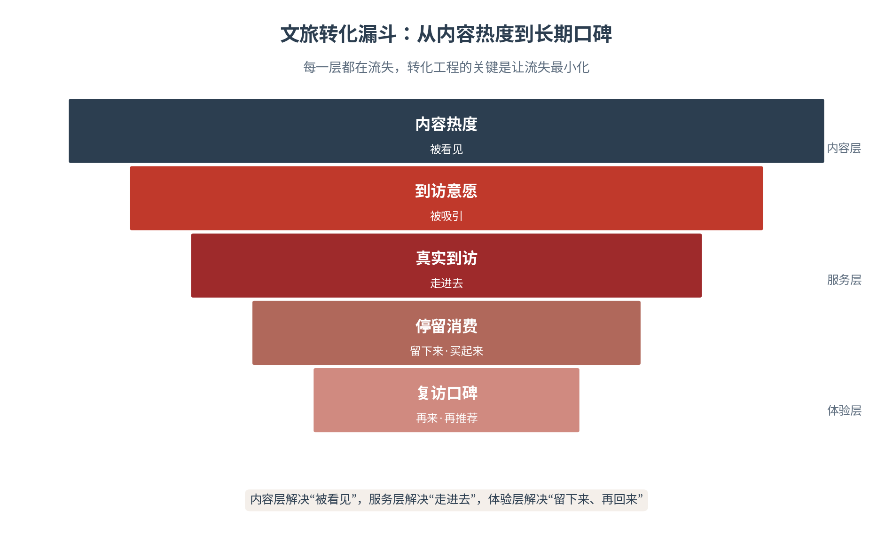
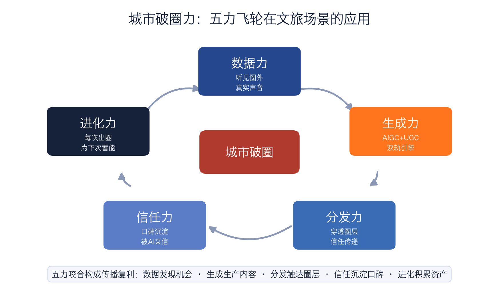

# 第十章 文旅转化——从内容热度到真实到访

城市定位确立之后，第一场硬仗是把认知变成到访。本章回答一个贯穿城市传播的老问题：内容热度如何转化为真实到访、停留消费、复访与长期口碑？文旅传播最易犯的错误，是把流量当终点——爆款刷屏即庆功，热度退潮即归零。本章提出文旅转化的核心命题：热度只是起点，转化才是价值；内容解决“被看见”，服务解决“走进去”，体验解决“留下来、再回来”。以哈尔滨冰雪游为主案例，以“内容—服务—体验—治理”四层转化机制为主线，以五力飞轮为破圈引擎，本章把文旅转化从经验操作升级为可测量、可运营的转化工程——让每一份热度，都流向真实的价值。

## 10.1 内容机制——文旅传播如何出圈

**内容——城市出圈的起点**

文旅传播的起点是内容——一条视频、一场直播、一个热梗，都可能成为城市出圈的引信。哈尔滨冰雪游是近年最完整的一次示范：短视频里的冰雪奇观与“南方小土豆”的热梗，让这座老工业城市在一夜之间站上流量的顶点，元旦假期3天即接待游客304.79万人次、实现旅游总收入59.14亿元，均达历史峰值[1]。但流量从来不是凭空而来，其背后是一条可拆解的传播链路：内容生产供给弹药，平台分发放大声量，城市出圈沉淀IP（见图10-1）。理解这条链路，是理解文旅转化全部机制的入口。

图10-1　文旅内容的传播机制：从内容生产到城市出圈

文旅传播的完整链路，是“注意力—认知—信任—行为”的四级递进。内容制造注意力，叙事塑造认知，服务与体验建立信任，到访与消费兑现行为。四级的每一步都会流失，也都需要专门的经营：注意力靠内容经营，认知靠叙事经营，信任靠体验经营，行为靠服务经营。哈尔滨之所以成为样本，正在于它完整走完了这四级——不是停在“火了”的注意力层，而是一路走到了“来了、花了、还推荐了”的行为层。这一链路，是本章全部转化机制的总纲。

**短视频爆款与城市出圈**

短视频是城市出圈的引爆器。一条爆款短视频的诞生，通常具备三个要素：情绪共鸣（击中某种集体情绪，如对雪的向往、对烟火气的怀念）、视觉奇观（提供超出日常的视觉冲击，如冰雕、夜景、地貌）、身份代入（让观看者想象“我也在那里”）。三要素叠加，触发点赞、转发、模仿的链式反应，最终把一个城市推向全网话题的顶点。爆款出圈的链条是：单点引爆—话题聚合—打卡模仿—线下聚集，每一步都在放大声量、缩短“看见”与“到访”之间的距离。

短视频爆款背后有一套清晰的算法逻辑。平台的推荐机制奖励“完播率、互动率、转发率”三高的内容，这意味着城市文旅内容的形态要适配算法：前3秒抓人（强钩子）、中段给价值（美、奇、情）、结尾留互动（引导评论转发）。理解算法不等于迎合算法——爆款的内容本质仍是真与美，算法只是把真与美放大的杠杆。城市内容团队的任务，是在守住内容品质的前提下，用算法逻辑放大传播效率，而非为流量牺牲城市的真实与格调——格调，是城市内容最深的护城河。

**直播、达人传播与本地内容生态**

直播与达人传播，是短视频之外的两大内容引擎。直播以实时沉浸取胜——镜头前的第一视角让观众产生“身临其境”的临场感，互动性又把单向观看变为双向参与；达人传播以信任背书取胜——达人的推荐自带人格信用，其粉丝对内容的采信度远超官方广告。二者之下，是本地内容生态的持续供给：本地商户、文旅从业者、普通市民共同构成的城市内容网络，是城市文旅内容的“长流水”——爆款靠运气，生态靠经营，前者决定上限，后者决定下限。

本地内容生态的建设，需要制度化的培育。其一，创作者扶持：以培训、流量扶持、创作补贴培育本地的内容创作者，让“城市发现官”“本地生活博主”成为城市的常设内容力量。其二，内容激励：以赛事、榜单、奖励机制激发持续创作，让城市内容供给保持活力。其三，内容中台：建设城市级的内容素材库与创作工具，为各类创作者提供权威、可用的素材底座。本地内容生态的成熟标志，是城市在“无爆款”时仍有稳定的内容声量——生态是城市的“内容免疫力”。

**文旅IP与城市符号**

零散的热点转瞬即逝，稳定的文旅IP才能沉淀为城市符号。文旅IP有三种形态：符号型（一个高度浓缩的视觉或文化符号，如哈尔滨的冰雪、成都的熊猫）、场景型（一个可复现的体验场景，如重庆的洪崖洞夜景、长沙的文和友）、故事型（一段可延展的城市叙事，如西安的盛唐想象）。从战略叙事视角看，文旅IP的本质是城市叙事的人格化与符号化——它让抽象的城市气质变得可感知、可传播、可记忆[2]；数字媒体增强型文化品牌研究则提示，遗产-数字合成与社区中心内容创作是IP建设的高杠杆支点[3]。

文旅IP的培育，遵循从“符号”到“IP”的孵化路径。第一步提炼：从城市资源中提炼最具辨识度、最可延展的核心符号。第二步演绎：为符号注入故事、人格与情感，让符号“活起来”——一个会说话、有性格的城市符号，远比一个静态标识有传播力。第三步运营：通过持续的内容生产、场景落地与跨界联动，让IP从“一次出圈”走向“持续在线”。文旅IP的本质是城市叙事的人格化结晶，它让城市在受众心中从“一个地名”变成“一个可亲近、可记忆的角色”。

文旅IP与城市符号的AI化，是本章承上启下的一环。第九章确立了城市的语义坐标，本章的文旅IP就是这一坐标的“内容化身”——当“冰雪”在AI知识图谱中与哈尔滨强绑定，当用户向AI询问“冬天去哪玩”时哈尔滨被优先推荐，城市符号便完成了从人类心智到算法认知的双轨占位。文旅传播的内容生产，因此不仅面向人，也面向机器——让每一条内容都成为城市语义坐标的一次强化。

文旅内容的“机器可采信”优化，是本章不可忽略的一环。当用户向AI询问“这个城市有什么好玩的”“冬天去哪看雪”时，AI的答案来自训练数据与检索内容的采信——城市的文旅内容若以结构化、权威、可引用的形态存在，就更可能进入AI的答案并被优先推荐。因此文旅内容的生产要兼顾两类受众：面向人的内容求“动人”，面向机器的内容求“可采信”——攻略、路线、体验信息带出处、结构化、多语种，让AI能准确引用。人机并重的内容生产，才能让文旅传播同时赢得人心与算法。

## 10.2 转化三层次——从内容到服务到体验

**热度不等于到访——转化的三层漏斗**

内容热度是文旅转化的前提，但远非全部。热度与到访之间，隔着一道转化漏斗：看见内容的人未必产生到访意愿，产生意愿的人未必真的出发，出发的人未必停留消费，消费的人未必复访与推荐。每一层都在流失，转化工程的目标就是让流失最小化（见图10-2）。这一漏斗对应文旅转化的三层机制：内容层解决“被看见”，服务层解决“走进去”，体验层解决“留下来、再回来”——三层之外，还有治理层为全链条兜底。

图10-2　文旅转化漏斗：从内容热度到长期口碑

转化漏斗每一层的流失，都有数据可察。以文旅传播的一般规律看，内容曝光到点击的流失、点击到搜索的流失、搜索到到访的流失、到访到消费的流失，层层叠加，最终到访转化率往往只是曝光量的一个零头。哈尔滨的数据提供了一个参照：2024年全年接待游客1.79亿人次、旅游总花费2314.2亿元[1]，其背后是海量的内容曝光经多层漏斗后的“有效沉淀”。理解流失的普遍性，才能正视转化的专业性——文旅转化不是“爆了就成”，而是每一层都要精打细算的漏斗工程。

**内容层——AIGC驱动的城市共创**

内容层解决“被看见”的广度与成本。AIGC把城市内容生产的边际成本降到极低，使大规模、多形态、多语种的内容供给成为可能。河南的“AIGC城市共创”项目覆盖全省18个城市，产出5400余篇AI内容，以数字人直播与AI文案推动文旅品牌焕新[4]；南京的《AI你·南京》AI视频在抖音平台获得13.9万观看，以低成本完成了城市形象的传播[5]。这些案例的共同价值在于：AIGC让内容生产从“大制作、长周期”转向“小步快跑、持续供给”，为城市文旅内容生态提供了源源不断的“弹药”。

内容层的打法需要“一城一策”。资源禀赋不同的城市，其AIGC内容策略应有差异：文旅资源富集型城市（如河南、西安）重在“存量激活”——用AIGC把海量文物、遗产、典故转化为海量内容。场景特色型城市（如重庆、长沙）重在“场景放大”——用AIGC把城市地貌、夜景、美食的奇观效应放大。新兴目的地城市（如县域文旅）重在“从零造势”——用AIGC低成本构建城市的基础内容资产。一城一策的背后，是内容生产与城市定位的匹配——内容永远是定位的化身，而非脱离定位的流量游戏。

**服务层——智能体与个性化转化**

服务层解决“走进去”的便利与精准。文旅智能体把城市的服务能力前置到用户的决策环节：杭州的“杭小忆”文旅智能体整合城市数据，实现“千人千面”的个性化推荐，西湖景区的“数字导游”使游客平均停留时间延长至5小时，带动二次消费收入增长30%[6]。新加坡Jewel Changi部署的AI聊天机器人，使邮件咨询量下降50%、电话量减少20%、单次查询成本降低70%以上，同时提升了游客满意度[7]。智能体的价值在于“精准承接”——把被内容吸引来的流量，精准引导到符合其需求的服务与场景中。

文旅智能体有若干典型形态。问答型智能体：回答游客的行程、交通、票务等具体问题，以结构化知识库为底座，如新加坡Jewel Changi的AI聊天机器人。推荐型智能体：根据用户偏好做个性化推荐，如杭州“杭小忆”的“千人千面”。导览型智能体：在游览中提供实时讲解与路线引导，如各景区的“数字导游”。三种形态的共同逻辑，是把城市的服务能力“前置”到用户的决策与体验环节——游客尚未抵达，服务已经到位；游客身在其中，服务如影随形。

**体验层——沉浸式场景与场景革命**

体验层解决“留下来”的沉浸与记忆。沉浸式场景让城市从“被观看”变为“被体验”：重庆的无人机集群表演带来全网传播量110亿次，并直接带动文旅消费增长近30%[8]；首尔的AI短视频在两周内播放量突破180万次，以数字创意激活了城市的文旅叙事[9]。场景革命的核心在于“制造记忆点”——一个让人忍不住拍照、分享、回味的体验场景，既是消费的载体，也是二次传播的起点，把每一次到访都变成下一次传播的素材。

体验层的核心能力，是“可分享性设计”。一个沉浸式场景能否引发二次传播，取决于它是否被设计成“可拍、可晒、可炫耀”——视觉上有没有冲击力（值得拍）、情绪上有没有记忆点（值得发）、社交上有没有话题性（值得聊）。重庆的无人机集群表演，正是“可分享性设计”的极致：奇观级的视觉、震撼的情绪、天然的话题，三者合一，把一次线下体验变成了全网传播的素材。场景即媒体——当体验本身成为传播内容，城市的文旅转化便获得了“体验—传播—新体验”的自增强循环。

体验层的进阶课题，是“记忆点工程”——在游客的整段旅程中，设计若干个值得铭记的瞬间。记忆点不必宏大，而贵在真实与独特：一顿难忘的本地早餐、一次意外的街头演出、一位热心的本地店主、一场恰到好处的雪落。这些瞬间构成了游客对城市的情感记忆，也构成了他们日后向他人推荐城市的理由。记忆点工程的要义，是把“标准化的服务”升级为“有温度的记忆”——服务的及格线是“不犯错”，记忆点的及格线是“被记住”，二者之间，隔着一个城市的用心程度。

**治理层——智慧景区与流量管理**

治理层是转化的“隐形基础设施”，其功能是守住体验的底线。流量一旦集中涌入，交通、排队、安全、服务质量都面临压力，任何一环失守都会击穿体验、反噬口碑。济南探索利用AI视频分析监测客流、智能引导停车、优化服务[10]，哈尔滨则通过大数据与AI对客流进行前瞻预测与动态疏导，动态调整地铁班次、增加景区入口、发布避峰提示，有效缩短游客排队等候时间[1]。治理层的意义在于：它不直接创造热度，却决定热度能否被安全、有序地承接。

治理层面临一个永恒的平衡题：安全与体验的取舍。管控过严，游客体验受损，热度转化为怨气；管控过松，安全隐患累积，一次事故足以毁掉全部口碑。治理的艺术在于“有温度的秩序”——用AI的客流预测、动态疏导把安全前置，用服务的温度化解管控的生硬，让游客在安全的秩序中依然感受到自由与舒适。智慧景区治理的最高境界，是让游客“感受不到治理的存在，却处处被治理所保护”。

**交通、住宿、餐饮与公共服务的承接**

转化链条的“最后一公里”，落在交通、住宿、餐饮与公共服务上。游客的到访体验由无数细节构成：抵达是否顺畅、住宿是否舒适、餐饮是否地道、公共服务是否贴心。任何一处的失温，都会让前面所有环节的努力大打折扣；反之，一处贴心的细节——一条加开的公交、一份暖心的指引、一次及时的投诉处理——都可能成为游客自发传播的素材。文旅转化的最终检验标准，是游客离开时带走的是“还不错”的平淡，还是“还想再来”的牵挂。

承接能力须做“峰值设计”。文旅流量的特点是脉冲式——平日平稳、假日井喷，承接能力若按平均流量配置，必然在峰值时崩溃。峰值设计的三原则：弹性扩容（交通、住宿、餐饮的供给能在峰值时快速扩充）、提前疏导（用AI客流预测把峰值“削峰填谷”，如哈尔滨的动态地铁调度）、兜底保障（峰值时的投诉响应、安全保障、应急机制）。承接能力的峰值设计，是文旅转化从“能接住”到“接得住且接得好”的关键一跃——它决定了游客的峰值体验，也决定了城市口碑的峰值表现——峰值的承接力，就是城市文旅的真功夫。四层机制的全貌，见表10-1。

表10-1　文旅转化“内容—服务—体验—治理”四层机制

| 层级 | 核心问题 | 关键动作 | 典型样本 | 衡量指标 |
|---|---|---|---|---|
| 内容层 | 被看见 | AIGC城市共创·爆款短视频 | 河南18城·南京《AI你》 | 传播量·出圈话题数 |
| 服务层 | 走进去 | 文旅智能体·个性化推荐 | 杭州杭小忆·新加坡Jewel | 停留时长·转化率 |
| 体验层 | 留下来 | 沉浸式场景·记忆点制造 | 重庆无人机·首尔AI视频 | 二次消费·复访率 |
| 治理层 | 守底线 | 智慧景区·客流疏导 | 济南客流监测·哈尔滨疏导 | 投诉率·安全指标 |

## 10.3 长期运营——文旅传播的四季叙事

**流量是潮水，运营是河床**

一次出圈是运气，持续出圈是能力。文旅传播的长期价值，取决于能否把偶发的流量转化为稳定的运营——流量是潮水，有涨有落；运营是河床，决定潮水过后留下什么。只追流量而不修河床的城市，热度退潮后认知资产归零；把流量导入长期运营的城市，则能让每一次出圈都为下一次蓄能。长期运营的课题有三：如何避免透支、如何保持节奏、如何评估成效。

长期运营与短期爆款并非对立，而是辩证关系。爆款是运营的加速器——一次成功的出圈，能以极低成本为城市带来海量关注，是长期运营最省力的“获客”方式；运营是爆款的承接器——没有运营承接的爆款，热度退潮后一无所有。正确的姿态是“以运营待爆款”：平时把内容生态、服务能力、治理体系建设扎实，一旦爆款来临，就能稳稳接住并把流量沉淀为资产。长期运营的价值，恰恰在于让城市“接得住”每一次从天而降的运气。

**避免一次性流量透支**

流量透支是文旅传播最常见的陷阱，其表现有三：体验超载（客流远超承载，排队、拥挤、服务质量下降）、服务失温（短期内大量涌入的游客超出服务能力，价格失序、体验打折）、口碑反噬（负面体验在社交平台扩散，流量退潮后留下信任负债）。透支的根源在于“只做前半程”：内容造势用力过猛，承接能力却未同步建设。避免透支的关键是“能力前置”——在引爆之前，先把交通、服务、治理的承接能力建好，让流量来时有地方去、有服务接、有体验留。

流量透支往往有可识别的预警信号：投诉率上升、排队时长激增、价格异常波动、社交平台负面声量抬头。城市应建立“透支预警—动态干预”机制：当预警信号触发，及时采取限流、分流、增援、价格引导等措施，把透支风险化解在爆发之前。预警机制的价值在于“把危机管理前置”——它让城市不必在口碑崩塌之后亡羊补牢，而是在透支发生之前就主动降温、主动纾解。

**城市活动、节庆与四季叙事**

长期运营需要可持续的内容节奏。城市活动与节庆提供了“内容日历”——音乐节、美食节、马拉松、非遗展演，把城市传播从“等热点”变为“造节点”；四季叙事提供了“内容主题”——春花、夏水、秋叶、冬雪，让城市在每个季节都有新的故事可讲。哈尔滨的冰雪是冬季叙事，成都的火锅与夜生活是全年叙事，西安的盛唐是文化叙事——稳定的内容节奏，让城市的文旅传播从“脉冲式”的爆款依赖，转向“持续式”的生态供给。

四季叙事的要义，是让城市“季季有主题、时时可传播”。哈尔滨的冰雪是冬季的极致，但其“避暑胜地”的夏季叙事同样可以接力——清凉的松花江、音乐之都的夏日节庆，让城市的文旅传播不因冰雪消融而中断；成都则以“全季叙事”见长——火锅、茶馆、公园的闲适生活不挑季节，全年皆有故事。四季叙事不是简单的时间切分，而是把城市的资源禀赋拆解为全年的内容供给——让“来一次”的理由，变成“每季都来”的期待。

**文旅数据与传播效果评估**

长期运营需要数据支撑。文旅转化的核心评估指标有四：访问量增长率（热度是否转化为到访）、停留时长（到访是否转化为深度体验）、二次消费增长率（体验是否转化为消费）、复访率（消费是否转化为忠诚）。四指标构成从“看见”到“忠诚”的完整转化度量。此外，AI可见性监测也应纳入评估——城市在AI问答中的首提置顶率、实体识别准确率，是文旅认知资产在算法世界的“水位线”，研究证实引用添加可使可见性提升高达41%[11]。

文旅数据评估的落地，需要打通“线上数据—线下数据”的归因链路。线上数据（传播量、互动量、AI可见性）回答“被看见了多少”，线下数据（到访量、消费额、停留时长）回答“转化了多少”，二者的归因关联才是文旅转化的真实效率。打通归因的关键是数据闭环：以统一的游客标识、票务系统、消费数据贯通线上线下的行为链条，让每一次传播都能追踪到其带来的到访与消费。没有归因的文旅评估，如同只记投入不记产出的糊涂账。

**三种典型模式——事件驱动型、服务嵌入型、认知基建型**

中国与全球的城市文旅实践，可归纳为三种典型模式。事件驱动型（重庆、河南）：以爆款事件制造流量，优势是见效快、话题性强，风险是可持续性弱，流量退潮后易归零。服务嵌入型（杭州、深圳南山）：以智能体与服务嵌入提升转化效率，优势是效果可测量，风险是传播声量较小，难以制造现象级话题。认知基建型（新加坡、迪拜、合肥）：以语料、知识图谱、认知基建建立长期复利，优势是复利效应显著，风险是投入周期长、短期难见效果。三种模式并非互斥，成熟的城市往往三者兼备（见表10-2）。

三种模式的选择与组合，取决于城市的发展阶段与资源禀赋。缺乏知名度的城市，宜以事件驱动型破局——先制造一次出圈，再承接转化；已有流量基础的城市，宜以服务嵌入型深耕——把流量转化为可测量的到访与消费；追求长期竞争力的城市，则必须补上认知基建型这一课——以语料与知识图谱建立不可替代的认知资产。理想的组合是“以事件引流、以服务转化、以基建蓄能”——三者形成一个从短期到长期的完整能力栈。

三种模式的国际镜鉴同样清晰。新加坡走的是典型的认知基建型——以国家级的AI基础设施与权威语料，让“花园城市”的认知在世界AI系统中稳定复现。迪拜以事件与服务双轮驱动——奇观级的事件制造话题，AI Campus等生态建设承接转化。首尔则以文化IP与数字创意见长——AI短视频把韩流文化转译为全球传播的城市叙事。三者的共同启示是：模式无高下，适配是关键——城市应选择与自身资源禀赋、发展阶段相匹配的路径，而非盲目复制他城的成功模板。

表10-2　文旅传播三种典型模式对照

| 模式 | 代表城市 | 核心打法 | 优势 | 风险 |
|---|---|---|---|---|
| 事件驱动型 | 重庆·河南 | 爆款事件制造流量 | 见效快·话题强 | 可持续性弱·易归零 |
| 服务嵌入型 | 杭州·深圳南山 | 智能体与个性化服务 | 效果可测量 | 传播声量较小 |
| 认知基建型 | 新加坡·迪拜·合肥 | 语料·知识图谱·认知基建 | 复利效应显著 | 投入周期长 |

## 10.4 破圈五力——文旅场景的能力应用

**破圈的本质是五力飞轮**

文旅转化之外，城市还需要一种更主动的能力——破圈力，即让城市叙事穿透既有圈层、抵达更广泛受众的能力。破圈力的内核是本书的五力飞轮：数据力、生成力、分发力、信任力、进化力，五力咬合构成传播的复利机制（见图10-3）。在文旅场景中，五力各有其具体应用：数据力发现机会，生成力生产内容，分发力传递信任，信任力沉淀口碑，进化力积累资产——五力越咬合，城市破圈的复利效应越显著。

图10-3　城市破圈力：五力飞轮在文旅场景的应用

破圈力与文旅转化的关系，是“放大器”与“基本盘”的关系。文旅转化解决的是“来的人能不能留、能不能花、能不能再来”，这是城市文旅的基本盘；破圈力解决的是“让更多人知道、让更多圈层进来”，这是基本盘的放大器。没有基本盘，破圈带来的流量接不住、留不下；没有放大器，再好的基本盘也触达不到更广的受众。二者协同的理想状态，是破圈力持续引入新流量，文旅转化持续把流量转化为资产——一个负责“开源”，一个负责“节流”，共同支撑城市的文旅增长。

**数据力——听见圈外真实声音**

数据力是破圈的起点——先听见圈外的真实声音，才知道破圈的切口在哪里。在文旅场景中，数据力表现为对舆情的监测、对情绪的识别、对机会的捕捉：哪条内容正在升温、哪个话题可能引爆、哪类人群正在被吸引。哈尔滨的出圈，始于对“南方小土豆”这一热梗的敏锐捕捉——它不是城市主动策划的口号，而是被城市及时“听见”并顺势承接的圈外声音。数据力的要义是谦逊：破圈的机会往往来自圈外，而非圈内的自说自话。

数据力的技术实现，依托一套舆情与情绪监测系统。关键词监测捕捉升温话题，情感分析识别情绪走向，传播路径追踪还原热点的扩散网络，三者结合，让城市在热点“将起未起”时就捕捉到信号。但技术只是数据力的工具，数据力的核心是人——是那种放下“官方视角”、真正倾听圈外声音的谦逊姿态。哈尔滨对“南方小土豆”的承接之所以成功，正在于它没有把这句圈外的调侃视为“冒犯”，而是听出了其中的亲近与喜爱，顺势把它变成了城市叙事的共同语言。

**生成力——AIGC+UGC双轮引擎**

生成力是破圈的弹药库——把感知到的机会，快速转化为海量、多元的内容。AIGC与UGC构成双轮引擎：AIGC负责降本增效，以极低成本批量生产多形态、多语种内容；UGC负责增信增效，以用户的真实体验为城市背书，其可信度远超官方宣传。双轮并驱的关键是分工协同：AIGC提供“骨架”——统一的城市叙事与内容模板，UGC提供“血肉”——鲜活的个体体验与真实细节。两者结合，城市破圈才能既有规模、又有温度。

AIGC与UGC的双轮协同，需要明确的分工与激励。AIGC承担“生产基础设施”的角色——批量生成基础内容、多语种版本、适配不同平台格式；UGC承担“真实性引擎”的角色——提供鲜活的个体体验与可信的口碑背书。协同的关键在于“以AIGC放大UGC”：用AI工具降低UGC的创作门槛（一键剪辑、模板化创作），用AI分发放大UGC的传播半径，让更多用户愿意创作、能够创作、乐于传播。双轮协同的最终效果，是城市内容生态既有规模化的供给效率，又有真实性的信任温度。

**分发力——穿透圈层的信任建设**

分发力是破圈的桥梁——让城市叙事穿透圈层壁垒，抵达并打动不同的人群。分发力的实现路径有三：达人连接（借助达人的人格信用，把城市叙事带入其粉丝圈层）、社群连接（通过兴趣社群、本地社群的组织化传播，让叙事在圈层内生根）、跨圈连接（用破圈话题把原本无关的圈层串联，如把“冰雪”从户外圈带向亲子圈、摄影圈、美食圈）。分发力的本质是信任的传递——每一次连接，都是把城市的可信度从一个圈层传递给下一个圈层。

达人网络是分发力的核心资产。一个成熟的城市达人网络，通常分三层：头部达人制造声量（以影响力把城市叙事带入大众视野）、腰部达人深耕垂类（以专业度把城市叙事带入美食、摄影、亲子等细分圈层）、长尾达人维持生态（以持续性把城市叙事融入日常内容流）。三层达人网络的价值在于“连接的全覆盖”——它让城市叙事既有引爆的势能，又有渗透的深度。达人不只合作的要义，是把一次性的投放，变成长期共生的信任关系。

**信任力——把口碑沉淀为被采信的资产**

信任力是破圈的地基——流量能带来一时的到访，只有信任能带来长期的复访与推荐。在文旅场景中，信任力表现为口碑的可验证沉淀：真实的游客评价、兑现的服务承诺、可核查的体验证据，经年累月汇成城市的信任资产；AI时代又多出一层新含义——当游客向AI提问“哈尔滨值不值得去”，AI答案里引用的是谁的评价、哪份榜单，决定了城市在答案层的公信力。哈尔滨的高复访率与“南方小土豆”口碑的延续，正是信任力把线上热度沉淀为线下资产的过程。

信任力的建设路径有三：口碑运营（把分散在各平台的评价体系化管理，及时回应、核实与改进）、承诺兑现（把宣传话术转化为可核验的服务标准，让“说到”变成“做到”）、AI采信建设（把权威文旅信息结构化，让AI在回答城市问题时优先引用官方信息与真实口碑）。破圈带来的流量，只有经过信任力的沉淀，才能转化为城市可长期复利的声誉资产。

**进化力——让每次出圈为下次蓄能**

进化力是破圈的复利引擎——让每一次出圈都为下一次蓄能。进化的路径有三：资产沉淀（把流量沉淀为可复用的内容资产、数据资产、IP资产）、能力迭代（从每次传播中复盘方法、优化打法、升级工具）、生态养成（把单次合作发展为长期共生的内容生态、达人生态、商户生态）。进化力的检验标准是“复访”——城市的下一次出圈，是否比上一次更省力、更精准、更可持续。缺乏进化力的城市，每一次出圈都要从零开始；拥有进化力的城市，出圈的成本递减、收益递增。

进化力所积累的资产，可开列一张清单。内容资产：城市叙事的分层内容库，随取随用、持续更新；数据资产：文旅传播的受众画像、转化数据、效果归因，构成决策的底账；IP资产：城市符号、文旅IP、达人网络等可复用的无形资产；能力资产：沉淀下来的方法、流程、工具与人才。四类资产的共同特征是“越用越增值”——每一次出圈都在为它们添砖加瓦，而它们又反过来降低下一次出圈的成本。进化力，就是把一次次偶然的成功，变成持续可复制的必然。

**事件级、能力级、生态级破圈**

破圈力有高低三个级别。事件级破圈：靠一次爆款事件打破圈层，影响力大但难持续。能力级破圈：靠可复制的能力（内容能力、服务能力、运营能力）持续破圈，稳定性强但需长期投入。生态级破圈：靠一个自我循环的生态（内容—服务—体验—口碑的正向循环）实现“自带流量”的破圈，这是城市破圈的终局形态。三级递进的路径，正是哈尔滨走过的路——从“冰雪热”的事件级破圈，到“服务承接”的能力级破圈，再到“四季文旅”的生态级破圈。

三级破圈的跃迁路径，本质是城市能力的三次升级。事件级破圈检验的是“生成力”——能否造出一个爆款；能力级破圈检验的是“分发力+数据力”——能否持续捕捉机会、持续穿透圈层；生态级破圈检验的是“进化力”——能否让内容、服务、体验、口碑形成自我循环。三级跃迁没有捷径，也不能跳级——没有事件级破圈的经验积累，就没有能力级破圈的方法沉淀；没有能力级破圈的方法沉淀，就没有生态级破圈的复利效应。城市的破圈之路，是一步一个脚印的能力进阶——而所谓破圈，本质就是城市能力的一次次外溢，从圈内溢向圈外、从一地溢向四方。

> **术语释义｜城市破圈力的三个级别**
> 事件级破圈：以单次爆款事件击穿圈层壁垒，特点是爆发力强、持续性强依赖下一个爆款；能力级破圈：以可复制的传播与服务能力持续破圈，特点是稳定但投入周期长；生态级破圈：以内容—服务—体验—口碑的自循环生态实现“自带流量”，是城市破圈的终局形态。三级破圈对应五力飞轮的不同成熟度——事件级靠生成力，能力级靠分发力，生态级靠进化力，而数据力与信任力贯穿始终。

## 10.5 本章行动——文旅转化的落地要点

本章提供三张核心工具表。城市文旅传播转化表（见表10-3）回答“四层转化怎么落地”——把内容、服务、体验、治理四层的动作、责任与指标对齐。文旅内容到线下服务对接清单（见表10-4）回答“线上热度如何接入线下承接”——打通从内容爆款到真实到访的服务链路。城市破圈力五维评估表（见表10-5）回答“破圈能力如何测量”——以四力加转化五维诊断城市的破圈成熟度。三表构成“转化—对接—评估”的完整闭环。

本章工具与城市层后续章节紧密衔接。第十章的文旅转化，是第九章“认知锚定—认知分发”的自然延伸——把确立的语义坐标转化为真实的到访与消费；而本章的转化数据与破圈能力，又为第十一章“招商传播”提供了信任证据与认知资产。城市层四章由此形成“定位—转化—招商—治理”的完整链条，本章居于承上启下的关键位置：向上承接定位的认知成果，向下输送转化的信任证据。

三类主体各有侧重。文旅部门：主导内容层与体验层，以文旅IP与节庆活动经营内容生态；大数据与信息化部门：主导服务层与治理层，以智能体、客流监测构建转化与承接的基础设施；宣传部门：统筹破圈力的四力协同，以数据力捕捉机会、以进化力沉淀资产。三部门协同，方能把文旅转化从“流量工程”升级为“系统工程”。

三类主体的协同，需要一套机制而非一纸分工。协同机制的核心是“一个目标、一张数据表、一个调度会”：以“到访与消费增长”为统一目标，避免各部门各算各的账。以一张共享的文旅转化数据表对齐内容、服务、体验、治理四层的指标，让各部门看到同一份成绩单。以一个定期的调度会协调跨部门动作，及时解决线上线下的衔接断点。协同机制的成熟，是文旅转化从“各自为战”走向“整体作战”的标志。

使用三表时须把握三个原则。数据真实：转化表中的每一项指标都须有真实数据支撑，以“好看”的数据自欺，只会让城市在错误的信号上加大投入。能力匹配：对接清单的每一项线上动作，都要有对应的线下承接能力，线上造势、线下失守是文旅转化最常见的断点。长期主义：破圈力评估的价值不在单次打分，而在连续的追踪——五维能力的提升是慢功夫，需要用时间序列观察趋势，而非用一次评估定优劣。

表10-3　城市文旅传播转化表

| 层级 | 落地动作 | 责任主体 | 完成标志 |
|---|---|---|---|
| 内容层 | AIGC城市共创·爆款内容矩阵 | 文旅部门 | 传播量与出圈话题数达标 |
| 服务层 | 文旅智能体·个性化推荐 | 大数据信息化部门 | 停留时长与转化率提升 |
| 体验层 | 沉浸式场景·记忆点制造 | 文旅与运营部门 | 二次消费与复访率改善 |
| 治理层 | 智慧景区·客流疏导 | 交通·公安·文旅协同 | 投诉率下降·安全达标 |

表10-4　文旅内容到线下服务对接清单

| 对接环节 | 线上动作 | 线下承接 | 常见断点 |
|---|---|---|---|
| 内容→到访 | 爆款内容挂载路线·预订入口 | 交通接驳·票务预约 | 内容无到访入口 |
| 到访→消费 | 智能体推荐·优惠券发放 | 商圈·餐饮·景区承接 | 推荐与实景脱节 |
| 消费→复访 | 会员·复购激励·口碑引导 | 体验兑现·售后保障 | 一次性消费无沉淀 |
| 复访→传播 | UGC激励·二次传播素材 | 打卡点·分享设施 | 无传播设计 |

表10-5　城市破圈力五维评估表

| 维度 | 评估内容 | 衡量指标 | 改进方向 |
|---|---|---|---|
| 数据力 | 听见圈外声音的能力 | 舆情监测覆盖·机会捕捉 | 监测系统·情绪识别 |
| 生成力 | 内容生产的规模与质量 | AIGC+UGC内容量·出圈率 | 内容中台·双轮协同 |
| 分发力 | 穿透圈层的信任建设 | 跨圈传播率·达人网络 | 达人矩阵·社群运营 |
| 进化力 | 复利积累的能力 | 资产沉淀·能力迭代 | 数据资产·方法复盘 |
| 转化力 | 热度到到访的转化 | 到访率·消费·复访率 | 四层机制落地 |

文旅转化的终局，是把流量变成资产。一时的热度会退潮，一次的活动会落幕，唯有把内容热度转化为真实的到访、把到访转化为稳定的复访与口碑、把口碑沉淀为可复用的认知资产，城市文旅才能走出“火一时、冷一时”的循环，走向可持续的增长。这是本章的全部要义：流量是借来的潮水，资产是自己挖的河床——聪明的城市，从不指望潮水常来，而是趁潮水来时，把河床挖得更深、更宽——如此，方能让城市的热度成为长流水，而非一阵风。

> **本章案例｜江苏“苏超”城市足球联赛AI传播**
> 【案例背景】城市文旅转化常面临“有赛事、无热度”或“有热度、无转化”的困境。地方赛事具有天然的社群基础与情感浓度，却往往困于本地圈层，难以转化为跨区域的话题与到访。如何用AI放大地方赛事的传播势能，并把赛事热度导入文旅消费，成为检验文旅转化机制的现实考题。
> 【核心问题】如何把地方赛事热度，转化为“赛事+文旅+消费”的线下转化闭环。
> 【模型工具】用AI二创视频、方言海报、说唱视频和算法分发放大赛事热度。结合AI客流分析推动“赛事+文旅+消费”联动，以内容层（AIGC声量）→服务层（智能承接到访）→体验层（线下消费）三层机制实现从流量到真实到访与消费的转化（据项目方披露[12]）。方言海报与说唱视频以本地文化符号制造记忆点，算法分发则把赛事话题精准推送到异地目标人群，完成从“本地赛事”到“区域话题”的破圈。
> 【案例启示】文旅转化遵循“内容—服务—体验”三层机制，不能停留在爆款热度，而要打通“注意力—认知—信任—行为”的完整链路。AI客流分析与算法分发，是把内容热度转化为真实到访与消费的关键工具，正对应本章“认知变现”。地方赛事的独特价值在于：它自带情感浓度与社群基础，天然具备从“事件级破圈”走向“能力级破圈”的潜质——关键在于用AI把这份情感势能，转化为可承接、可转化、可沉淀的文旅资产。
> 【行动清单】①用AIGC放大赛事与城市内容声量（内容层）；②用AI客流数据预判与承接到访需求（服务层）；③联动文旅、餐饮、住宿做消费转化（体验层）；④把赛事热度沉淀为城市长期口碑资产（进化力）。
> 【案例复盘】复盘本案例可提炼出文旅赛事转化的三条经验。赛事势能要用AI放大——方言、说唱等本地符号经AIGC转译为跨圈内容，是把“本地情感”变成“区域话题”的关键。流量承接要三层贯通——内容层造声量、服务层接客流、体验层促消费，任何一层断链都会让转化功亏一篑。短期热度要长期沉淀——赛事的“高光时刻”转瞬即逝，唯有把赛事热度沉淀为城市口碑与文旅资产，才能让一次比赛成为城市文旅的长期引擎。

## 本章参考文献

[1] 哈尔滨市文化广电和旅游局. 2024年哈尔滨市旅游数据通报[R]. 哈尔滨, 2024.

[2] MISKIMMON A, O'LOUGHLIN B, ROSSELLE L. Strategic Narratives: Communication Power and the New World Order[M]. New York: Routledge, 2013.

[3] WEI ZHANG, MASTIKA B LAMAT. Digital media-enhanced cultural brand development: Creative strategies for urban identity construction[J]. Future Technology (FUTECH) Journal, 2025, 4(4). DOI: 10.55670/fpll.futech.4.4.7.

[4] 河南锐之旗. AIGC城市共创项目数据[EB/OL]. (2025).（据项目方披露）

[5] 南京市文化和旅游局. 《AI你·南京》AI视频传播数据[EB/OL]. (2024).（平台公开数据）

[6] 杭州市文化广电旅游局. “杭小忆”文旅智能体项目数据[EB/OL]. (2025).（据项目方披露）

[7] G20旅游工作组. 2025年主席国文件：新加坡Jewel Changi AI聊天机器人案例[R]. 2025.

[8] 重庆市文化和旅游发展委员会. 无人机集群表演传播数据[EB/OL]. (2025).（据项目方披露）

[9] 首尔市政府. AI短视频传播数据[EB/OL]. (2025).（平台公开数据）

[10] 济南市文化和旅游局. AI客流监测项目数据[EB/OL]. (2025).（据项目方披露）

[11] CHEN M, CHEN K, WANG X, et al. Generative Engine Optimization: How to Dominate AI Search[EB/OL]. arXiv preprint arXiv:2509.08919, 2025.

[12] 江苏省体育局. “苏超”城市足球联赛AI传播项目数据[EB/OL]. (2025).（据项目方披露）
