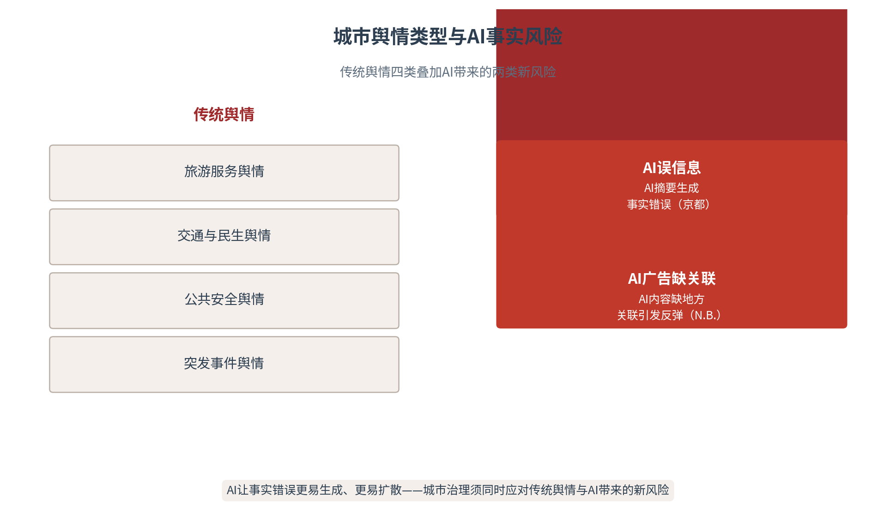
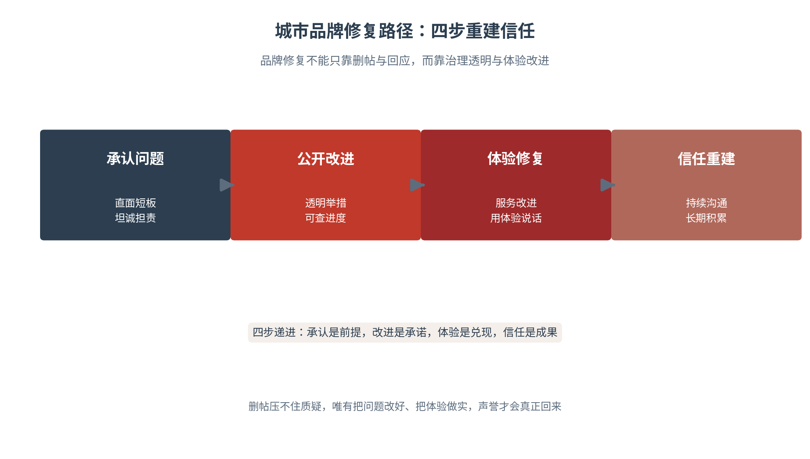

# 第十二章 城市治理——舆情应对与品牌修复

城市定位确立了认知，文旅转化带来了人气，招商传播兑现了价值——而本章处理的是这条价值链的守护命题：当舆情来袭、声誉受损，城市如何应对与修复。城市治理不是城市传播的“附属品”，而是认知资产得以长存的“护城河”。本章提出城市品牌修复的核心命题：修复不能只靠删帖与回应，而要通过治理透明、公共服务改进与持续沟通重建公众信任；并沿“舆情应对—品牌修复—一体化协同—城市共生”展开，把城市治理从危机处置升级为可持续的信任经营。本章亦为第三篇收官之章——守护认知资产，方能让城市的价值行稳致远。

## 12.1 舆情图谱——城市舆情的类型与AI风险

**城市的舆情版图与AI的新风险**

城市的声誉，建立在无数个日常细节之上，也可能毁于某一次突发的失范。战略传播研究把声誉管理列为核心职能，认知主权理论则提示：城市在AI时代面临的声誉风险，既来自传统的舆情事件，也来自AI这一新生变量[1][2]。理解城市的舆情版图，须先看清两件事：传统舆情有哪几类、AI又带来了哪些新风险（见图12-1）——看清版图，才能守住声誉的疆界。

图12-1　城市舆情类型与AI事实风险

**旅游服务舆情**

旅游服务是城市舆情的高发地带。一座城市的文旅热度越高，其服务短板暴露得越快——宰客、拥堵、排队、服务失温，任何一个细节的失范都可能被放大为城市的整体负面形象。旅游服务舆情的特殊性在于“体验即证据”：游客亲历的负面体验，其可信度远超任何官方澄清，会在社交平台以第一人称的形态快速扩散。城市的文旅出圈与舆情风险，是一枚硬币的两面——热度越高的城市，越需要过硬的旅游服务来兜底。

旅游服务舆情的“体验即证据”机制，决定了它的传播力远超想象。一条游客的吐槽视频，因为附带真实的时间、地点、画面，天然具备“现场证据”的说服力；而官方的事后澄清，往往被预设为“辩解”而遭初始折扣。这一不对称提示城市：旅游服务舆情的根除，不在传播端而在服务端——把服务做实，让负面体验无从产生，才是旅游舆情治理的根本。热度的城市需要“热服务”来配“热话题”，服务冷一分，舆情就热一分。

**交通与民生舆情**

交通与民生是城市治理的“基本盘”，也是最易引发舆情的领域。通勤的拥堵、公交的准点、道路的维护、菜价的波动、供热的稳定——这些与市民日常生活直接相关的议题，一旦出现问题，就会迅速转化为对城市治理能力的质疑。民生舆情的特征是“高情感、高关注、易共情”：它不需要复杂的叙事，一个具体的生活场景就足以引发广泛共鸣。治理民生舆情的关键，不在于压制声音，而在于把市民的关切当作改进的信号。

民生舆情的治理，核心在“情感治理”。民生议题的背后，是市民对生活品质的切身感受，其舆情往往带有强烈的情感诉求——不是要一个“官方结论”，而是要一个“被重视的回应”。因此民生舆情的应对，要回应情感而不仅是回应事实：先让市民感到“被听见、被重视”，再给出实质的解决举措。情感治理的要义，是把舆情从“对立”转化为“对话”——市民的抱怨，实则是城市改进最真实的线索。

**公共安全与突发事件**

公共安全与突发事件，是城市声誉的“极限压力测试”。一场安全事故、一次自然灾害、一起公共事件，都会在短时间内集中考验城市的信息发布、应急处置与责任担当。突发事件舆情的特征是高烈度、高时效、高敏感——信息真空会让谣言趁虚而入，处置失当会让公信力瞬间受损。第八章讨论的国家危机治理框架，在城市层面同样适用：第一时间发布、权威口径、事实核验、信任修复，是城市应对突发事件的四件套。

突发事件舆情的最大风险，在于“信息真空”。事件发生后，若权威信息未能第一时间抵达，谣言就会在信息真空中趁虚而入——而谣言的扩散速度，往往数倍于权威信息的跟进速度。因此突发事件舆情的应对，第一要务是“抢占信息真空”：第一时间发布已知事实、明确处置进程、预告后续发布，用权威信息的持续供给，压缩谣言的生存空间。信息真空不是“没有信息”，而是“没有权威信息”——填补真空的，只能是城市自己的权威声音。

**AI生成内容引发的事实错误风险**

AI为城市治理带来了全新的风险维度。京都市政府2025年10月发现，X平台官方服务推送了基于生成式AI摘要新闻文章而产生的关于京都市行政的误信息，市方向X运营公司提出删除请求[3]。这一事件的警示在于：AI对城市信息的“再加工”，可能生成看似权威的错误内容——AI摘要的“客观”外表，反而会放大误信息的可信度。城市治理因此必须直面一个现实：城市的声誉风险，不再只来自人的误传，也来自机器的误读。

AI误信息的识别，是城市治理的新难题。AI生成的误信息，往往“形似而神非”——语句通顺、格式规范、看似权威，却可能在关键事实上出错。公众没有能力逐条核验，而AI的“客观”外表又天然降低了其被质疑的概率。城市治理的应对，须从“被动澄清”转向“主动监测”：建立针对本城的AI内容监测机制，定期扫描主流AI平台对城市的表述，发现错误及时纠偏；同时以权威、结构化的城市语料，从源头上减少AI误读的可能。

京都市事件的另一重启示，在于城市与AI平台之间的协作机制亟待建立。城市的权威信息与AI平台的算法之间，存在一道“信息鸿沟”——城市的澄清要经过一定的流程才能被AI系统采信，而AI的误信息又可能在这一空档期持续扩散。城市应主动建立与主流AI平台、AI服务商的常态化协作渠道：约定误信息的快速纠正机制、权威信息的优先采信机制、城市语料的开放共享机制。让城市的权威声音，在AI的世界里也能“第一时间抵达”。

**AI广告缺乏地方关联性的公众反弹**

AI生成内容还可能因“缺乏地方关联性”而引发公众反感。加拿大新不伦瑞克省N.B. Liquor于2025年12月发布完全由AI生成的节日广告，引发强烈负面反响，当地电影教授将其描述为“创造性侮辱”，指出广告“没有雇用当地的艺术家”且“看起来可以在世界任何地方播出，与新不伦瑞克没有真正的联系”，该省部长随即要求暂停广告[4]。中国台湾地区桃园市的AI观光宣传片也因完全由AI制作而引发舆论批评[5]。这些失败案例的共同教训是：公共资金用于AI内容生产时，文化真实性是底线——Wei Zhang等的研究早已强调数字真实性的重要性，脱离本地真实语境的AI内容，会引发“技术正确、文化失格”的反弹[6]。四类舆情与两类AI风险的完整对照，见表12-1。

表12-1　城市舆情类型与AI事实风险对照

| 类型 | 特征 | 典型案例 | 治理要点 |
|---|---|---|---|
| 旅游服务舆情 | 体验即证据·扩散快 | 宰客·拥堵·服务失温 | 体验承接·服务兜底 |
| 交通民生舆情 | 高情感·易共情 | 通勤·供热·菜价 | 倾听关切·改进信号 |
| 公共安全舆情 | 高烈度·高时效 | 事故·灾害·事件 | 权威发布·快速处置 |
| AI事实风险 | 机器误读·难识别 | 京都AI误信息 | 事实核查·内容标识 |

## 12.2 应对机制——城市舆情的分级响应

**早发现、快回应、可验证**

城市舆情应对的第一原则，是“早发现、快回应、可验证”。早发现：以AI舆情监测实现对负面信息的早期预警，在危机“崩塌之前看见裂缝”；快回应：抢在谣言定型之前发出权威声音，让真相跑在谣言前面；可验证：回应的每一条信息都真实可查，经得起公众与AI的交叉核验。三个原则环环相扣：发现得早，才能回应得快；回应得快，还要回应得准——而“准”的保障，正是可验证。

“早发现”的技术实现，依托一套AI舆情监测系统。关键词监测捕捉负面信息的萌芽，情感分析识别情绪走向，传播路径追踪判断扩散风险，预警分级触发相应级别的响应——哈尔滨的文旅企业曾在冰雪季通过AI监测实现“7×24小时”的全网舆情监测。但技术只是“早发现”的工具，真正的“早”还依赖人的敏锐：把监测到的信号，及时转化为处置的行动。发现得早而不行动，等于没有发现——感知的价值，在于它触发了行动。

**政府部门、媒体与平台协同**

城市舆情应对不是单个部门的事，而是一场多方协同。政府部门提供权威信息与处置行动，媒体提供公开报道与舆论引导，平台提供信息治理与算法协同——三方各司其职又相互支撑。协同的关键是“统一入口、统一口径、统一出口”：由一个牵头部门统筹信息，以权威口径统一各方表述，经统一渠道对外发布。口径打架是舆情应对的大忌，它会让公众对城市的治理能力产生更大的质疑。

三方协同需要清晰的责任边界。政府部门的责任是“供信息”——提供权威、准确、及时的信息源；媒体的责任是“作报道”——以专业、客观的报道引导舆论；平台的责任是“管生态”——以算法治理、内容审核维护信息生态的秩序。三方的边界清晰，协同才有效率；边界模糊，则容易陷入“都管都不管”的困境。协同的成熟标志，是三方在各自的边界内高效运转，又在危机时刻无缝衔接。

平台的算法治理，是三方协同中技术含量最高的一环。平台须以算法识别、内容审核、辟谣机制等技术手段，抑制谣言的扩散、放大权威的声音。其协同要点有三：一是降噪，对明显失实的内容做降权、标注或下架；二是加权，对权威来源的信息做优先呈现；三是溯源，协助追踪谣言的源头与扩散路径。平台的算法治理，本质是把“技术中立”转向“技术有责”——算法既可能放大谣言，也应成为抑制谣言的力量。

**从事件处置到制度改进**

高水平的舆情应对，不止于“处置事件”，更在于“改进制度”。一次舆情的发生，往往暴露了城市治理中的某个制度漏洞或能力短板；若处置止于“灭火”而不触及“病灶”，同样的舆情必然会再次发生。因此舆情应对要建立“事件处置—制度改进”的闭环：处置当前的危机，复盘深层的成因，把教训转化为制度安排。让每一次舆情都成为城市治理的一次升级，才是舆情应对的真正价值。

“事件处置—制度改进”闭环的落地，需要一个制度化的复盘机制。每次重大舆情处置后，由牵头部门组织复盘：复盘危机的成因（为什么发生）、回应的得失（应对得怎么样）、制度的缺口（暴露了什么短板）、改进的举措（下一步怎么改）。复盘的结果要落到具体的制度安排——修订预案、优化流程、补齐能力，而非止于一份总结报告。让复盘成为城市治理的“免疫系统”，城市才能在一次次舆情中变得更稳健。

**24小时首次回应＋48小时处置方案**

舆情应对有明确的时间标尺。24小时内发布首次回应：告知公众“城市已知晓、正在调查、将及时公布进展”，用第一时间的态度稳住舆论场；48小时内给出处置方案：在核实事实的基础上，公布调查结果、整改措施与责任认定，用实质性的行动回应公众关切。这一“24小时+48小时”的节奏，来自危机传播的“黄金时间”经验——回应越早、越实，修复的成本越低（见表12-2）。

“24小时+48小时”的时间尺度，需要结合事态灵活把握。重大突发事件，首次回应应更快，甚至做到“分钟级”的初步表态；一般性舆情，则可在核实后从容回应，避免仓促出错。时间标尺的意义不在机械执行，而在倒逼响应机制的建设——城市须在平时就预置好响应流程、沟通模板与责任分工，才能在危机来临时“按图索骥”地快速响应。时间标尺是底线，能力储备是保障。

**事实核查机制与AI内容标识**

AI时代的事实核查，多了一层新内涵。除了传统的事实核验（多源交叉、权威背书、分级确认），城市还要应对AI生成内容带来的事实风险：建立AI内容的事实核查机制，对AI生成的涉及城市的信息做准确性把关。推动AI内容的标识制度，让公众能识别内容的生成来源。建立与平台、AI服务商的协作机制，及时纠正AI系统中的城市误信息。京都市对X平台的删除请求，正是这一新机制的雏形[3]。

AI内容标识的制度建设，须多方协同推进。生产端：推动AI内容生产者对生成内容做明确标识，让公众能识别“这是AI生成的”；平台端：要求平台对AI生成内容做标识与提示，避免误导公众；城市端：对涉及本城的AI内容建立监测与纠错机制，及时发现并纠正AI系统中的错误信息。标识制度的价值，在于把“AI生成”与“事实”区分开——让公众知道信息的来源，才能正确地判断信息的可信度。

表12-2　城市舆情分级响应表

| 响应等级 | 判定标准 | 响应主体 | 时限要求 | 处置要点 |
|---|---|---|---|---|
| 一级（重大） | 公共安全·突发·大范围 | 市级统筹·多部门联动 | 24小时首回应 | 统一口径·持续供给 |
| 二级（较大） | 涉面广·情绪聚集 | 区级牵头·部门协同 | 48小时处置方案 | 分级核验·跟进回应 |
| 三级（一般） | 局部议题·扩散可控 | 属地处置·线上引导 | 72小时内回应 | 属地化解·防升级 |
| 四级（苗头） | 潜在风险·未扩散 | 属地监测·研判预警 | 即时监测 | 前置干预·防发酵 |

## 12.3 品牌修复——从承认到重建

**修复不是删帖，而是重建信任**

城市品牌的修复，是一场信任的重建。信任研究的经典模型提示，信任由能力、善意、正直三维构成[7]：城市品牌受损，往往三维并伤——处置失当伤能力，冷漠推诿伤善意，前后不一伤正直。因此品牌修复也必须三维并进，其路径可归纳为四步：承认问题、公开改进、体验修复、信任重建（见图12-2）。四步的共同逻辑是——删帖压不住质疑，唯有把问题改好、把体验做实，声誉才会真正回来。

图12-2　城市品牌修复路径：四步重建信任

信任三维度在品牌修复中的受损，各有其表现。能力受损：城市的治理能力被质疑——“这样的城市管得好吗”；善意受损：城市的态度被寒心——“这座城市在乎我们吗”；正直受损：城市的言行被失望——“说一套做一套”。三者的修复难度依次递增：能力可以靠投入快速补齐，善意需要态度的持续积累，正直只能靠一次次言行一致的兑现。品牌修复的评估，因此不能只看舆情是否平息，更要看三个维度各恢复了多少。

**承认问题与公开改进**

品牌修复的第一步，是坦诚承认问题。回避、否认、推诿，只会让质疑在信息真空中发酵；坦诚面对问题、明确表达态度，则是修复信任的起点。承认之后是公开改进：把整改的举措、进度、结果公之于众，让公众看到城市“真的在改”。公开改进的价值在于“可验证”——公众能对照整改台账核验承诺的兑现，这种可验证的改进，远比空洞的表态更能重建信任。

承认问题的“度”，需要审慎把握。坦诚承认不等于全盘自我否定——承认的是具体的问题与责任，而非否定城市的全部价值；过度自贬非但不能赢得好感，反而会放大负面形象。恰当的承认是“就事论事的坦诚”：准确界定问题的性质与范围，明确承担应负的责任，同时传递“城市有能力、有决心改正”的坚定。承认的姿态，应是“认错而不失格、担责而不失态”——坦诚与担当并存，才是修复信任的正确起点。

**用服务体验修复形象**

品牌修复最有力的方式，不是言语，而是体验。当公众在一次实际的服务中感受到城市的改进——更畅通的交通、更贴心的服务、更高效的治理——负面印象才会真正松动。服务体验修复的逻辑，是把“说得好”转化为“做得好”：城市品牌的说服力，最终来自游客与市民的真实感受。哈尔滨的文旅出圈正是如此——它没有靠口号自证，而是靠服务温度与体验兑现，把注意力沉淀为信任[8]。

服务体验修复的“可感知”设计，是关键所在。修复的改进若“无声无息”，公众无从感知，信任也无从重建；唯有让改进“可感知”——一条更畅通的路、一次更高效的办事、一处更贴心的服务——公众才能在亲身体验中重新校准对城市的认知。可感知的改进，本身就是最强的品牌叙事：它不需要任何口号，就能让“城市在变好”成为公众的共识。

**长期信任重建与传播复盘**

品牌修复是长周期工程。一次成功的危机处置，未必能立刻重建信任；但一次失败的处置，足以让多年积累的信任清零。因此长期信任重建，需要持续的经营：持续的改进、持续的沟通、持续的正面体验供给，让信任在日积月累中缓慢修复。与之配套的是传播复盘——复盘危机的成因、回应的得失、修复的成效，把教训沉淀为城市治理的制度资产。复盘的意义，在于让城市“不在同一个地方跌倒两次”。

传播复盘须回答四个问题。成因之问：危机因何而起，是偶发事件还是制度缺陷；回应之问：回应的时机、口径、方式是否得当，有哪些失分；修复之问：修复的举措是否落实、体验是否改善、信任是否回升；改进之问：下一步的制度改进与能力建设是什么。四问层层深入，把一次危机的处置，转化为城市治理的一次系统升级。复盘的价值，在于让危机“物有所值”——学费不能白交。

**AI叙事真实性危机——文化契合度的审慎评估**

AI时代的品牌修复，还面临一个独特的风险——AI叙事真实性危机。N.B. Liquor与桃园市的教训提示：公共资金用于AI内容生产时，须审慎评估其文化契合度[4][5]。一个脱离本地真实语境的AI宣传片，非但不能修复品牌，反而会引发“技术正确、文化失格”的二次伤害。因此城市的AI内容生产，必须守住文化真实性的底线——AI是工具，真实性是内容，工具永远不能替代内容本身的文化根基。

AI叙事真实性危机的治理边界，在于文化契合度的审慎评估。AI内容生产的效率诱惑巨大，但城市品牌的内容，本质是“这座城市的文化表达”——脱离了本地真实语境的AI内容，即使技术上完美，也会因“文化失格”而适得其反。因此城市在采用AI生产品牌内容时，须建立“文化契合度”的前置评估：内容是否植根于本地真实的文化、是否能被本地人认同、是否经得起“这是不是我们”的检验。技术可以加速，文化不能速成。

## 12.4 一体化协同——品牌、文旅、招商的贯通

**城市传播的整合难题**

城市传播的一个长期痛点，是“各说各话”：文旅部门宣传“休闲之城”，招商部门强调“制造强市”，宣传部门主打“历史名城”——三套叙事各行其是，在AI的知识图谱中生成相互矛盾的城市描述。安霍尔特的城市品牌理论早已提示，城市的品牌形象是一个整体，需要六维度的统一经营[9]；在AI时代，这一整合的必要性更为迫切——因为AI会把城市各部门的碎片化叙事，拼贴成一份自相矛盾的城市画像。

城市叙事分裂的危害，在AI时代被显著放大。传统媒体时代，城市各部门的叙事各行其道，受众还能通过不同渠道分别接收；AI时代，用户的一次提问，AI就可能把城市多个部门相互矛盾的表述“拼贴”进同一个答案——一会儿说“休闲之城”，一会儿说“制造强市”，让用户对城市形象无所适从。叙事的碎片化，最终会以“认知的矛盾化”反噬城市——一个自我矛盾的城市，无法在AI的认知中形成清晰、可信的实体画像。

**组织协同——从多头管理到统一品牌治理**

组织协同是整合的前提。多头管理、各管一摊的体制，是城市叙事分裂的根源。破解之道是参考纽约市“NYC & Company”模式，成立城市品牌办公室：一个统筹城市品牌定位、叙事口径与传播资源的专门机构，协调文旅、招商、宣传等部门的对外表述。品牌办公室的核心职能不是“统一所有声音”，而是“统一一套口径”——让各部门在各自的场景里发声，却讲述同一个城市故事。

品牌办公室的职能边界，须把握“统一口径而非统一声音”。品牌办公室要统一的，是城市的定位、叙事主线与关键事实口径，而非所有部门的每一句话；各部门在统一口径的框架下，仍可结合自身场景灵活表达。过度集权会把城市叙事变成“一言堂”，失去多元的活力；适度统一则让多元的叙事在共识下各得其所。品牌办公室的智慧，在于找到“统一”与“多元”之间的平衡点。

**数据协同——一套数据资产服务多目标**

数据协同是整合的底座。城市的品牌、文旅、招商传播，看似面向不同的受众、讲不同的内容，底层却共享同一套数据资产——城市的历史文化数据、产业数据、公共服务数据。数据协同的要义，是“用同一套数据资产服务多个目标”：一份产业数据，既服务招商的证据链，也服务城市叙事的素材库，还服务AI认知的语料库。此外，A/B测试在GEO语境下有了新含义——不仅是测试人类受众的反应，也是测试模型对不同表述方式的引用倾向[10]，以数据驱动城市叙事的持续优化。

数据协同的技术实现，依托统一的数据中台与数据标准。数据中台把散落在各部门的城市数据汇聚为一张可共享的数据底座，消除信息孤岛；统一的数据标准让异构数据可互通、可比对、可复用，避免“各做各的、对不上账”。数据协同的难点不在技术而在治理——数据的归集、共享、开放涉及部门利益与数据安全，需要明确的制度安排与责任界定。数据中台是城市传播的“底座工程”，底座越牢，上层的一体化协同越稳。

**内容协同——一次生产、多场景复用、多语种分发**

内容协同是整合的落地。城市传播的内容生产，应追求“一次生产、多场景复用、多语种分发”：一次高质量的城市内容，经结构化处理后可复用于文旅宣传、招商推介、对外传播等多个场景，再经AI多语种转换分发给不同语言的市场。内容协同的价值在于效率与一致性的兼得——既避免了重复生产的浪费，又保证了各场景内容的口径统一。

内容协同的“结构化处理”，是复用的关键。一次生产的内容，只有经结构化处理——提炼关键信息、打上语义标签、建立知识关联——才能被多场景、多语种地高效复用。结构化处理的价值，在于把“一篇内容”变成“一个知识节点”：它既可以被文旅宣传引用，也可以被招商材料调用，还可以被AI作为语料采信。内容协同的成熟标志，是城市的内容资产“一次沉淀、处处可用”。

**一体化协同的闭环**

品牌、文旅、招商的一体化协同，最终要形成一个完整的闭环：品牌曝光→认知沉淀→体验转化→消费实现→产业认知→投资对接。品牌传播让城市被看见，认知沉淀让城市被记住，体验转化让城市被到访，消费实现让城市被消费，产业认知让城市被投资，投资对接让城市被发展——六环节环环相扣，构成城市传播从认知到发展的完整价值链。这一闭环，正是城市层四章（定位—转化—招商—治理）共同守护的目标（见表12-3）。

一体化协同的闭环，需要全链条的度量。品牌曝光的度量看认知度，认知沉淀的度量看记忆度，体验转化的度量看到访率，消费实现的度量看消费额，产业认知的度量看投资意向，投资对接的度量看项目落地。六环节的度量环环相扣，构成城市传播“从认知到发展”的完整归因链。目前多数城市只度量了前几环（曝光、到访、消费），后几环（产业认知、投资对接）的归因尚属空白——补上这条归因链，是一体化协同走向成熟的关键。

表12-3　品牌—文旅—招商一体化协同三机制

| 协同维度 | 核心机制 | 落地要点 | 协同目标 |
|---|---|---|---|
| 组织协同 | 统一品牌治理 | 城市品牌办公室·统一口径 | 口径一致·避免打架 |
| 数据协同 | 一套数据资产多目标 | 共享数据底座·A/B测试 | 数据复用·驱动优化 |
| 内容协同 | 一次生产多场景复用 | 结构化处理·多语种分发 | 效率与一致性兼得 |

## 12.5 城市共生——从营销到多主体共创

**政府角色——从推广者到园丁**

城市传播的终极命题，是从“城市营销”走向“城市共生”。城市营销的逻辑是政府“推广”城市——把城市当作一个产品，向受众推销其形象；城市共生的逻辑是政府“培育”城市——把城市当作一个生态，让市民、企业、游客、AI共同参与城市价值的创造。政府角色由此从“推广者”转变为“园丁”：不是替城市发声，而是为城市生态提供阳光、土壤与秩序，让多元主体在城市生态中各得其所、各展其长。

从营销到共生的范式转变，本质是权力关系的重构。营销范式下，城市叙事的话语权在政府——政府定义城市是什么、城市讲什么；共生范式下，叙事的话语权在多元主体——市民、企业、游客共同定义城市是什么。这一转变的深层逻辑在于：城市形象的真正塑造者，从来不是政府的宣传，而是生活在城市中的每一个人。政府能做的最好的“宣传”，是让城市的每一个主体都愿意为城市发声。

**市民、企业、游客、AI多主体价值共创**

城市共生的核心，是多主体价值共创。市民是城市叙事的“原生作者”——他们的日常生活，是城市最真实、最有温度的内容。企业是城市价值的“创造者”——他们的产品与服务，是城市品牌最坚实的支撑。游客是城市形象的“传播者”——他们的体验与分享，是城市口碑最有力的扩散。AI是城市认知的“沉淀器”——它把多元主体的叙事，汇聚为城市在数字世界的知识资产。四主体各司其职，共同编织城市的共生生态。

四主体的价值共创，需要一套协同机制。市民的参与靠“激励”——以内容激励、荣誉认可激发市民的叙事热情。企业的参与靠“共赢”——让企业的品牌叙事与城市叙事相互成就。游客的参与靠“体验”——以优质体验激发游客的自发传播。AI的参与靠“语料”——以持续、多样的语料供给滋养AI对城市的认知。四主体各有所求，协同机制的关键，是让各方在价值共创中各有所得。

游客的传播，是城市共生中最具杠杆的一环。一位游客的满意体验，会转化为一条自发的分享、一次真诚的推荐，其可信度远超任何官方宣传；而游客的负面体验，同样会以数倍于官方澄清的速度扩散。城市经营游客传播的关键，是“体验即传播”——把游客的每一次到访都当作一次传播的机会，以优质体验激发游客的自发分享，让游客成为城市最有力的“编外传播官”。

**城市生态四柱——产品力、故事力、场景力、服务力**

城市共生生态的底座，是四大能力支柱：产品力（城市的产品与产业硬实力，是城市价值的根本）、故事力（城市的叙事与文化感染力，是城市魅力的表达）、场景力（城市的体验与消费承载力，是城市吸引力的兑现）、服务力（城市的治理与公共服务软实力，是城市信任的保障）。四柱相互支撑，构成城市“宜居宜业宜游”的整体能力（见图12-3）。四柱的均衡发展，是城市从“营销”走向“共生”的能力前提。

图12-3　城市生态四柱：产品力·故事力·场景力·服务力

四柱的均衡发展，是城市共生的健康指标。四柱失衡的城市，往往呈现特定的“病征”：产品力强而故事力弱，城市“有实力没魅力”；故事力强而场景力弱，城市“有名声没承接”；场景力强而服务力弱，城市“有人气没口碑”。城市的共生治理，须对四柱做均衡诊断，找出短板、精准补强——四柱的均衡，比单柱的突出更能支撑城市的长远发展。

四柱均衡诊断的操作方法，是“对标—诊断—补强”三步。对标：以标杆城市为参照，明确四柱的应有水平；诊断：以城市共生的评估数据，找出四柱中的短板与失衡；补强：把有限的资源精准投向短板，实现四柱的动态均衡。诊断的价值在于“看清自己”——城市的共生治理，最忌“长板更长、短板更短”的失衡发展。四柱的均衡，不是平均用力，而是让每一柱都达到支撑城市共生的最低标准之上。

**全民共创机制——解决语料供给的持续性**

城市共生面临一个现实课题：语料供给的持续性。城市在AI知识网络中的存在感，依赖持续、新鲜、多样的语料供给——单靠官方生产，难以覆盖城市生活的全部细节；唯有全民共创，才能让语料供给持续不断。全民共创机制，是把市民、企业、游客都变成城市语料的“生产者”：以内容激励、平台赋能、数据开放，降低多元主体参与城市叙事创作的门槛，让城市的语料如活水般源源不断。语料供给的持续性，正是城市认知主权的可持续性。

全民共创的激励机制，是语料持续供给的动力源。内容激励：以流量扶持、创作补贴、榜单奖励激发持续创作；平台赋能：以AI工具、模板、素材库降低创作门槛，让更多人“能创作”；数据开放：以城市数据的合规开放，为创作者提供权威、可用的素材底座。激励机制的成熟标志，是城市语料的供给从“官方输血”走向“全民造血”——城市在AI知识网络中的存在感，不再依赖官方的持续投入，而依赖全民的自发生长——这是信任经济学所言的“认知复利”在城市语料上的体现[11]。

> **术语释义｜城市共生**
> 城市共生是城市传播的终极形态：从政府单向“推广”城市，转向政府、市民、企业、游客、AI多主体共同“经营”城市。其要点有三：政府角色从推广者转为园丁，提供生态而非代劳叙事；多元主体价值共创，各展其长、各得其所；以产品力、故事力、场景力、服务力四大支柱支撑生态的均衡发展。城市共生的本质，是把城市传播从一项“活动”升级为一种“生态”。

## 12.6 本章行动——城市治理的落地要点

本章提供四张核心工具表。城市舆情分级响应表（见表12-2）回答“舆情来了怎么分级响应”。城市品牌修复沟通模板（见表12-4）回答“声誉受损怎么沟通”——以“事实—态度—行动”的结构组织修复沟通。城市共生生态评估表（见表12-5）回答“城市生态怎么诊断”——以产品力、故事力、场景力、服务力四柱评估城市生态的均衡度。“四层双轨”评估框架（见表12-6）回答“品牌效果怎么验证”——在认知、传播、转化、效率四层，人类受众轨与算法受众轨双轨验证。

三类主体各有侧重。宣传与网信部门：主导舆情应对与品牌修复，以分级响应与沟通模板守住声誉底线；品牌办公室：主导一体化协同，以组织、数据、内容三协同整合城市传播；大数据与信息化部门：主导四层双轨评估，以人类受众轨与算法受众轨的双轨数据验证品牌效果。三部门协同，方能把城市治理从“危机处置”升级为“信任经营”。

作为第三篇的收官之章，本章与前三章构成完整的城市层传播闭环：第九章回答了城市如何定位，第十章回答了如何把认知变成到访，第十一章回答了如何把认知变成投资，本章则回答了如何守护认知资产、修复城市声誉——定位、转化、变现、守护，构成城市认知主权的完整生命周期。以此收官城市层，全书随之转入第四篇——企业层传播，把城市叙事的能力体系进一步下沉到企业这一最微观的主体。

使用四表时须把握三个原则。数据真实：四层双轨评估的每一项指标都须真实可测，以“好看”的数据自欺，只会让城市在错误的信号上加大投入。双轨并重：品牌效果必须在人类受众轨与算法受众轨同时验证，只重人类而忽视算法，城市会在AI世界缺位，只重算法而忽视人心，城市会失去温度。长期追踪：城市共生的生态评估是慢功夫，四柱的均衡度、双轨的表现都要以时间序列观察趋势，而非以一次评估定优劣。

表12-4　城市品牌修复沟通模板

| 沟通阶段 | 核心内容 | 沟通要点 | 常见失分 |
|---|---|---|---|
| 承认问题 | 直面短板·坦诚担责 | 事实准确·态度诚恳 | 回避否认·推诿塞责 |
| 公开改进 | 透明举措·可查进度 | 举措具体·进度可查 | 空泛表态·无实质 |
| 体验修复 | 服务改进·用体验说话 | 可感知·可验证 | 只说不做·体验照旧 |
| 信任重建 | 持续沟通·长期积累 | 持续供给·言行一致 | 一次性表态·无后续 |

表12-5　城市共生生态评估表

| 生态支柱 | 评估内容 | 衡量指标 | 改进方向 |
|---|---|---|---|
| 产品力 | 产品与产业硬实力 | 产业规模·产品质量 | 产业升级·品质提升 |
| 故事力 | 叙事与文化感染力 | 内容传播量·文化辨识度 | 叙事深化·文化解码 |
| 场景力 | 体验与消费承载力 | 到访量·消费额·停留时长 | 场景营造·承接扩容 |
| 服务力 | 治理与公共服务软实力 | 满意度·投诉率·响应速度 | 治理优化·服务提质 |

表12-6　“四层双轨”评估框架

| 评估层 | 人类受众轨 | 算法受众轨 | 验证方式 |
|---|---|---|---|
| 认知层 | 品牌联想准确率·信任度 | 首提置顶率·实体识别准确率 | 双轨对照 |
| 传播层 | 到达率·互动率 | 引用频次·AI可见性 | 跨源验证 |
| 转化层 | 到访率·消费额 | AI推荐转化率 | 归因分析 |
| 效率层 | 投入产出比 | AI引用边际成本 | 复利效应评估 |

城市治理的终局，是让认知资产长存。城市定位、文旅转化、招商传播所积累的认知资产，唯有经得起舆情的冲击、守得住声誉的底线，才能真正成为城市的长久财富。本章以“修复不能靠删帖，而靠治理透明与体验改进”收束城市层，全书随之转入企业层——那里，认知主权的逻辑将在最微观、最活跃的主体上，完成最后一层展开。城市层的经验，是企业层的起点——信任的经营之道，将在最小的主体上见真章。

> **本章案例｜义乌“以商传声”与城市共生治理**
> 【案例背景】义乌以“世界小商品之都”闻名，其城市传播却长期面临一个独特难题：商贸城市的国际影响力巨大，但官方宣传难以覆盖庞大的外籍商人群体与多元的贸易网络。如何突破官方宣传的局限，形成多主体、可持续的全球叙事网络，成为义乌城市品牌国际化的核心命题。
> 【核心问题】如何让一座商贸城市突破官方宣传的局限，形成多主体、可持续的全球叙事网络，并在争议中重建信任。
> 【模型工具】借助AI翻译、内容分发与海外社媒运营，孵化外籍民间叙事者，把商贸网络转化为城市国际传播节点。通过组织协同（统一品牌治理）、数据协同（一套数据资产服务多目标）、内容协同（一次生产多语种分发）实现从官方宣传到多主体共生的升级（据项目方披露[12]）。外籍商人以母语讲述义乌的商贸故事，AI翻译与智能分发降低跨文化生产门槛，让商贸主体成为城市叙事的共建者。
> 【案例启示】城市品牌的国际化与治理不能是“官方一家之言”，而是“多主体共生”：AI翻译与智能分发降低跨文化生产门槛，让商贸主体、外籍友人成为城市叙事共建者；全民共创机制解决语料供给持续性，契合本章“从城市营销到城市共生”与“四层双轨”评估。其深层启示在于：城市传播的最高境界，不是城市“说得好”，而是让所有与城市相关的人，都愿意为城市“说”。
> 【行动清单】①建立多语种AI翻译与内容生产流水线；②孵化外籍与民间叙事者节点；③用统一品牌办公室协调文旅、招商、宣传口径；④用人类受众轨与算法受众轨双轨评估传播成效。
> 【案例复盘】复盘本案例可提炼出城市共生的三条经验。多主体比单主体更可信——外籍商人的母语叙事，比官方宣传更具说服力；AI是共生的放大器——翻译与分发把每个叙事者的声音放大到全球；组织协同是共生的前提——没有统一的品牌治理，多主体的叙事就会陷入口径混乱。三条经验的共同指向，是城市传播从“官方独白”走向“多主体合唱”——城市的声音，终将由每一个热爱它的人共同发出。

## 本章参考文献

[1] 逄培. DeepSeek类人工智能赋能中华文明国际传播：机遇、挑战与路径[J]. 中国发展, 2026.

[2] HALLAHAN K, HOLTZHAUSEN D, VAN RULER B, et al. Defining Strategic Communication[J]. International Journal of Strategic Communication, 2007, 1(1): 3-35.

[3] 京都市政府. 关于X平台AI生成误信息的处理通报[EB/OL]. (2025-10).（据公开报道）

[4] CBC News. Province pauses AI commercial from N.B. Liquor after negative reception[EB/OL]. (2025-12-04).

[5] 台湾地区桃园市政府工务局. 桃园珍珠海岸整合行销案相关说明[EB/OL]. (2026).（据公开报道）

[6] WEI ZHANG, MASTIKA B LAMAT. Digital media-enhanced cultural brand development: Creative strategies for urban identity construction[J]. Future Technology (FUTECH) Journal, 2025, 4(4). DOI: 10.55670/fpll.futech.4.4.7.

[7] MAYER R C, DAVIS J H, SCHOORMAN F D. An Integrative Model of Organizational Trust[J]. Academy of Management Review, 1995, 20(3): 709-734.

[8] 哈尔滨市文化广电和旅游局. 2024年哈尔滨市旅游数据通报[R]. 哈尔滨, 2024.

[9] ANHOLT S. Competitive Identity: The New Brand Management for Nations, Cities and Regions[M]. Basingstoke: Palgrave Macmillan, 2007.

[10] CHEN M, CHEN K, WANG X, et al. Generative Engine Optimization: How to Dominate AI Search[EB/OL]. arXiv preprint arXiv:2509.08919, 2025.

[11] AI时代中国品牌战略白皮书[R]. 2026.（行业实践指南）

[12] 义乌市. “以商传声”城市国际传播项目数据[EB/OL]. (2025).（据项目方披露）
