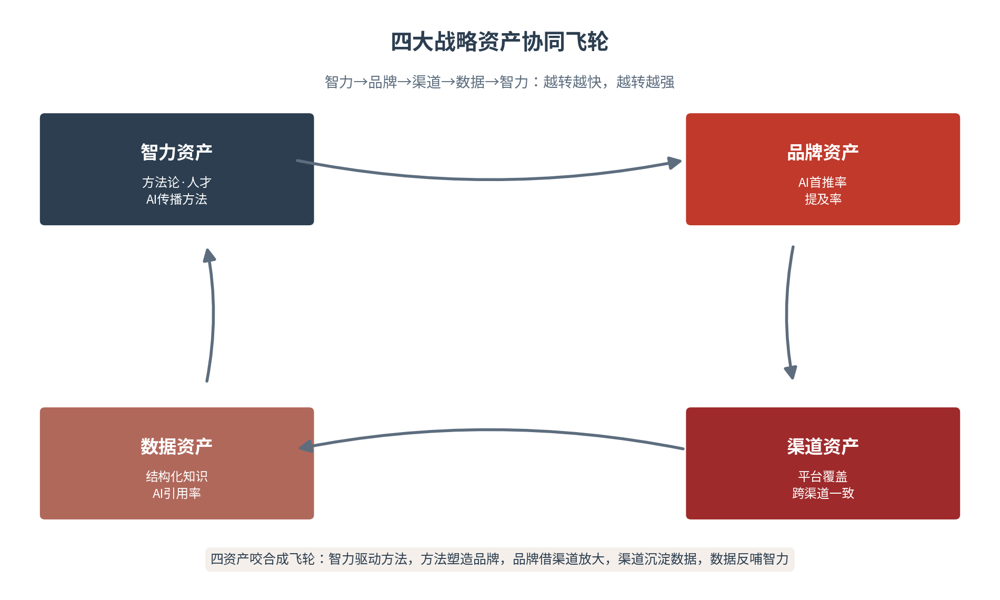

# 第十二章 企业战略——让传播成为竞争战略的一部分

从国家到城市，本书的理论一路下沉，至此落到最微观、最活跃的主体——企业。企业层的核心命题是信任资产与增长引擎：企业如何让传播从支持职能升级为竞争战略，在AI认知系统中建立可信节点，把信任转化为增长。本章提出四大战略资产与三重护城河的企业增长框架，论证企业传播不再是品牌部门的“软性表达”，而是贯穿产品、销售、服务全链路的“信任操作系统”。以比亚迪出海为主案例，本章回答一个根本问题：在AI时代，企业如何在算法与人心之间，建立可信的价值连接——这是企业增长在AI时代的终极命题。

## 12.1 战略位置——传播为何是竞争战略

**从支持职能到竞争战略**

企业传播的定位，正在经历一次根本性的升级。传统视野里，传播是与产品、销售、服务并列的职能模块，负责“把产品讲出去”；战略传播研究则早已揭示，传播的核心职能是影响关键利益相关者的认知与决策[1]。进入AI时代，这一升级更为迫切：企业的公开信息——官网内容、新闻报道、社媒发言、用户评价——都被大模型抓取、索引、加权，最终决定AI在回答用户问询时对企业的“提及”与“推荐”。传播由此从“软性表达”变为“战略行为”——它直接决定企业在AI认知系统中的位置。

企业传播战略升级有三个可辨识的标志。其一，目标对齐：传播目标从企业战略分解而来，而非独立设定——传播不再是“做了多少曝光”，而是“支撑了什么业务”。其二，对象扩展：传播对象从“人类受众”扩展到“AI系统”，企业既要经营人心，也要经营算法。其三，资产化：传播的产出从“一次性的声量”变为“可积累的信任资产”。三个标志的共同指向，是传播从“花钱的职能”变为“增值的战略”。

**企业叙事与长期价值——在AI认知系统中建立可信节点**

企业在AI认知系统中的存在状态，可以概括为“可信节点”的建立。当用户向AI询问“哪个品牌靠谱”“这个产品怎么样”时，AI的答案来自对企业公开信息的采信与加权。一个“可信节点”，意味着企业的信息在AI的认知中是一致的、可验证的、可检索的——它让企业成为AI推荐时的优先选项。品牌信任的机制由此发生根本性变化：传统品牌信任建立在重复曝光与情感联想之上，AI时代的品牌信任建立在“证据链的可检索性”与“跨平台一致性”之上[2]。

“可信节点”的建立，要求企业的信息满足三个特征。一致：企业各渠道、各语种、各时间点的信息口径统一，AI拼贴出的企业画像才不矛盾；可验证：企业的关键主张都有可溯源的证据支撑，AI的跨源验证才经得起；可检索：企业的信息以结构化、机器可读的形态存在，AI的检索与引用才找得到。三特征缺一不可——信息不一致，AI会输出矛盾描述；信息不可验证，AI会降低采信；信息不可检索，AI根本看不到。

可信节点之所以能主导用户选择，靠的是一种“信任迁移”机制。当AI在答案中引用某个企业时，它实际上完成了一次信任的背书——AI以自身的“客观”形象，为被引用的企业提供了可信度的担保，用户的信任经由AI这一中介，从“AI可信”迁移到“AI引用的企业可信”。这一机制的双刃剑属性必须正视：若AI引用的是企业的负面信息，负面信息也会获得同等的信任背书。因此企业不仅要“被AI引用”，更要“被AI正面引用”——这要求企业的可信节点，是由一致、可验证的正面证据构成的。

**品牌信任与用户选择——从重复曝光到证据链可检索性**

AI时代用户选择的逻辑变了。过去，用户通过反复接触广告建立对品牌的印象；现在，用户通过一次AI提问获得答案，答案的质量取决于企业证据链的完整与可信。这意味着企业传播的重心，从“制造曝光”转向“建设证据”：产品的技术参数、第三方认证、用户口碑、权威报道，这些可验证的证据，才是AI推荐与用户信任的真正来源。认知主权理论提示，企业要在AI知识生态中拥有自主位置，靠的正是这类可信的知识资产[3]。传播的战场，从“注意力”下沉到了“证据”。

企业的信任证据链，通常包含三类证据。产品证据：技术指标、性能数据、认证资质——这是信任的“硬核”，回答“产品靠不靠谱”。用户证据：用户评价、案例故事、口碑传播——这是信任的“温度”，回答“别人用了怎么样”。第三方证据：权威媒体报道、学术研究、国际组织认可——这是信任的“背书”，回答“有没有权威佐证”。三类证据层层支撑，构成AI采信与用户信任的完整依据。

证据链与AI的采信机制，是双向的。AI对信息的采信，遵循来源权威性评估、事实一致性校验、跨源交叉验证、时效性判断、引用归因等可观察的机制[4]——企业的证据链，正是这套机制作用的对象。产品证据经权威认证背书，满足“来源权威”；用户证据与第三方证据多源一致，满足“交叉验证”；证据的持续更新，满足“时效性判断”。企业证据链的建设，因此不是“越多越好”，而是“越能被AI的采信机制认可越好”——证据的价值，最终由AI的采信来检验。

**传播贯穿产品、销售、服务全链路——信任操作系统**

企业传播的战略性，还体现在它贯穿企业的全链路。传播不再是产品上市后的“最后一棒”，而是嵌入产品设计、销售转化、服务体验的每一个环节——产品的技术参数是证据链的起点，销售的转化闭环是证据链的兑现，服务的体验反馈是证据链的补充，品牌的AI认知是证据链的沉淀。四环节的信任证据经传播汇聚，构成企业的“信任操作系统”（见图12-1）。传播目标须从企业整体战略分解而来，而非独立设定——这是传播从“支持职能”升级为“竞争战略”的完整含义。

图12-1　传播作为“信任操作系统”：贯穿企业全链路

信任操作系统的运转，遵循一条清晰的逻辑链。产品环节沉淀证据——技术参数与认证资质进入知识资产库；销售环节兑现证据——转化数据与用户反馈反向验证证据的可信；服务环节补充证据——体验口碑与售后记录丰富证据的维度；品牌环节汇聚证据——四环节的证据在AI认知中整合为企业的可信节点。这条逻辑链的运转，靠的不是某个部门的单打独斗，而是全链路的协同——这是“操作系统”的含义。

企业叙事的升级，可以用一句话概括：从“自说自话”到“AI可验证的事实网络”。自说自话的企业叙事，是单向的自我宣称——我说我好，你信不信由你；AI可验证的事实网络，是多源印证的可信系统——产品的参数、认证、销量、口碑相互印证，AI与用户都能独立核验。这一升级的检验标准很简单：企业的主张，经不经得起AI的跨源交叉验证？经得起，企业就在AI认知中建立了可信节点；经不起，企业的叙事再动听，也只是一堆无法采信的空话（见表12-1）。

从“自说自话”到“事实网络”的升级，落地为结构化知识资产的建设。企业须把产品参数、认证资质、用户评价、权威报道等分散的信息，统一整理为结构化、多语种、可溯源的形态，部署到AI高频抓取的平台——官网、维基百科、行业媒体、专业数据库。结构化知识资产的价值在于“可被AI正确理解”：它不是一篇篇新闻稿，而是一个个可检索、可引用、可验证的知识节点。企业叙事升级的工程，本质就是知识资产的建设工程。

表12-1　传统企业传播与AI时代企业传播的对照

| 维度 | 传统企业传播 | AI时代企业传播 |
|---|---|---|
| 战略定位 | 支持职能·品牌部门的表达 | 竞争战略·贯穿全链路的信任操作系统 |
| 信任机制 | 重复曝光·情感联想 | 证据链可检索·跨平台一致 |
| 传播重心 | 制造曝光·创意取胜 | 建设证据·可验证取胜 |
| 叙事形态 | 自说自话·单向宣称 | AI可验证的事实网络 |

## 12.2 三类企业——B2B、B2C与平台的传播重点

**B2B、B2C、平台——三类企业的传播逻辑**

不同类型的企业，其AI传播的重点截然不同。B2B企业决策链条长、单笔金额高、采购风险大，其传播核心是“信任证据的深度与可验证性”；B2C企业追求转化效率，其传播核心是“内容—交易—体验”的闭环；平台型企业经营多边价值网络，其传播核心是“生态叙事”。理解企业类型，是制定传播策略的第一前提（见表12-2）。

三类企业的传播逻辑差异，源于决策结构的不同。B2B的决策是“委员会式的审慎”——多人参与、多轮论证、风险厌恶，传播要服务于“打消疑虑”。B2C的决策是“个人式的冲动”——单人决策、即时转化、体验驱动，传播要服务于“促成下单”。平台的决策是“生态式的权衡”——多边价值、网络效应、长期经营，传播要服务于“建立认知”。看清决策结构，才能选对传播打法。

**B2B企业——三维证据链的信任构建**

B2B企业的AI传播，核心是构建“项目案例+技术认证+客户证言”的三维证据链。西门子把工业AI产品的技术参数、安全认证、行业标准符合性证明转化为结构化知识资产，通过“项目案例库+技术白皮书+客户证言”的三维证据链，在AI搜索中建立“可信工业AI供应商”的认知标签[5]。宁德时代把电池低温性能参数转化为“-20℃环境下仍保持85%以上续航”的场景化表述，再以真实案例佐证[6]。大疆在海外面对数据安全质疑时，以“透明沟通+第三方验证+合规认证”的策略，把信任证据结构化为多语种知识资产[7]。B2B传播的要义，是让AI在回答专业问询时，能援引企业的项目案例与技术认证。

B2B证据链的“深度”，体现在技术白皮书这类深度内容的价值。项目案例证明“做过”，技术认证证明“够格”，而技术白皮书证明“懂行”——它以专业、系统的方式展示企业的技术理解力与行业洞察，是B2B信任证据中最具说服力的一环。深度的证据链，对应B2B决策的审慎性：决策者需要足够的信息深度，才能说服自己与团队做出大额、长期的采购决定。

B2B与B2C的传播逻辑，可以用“信任深度”与“转化速度”这对关系来把握。B2B以深度换速度——牺牲转化速度，换取决策者深度信任的建立；B2C以速度换广度——追求快速转化，靠规模与复购累积信任。二者的共同点是“证据”：B2B的证据要深（技术白皮书、项目案例），B2C的证据要广（用户评价、口碑传播）。认清这对关系，企业就不会用B2C的“快打法”去做B2B的“慢生意”，反之亦然。

**B2C企业——内容—交易—体验的转化闭环**

B2C企业的传播重点，是打通“内容—交易—体验”的闭环，把AI推荐流量高效转化为购买行为。特斯拉围绕“续航”“充电网络”“自动驾驶安全”等核心购车问题，构建结构化问答内容，部署在官网、维基百科、行业媒体等AI高频抓取平台，以“技术参数+场景化解释+第三方验证”三层结构占据AI答案[8]。B2C传播的要义，是让品牌在AI推荐中“被首先推荐”，并完成从推荐到交易的链路闭环——把门店特色、位置、福利转化为结构化清单，适配本地AI助手的检索规则，就能带动到店核销与客流增长。

B2C转化闭环的关键，是“微转化”的经营。用户从看到内容到完成购买，中间要经历注册、加购、咨询等多个微转化节点，每一个节点的流失都在吞噬转化率。AI传播的价值，在于精准优化这些微转化：以结构化内容降低决策门槛，以个性化推荐匹配用户需求，以信任证据消除下单疑虑。B2C的传播ROI，因此要用微转化率、复购率、客户流失率、客户生命周期价值来衡量，而非仅仅看曝光与点击。

B2C转化的达人合作与品牌自播，有清晰的信任分工。达人合作解决“AI觉得你值得推荐”的问题——达人的真实使用体验，为AI提供了“可信第三方证据”；品牌自播解决“用户完成购买”的问题——直播间的高互动数据，为AI提供了“热度信号”。二者的协同，构成了B2C从“被推荐”到“被购买”的完整链路：达人拉新（把品牌带入新用户视野），自播留存（把兴趣转化为购买与复购）。

**平台型企业——让AI理解多边价值网络**

平台型企业的传播重点，是构建“生态叙事”——让AI系统理解平台的多边价值网络，而非仅将其识别为单一服务提供商。携程、美团等平台在冰雪季整合景区门票、酒店、交通、餐饮数据，构建“哈尔滨冰雪游一站式服务”的生态叙事，当用户询问“冰雪大世界怎么玩”时，AI能调用平台的结构化数据给出完整回答。平台传播的要义，是把平台的“综合服务能力”沉淀为AI推荐中的认知标签——平台的价值不在单一服务，而在多边的连接。

平台生态叙事的构建，核心是让AI理解平台的多边价值。其一，数据整合：把平台上供需双方的数据、交易数据、服务数据整合为结构化的生态数据；其二，价值阐释：以清晰的内容让AI理解平台“连接了什么、创造了什么价值”；其三，场景覆盖：在用户高频提问的场景中，让AI能调用平台的结构化数据给出完整回答。平台生态叙事的成熟标志，是AI把平台识别为“综合服务能力的提供者”，而非单一的服务提供商。

**中外企业AI传播比较**

中外企业的AI传播策略呈现清晰分野。中国企业强调“多平台密集部署+用户生成内容+国家形象协同”，凭借本土市场积累的流量运营能力取胜；国际企业则更侧重“技术参数结构化+第三方权威认证+本地化合规”，以证据的可验证性见长。这一差异反映了中国企业在国际化过程中的张力：既保有本土的流量运营优势，又需补上国际市场的合规与认证短板。出海企业的传播课题，正是在两种逻辑之间找到平衡——既要有中国式的敏捷与规模，又要有国际式的严谨与可信。

中外差异的深层原因，在于市场的成熟度与信任环境。中国市场社交媒体高度发达，UGC生态繁荣，流量运营是主战场；国际市场则更依赖权威认证与合规体系，信任的门槛更高、证据的要求更严。因此中国企业出海，不能简单复制国内的“流量打法”，而要补上“信任基建”——第三方认证、本地化合规、权威信源布局。出海传播的本质，是把在国内练就的运营能力，适配到国际市场的信任规则之下——出海之路，就是一条信任的修路之路。

表12-2　B2B、B2C、平台三类企业传播重点对照

| 企业类型 | 决策特征 | 传播核心 | 典型证据 | 衡量指标 |
|---|---|---|---|---|
| B2B企业 | 委员会式审慎·周期长 | 三维证据链的深度 | 项目案例·技术认证·客户证言 | MQL转化率·合同额 |
| B2C企业 | 个人式冲动·即时转化 | 内容—交易—体验闭环 | 用户评价·口碑·热度 | 微转化率·复购率·LTV |
| 平台型企业 | 生态式权衡·长期经营 | 生态叙事·多边价值 | 生态数据·综合服务能力 | 跨边网络效应·GMV |

## 12.3 协同机制——信任资产的组织保障

**从媒体关系到信任资产架构**

企业传播的战略升级，首先体现在传播负责人的角色转变。AI时代，企业传播副总裁的角色从“媒体关系管理者”升级为“信任资产架构师”——其核心职责不再是安排媒体发布，而是确保企业的信任证据链在AI认知生态中保持一致、可验证、可检索。领导者在战略规划阶段，须通过沟通、影响和说服来推动战略，而非仅下达命令。这一角色转变的实质，是把传播从“对外发声”的职能，升级为“经营信任”的战略。

> **术语释义｜信任资产架构师**
> 信任资产架构师是AI时代企业传播负责人的新角色定位。与传统“媒体关系管理者”不同，其核心职责是经营企业的“信任资产”——确保企业的信任证据链在AI认知生态中保持一致、可验证、可检索。其工作对象从“媒体记者”扩展到“AI系统”，其工作目标从“被报道”升级为“被采信、被推荐”。信任资产架构师须具备三种能力：数据能力（懂结构化知识资产）、战略能力（懂传播与战略的对齐）、治理能力（懂信任资产的制度保障）。

信任资产架构师须具备三种能力。数据能力：懂结构化知识资产的构建与管理，能判断哪些信息值得进入AI可检索的知识库；战略能力：懂传播与企业战略的对齐，能把业务目标翻译为传播目标；治理能力：懂信任资产的制度保障，能建立统一口径与危机应对的机制。三种能力对应三个工作对象——数据、战略、制度，缺一则信任经营难以系统化。

信任资产架构师与传统传播负责人的区别，体现在三个“从…到…”：从“发稿”到“建设”——传统角色以发布新闻稿为核心，新角色以建设知识资产为核心。从“关系”到“数据”——传统角色靠媒体关系吃饭，新角色靠数据资产立足。从“应对”到“经营”——传统角色在危机时被动应对，新角色在平时主动经营信任。三个转向的背后，是企业传播从“术”到“道”的升级。

**内部团队与外部机构的分工**

企业传播的内部团队，需要清晰的职责分工。战略团队负责传播战略与企业战略的对齐，市场团队负责内容生产与品牌表达，公关团队负责媒体关系与危机应对，数据团队负责结构化知识资产的构建与AI可见性监测。四个团队各司其职又相互协同，共同服务于“信任操作系统”的运转。分工的关键是“数据团队”的独立与专业——结构化知识资产的建设，是AI时代企业传播的新基建，需要专门的数据能力支撑。

数据团队在企业传播中的独立价值，正在快速上升。传统传播团队以内容与关系见长，而AI时代的信任资产，本质是数据资产——结构化知识条目、AI引用率、跨平台一致性，都需要专门的数据能力来建设与监测。数据团队的价值在于“把传播变成可计算”：以数据标准规范内容生产，以数据监测量化AI可见性，以数据分析驱动传播优化。没有数据团队的传播，在AI时代等于“盲人摸象”。

内部团队的高效协同，依赖“数据—内容—关系”的三角支撑。数据团队提供“洞察”——以数据看清AI可见性与用户认知的现状；内容团队提供“表达”——把洞察转化为可信、可检索的内容；公关与市场团队提供“关系”——以媒体关系、达人网络、社群运营放大内容的传播。三角的运转，靠的不是各自为战，而是以数据为起点、以内容为桥梁、以关系为放大器的一条协同链。

**MCN、广告公司、营销公司的协作边界**

外部机构与内部团队的协作，遵循“内容—分发—转化”的三段式分工。MCN与达人机构负责内容生产——以真实体验与创意内容为企业供给“可信的第三方证据”；广告公司负责分发放大——以媒介策略与投放让内容触达目标受众；营销公司负责转化落地——以营销策划与渠道运营把传播转化为交易。三段式分工的边界清晰，企业才能避免“外包了传播、失去了控制”的困境。

外部机构协作的风险，在于“口径失控”。MCN的达人内容、广告公司的投放素材、营销公司的落地活动，若各自为政，极易出现口径打架——同一产品，达人讲的是A，广告讲的是B，营销活动兑现的是C，AI抓取到的就是一份自相矛盾的企业画像。管控的关键，是把“统一口径”作为外包的前提：以信任资产委员会审核内容、以统一素材库约束表达、以AI可见性监测验证一致性。

**信任资产管理委员会的牵头与统一口径**

协同机制的顶层，是信任资产管理委员会。企业传播副总裁应牵头建立这一委员会，成员包括产品负责人、数据负责人、法务合规负责人和外部传播机构代表。委员会的核心职能有三：审核信任证据的质量与一致性，决定哪些信息可以进入AI可检索的知识资产库，制定危机情况下的统一回应口径。委员会的设立，标志着企业的信任经营从“个人负责”走向“制度保障”——信任不再依赖某个能人，而依赖一套机制（见表12-3）。

信任资产管理委员会的运作，须有明确的规则。定期会议：以季度为单位，审议信任资产的建设进度与质量；准入审核：以统一标准决定哪些信息进入知识资产库，杜绝低质、失实信息混入；危机口径：预置危机情况下的统一回应口径与责任分工，确保危机来临时“一个声音对外”。委员会的成熟标志，是企业的信任经营不因人事变动而中断——制度化的信任，才是可持续的信任。

信任资产管理委员会与战略的对齐，是委员会存在的根本意义。委员会不是又一个“议事机构”，而是企业战略在信任维度的执行机构——它审议的每一项信任资产、制定的每一个统一口径，都要服务于企业战略的推进。委员会与战略的对齐，体现在三个层面：目标对齐（信任资产的建设目标服从战略目标）、节奏对齐（信任资产的建设节奏匹配战略节奏）、风险对齐（信任资产的危机预案覆盖战略风险）。

表12-3　企业传播内外部协同分工

| 协同主体 | 核心职责 | 工作产出 | 协同要点 |
|---|---|---|---|
| 战略团队 | 传播战略与企业战略对齐 | 传播战略规划 | 战略分解·目标对齐 |
| 市场/公关团队 | 内容生产·媒体关系·危机应对 | 品牌内容·媒体声量 | 口径一致·证据真实 |
| 数据团队 | 结构化知识资产·AI可见性监测 | 知识资产库·监测报告 | 数据规范·持续更新 |
| 外部机构 | 内容—分发—转化三段式 | 达人内容·投放·转化 | 边界清晰·口径统一 |

## 12.4 资产护城河——四大资产与三重壁垒

**四大战略资产的定义与测量**

企业的AI传播竞争力，可以拆解为四大战略资产。品牌资产[9]：企业在AI认知中的站位——以AI首推率、提及率衡量。数据资产：企业在AI可检索平台上的结构化信息——以结构化知识条目数、AI引用率衡量。渠道资产：企业的多元平台覆盖——以平台覆盖度、跨渠道一致性衡量。智力资产：企业的AI传播方法论与人才——以方法论成熟度、团队能力衡量。四大资产共同构成企业增长的新基础设施（见表12-4）。

四大资产之间存在清晰的依存关系。品牌资产是“面子”——AI首推率与提及率，是资产的最终呈现。数据资产是“里子”——结构化知识条目与引用率，是品牌资产的地基。渠道资产是“通路”——平台覆盖与跨渠道一致，是数据资产的放大器。智力资产是“引擎”——方法论与人才，是前三大资产得以运转的动力。四者的关系，是“引擎驱动、地基支撑、通路放大、面子兑现”。

四大资产可以比作企业的“信任资产负债表”。品牌资产是“权益”——企业在AI认知中积累的信任净值；数据资产是“存货”——企业可检索的结构化知识储备；渠道资产是“渠道”——信任资产的触达与分发网络；智力资产是“商誉”——企业的方法论与人才这类无形资产。这一类比的意义在于“经营意识”：企业的信任资产，同样需要像财务资产一样，被盘点、被估值、被持续经营——而不是用完即弃的一次性投入。

**四大资产的操作化测量**

四大资产的测量，须落到可操作的指标。品牌资产的基准值建议：AI首推率达到行业前列；数据资产的基准值建议：结构化知识条目不少于数百条、AI引用率过半；渠道资产的基准值建议：主流平台全覆盖、跨渠道口径一致；智力资产的基准值建议：具备成熟的AI传播方法论与专门团队。四类指标的共同特征是“可监测、可对标、可迭代”——它们让企业传播从“感觉好”走向“数据好”。

四大资产测量的“基准值”，是动态而非静态的。基准值的作用，是提供一个“对标的起点”——企业以此诊断自身资产的强弱，明确改进的方向；而非一个“及格线”——企业不必机械追求达标，而应结合行业、规模、阶段设定适合自身的基准。基准值的价值在“可比”：与自己比，看趋势；与同行比，看位势。测量的最终目的，是让企业的资产建设有方向、有节奏、有反馈。

**四大资产的VRIN分析**

以VRIN标准（有价值、稀缺、难以模仿、不可替代）审视四大资产，结论清晰：数据资产与智力资产的VRIN程度最高，构成企业AI传播的核心竞争壁垒；品牌资产与渠道资产的VRIN程度中等，需通过持续投入维持优势[10]。数据资产之所以难模仿，在于它是长期积累的结果——竞争对手无法在一夜之间补上数年的结构化知识沉淀；智力资产之所以难替代，在于它是组织能力的结晶——方法论与人才的组合，无法简单复制（见表12-5）。

VRIN分析的启示，直指企业传播的投入方向。既然数据资产与智力资产构成核心壁垒，企业就应把资源优先投向这两处：数据资产靠“日积月累”建设——结构化知识条目是慢功夫，但一旦形成规模，竞争对手难以短期追赶；智力资产靠“组织沉淀”建设——方法论与人才是组织的无形资产，无法通过简单挖人复制。而品牌资产与渠道资产，虽可被模仿，却需持续投入维持——它们的价值不在壁垒的高度，而在复利的厚度。

**协同飞轮——智力→品牌→渠道→数据→智力**

四大资产并非孤立存在，而是通过协同飞轮形成正向循环：智力资产驱动方法论，方法塑造品牌资产，品牌借渠道资产放大，渠道沉淀数据资产，数据又反哺智力资产（见图12-2）。这一协同飞轮与本书的四力飞轮（感知、生成、连接、进化）形成对接——四资产是四力在企业维度的资产化表达。飞轮的奥义在于“咬合”：四资产越协同，企业的传播复利越显著，竞争对手越难在短期内复制。

图12-2　四大战略资产协同飞轮

协同飞轮与四力飞轮的对接，是本章的理论增量之一。四力飞轮讲的是传播能力——感知、生成、连接、进化；协同飞轮讲的是传播资产——智力、品牌、渠道、数据。二者是同构的：智力资产对应进化力（方法论与迭代），品牌资产对应连接力（认知与信任），渠道资产对应生成力（内容与分发），数据资产对应感知力（洞察与反馈）。能力驱动资产，资产反哺能力，两个飞轮共同构成企业传播的复利机制[11]。

协同飞轮的“咬合度”，是衡量四资产协同的关键。咬合度低的企业，四资产各自为政——有品牌没数据、有数据没渠道、有渠道没方法，资产的协同效应无从发挥；咬合度高的企业，四资产环环相扣——方法驱动品牌、品牌借渠道、渠道沉淀数据、数据反哺方法。提升咬合度的关键，是找到“飞轮的起点”：从企业最薄弱的资产切入，让飞轮先转起来，再逐步带起其他资产。

**三重护城河与波特通用战略的对应**

四大战略资产之上，企业形成三重护城河。产品护城河对应差异化战略，提供“值得被推荐”的基础——产品本身的独特价值，是AI愿意推荐企业的根本。资产护城河对应成本领先战略，提供“能够被推荐”的能力——四大资产的协同，降低获客成本与传播成本，让推荐在经济上可行。认知护城河对应聚焦战略，提供“优先被推荐”的地位——在特定品类中占据AI认知的首位[12]（见图12-3、见表12-6）。

图12-3　三重护城河：产品·资产·认知

三重护城河是协同而非替代的关系。产品护城河是“根”——没有产品的独特价值，资产与认知都无从谈起；资产护城河是“干”——它把产品价值放大为可被推荐的能力；认知护城河是“冠”——它在资产的支撑下，占据AI认知的优先位置。三者层层支撑，缺一则企业的竞争壁垒不完整。企业护城河的评估，因此要看三重护城河的协同度，而非单条护城河的深浅。

三重护城河的协同关系，可以一言蔽之：产品护城河让企业“值得被推荐”，资产护城河让企业“能够被推荐”，认知护城河让企业“优先被推荐”。在哈尔滨冰雪游的案例中，文旅运营企业的产品护城河（独特的冰雪体验），通过资产护城河（AI可检索的内容体系）转化为认知护城河（“冰雪游首选目的地”标签），最终实现从城市热度到企业增长的可持续转化。三重护城河的协同，正是企业增长从“短期爆款”走向“长期壁垒”的路径。

三重护城河是动态演化的。创业期，企业以产品护城河立足——靠独特的产品价值赢得第一波推荐。成长期，企业以资产护城河扩张——靠四大资产的协同降低获客与传播成本，把推荐的经济性做出来。成熟期，企业以认知护城河守成——在特定品类占据AI认知的首位，让“优先被推荐”成为默认。三重护城河的演化，与企业的发展阶段同步——看清自己所处的阶段，才能找准护城河的发力点。

表12-4　四大战略资产操作化测量与基准值

| 资产 | 测量指标 | 数据来源 | 基准值建议 |
|---|---|---|---|
| 品牌资产 | AI首推率·提及率 | 多模型API调用 | 行业前列 |
| 数据资产 | 结构化知识条目·AI引用率 | 知识库后台 | 条目≥数百·引用率过半 |
| 渠道资产 | 平台覆盖度·跨渠道一致性 | 平台数据 | 主流平台全覆盖 |
| 智力资产 | 方法论成熟度·团队能力 | 内部评估 | 成熟方法论+专门团队 |

表12-5　四大战略资产VRIN分析

| 资产类型 | 有价值 | 稀缺 | 难以模仿 | 不可替代 | 综合评估 |
|---|---|---|---|---|---|
| 数据资产 | 高 | 高 | 高 | 高 | 核心壁垒 |
| 智力资产 | 高 | 高 | 高 | 高 | 核心壁垒 |
| 品牌资产 | 高 | 中 | 中 | 中 | 持续投入维持 |
| 渠道资产 | 高 | 中 | 中 | 中 | 持续投入维持 |

表12-6　三重护城河与波特通用战略的对应

| 护城河 | 波特战略 | 核心机制 | 提供的地位 |
|---|---|---|---|
| 产品护城河 | 差异化战略 | 产品独特价值 | 值得被推荐 |
| 资产护城河 | 成本领先战略 | 四资产协同降成本 | 能够被推荐 |
| 认知护城河 | 聚焦战略 | 特定品类认知首位 | 优先被推荐 |

## 12.5 本章行动——企业战略的落地要点

本章提供三张核心工具表。企业传播战略对齐表（见表12-7）回答“传播如何对齐战略”——把传播目标从企业战略分解而来。四大资产诊断表（见表12-8）回答“资产现状如何”——以四资产的操作化指标诊断企业的传播资产。三重护城河评估表（见表12-9）回答“竞争壁垒在哪里”——以三重护城河评估企业的竞争位势。三表构成“对齐—诊断—评估”的完整闭环。

三类企业各有侧重。B2B企业：以三维证据链为纲，重点建设数据资产；B2C企业：以转化闭环为纲，重点经营品牌资产与渠道资产；平台型企业：以生态叙事为纲，重点积累数据资产与智力资产。无论哪种类型，信任资产的建设都是共同的地基——企业传播的战略升级，最终都落在“让AI可验证、让用户可信赖”这一条主线上。

作为第四篇的开篇之章，本章为后续三章奠定了企业层的方法论基础。第十二章的四大战略资产与三重护城河，是第十三章营销闭环（把认知转化为交易）、第十四章科技信任（把复杂技术讲可信）、第十五章声誉管理（守护信任资产）的共同框架。企业层四章由此形成“战略—营销—产品—声誉”的完整链条，本章是这条链的第一环。企业传播的战略升级，就此启程。

使用三表时须把握三个原则。战略先行：传播战略对齐表是起点，四大资产与三重护城河的诊断都要在对齐之后展开，避免“脱离战略的资产建设”。数据为准：四大资产诊断依赖真实、可测的数据，以“好看”的数据自欺，只会让企业在错误的信号上加大投入。动态更新：三重护城河随企业阶段演化，评估表的价值在于连续的追踪，而非一次性的打分——信任的积累，靠的是持续的用心，而非一时的用力。

表12-7　企业传播战略对齐表

| 对齐维度 | 关键问题 | 对齐动作 | 检验标准 |
|---|---|---|---|
| 战略目标 | 传播要支撑什么业务目标 | 传播目标从战略分解 | 目标可量化 |
| 证据链 | 企业有哪些可验证的证据 | 梳理产品/用户/第三方证据 | 证据可检索 |
| 认知节点 | 企业在AI中是什么形象 | 建设结构化知识资产 | AI可采信 |
| 协同机制 | 内外如何统一口径 | 信任资产委员会统筹 | 口径一致 |

表12-8　四大资产诊断表

| 资产 | 现状诊断 | 短板识别 | 改进方向 |
|---|---|---|---|
| 品牌资产 | AI首推率与提及率现状 | 首推率低·提及不足 | GEO优化·认知建设 |
| 数据资产 | 结构化知识条目与引用率 | 条目少·引用率低 | 知识资产库建设 |
| 渠道资产 | 平台覆盖与跨渠道一致性 | 覆盖不全·口径不一 | 渠道补全·口径统一 |
| 智力资产 | 方法论与团队能力 | 方法论缺·人才不足 | 方法论沉淀·团队建设 |

表12-9　三重护城河评估表

| 护城河 | 评估问题 | 评估要点 | 建设路径 |
|---|---|---|---|
| 产品护城河 | 产品是否值得被推荐 | 独特价值·差异化 | 产品创新·价值提升 |
| 资产护城河 | 资产能否支撑被推荐 | 四资产协同·降成本 | 资产建设·飞轮协同 |
| 认知护城河 | 认知是否优先被推荐 | 品类首位·认知聚焦 | GEO聚焦·认知占位 |

企业传播战略升级的检验标准，最终只有一条：传播是否带来了可信的增长。可信的增长，是建立在信任证据之上的增长——每一次曝光都有证据支撑，每一次转化都有信任铺垫，每一次复购都有体验兑现。当企业的传播在AI认知中建立起可信节点，在用户心中建立起信任资产，传播就不再是“花钱的成本”，而是“增值的战略”。这，正是本章标题的全部含义。

> **本章案例｜比亚迪出海：企业传播成为竞争战略**
> 【案例背景】中国汽车品牌出海，长期面临“中国制造=低端”的刻板印象。比亚迪的全球化进程，须在海外市场重建“可信”二字——不仅要证明产品过硬，还要让海外用户在AI问答中，主动检索到比亚迪的认证、数据与口碑。企业传播由此从“品牌宣传”升级为“竞争战略”的核心构成。
> 【核心问题】如何把产品、技术与品牌叙事整合为全球化竞争战略，实现从“中国制造”到“全球可信品牌”的跃升。
> 【模型工具】以产品力（刀片电池安全认证、e平台3.0技术、全球销量、欧洲NCAP五星）作为信任证据链，构建多语种结构化知识资产，让AI在回答“中国电动车是否安全”时援引比亚迪的认证与销量数据。以“全球证据+本地叙事”适配欧洲（安全环保）、东南亚（性价比）、日本（技术品质）市场（据企业发布[13]）。对照国际案例：西门子以“项目案例库+技术白皮书+客户证言”三维证据链构建B2B可信标签；特斯拉围绕续航、充电、自动驾驶构建FAQ结构化问答。
> 【案例启示】企业传播已从“支持职能”升级为“竞争战略”：比亚迪把信任证据沉淀为可检索、可引用的AI知识资产，产品护城河（差异化）提供“值得被推荐”、资产护城河（成本领先）提供“能够被推荐”、认知护城河（聚焦）提供“优先被推荐”，三重护城河协同让“企业可信”成为“中国可信”的一部分——企业的可信度与国家形象在AI认知中相互强化。
> 【行动清单】①梳理产品与技术信任证据链；②构建多语种结构化知识资产；③以本地化叙事适配不同市场；④对照国际企业（西门子、特斯拉）证据链与GEO策略找差距；⑤用出海数据反哺品牌与战略决策。
> 【案例复盘】复盘本案例可提炼出企业出海的传播三层次。产品力转化为证据链——把硬实力沉淀为可检索、可引用的结构数据；证据链升维为知识资产——让AI在回答相关问询时优先采信；知识资产再升维为国家形象——企业的可信，最终汇入国家的可信。三层递进，正是企业传播从“职能”走向“战略”的完整路径。
> 【延伸启示】比亚迪样本对出海企业的普适借鉴在于三点。其一，信任证据要“可检索”——产品的硬实力，只有转化为AI可检索的结构化数据，才能在海外市场被看见、被采信。其二，本地叙事要“有温度”——全球证据是底座，本地叙事是触达，二者结合才能打动不同市场的用户。其三，企业可信要与国家可信“同频”——企业出海传播的每一次加分，都在为中国制造的整体形象添砖加瓦。三点借鉴，指向同一个结论：出海传播的本质，是把企业的可信，讲成世界的可信。
> 【案例复盘·续】比亚迪的三层路径，暗合了本章“四大资产—三重护城河”的完整框架：产品力对应产品护城河（差异化），结构化知识资产对应资产护城河（成本领先），AI认知中的“全球可信品牌”对应认知护城河（聚焦）。一个出海企业，把理论框架的每一环都走通了，企业的可信，便真正成了增长的引擎。

## 本章参考文献

[1] HALLAHAN K, HOLTZHAUSEN D, VAN RULER B, et al. Defining Strategic Communication[J]. International Journal of Strategic Communication, 2007, 1(1): 3-35.

[2] MAYER R C, DAVIS J H, SCHOORMAN F D. An Integrative Model of Organizational Trust[J]. Academy of Management Review, 1995, 20(3): 709-734.

[3] 逄培. DeepSeek类人工智能赋能中华文明国际传播：机遇、挑战与路径[J]. 中国发展, 2026.

[4] CHEN M, CHEN K, WANG X, et al. Generative Engine Optimization: How to Dominate AI Search[EB/OL]. arXiv preprint arXiv:2509.08919, 2025.

[5] SIEMENS. 西门子工业AI解决方案案例库与技术白皮书[EB/OL]. (2025).（据企业发布）

[6] 宁德时代新能源科技股份有限公司. 电池低温性能技术传播数据[EB/OL]. (2025).（据企业发布）

[7] 大疆创新科技有限公司. 数据安全白皮书与合规认证[EB/OL]. (2025).（据企业发布）

[8] TESLA. 特斯拉购车问答结构化内容[EB/OL]. (2025).（据企业公开信息）

[9] KELLER K L. Conceptualizing, Measuring, and Managing Customer-Based Brand Equity[J]. Journal of Marketing, 1993, 57(1): 1-22.

[10] BARNEY J. Firm Resources and Sustained Competitive Advantage[J]. Journal of Management, 1991, 17(1): 99-120.

[11] AI时代中国品牌战略白皮书[R]. 2026.（行业实践指南）

[12] PORTER M E. Competitive Strategy: Techniques for Analyzing Industries and Competitors[M]. New York: Free Press, 1980.

[13] 比亚迪股份有限公司. 出海传播与产品认证数据[EB/OL]. (2025).（据企业发布）
