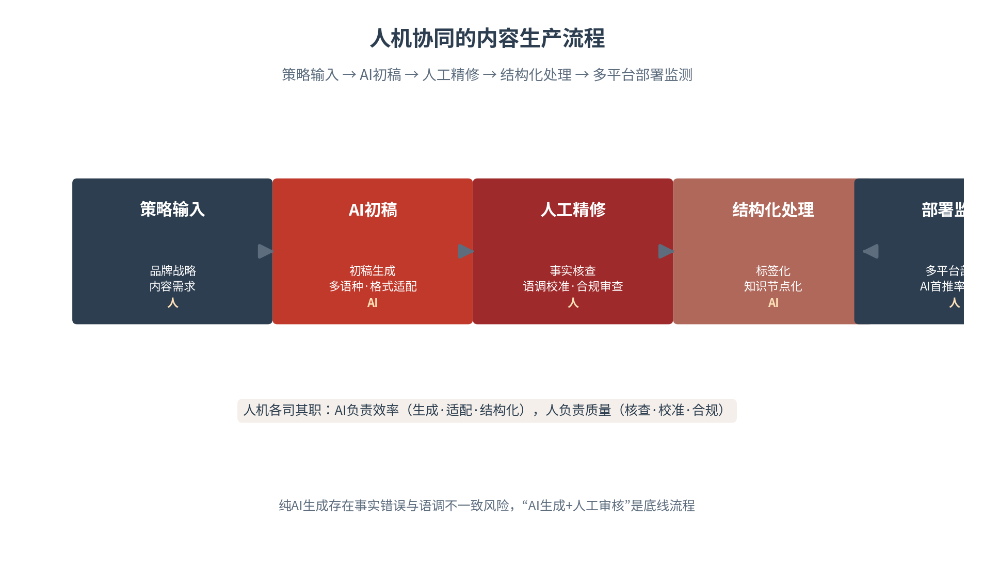
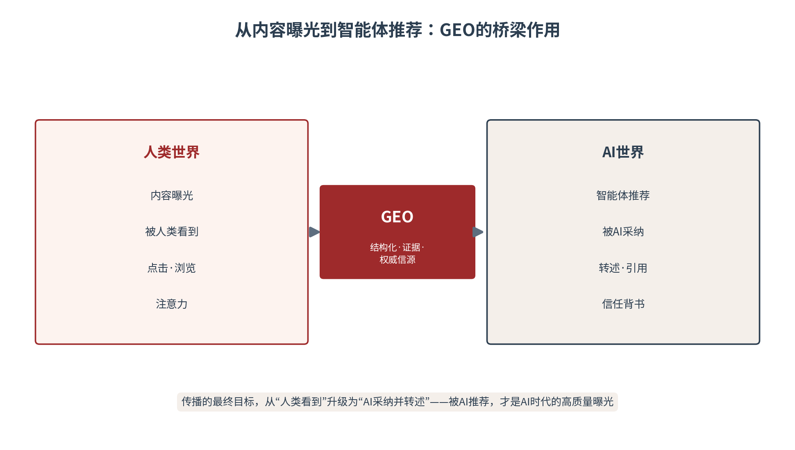

# 第十三章 营销闭环——从内容曝光到交易转化

企业传播的战略定位确立之后，落地的问题随之而来：内容如何生产、如何分发、如何把曝光转化为交易、又如何衡量这笔投入值不值。本章讨论企业AI营销的完整闭环，提出AI-5A框架并与全书的“四级跃迁”对接——注意力、认知力、信任力、竞争力，最终落到传播复利与认知资产的积累。本章的核心命题是：企业传播必须形成从注意力到转化的闭环，并用数据和业务结果检验传播效果。营销不是“做内容”，而是“跑通一条从被AI推荐到用户购买的完整链路”。

## 13.1 内容生产——AI如何守住品牌一致性

**人机协同——AI的效率与人的把关**

AI内容生产的价值在效率，风险在一致性。AI可以极低成本批量生成内容、多语种翻译、格式适配，但纯AI生成的内容存在两个致命风险：事实错误与语调不一致。战略传播研究早已强调，品牌的一致性是企业可信的基础[1]——而AI生成内容的“随性发挥”，恰恰最易破坏这种一致性。因此企业必须建立“AI生成+人工审核”的人机协同流程，让AI承担效率，让人承担质量（见图13-1）。

图13-1　人机协同的内容生产流程

AI内容生产的效率与风险，是一对辩证关系。效率来自AI的“无限供给”——它可以在极短时间内生成海量、多形态、多语种的内容；风险也来自这种“无限供给”——供给太快、太多，质量与一致性的把关就容易失守。二者的平衡点，在于“人机协同”的流程设计：让AI的供给力成为企业的“弹药”，让人的把关力成为企业的“保险”。效率与安全，一个都不能少。

**生成式内容在营销中的应用**

生成式内容在营销中的应用，覆盖内容生产的全链条：文案初稿、多语种翻译、素材适配、短视频脚本、直播话术、FAQ问答。AI的价值在于“规模化”——一个品牌的活动，可以在极短时间内生成适配不同平台、不同语种、不同受众的内容矩阵。但规模化必须以可控为前提：AI生成的内容，须经人工的事实核查、品牌语调校准与合规审查，才能对外发布。规模化与可控性的平衡，是AI内容生产的核心命题。

生成式内容在营销中的具体应用，可列一张场景清单：产品文案（详情页、卖点提炼）、短视频脚本（口播稿、分镜提示）、直播话术（开场、讲解、逼单）、FAQ问答（高频问题、结构化答案）、多语种本地化（翻译+文化适配）、私域内容（社群话术、会员推送）。六类场景覆盖营销内容的主干，AI在每一类都能大幅提效。但场景越广，把关的责任越重——AI的“能写”与“写得对”，从来不是一回事。

**品牌语调、视觉规范与内容审核——从理念层下沉到数据层**

品牌一致性在AI时代的落点，是从“理念层”下沉到“数据层”。传统上，品牌语调与视觉规范是一本“品牌手册”，靠人的理解与执行来贯彻；AI时代，这些规范要转化为可被AI执行的“数据层约束”——品牌的关键词库、句式偏好、语气参数、视觉模板，都被结构化地注入AI的内容生产流程。品牌权益的研究提示，品牌的一致性决定品牌联想的强度[2]；而AI让这种一致性可以“用数据来保障”，而非“靠人来碰运气”。

品牌语调的“数据化”，落地为三套工具。语调库：把品牌的核心语气、句式、用词偏好整理成结构化的语调规范，供AI生成时调用；关键词库：把品牌的核心概念、专属术语、禁用词整理成关键词约束，防止AI用词走偏；模板库：把品牌常见的内容类型整理成模板，约束AI的结构与风格。三套工具的共同作用，是让“品牌一致性”从人的经验，变成可执行、可校验的数据约束。

**人机协同的内容生产流程**

人机协同的内容生产，遵循一条清晰的流程：策略输入（品牌战略与内容需求转化为生产指令）→AI初稿（AI生成初稿、多语种翻译、格式适配）→人工精修（人工做事实核查、品牌语调校准、合规审查）→结构化处理（内容标签化、知识节点化，便于AI检索与复用）→多平台部署监测（部署到各平台并监测AI首推率）。五步环环相扣，AI负责“快”，人负责“对”（见表13-1）。

人机协同的边界，需要清晰界定。AI擅长的环节：初稿生成（海量、快速）、多语种翻译（准确、廉价）、格式适配（不同平台的尺寸与规范）、结构化处理（标签化、知识化）。人负责的环节：事实核查（AI会一本正经地出错）、语调校准（品牌的“味道”要靠人把）、合规审查（法律与伦理的边界靠人守）。边界清晰，协同才高效——把AI用在不该用的环节，或把人浪费在该用AI的环节，都是协同的失当。

这条流程的关键，在于“人”的位置。人的把关不在流程的末端，而在AI生成与发布之间：事实核查防止AI“一本正经地胡说”，语调校准防止品牌“说着说着变了味”，合规审查防止内容触碰法律与伦理的红线。三道人工关口，是AI内容生产的“安全阀”——它们让企业既能享受AI的效率，又不失品牌的一致与可信。

内容审核在AI时代，还要多一层“面向机器”的视角。传统的审核面向人类——审查内容是否合规、是否准确、是否有吸引力；AI时代的审核还要面向机器——审查内容是否结构化、是否可被AI检索、是否在AI的采信中站得住。这一层“机器可读性”审核，是企业内容在AI世界“立得住”的前提：一条内容再精彩，若AI检索不到、引用不了，它在AI时代的传播价值就大打折扣。

表13-1　AI营销内容审核五维度清单

| 审核维度 | 审核内容 | 审核要点 | 常见风险 |
|---|---|---|---|
| 事实 | 数据·结论·案例是否真实 | 事实准确·可溯源 | AI幻觉·张冠李戴 |
| 语调 | 是否符合品牌语调与语气 | 语调一致·风格统一 | 语调漂移·人格分裂 |
| 合规 | 广告法·隐私·行业规范 | 合规合法·无风险表述 | 夸大宣传·违规承诺 |
| AI可读性 | 是否结构化·可被AI检索 | 标签化·知识节点化 | 难以被AI采信 |
| 多语种 | 翻译是否准确·文化适配 | 语境对等·非直译 | 机器翻译·文化失格 |

## 13.2 智能分发——AI搜索优化的七步法

**让品牌在AI搜索中被看见**

内容生产完成之后，是分发的战场。AI时代的分发，多了一个全新的阵地——AI搜索与智能问答。用户不再只通过信息流“刷”到内容，更通过向AI提问“问”出答案；品牌能否进入AI的答案，取决于其内容在AI系统中的可见性。认知主权理论提示，企业在AI知识生态中的位置，决定了它被推荐的可能[3]。智能体分发，由此成为企业营销的新基建。

智能体分发的场景，大致有三类。问答场景：用户向AI助手提问“什么品牌好”“这个怎么样”，AI给出推荐；对比场景：用户向AI请求“A和B怎么选”，AI给出对比分析；决策场景：用户向AI咨询“预算X买什么”，AI给出购买建议。三类场景的共同点，是AI都充当了“决策的中介”——品牌的可见性，直接决定了它在这些场景中的命运。智能体分发，就是在这三类场景中争夺品牌的可见位置。

**AI助手、智能客服与知识图谱——知识图谱友好内容体系**

品牌在AI搜索中的可见性，建立在“知识图谱友好”的内容体系之上。AI助手、智能客服、知识图谱是AI分发的三大载体：AI助手在对话中推荐品牌，智能客服在服务中传递品牌，知识图谱在结构化认知中定位品牌。三者共同要求企业的内容“结构化”——以清晰的实体、属性、关联组织信息，让AI能准确识别“这是什么品牌、有什么特点、凭什么可信”。构建知识图谱友好的内容体系，是企业AI分发的地基工程。

知识图谱友好的内容构建，有三项具体工作。实体建设：为品牌、产品、技术建立清晰的知识图谱实体，明确其属性与关联；关系标注：明确品牌与品类、技术、场景之间的关系，让AI理解“这是什么、属于什么、关联什么”；事实标注：为关键信息标注出处与可信度，让AI的采信有据可依。三项工作的共同目标，是让品牌在AI的知识图谱中成为一个结构清晰、事实可查的节点。

**品牌在AI搜索中的可见性建设——三要素**

品牌在AI搜索中的可见性，取决于三个要素。内容结构化程度：企业的信息以机器可读的结构化形态存在，AI才检索得到、引用得了；证据可验证性：企业的关键主张有可溯源的证据支撑，AI的跨源验证才经得起；信息更新频率：企业的信息持续更新，AI的时效性判断才采信。三要素缺一不可——结构化不足则“看不见”，证据不足则“信不过”，更新不及时则“过时了”。

可见性三要素的操作化，各有其抓手。内容结构化：以实体、属性、关联组织企业信息，让知识图谱能准确识别；证据可验证：关键主张配齐可溯源的证据，让AI的跨源验证能通过；信息更新：建立常态化的内容更新机制，让AI的时效性判断能采信。三个抓手的共同目标，是让企业信息在AI系统中“找得到、信得过、用得新”——这是品牌AI可见性的完整内涵。

可见性的建设，是一项持续运营而非一次性工程。AI的检索索引、训练数据、知识图谱都在动态更新，企业若只在某一次“建好”可见性就高枕无忧，很快就会被AI的新一轮更新“遗忘”。因此可见性的经营要“持续”：持续更新结构化内容、持续补强证据链、持续监测AI首推率的波动。可见性不是“建成即得”的资产，而是“不进则退”的水位——持续经营，才能常保企业信息在AI系统中的地位。

**从内容曝光到智能体推荐——从人类看到到AI采纳并转述**

AI时代传播目标的一次根本升级，是从“人类看到”到“AI采纳并转述”。传统传播追求内容被人类受众看到；AI时代，更高价值的传播是内容被AI采纳、转述、引用——当AI在回答用户问题时推荐了品牌，这不仅是“曝光”，更是一次“信任背书”。研究证实，AI搜索系统性偏好第三方权威来源，引用添加可使可见性提升高达41%[4]（见图13-2）。被AI推荐，才是AI时代的高质量曝光。

图13-2　从内容曝光到智能体推荐：GEO的桥梁作用

从曝光到推荐的“信任背书”机制，是智能体分发的核心价值。传统曝光是“平视”的——内容与用户之间是平等的触达关系；AI推荐是“背书”的——AI以自身的“客观”形象，为被推荐品牌提供了可信度的担保。这一背书的价值，远超传统曝光：它不仅让用户“看到”品牌，更让用户“相信”品牌。因此企业分发战略的重心，应从“争取曝光”升级为“争取背书”。

**GEO优化七步法**

智能体分发的操作框架，可归纳为GEO优化七步法。第一步，识别高频问答场景——找到目标用户最常向AI提出的问题。第二步，构建结构化答案——围绕高频问题，构建“直接答案+证据支撑+行动引导”的结构化内容。第三步，多平台部署——把内容部署到官网、维基百科、行业媒体等AI高频抓取平台。第四步，证据链强化——以第三方认证、权威信源强化内容的可信。第五步，监测AI首推率——持续监测品牌在AI答案中的首推位置。第六步，迭代优化——依据监测结果迭代内容。第七步，效果归因——把AI曝光归因到业务转化（见表13-2）。

GEO七步法的常见误区有三。误区一，只做“答案”不做“证据”：结构化答案若缺乏可验证的证据支撑，AI的采信会大打折扣。误区二，只部署“自有渠道”不做“第三方”：AI搜索系统性偏好第三方权威来源，只在官网做GEO等于“自说自话”。误区三，只监测“排名”不做“归因”：AI首推率的提升若不能归因到业务转化，GEO的投入就无法证明价值。避开三误区，GEO才能从“技巧”升华为“战略”。

表13-2　GEO优化七步法

| 步骤 | 动作 | 目标 | 关键产出 |
|---|---|---|---|
| 一 | 识别高频问答场景 | 找准用户提问 | 高频问题清单 |
| 二 | 构建结构化答案 | 答案+证据+引导 | 结构化内容 |
| 三 | 多平台部署 | AI高频抓取平台覆盖 | 平台部署矩阵 |
| 四 | 证据链强化 | 第三方认证·权威信源 | 可信证据链 |
| 五 | 监测AI首推率 | 掌握首推位置 | 首推率数据 |
| 六 | 迭代优化 | 依据数据改进 | 优化后的内容 |
| 七 | 效果归因 | AI曝光到业务转化 | 归因报告 |

## 13.3 三件套协同——直播、短视频与私域

**内容—交易—体验的三位一体**

在AI营销之外，直播、短视频与电商的协同，构成了企业转化闭环的“内容三件套”。短视频负责“种草”——以内容激发兴趣，让用户在刷屏中被吸引；直播负责“转化”——以实时互动促成下单，把兴趣转化为交易；电商负责“承接”——以交易体验与私域运营完成购买并沉淀用户。三者协同，构成企业从“被看见”到“被购买”再到“被留住”的完整链路（见表13-3）。

三件套的节奏协同，遵循“先种草、后转化、再留存”的顺序。种草在前，以短视频铺开兴趣的广度；转化居中，以直播承接兴趣的浓度；留存殿后，以私域沉淀用户的深度。三者的节奏错配，会导致转化链的断裂——没有种草的直播是“无源之水”，没有直播的种草是“有花无果”，没有私域的转化是“一锤子买卖”。节奏对了，三件套才能形成合力。

**内容种草与交易转化——短视频种草+直播转化**

短视频与直播的组合，是内容种草与交易转化的经典搭配。短视频种草解决“兴趣”——以高质量的内容、真实的使用体验、有吸引力的场景，在用户心中种下“想要”的种子；直播转化解决“下单”——以实时的展示、限时的优惠、互动的氛围，把“想要”催化为“买下”。两者的节奏配合至关重要：短视频负责“广撒网”的兴趣触达，直播负责“高转化”的临门一脚。

短视频种草的内容质量，决定转化的“水源”。高质量的种草内容，具备三个特征：真实（真实的场景、真实的使用、真实的体验，而非浮夸的广告）、有用（给用户以信息价值，而非单纯叫卖）、有记忆点（让用户在需要时能想起这个品牌）。种草的本质是“种下兴趣的种子”，种子越真实、越有用，转化的果实才越扎实——虚假的种草，只会种出转化的“反噬”。

直播转化的“临门一脚”，靠的是三重机制。实时性：直播的即时互动，把用户的“想要”在当前催化为“买下”；稀缺性：限时、限量、限价的优惠设计，制造“错过即失”的紧迫感；信任感：主播的现场展示与实时答疑，打消用户下单前的最后疑虑。三重机制共同把种草积累的兴趣，转化为直播间里的成交。直播转化的精髓，在于“势能的集中释放”——把种草的势能，在直播间这个高能量场里一次兑现。

**达人合作与品牌自播——达人拉新+自播留存的信任分工**

达人合作与品牌自播，有清晰的信任分工。达人合作解决“AI觉得你值得推荐”的问题——达人的真实使用体验，为AI提供了“可信的第三方证据”，把品牌带入新用户的视野；品牌自播解决“用户完成购买”的问题——直播间的高互动数据，为AI提供了“热度信号”，把兴趣转化为购买与复购。达人拉新、自播留存，二者的协同构成了品牌从“被推荐”到“被购买”的完整信任链路。

达人选择的“匹配度”，优先于“知名度”。品牌选择达人，看的不是粉丝多少，而是达人的粉丝与品牌的用户有多重合、达人的调性与品牌的调性有多契合、达人的口碑与品牌的定位有多一致。匹配度高的达人，其推荐是“水到渠成”的信任传递；匹配度低的达人，即使粉丝庞大，其推荐也难有转化。达人营销的智慧，在于“宁缺毋滥”——一个契合的达人，胜过十个不相关的大V。

品牌自播的信任价值，在于“可控与持续”。达人合作带来的是“借来的信任”——达人的背书随合作而变化；品牌自播积累的是“自己的信任”——直播间的持续经营，让品牌与用户建立直接的、可累积的信任关系。自播的可控性，还体现在口径的把握：品牌可以精准控制自播的内容、话术与承诺，避免达人内容的口径漂移。达人拉新、自播留存的组合，正是“借势”与“自立”的平衡。

**私域运营与用户留存——从一次性购买到品牌共建**

私域运营的价值，在于把“一次性购买”变为“品牌共建”。公域的流量是一次性的——买完即走；私域的沉淀是长期的——把用户引入企业微信、社群、会员体系，持续经营关系、激发复购、培育口碑。私域更深的战略价值在于“信任证据的生产源”：私域用户的真实反馈、复购行为、口碑传播，构成了品牌最鲜活的信任证据——它们既服务于人类受众的信任，也服务于AI采信的语料。私域由此成为企业信任资产的“蓄水池”。

私域作为“信任证据生产源”的机制，值得深挖。私域用户的每一次互动——咨询、复购、好评、晒单——都是品牌真实性的活证据；这些证据经结构化处理后，成为AI采信品牌的语料，反哺品牌的AI可见性。私域因此不只是“交易的留存地”，更是“信任的生产线”——它源源不断地为品牌供给真实的信任证据，让品牌在人类与AI两个世界里，都更可信、更可推荐。

表13-3　短视频、直播、私域协同分工

| 载体 | 核心功能 | 信任机制 | 关键指标 |
|---|---|---|---|
| 短视频 | 内容种草·激发兴趣 | 真实体验·有用有记忆点 | 播放·互动·种草率 |
| 直播 | 实时转化·促成下单 | 实时性·稀缺性·信任感 | 转化率·客单价·GMV |
| 私域 | 留存复购·品牌共建 | 持续关系·信任证据生产 | 复购率·NPS·LTV |

## 13.4 AI-5A——从认知到拥护的闭环

**AI-5A与四级跃迁的对接**

本章的核心框架，是AI-5A模型。参照科特勒的5A模型[5]，AI-5A把用户的旅程拆解为五环：AI-Aware（AI感知）、AI-Appeal（AI吸引）、AI-Ask（AI问答）、AI-Act（AI行动）、AI-Advocate（AI倡导）。五环与本书的“四级跃迁”形成完整对接：A1认知对应注意力，A2吸引对应认知力，A3问询对应信任力，A4行动对应竞争力，A5拥护对应传播复利与认知资产的积累（见图13-3、见表13-4）。这一对接，把营销的“旅程”与传播的“跃迁”统一到了同一个框架之下。

图13-3　AI-5A与四级跃迁的对接

AI-5A与传统5A的区别，在于“AI的中介”。传统5A的旅程，是用户与品牌之间的直接互动——认知、吸引、问询、行动、拥护，每一步都由用户自己完成。AI-5A的旅程，多了AI这一中介——用户的认知来自AI的提及，吸引来自AI的推荐，问询经由AI的回答，行动受AI的影响，拥护经AI的引用而放大。AI的中介化，是AI-5A相较传统5A的根本增量。

> **术语释义｜AI-5A**
> AI-5A是企业营销的用户旅程框架，参照科特勒5A模型改造而来，专为AI时代设计。五环为：A1认知（AI感知，以AI提及率衡量）、A2吸引（AI吸引，以AI首推率衡量）、A3问询（AI问答，以AI引用率衡量）、A4行动（AI行动，以转化率衡量）、A5拥护（AI倡导，以NPS与复购率衡量）。五环与四级跃迁对接：A1注意力、A2认知力、A3信任力、A4竞争力、A5传播复利。AI-5A的增量，在于把“AI认知系统”纳入了用户旅程——用户的选择，越来越经由AI的中介。

**五环节的展开**

五环节各有其核心指标。A1认知：让AI提及你——以AI提及率衡量，品牌进入AI的认知范围。A2吸引：让AI觉得你值得推荐——以AI首推率衡量，品牌成为AI的推荐候选。A3问询：让AI为你背书——以AI引用率衡量，品牌被AI正面引用。A4行动：让用户完成购买——以转化率衡量，兴趣转化为交易。A5拥护：让用户成为共建者——以NPS、复购率衡量，购买转化为口碑与复购。五环逐级递进，构成用户从“知道”到“拥护”的完整旅程。

五环节之间的“流失”，是营销优化的主战场。从认知到吸引，流失的是“兴趣未起”；从吸引到问询，流失的是“信任未立”；从问询到行动，流失的是“冲动未至”；从行动到拥护，流失的是“体验未满”。每一环节的流失，都有对应的优化动作：认知到吸引靠内容的质量，吸引到问询靠证据的可信，问询到行动靠转化的便利，行动到拥护靠体验的兑现。优化五环节的流失，就是营销闭环的全部功课。

**A3问询——信任力的落点**

五环中，A3问询是AI-5A最具AI特色的环节，也是信任力的落点。传统营销中，用户的“问询”是向客服、向朋友、向口碑平台求证；AI时代，用户的“问询”是向AI助手提问——而AI的答案，取决于品牌信任证据的质量。信任研究的经典模型提示，信任由能力、善意、正直三维构成[6]；在A3问询环节，这三者被转化为AI采信的具体依据：能力对应产品证据，善意对应用户口碑，正直对应第三方背书。让AI在问询中为企业“背书”，正是AI-5A的独特价值。

A3问询环节的GEO优化，是AI-5A落地的关键。用户向AI提问时，AI的答案取决于品牌内容的结构化程度与证据质量——因此A3问询的优化，本质是GEO优化：围绕高频问题构建结构化答案，配齐可验证的证据，部署到AI高频抓取的平台。当品牌在AI的答案中被正面引用、被优先推荐，A3问询就完成了从“用户问”到“AI荐”的信任转化。

A3问询的优化，需要与A1、A2协同。A1认知解决“AI知不知道你”，A2吸引解决“AI觉得你值不值得推荐”，A3问询解决“AI愿不愿意为你背书”——三环递进，A3的背书效果，取决于A1的提及广度与A2的推荐力度。因此A3问询的GEO优化，不能孤立进行，而要放在AI-5A的前三环里统筹：先让AI“知道”、再让AI“看好”、最后让AI“背书”。三环协同，A3的信任转化才水到渠成。

**A5拥护——传播复利的起点**

A5拥护是AI-5A的终点，也是传播复利的起点。拥护意味着用户不仅自己购买，还主动推荐、主动传播、主动为品牌“说话”——这些自发的拥护行为，构成了品牌最有力的信任证据，反哺AI的采信与下一轮用户的信任。A5的价值，在于把营销的“终点”（交易）转化为传播的“起点”（复利）——用户从“被营销的对象”，变成了“品牌的共建者”。这是AI-5A相较传统5A的增量所在。

A5拥护的“共建者”机制，是营销闭环向信任经营升华的关键。拥护的用户不再是“被营销的对象”，而是“品牌的共建者”——他们贡献口碑、参与共创、主动推荐，成为品牌信任证据的活水源。这一机制的深层意义，在于把营销的“单向投放”变为“双向共建”：品牌向用户传递价值，用户向品牌回馈信任，二者在共建中形成越滚越大的信任飞轮。这是AI-5A把营销从“交易”升华为“关系”的价值所在。

**AI-5A在案例中的验证**

AI-5A框架在多个案例中得到验证。哈尔滨冰雪游中，文旅企业的传播完整走过了五环——从内容出圈（A1认知）、冰雪吸引力（A2吸引）、口碑问询（A3问询）、到访消费（A4行动）、复访推荐（A5拥护）[7]。比亚迪出海以“全球证据+本地叙事”在海外市场完成了同样的旅程[8]。连锁餐饮以结构化门店数据适配本地AI助手，把AI推荐转化为到店核销与客流增长[9]。三个样本共同证明：AI-5A不是理论空转，而是可落地、可验证的营销闭环。

AI-5A的度量与监测，是闭环运转的仪表盘。五环节各有指标：A1看AI提及率、A2看AI首推率、A3看AI引用率、A4看转化率、A5看NPS与复购率。五指标的监测，让企业看清用户旅程在哪一环“卡住”、在哪一环“流失”，从而精准优化。没有度量的AI-5A，只是概念；有度量的AI-5A，才是可运营的闭环。

表13-4　AI-5A五环节与四级跃迁的对接

| 环节 | 含义 | 核心指标 | 对应跃迁 |
|---|---|---|---|
| A1 认知 | 让AI提及你 | AI提及率 | 注意力 |
| A2 吸引 | 让AI觉得你值得推荐 | AI首推率 | 认知力 |
| A3 问询 | 让AI为你背书 | AI引用率 | 信任力 |
| A4 行动 | 让用户完成购买 | 转化率 | 竞争力 |
| A5 拥护 | 让用户成为共建者 | NPS·复购率 | 传播复利 |

## 13.5 ROI评估——传播如何量化增长

**从曝光到价值的指标体系**

营销闭环的最后一步，是评估——这笔传播投入，到底值不值。传统营销评估止于曝光与点击，AI时代的营销评估要延伸到业务增长。评估的指标体系分为四层：曝光层（AI提及率、AI首推率、内容触达量）、互动层（点击率、互动率、留资率）、转化层（转化率、客单价、GMV）、长期价值层（CLV客户生命周期价值、复购率、NPS净推荐值）。四层从“看见”到“价值”层层递进（见表13-5）。

四层指标的关系，是一条“价值漏斗”。曝光层的量大，但价值远；转化层的量小，但价值近；长期价值层的量最小，却价值最重。评估的要义，是不止于看“漏了多少”，而看“每一层的价值沉淀了多少”——曝光看触达的广度，互动看兴趣的深度，转化看交易的实度，长期价值看信任的厚度。四层并重，才是完整的传播价值评估。

四层指标的数据治理，是评估准确性的前提。曝光层的数据来自多模型API，互动层与转化层的数据来自平台与电商系统，长期价值层的数据来自私域与会员体系——四层数据分处不同系统，口径不一、标准各异，若不经统一治理，评估就是“各说各话”。数据治理的关键，是建立统一的数据标准与归因规则，让四层数据能对齐、可打通、可比较。数据不打通，评估就是糊涂账。

**ROI计算公式与八步评估流程**

传播ROI的计算，是把传播投入与业务产出对照。ROI＝（传播带来的业务产出－传播投入）÷传播投入。八步评估流程：第一步，明确评估目标（要评估什么业务结果）。第二步，设定基线（评估前的业务水平）。第三步，归因设计（如何区分传播与自然增长）。第四步，数据采集（曝光、互动、转化、长期价值四层数据）。第五步，增量计算（A/B测试或对照组的增量）。第六步，成本核算（传播的总投入）。第七步，ROI计算。第八步，复盘迭代（把结论用于下一轮优化）。

ROI归因的难点，在于“多触点”的复杂性。一个用户的购买，往往经过了短视频种草、AI问询、直播转化等多个触点的共同作用——把成果归给哪一个触点，直接影响ROI的计算。多触点归因的方法，有首次触点归因（归给第一个触点）、末次触点归因（归给最后一个触点）、线性归因（平均分摊）、时间衰减归因（越近权重越高）。企业应结合业务特点选择合适的归因模型，而非一刀切。

**营销信任与长期复购——CLV、复购率、NPS**

长期价值层的三个指标，衡量的是营销的“复利”。CLV（客户生命周期价值）衡量一个客户在完整生命周期里为企业创造的总价值，反映营销的“深度”；复购率衡量客户的忠诚度，反映营销的“黏性”；NPS（净推荐值）衡量客户主动推荐的意愿，反映营销的“温度”。三个指标共同回答一个长期问题：营销带来的，是一次性的交易，还是可复利[10]的信任。

CLV、复购率、NPS三个指标，从三个维度刻画信任的复利。CLV刻画“深度”——一个信任品牌的客户，其生命周期价值远高于一次性客户；复购率刻画“黏性”——信任让用户一次次回来；NPS刻画“温度”——信任让用户主动推荐。三者的共同逻辑是：信任不是营销的“副产品”，而是营销的“本金”——它让每一次交易，都产生超越交易本身的长期价值。

ROI评估的“长期视角”，是避免短视的关键。一次营销活动的即时ROI，可能掩盖了它带来的长期价值——一次种草，短期看ROI平平，长期看却带来了持续的自然流量；一次私域运营，短期看投入大于产出，长期看却沉淀了高价值的客户资产。因此ROI评估要“长短结合”：既看即时转化，也看长期价值（CLV、复购率、NPS），避免用短期的账，误判了长期的事。

**传播投入与业务产出评估——A/B测试的增量计算**

评估传播真实效果的难点，在于区分“传播带来的增长”与“自然发生的增长”。A/B测试的增量计算是解法：将使用AI营销的实验组与使用传统营销的对照组对比，计算转化率提升、GMV增量、LTV提升等增量指标。增量的意义在于“归因的干净”——它剥离了自然增长与外部因素，让企业看清传播投入的真实产出。没有增量的评估，企业就无法知道“这笔钱花得值不值”（见表13-6）。

A/B测试的设计，有若干要点。样本分层：实验组与对照组须在用户特征上可比，避免“选偏”导致增量失真。周期充足：测试周期须覆盖完整的转化周期，避免“半程数据”误导结论。单一变量：一次只改变一个变量（如是否使用AI营销），才能干净地归因。统计显著：增量须达到统计显著，避免“偶然波动”被当作“真实效果”。四要点保证A/B测试的增量，是可信的增量。

表13-5　传播转化漏斗评估表

| 漏斗层级 | 核心指标 | 数据来源 | 评估要点 |
|---|---|---|---|
| AI曝光 | AI提及率·AI首推率 | 多模型API调用 | 被AI看见的程度 |
| 互动 | 点击率·互动率·留资率 | 平台数据 | 兴趣的转化 |
| 购买 | 转化率·客单价·GMV | 电商与交易数据 | 交易的达成 |
| 复购 | 复购率·CLV·NPS | 私域与会员数据 | 长期价值的积累 |

表13-6　传播ROI八步评估流程

| 步骤 | 动作 | 关键问题 | 产出 |
|---|---|---|---|
| 一 | 明确评估目标 | 要评估什么业务结果 | 评估目标 |
| 二 | 设定基线 | 评估前的业务水平 | 基线数据 |
| 三 | 归因设计 | 如何区分传播与自然增长 | 归因方案 |
| 四 | 数据采集 | 四层数据如何采集 | 数据底账 |
| 五 | 增量计算 | A/B测试或对照增量 | 增量数据 |
| 六 | 成本核算 | 传播总投入多少 | 成本数据 |
| 七 | ROI计算 | 投入产出比 | ROI数值 |
| 八 | 复盘迭代 | 如何用于下一轮优化 | 优化方案 |

## 13.6 本章行动——营销闭环的落地要点

本章提供三张核心工具表。AI营销内容审核五维度清单（见表13-1）回答“内容怎么把关”——以事实、语调、合规、AI可读性、多语种五维度审核AI生成内容。传播转化漏斗评估表（见表13-5）回答“转化怎么衡量”——以AI曝光、互动、购买、复购四层指标度量转化效率。数据力与信任力自检表（见表13-7）回答“地基怎么夯实”——以数据力与信任力两大维度诊断企业的营销地基。三表构成“把关—衡量—诊断”的完整闭环。

三类企业各有侧重。B2C企业：以转化漏斗评估表为核心，重点优化从AI曝光到购买的转化链路；B2B企业：以内容审核与信任力自检为核心，重点建设深度的信任证据；平台型企业：以数据力自检为核心，重点经营生态数据的结构化。无论哪种类型，AI-5A的五环闭环与数据驱动的效果评估，都是共同的作业框架。

作为第四篇的第二章，本章与第十二章、后续两章构成企业层的完整闭环。第十二章解决了“传播的战略定位”，本章解决了“营销的落地闭环”——把战略转化为从曝光到交易的完整链路；第十四章将聚焦“科技信任”，解决“复杂产品如何讲可信”；第十五章将聚焦“声誉管理”，解决“信任资产如何被守护”。企业层四章由此形成“战略—营销—产品—声誉”的完整链条，本章承上启下，是战略落地的关键一环。

企业AI营销的终局，是跑通“从被AI推荐到用户购买”的完整闭环。这一闭环的每一环——内容生产、智能分发、种草转化、AI-5A旅程、ROI评估——都不是孤立的技术，而是一条环环相扣的价值链：内容供给了分发的弹药，分发放大了种草的声量，种草铺垫了转化的信任，AI-5A串起了信任的旅程，ROI验证了投入的价值。环环咬合，企业营销才能在AI时代从“花钱的曝光”走向“增值的闭环”。

表13-7　数据力与信任力自检表

| 自检维度 | 自检项 | 合格标准 | 改进方向 |
|---|---|---|---|
| 数据力 | 内容结构化程度 | 知识图谱友好·可检索 | 结构化改造·标签化 |
| 数据力 | 证据可验证性 | 关键主张可溯源 | 证据链补全 |
| 数据力 | 信息更新频率 | 持续更新·不过时 | 更新机制建立 |
| 信任力 | 产品证据 | 技术参数·认证齐全 | 认证补齐·数据公开 |
| 信任力 | 用户口碑 | 真实评价·正面为主 | 口碑经营·UGC激励 |
| 信任力 | 第三方背书 | 权威媒体·机构认可 | 权威信源布局 |

营销闭环的最终检验，是增长的成色。一个健康的营销闭环，带来的不是“虚胖”的曝光，而是“实在”的增长——有证据的曝光、有信任的转化、有复利的复购。当企业的营销在AI的推荐中站稳、在用户的信任中扎根，营销就不再是“花钱的部门”，而是“增值的引擎”。这，正是本章标题“从内容曝光到交易转化”背后的深意。

> **本章案例｜新能源车企AI购车问答首推**
> 【案例背景】新能源汽车的购车决策高度依赖信息比较：续航、充电、安全、性价比，每一项都影响用户的最终选择。随着用户越来越多地向AI助手提问“20万电动车推荐”“冬天续航怎么样”，品牌能否在AI问答中被首先推荐，直接决定了高意向用户的流向。
> 【核心问题】如何在高意向用户的AI问答场景中“被首先推荐”，把AI问答流量转化为试驾、留资与成交。
> 【模型工具】围绕“20万电动车推荐”“冬天续航”“比亚迪和特斯拉怎么选”等高频问题，构建“直接答案+对比分析+证据支撑+行动引导”的结构化内容；按GEO优化七步法在多AI平台部署与监测，提高AI首推率（据项目方披露[11]）。对照国际案例：特斯拉以“技术参数+场景化解释+第三方验证”三层结构部署官网FAQ、维基百科、行业媒体[12]。打通“种草—问询—行动”链路，AI-5A各环节衔接四级跃迁。
> 【案例启示】AI时代的营销闭环始于“被AI推荐”：GEO优化让品牌在智能问答中占据首推位。AI-5A与四级跃迁形成完整对接——注意力（A1）、认知力（A2）、信任力（A3）、竞争力（A4）再到传播复利（A5认知资产积累），数据力（答案结构）、认知力（证据链）、转化力（引导成交）在此闭环。其深层启示在于：高意向用户的争夺，已从“搜索广告”转移到“AI问答”——谁在AI的答案里，谁就赢得了第一顺位的信任。
> 【行动清单】①识别用户高频购车问答场景；②构建结构化答案与证据链；③按GEO七步法在多AI平台优化与监测；④对照特斯拉案例补齐高频抓取平台部署；⑤设计从AI问答到留资成交的转化路径，并用AI-5A各环节指标评估。
> 【案例复盘】复盘本案例可提炼出AI问答营销的三条经验。场景是起点——找准用户真正会问的高频问题，内容才有靶心。证据是根基——AI的答案质量取决于证据的可验证性，结构化答案必须配得上可溯源的证据。归因是闭环——从AI首推到留资成交的每一步，都要有数据归因，才能证明“被AI推荐”真正带来了“被用户购买”。
> 【延伸启示】本案例对高意向品类的普适借鉴在于三点。其一，高频问题是金矿——用户反复问的问题，就是最高价值的营销场景；其二，结构化答案是钥匙——只有结构化、带证据的答案，才能进入AI的采信；其三，归因是闭环——从AI首推到成交的每一步都归因，营销投入才算得清账。三点借鉴，指向同一个结论：AI问答营销的胜负手，在“被AI推荐”的那一刻就已注定。

## 本章参考文献

[1] HALLAHAN K, HOLTZHAUSEN D, VAN RULER B, et al. Defining Strategic Communication[J]. International Journal of Strategic Communication, 2007, 1(1): 3-35.

[2] KELLER K L. Conceptualizing, Measuring, and Managing Customer-Based Brand Equity[J]. Journal of Marketing, 1993, 57(1): 1-22.

[3] 逄培. DeepSeek类人工智能赋能中华文明国际传播：机遇、挑战与路径[J]. 中国发展, 2026.

[4] CHEN M, CHEN K, WANG X, et al. Generative Engine Optimization: How to Dominate AI Search[EB/OL]. arXiv preprint arXiv:2509.08919, 2025.

[5] KOTLER P, KARTAJAYA H, SETIAWAN I. Marketing 4.0: Moving from Traditional to Digital[M]. Hoboken: John Wiley & Sons, 2017.

[6] MAYER R C, DAVIS J H, SCHOORMAN F D. An Integrative Model of Organizational Trust[J]. Academy of Management Review, 1995, 20(3): 709-734.

[7] 哈尔滨市文化广电和旅游局. 2024年哈尔滨市旅游数据通报[R]. 哈尔滨, 2024.

[8] 比亚迪股份有限公司. 出海传播与产品认证数据[EB/OL]. (2025).（据企业发布）

[9] 连锁餐饮品牌. 本地AI助手优化项目数据[EB/OL]. (2025).（据项目方披露）

[10] AI时代中国品牌战略白皮书[R]. 2026.（行业实践指南）

[11] 新能源车企. AI购车问答首推项目数据[EB/OL]. (2025).（据项目方披露）

[12] TESLA. 特斯拉购车问答结构化内容[EB/OL]. (2025).（据企业公开信息）
