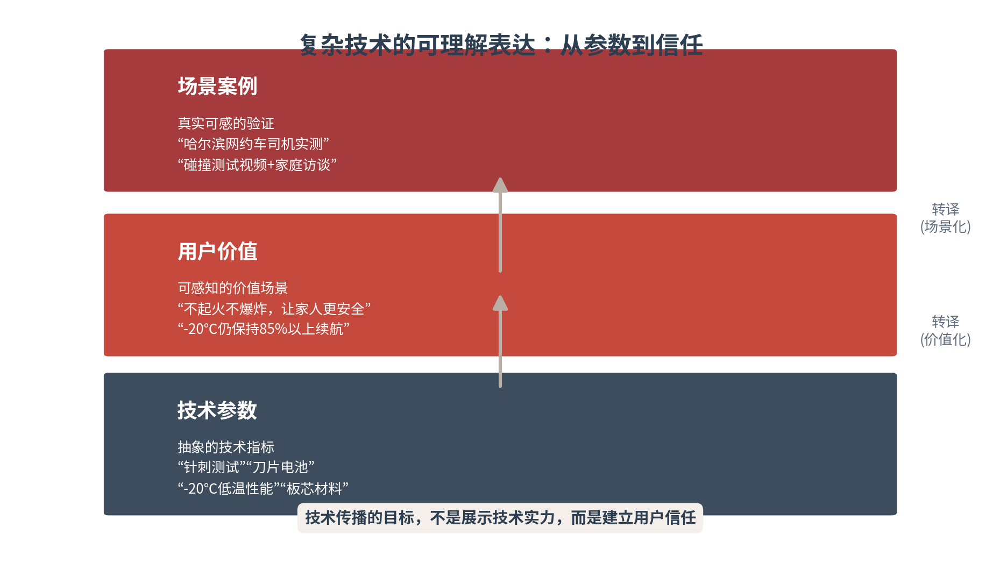
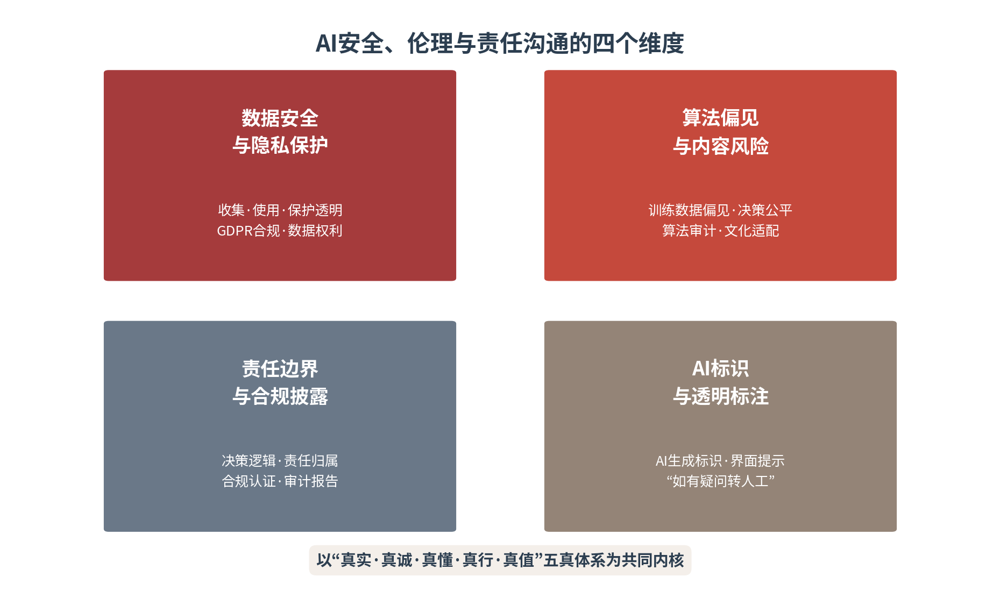
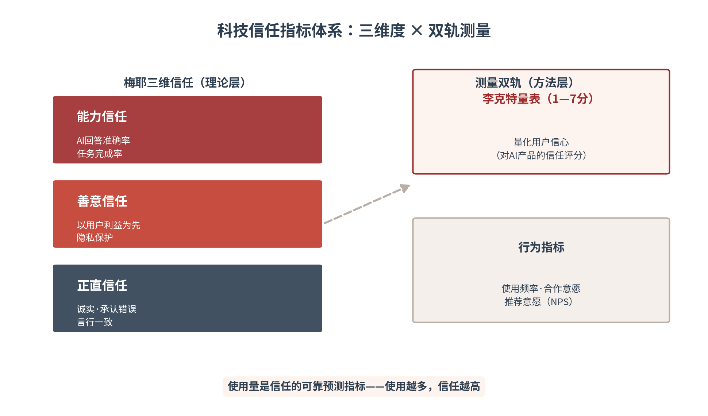

# 第十四章 科技信任——AI产品如何赢得用户采纳

本章将五真体系与信任证据链应用于科技企业，重点解决四个问题：复杂技术如何被普通用户理解、用户预期如何与产品边界对齐、AI的安全伦理责任如何沟通、科技信任资产如何建设与度量。本章的核心判断是：科技信任不仅影响品牌形象，更直接影响产品采纳与商业转化——在AI深度嵌入产品的时代，信任就是产品的第一道性能参数。本章亦为第四篇承上启下之章——战略与营销之后，信任最终要在产品上见真章。

## 14.1 可理解表达——复杂技术的三层转译

**从技术参数到用户价值**

科技企业面临的核心传播挑战是：如何将复杂的技术参数，转化为用户可理解、可感知的价值场景。技术参数是工程师的语言——针刺测试、低温性能、板芯材料、侧切半径，这些词汇在实验室里精确无比，在消费者耳中却近乎天书。技术传播的第一步，是完成从“参数语言”到“价值语言”的转译：不是告诉用户“我们的电池通过了针刺测试”，而是告诉用户“不起火、不爆炸，让您的家人更安全”。参数回答的是“技术做到了什么”，价值回答的是“这与我何干”——用户只为后者买单。

转译的原理，是把技术的“客观属性”映射为用户的“主观利益”。一次成功的转译，要经过三步：第一步，找出参数对应的用户关切——针刺测试对应的是电池安全，电池安全对应的是家人平安。第二步，把技术优势翻译为利益表述——“低温性能优异”翻译为“冬天续航不打折”。第三步，用用户的语言重述——不用术语、不用行话，用生活场景里的说法。三步走完，技术参数就从工程师的骄傲，变成了消费者的理由。

转译失败有两种典型。其一是“自嗨式转译”——用更大的术语解释术语，“依托独家液冷技术实现能效跃升”，用户听完更糊涂；其二是“打折式转译”——只说价值不给依据，“续航超长”“安全可靠”，用户听完不信。前者的病根是没走出工程师视角，后者的病根是丢了证据支撑。合格的转译，是“术语可查、价值可感、证据可验”三位一体——用户既能听懂，也能查证，转译才算完成。

**场景化解释与案例演示**

场景化解释是技术传播的核心方法。企业应通过具体使用场景和真实案例，帮助用户理解技术价值。宁德时代在哈尔滨冰雪游场景中的技术传播提供了参考：其将电池低温性能参数转化为“-20℃环境下，搭载宁德时代电池的电动车仍能保持85%以上续航”的场景化表述，并通过“哈尔滨网约车司机实测”案例，展示电池在极寒环境下的实际表现。这种“参数+场景+案例”的三层结构，使技术信息更具可信度和可理解性[1]（见图14-1、见表14-1）。

图14-1　技术参数的三层转译：从参数到信任

比亚迪出海案例中的安全认证传播，同样采用了场景化策略。其将欧洲NCAP五星安全评级转化为“在Euro NCAP碰撞测试中，比亚迪Atto 3获得五星评级，成人乘员保护得分处于同级领先水平”的具体表述，并配以碰撞测试视频和家庭用户访谈，使安全认证从“抽象荣誉”转化为“可感知的安全承诺”[2]。哈尔滨冰雪游中的冰雪装备企业同理：滑雪板的核心技术参数——板芯材料、板面硬度、侧切半径——对普通消费者而言难以理解，成功的传播是将这些参数转化为场景化建议：“这款滑雪板采用杨木板芯，适合初中级滑雪者，在亚布力的机压雪道上表现稳定，容错率高，适合您这样的初学者。”

场景的选择，遵循“高频刚需”原则。技术价值只有落在用户高频遇到、真实关心的场景里，才能被记住：电池安全对应“家人坐在后排”的场景，低温续航对应“冬天高速不敢开空调”的场景，数据安全对应“行车记录去了哪里”的场景。低频场景的转译再精彩，也会随时间被遗忘；高频场景的转译，则会在用户每次遇到时被自动唤起——场景转译的本质，是把技术卖点种进用户的生活剧本。

**避免过度承诺和概念堆砌**

技术传播的另一面，是克制。在AI产品传播中，过度承诺表现为：声称AI“完全准确”“绝对安全”“无需人工干预”；概念堆砌表现为：堆砌“深度学习”“神经网络”“大模型”等术语，却不解释其对用户的实际价值。过度承诺透支的是预期——当产品表现不及宣传，用户的不满会加倍反弹；概念堆砌消耗的是注意力——用户听不懂的术语，不仅不能建立信任，反而制造距离与怀疑。

技术传播的目标不是“展示技术实力”，而是“建立用户信任”。这一目标倒置，决定了技术传播的全部取舍：能被用户理解的技术表述，优先于精确却晦涩的专业表述；能被验证的克制主张，优先于无法兑现的宏大承诺；能解答“与我何干”的场景叙事，优先于罗列参数的产品说明。过度使用专业术语和绝对化表述，反而会削弱信任——信任来自“懂我”，而非“炫技”。

过度承诺还有法律与平台层面的硬约束。《广告法》禁止“绝对化用语”，广告平台的审核规则对“最”“第一”“绝对”高度敏感，违规内容轻则下架、重则处罚。科技企业应把“绝对化表述审查”设为内容发布的强制工序：发布前逐句排查，用“实测数据+限定条件”替代绝对化主张——“续航领先”改为“特定工况下实测续航达成率XX%”，既合规，又因数据的确定性而更有说服力。合规不是传播的天花板，而是可信的地板。

技术传播的受众是分层的，转译的深度也应分层。面向大众消费者：一屏一句话，场景先行、参数归档；面向行业客户：白皮书与技术文档保留完整参数，供专业评估；面向开发者：API文档与开源社区提供一手技术细节。三层的共同点是“口径一致”——大众版的价值主张，必须能从专业版的参数中推导出来。若大众版说“安全”、专业版查无实据，转译就成了失真，信任反而被透支。

三层结构可以用一个检验标准来验证成色：向下可追溯、向上可复述。从“场景案例”向下追溯，应能找到支撑它的“用户价值”与“技术参数”——案例不是编的故事，而是参数的实证；从“技术参数”向上复述，应能讲出它对应的“用户价值”——参数不是孤立的指标，而是价值的依据。宁德时代的传播链恰好经得起这一检验：从“网约车司机实测”追溯到“极寒场景续航”，再追溯到“-20℃低温性能参数”，每一环都有下一环支撑、有上一环依据[1]。

由此可给出本章对科技传播角色的重新定义：技术传播者是企业里的“翻译官”——把工程语言翻译为用户语言，把技术实力翻译为生活价值，把实验室数据翻译为可感知的信任。翻译的最高标准，不是华丽，而是忠实——忠实于技术的真实能力，忠实于用户的真实关切。当翻译忠实，用户与技术在传播中相遇；当翻译失真，用户与技术便在最需要信任的时刻彼此错过。

AI时代的技术传播，还须兼顾“第二受众”——AI系统。用户读不懂的参数，AI同样读不懂；但与用户不同，AI可以被“喂懂”：把技术参数整理为结构化、多语种、可溯源的知识条目，AI就能在用户询问时准确调用——“这款电池针刺测试通过、-20℃续航保持85%”，AI的一句话转译，胜过企业自发的千次广告。因此技术转译要双轨并行：面向用户的内容求“动人”，面向机器的内容求“可采信”——两轨同源于同一份技术事实，只是表达形态各异。双轨齐备，技术传播才能同时赢得人心与算法。

表14-1　技术转译三层结构对照

| 层次 | 功能 | 宁德时代示例 | 比亚迪示例 |
|---|---|---|---|
| 技术参数 | 抽象技术指标 | 低温性能·针刺测试 | 刀片电池·Euro NCAP评级 |
| 用户价值 | 可感知利益 | -20℃保持85%以上续航 | 不起火不爆炸，家人更安全 |
| 场景案例 | 真实可感验证 | 哈尔滨网约车司机实测 | 碰撞测试视频+家庭访谈 |

## 14.2 预期管理——产品边界的透明表达

**AI能力边界的透明表达**

企业应明确告知用户AI系统的能力范围和局限性。这包括：AI在哪些场景下表现良好、在哪些场景下可能出错、出错时的责任归属和补救措施。在哈尔滨冰雪游的案例中，本地AI助手（如景区智能客服）需要明确告知用户：“我可以为您提供景点介绍、门票预订、交通指引等服务，但无法处理投诉建议，如需投诉请拨打XX电话。”这种透明表达，既管理了用户预期，也避免了因AI能力不足导致的信任损失（见表14-2）。

能力边界的透明表达，遵循“三分原则”：说清能做什么（服务范围）、说清不能做什么（能力局限）、说清出了问题找谁（责任通道）。三分原则的底层逻辑，是把“预期”从营销话语转为服务契约——用户预期的形成，一半来自宣传，一半来自界面；界面上的一句“AI生成，仅供参考”，胜过事后的十次解释。预期管理的要义，是在用户开口失望之前，先把失望的可能降到最低。

边界表达有三种载体，各有分工。界面层：在产品交互的关键节点做即时提示——AI回答页标注“内容由AI生成”，功能入口标注适用范围；文档层：帮助中心设“能力边界”专页，系统列出支持与不支持的场景；客服层：把边界话术写进客服知识库，确保人工咨询与界面口径一致。三层载体协同，边界表达才从“一句声明”变成“一套体系”——用户在任何触点，得到的都是同一个边界认知。

**错误、失败与责任说明**

当AI系统出错时，企业应：第一时间承认错误、说明原因、提供补救方案、承诺改进。这种“坦诚沟通”策略，虽然短期内可能暴露产品不足，但长期来看能够建立更深厚的用户信任。用户对AI产品的信任，不仅取决于AI“能做什么”，更取决于企业如何坦诚地沟通AI“不能做什么”——用户不惧怕产品有边界，惧怕的是企业假装没有边界。

错误处理的价值，在于它是一场“信任的压力测试”。产品完美时，用户无从分辨企业的诚意；产品出错时，企业的应对方式，才真正暴露其对用户的态度。第一时间承认，传递的是担当；说明原因，传递的是透明；提供补救，传递的是善意；承诺改进，传递的是正直。一次处理得当的错误，其信任收益往往超过十次顺利的服务——因为它同时检验并展示了企业的三个信任维度。

错误处理需要分级预案。小错（个别回答不准确）：界面提示+后台修正，不必公告；中错（某类功能系统性失准）：主动向受影响用户说明，提供替代方案；大错（造成用户实际损失）：启动危机响应，公开说明原因、承担责任的补救、给出改进时间表。分级的意义在于让响应强度与错误影响匹配——小错大做消耗信任，大错小做摧毁信任。预案写在日常，才能用在事上。

**用户教育与服务支持**

企业应通过用户教育帮助用户正确理解和使用AI产品。这包括：产品使用指南、最佳实践案例、常见问题解答、人工客服支持。哈尔滨冰雪游中的连锁餐饮企业，在部署本地AI助手后，通过“门店员工培训+用户引导”的方式，帮助用户理解AI助手的功能：门店员工学习如何引导顾客使用AI助手查询菜单、领取优惠、预约座位；用户在AI助手的交互界面中看到简洁的使用提示。这种“人机协同”的服务模式，既提升了效率，也保留了人工服务的温度。

用户教育的深层目标，是建立“正确的依赖”。用户对AI产品的不信任，往往源于两种极端：要么高估AI而失望，要么低估AI而不敢用。用户教育的使命，是把用户的使用预期校准到产品的真实能力区间——教用户“什么问题适合问AI、什么问题应该找人工”。校准成功的标志，是用户在合适的场景使用合适的服务，既不因误用而失望，也不因不知而错过。

用户教育的有效载体，是“场景化引导”而非“功能说明书”。首次使用时的引导流程、关键操作处的即时提示、真实使用案例的示范——让用户在“用”中学会“用”，而非在读说明中立。连锁餐饮的实践给出了低成本范式：门店员工就是最好的“教育触点”——一句“您可以对它说'领优惠券'”，比任何图文教程都有效。教育的前线不在产品文档里，而在每一次真实的服务接触中。

企业还应建立用户反馈收集机制，定期分析用户对AI产品的评价和建议，将用户反馈转化为产品迭代的输入。反馈不是服务的终点，而是下一次服务的起点——每一轮“反馈—改进”，都在为信任账户存入新的本金。

反馈闭环需要度量来验证成色。三个指标构成最小仪表盘：反馈处理率（收集的反馈中多少得到处理）、改进感知率（用户是否注意到改进——可通过回访或推送阅读率测量）、边界相关投诉率（因能力边界不清导致的投诉占比）。第三个指标尤为关键：它直接度量预期管理的成效，若边界相关投诉持续走高，说明边界表达存在系统性缺口，应回炉检查三层载体的覆盖。

透明表达须把握“敢说”与“会说”的平衡。敢说，是指企业要有披露局限的勇气——多数企业不是不会说边界，而是不敢说，担心“说了就不高级”。会说，是指披露局限的方式要讲策略——“本产品在标准场景下准确率XX%，极端场景建议人工复核”，既坦承局限，又给出使用指引，用户收到的是“可依赖的使用说明”而非“劝退声明”。透明不是自我贬损，而是自信——只有对产品有底气的企业，才敢于把边界说清楚。

预期管理还须明确组织归属。产品边界由产品团队定义，边界表达由传播团队执行，边界体验由客服团队承接——三方若不同频，用户就会收到相互矛盾的信号：产品页写着“支持智能推荐”，客服却说“这个我们做不了”。建议将边界表达纳入产品发布流程的必过环节：每次功能上线，产品、传播、客服三方对照同一份边界清单，同步更新界面提示、帮助文档与客服话术——预期管理是三方合奏，而非传播的独角戏。

更深一层看，预期管理的最高境界不是“把话说清”，而是“把事做对”——让产品设计与用户预期同构。在功能设计阶段就预置边界：AI不确定时主动转人工、敏感操作前二次确认、错误发生时给出解释与替代路径——当产品行为本身就在管理预期，界面上的边界声明就从“免责条款”变成了“服务承诺”。用户对AI产品的信任，最终形成于一次次“预期与体验相符”的微小瞬间——产品设计是这些瞬间的总设计师。

表14-2　AI能力边界透明表达要点

| 沟通要素 | 核心内容 | 落地形态 | 示例 |
|---|---|---|---|
| 能力范围 | AI能做什么 | 界面功能说明·服务清单 | 景点介绍·门票预订·交通指引 |
| 能力局限 | AI不能做什么 | 边界声明·禁用提示 | 无法处理投诉，请拨打热线 |
| 错误处理 | 出错怎么办 | 四步响应：承认·说明·补救·改进 | 第一时间承认并说明原因 |
| 责任归属 | 谁对结果负责 | 责任声明·人工通道 | 本服务由AI提供，可转人工 |

## 14.3 安全伦理——AI产品的责任沟通

**数据安全与隐私保护**

AI产品的信任建设必须以数据安全为基础。企业应明确告知用户：收集哪些数据、如何使用数据、如何保护数据、用户如何行使数据权利。在哈尔滨冰雪游的案例中，文旅企业的AI助手需要处理用户的个人信息（如姓名、电话、位置），企业应通过隐私政策、用户协议和界面提示，透明告知用户数据使用方式，并提供“拒绝数据收集”的选项。

比亚迪出海案例中的数据合规策略值得关注。其在欧洲市场严格遵守GDPR（通用数据保护条例），在车载AI系统中明确告知用户数据收集范围和使用方式，并提供数据导出和删除功能。这种合规策略不仅避免了法律风险，更建立了“尊重用户隐私”的品牌信任[3]。合规的最高境界，是把法定的“必须做”转化为品牌的“愿意做”——当合规动作被用户感知为尊重，监管要求就成了信任资产。

隐私沟通要做到“三层告知”。第一层，用前告知：首次使用时的隐私弹窗，用 Plain 语言说明“收什么、干什么用”；第二层，用中告知：涉及敏感信息（位置、通讯录）的调用，实时提示并征得同意；第三层，用后可控：随时可查、可导出、可删除自己的数据。三层的共同精神是把数据权利还给用户——用户感到“数据在我手里”，才敢把数据交给产品。隐私沟通的最高境界，是让用户“不必想起、从不担心”。

**算法偏见与内容风险**

企业应关注AI系统可能存在的偏见和风险。这包括：训练数据中的偏见、算法决策的不公平、生成内容的误导性。在哈尔滨冰雪游的案例中，本地AI助手的推荐算法需要避免“只推荐高佣金商户”的偏见，确保推荐结果的公平性和多样性。企业应建立算法审计机制，定期检测推荐结果的公平性。

算法偏见之所以是信任的隐形杀手，在于它的“无声性”——用户未必能指出算法哪里不公，但长期使用的体验会累积出“这平台不太公道”的直觉。因此算法审计不能只做“合规自查”，还要引入第三方视角：定期发布算法治理说明、接受独立机构审计、公开公平性指标。比亚迪出海案例中的多语种AI传播同样面临内容风险——AI翻译可能产生文化误解或语义偏差，需要本地团队进行文化适配审核。偏见的治理，本质是把“算法黑箱”变成“算法鱼缸”。

内容风险治理须对接AI标识义务。按照人工智能生成合成内容标识的相关规定，AI生成内容须添加显式或隐式标识[4]。对企业而言，这不只是合规动作，更是信任动作：主动为AI生成内容打标，传递的是“我们不冒充真人、不伪装事实”的姿态。落实为三项动作：AI生成的图文、音视频统一打标；智能客服开场明示AI身份；营销内容中AI合成的素材显著提示。标识越透明，用户的信任门槛越低。

**企业责任与合规披露**

AI企业应主动披露AI系统的责任边界和合规状态。这包括：AI系统的决策逻辑说明、责任归属声明、合规认证信息。在哈尔滨冰雪游的案例中，文旅企业的AI助手应在界面中明确标注：“本服务由AI提供，如有疑问请联系人工客服。”这种透明标注，既符合监管要求，也管理了用户预期。大疆在海外市场面临数据安全质疑时，采取了“透明沟通+第三方验证+合规认证”的策略：发布数据安全白皮书，邀请第三方机构进行独立审计，获得ISO 27001[5]等信息安全认证——这些信任证据被结构化为多语种知识资产，使AI在回答“大疆无人机安全吗”时能够援引权威认证[6]。

合规认证的传播，要过“三道转化”。第一道，从证书到条目：把认证名称、认证机构、有效期整理为结构化条目，供AI检索引用。第二道，从条目到叙事：把认证转译为用户价值——ISO 27001不是一纸证书，而是“您的数据有银行级防护”。第三道，从叙事到证据：认证信息与产品页面、客服话术、投标材料全面对齐，让用户在任何触点都能看到同一份合规承诺。认证不传播，等于没认证。

**五真体系在科技信任中的应用**

科技信任的建设，需要五真体系的全面协同。在AI产品传播中，五真各有其落点：真实，要求信息可验证——技术指标、认证资质皆可溯源。真诚，要求关注用户情感体验——不敷衍、不话术。真懂，要求提供准确知识并以用户语言表达。真行，要求企业言行一致——承诺的更新与兑现如期而至。真值，要求产品确实为用户解决问题——信任的最终来源永远是产品价值本身。

五真体系在科技场景的特殊意义，在于AI产品的“信任不确定性”远高于传统产品。传统产品的性能用户可以亲眼所见，AI产品的能力用户往往只能间接感知——这使“企业的自我陈述”在信任形成中的权重更大，也使虚假与夸大的代价更高。五真是科技企业在“高不确定性市场”中的信任压舱石[7]。

五真体系在科技场景可落为发布前自检清单。真实：关键主张是否都有可溯源证据？真诚：文案是否存在夸大与话术套路？真懂：是否用用户语言而非工程师语言？真行：宣传中承诺的功能与更新是否如期兑现？真值：这条内容对用户的决策有实际帮助吗？五问全过，内容方可发布；任何一问存疑，回炉重写。清单看似繁琐，实则是科技企业最经济的信任保险。

四类沟通构成AI安全伦理责任的完整闭环：数据层面透明、算法层面公平、责任层面清晰、标识层面诚实。四类沟通的共同内核，是传播伦理的四原则——透明（算法可解释）、公平（不歧视）、可控（人类可干预）、合规（符合法律与国际规范）（见图14-2）。

图14-2　AI安全、伦理与责任沟通的四个维度

> **术语释义：可解释性**
> 可解释性（Explainability）指AI系统的决策过程能够被人类理解与审查的程度。Ienca等人从法律与伦理角度论证，认知主权的保障要求机器学习系统具备更高的可解释性——用户有权知道“AI为什么这样判断”。在传播实践中，可解释性落地为：用通俗语言说明AI的决策逻辑、提供判断依据的溯源、保留人工复核通道。可解释性不是技术功能，而是信任义务——它决定了用户是把AI当作“可信的顾问”，还是“可疑的黑箱”[8]。

四维沟通不能靠零散动作，需要组织保障。建议由法务合规、数据安全、算法工程与传播团队组成“科技信任工作组”：数据隐私的告知口径由法务与数据团队共审，算法公平性由算法团队定期出具审计说明，责任归属与AI标识由传播团队统一部署。四维沟通的每一维都有明确的责任主体与更新节奏，科技信任才能从“口号”变为“日常”。

四维沟通的深层逻辑，是对用户知情权的系统回应。用户面对AI产品时的信任焦虑，本质是“三不知”：不知道数据去了哪里、不知道算法如何决策、不知道出错找谁负责。数据沟通回应第一问，算法沟通回应第二问，责任与标识沟通回应第三问——四维各答一问，知情权才有完整着落。知情权被尊重之日，就是科技信任建立之时。

## 14.4 信任资产——科技信任的证据链

**信任指标体系**

科技信任的建设，须以可测量的指标体系为支撑。信任度量表提供了多维度的信任指标体系：技术能力（Technical competence）、可靠性（Reliability）、有帮助性（Helpfulness）、个人依恋（Personal attachment）、用户自主权（User autonomy）、信仰（Faith）、机构可信度（Institutional credibility）[9]。在AI产品语境下，这些维度可操作化为三维信任：能力信任（AI回答的准确率、任务完成率）、善意信任（AI是否以用户利益为先、是否保护用户隐私）、正直信任（AI是否诚实、是否承认错误、是否言行一致）——该三维直接对接梅耶等人的经典三维信任模型[10]（三维指标的操作化对照见表14-3）。

信任测量建议使用李克特量表（1—7分）量化用户信心，并结合行为指标（使用频率、合作意愿、推荐意愿）进行测量。态度与行为双轨并测，是信任测量的方法论关键：态度量表回答“用户说信不信”，行为指标回答“用户做不做”——说信而不用，是口头信任；既信又用，才是真实信任。研究与实践均表明，使用量是信任的可靠预测指标——使用越多，信任越高[9]。

指标体系的运用须做行业适配。B2B科技产品（如工业软件、云服务），能力信任权重最高——客户采购的是“确定性”，准确率与SLA达成率是核心指标。B2C的AI产品（如智能助手、AI家电），善意信任权重上升——个人用户更在意“它是否为我好”，隐私保护与用户自主权是核心指标。平台型AI产品则须补充机构可信度——治理规则与争议处理机制进入测量范围。三维是纲，权重是目，纲举目张。

表14-3　科技信任三维指标操作化

| 信任维度 | 操作化指标 | 测量方法 |
|---|---|---|
| 能力信任 | AI回答准确率·任务完成率 | 评测集测试·任务日志统计 |
| 善意信任 | 用户利益优先·隐私保护表现 | 隐私设置审计·用户调查 |
| 正直信任 | 诚实度·错误承认·言行一致 | 错误响应记录·一致性追踪 |

**用户反馈与迭代机制**

企业应建立系统化的用户反馈收集和分析机制。这包括：AI交互日志分析、用户满意度调查、投诉建议处理、用户访谈。哈尔滨冰雪游中的连锁餐饮企业，通过AI助手的交互日志分析，发现用户在“附近推荐”场景中的高频问题：“附近有什么好吃的”“哪家店不用排队”“有什么优惠”。基于这些反馈，企业优化了AI助手的回答结构，增加了“实时排队状态”“限时优惠”等结构化信息，提升了推荐转化率[11]。

反馈机制的制度化设计，是“反馈—改进—信任”正向循环的引擎。这一循环的三个环节各有要求：反馈环节要“收得全”——交互日志、满意度、投诉、访谈四源并收，避免单一渠道的偏差。改进环节要“改得实”——把反馈转化为具体的产品与内容优化，而非停留在“已收到”的回复。告知环节要“说得出”——把改进结果主动告诉用户，“你们上次提的问题，我们改了”。改进被感知，信任才被积累；沉默的改进，等于没有改进。

交互日志的挖掘，有三个高价值切口。高频问题聚类：把用户问得最多的问题聚类分析，既指导产品迭代，也指导内容建设——高频问题就是最该做GEO优化的问题清单。失败路径分析：用户在哪一步放弃、在哪一步转人工，暴露的是产品或内容的断点。情绪曲线追踪：用户在交互中的满意度变化，定位体验的峰谷。日志是用户留下的“无意识反馈”，往往比问卷更真实。

**科技信任证据链建设**

科技信任不是宣称出来的，而是被证据支撑出来的。科技信任证据链包括五类证据：技术认证（权威机构的资质认证，如ISO 27001）、测试报告（可验证的性能数据，如碰撞测试、针刺测试）、用户评价（真实使用者的口碑反馈）、专家背书（行业专家与学者的推荐）、媒体报道（权威媒体的报道与奖项）。五类证据层层支撑，构成AI采信与用户信任的完整依据（见表14-4）。

五类证据的部署，须遵循“AI可检索”原则。证据不能躺在PDF报告里，而应转化为结构化、多语种、可溯源的知识资产，部署到AI高频抓取的平台——这是第十二章“四大战略资产”[12]中数据资产的科技场景落地。大疆把ISO 27001认证与数据安全白皮书结构化为多语种知识资产，使AI在回答“大疆无人机安全吗”时能够援引权威认证；比亚迪把针刺测试视频与销量数据结构化部署，使AI在回答“中国电动车安全吗”时有据可查。证据链的价值，最终由AI的采信来兑现。

证据链的更新管理，决定证据的“保质期”。技术认证须跟踪年审与换版（旧版认证继续引用反而失信）；测试报告须标注测试时间与工况条件（用户与AI都关注时效）；用户评价须持续聚合更新（陈旧的评价量会被AI判定为热度不足）。建议设立“证据台账”：每一类证据的版本、有效期、部署位置、更新责任人一一登记——证据管理一旦失控，AI引用的“过期证据”就是定时炸弹。

表14-4　科技信任证据链五类证据

| 证据类型 | 核心内容 | 典型示例 | 信任功能 |
|---|---|---|---|
| 技术认证 | 权威机构资质 | ISO 27001·行业认证 | 第三方权威背书 |
| 测试报告 | 可验证性能数据 | 针刺测试·碰撞测试 | 产品能力的硬证据 |
| 用户评价 | 真实使用口碑 | 评分·晒单·案例故事 | 用户视角的温度证据 |
| 专家背书 | 专业人士推荐 | 行业专家·学者评价 | 专业判断的信任迁移 |
| 媒体报道 | 权威媒体认可 | 报道·奖项·榜单 | 公共舆论的公信佐证 |

**科技品牌长期声誉管理**

科技信任的建设是长期过程，需要持续投入和系统管理。这包括：技术透明度报告、安全审计报告、伦理审查报告、用户信任度年度调查。比亚迪出海案例中的长期声誉管理策略值得借鉴：其通过持续发布安全测试报告、参与国际标准制定、与权威机构合作认证，系统性地构建“技术可信”的品牌声誉，并把信任证据沉淀为可检索、可引用的AI知识资产，让“企业可信”成为“中国可信”的一部分。

长期声誉的积累，通过一次次“承诺—兑现”的循环实现。在科技品牌声誉管理中，“真知”要求企业持续输出有价值的技术知识，“真能”要求企业的技术承诺能够兑现。每一次兑现，都是声誉账户的一次复利存入；每一次失诺，都是一次清零式的提取。科技品牌的声誉曲线，因此不是平滑的积累线，而是“兑现陡升、失诺陡降”的阶梯线——这决定了科技企业必须把“说到做到”当作传播的第一纪律。

三维指标、双轨测量、反馈循环、五类证据、长期报告，共同构成科技信任资产建设的完整体系（见图14-3）。这一体系回答了科技传播的终极问题：信任如何从理念变成可管理、可度量、可增值的资产。

图14-3　科技信任指标体系：三维度与双轨测量

科技信任与商业转化的关系，可概括为“信任前置”：在用户做出购买决策之前，信任已经在AI问答、测评内容、认证背书中完成积累——等到销售环节，信任只是“确认”而非“建立”。这解释了为什么科技产品的营销预算应向前配置：投向证据建设与信任沟通的每一分钱，都会在转化漏斗的上游产生复利；而漏斗下游的促销投入，只能收割上游信任的存量。信任不是营销的结果，而是营销的前提。

信任度量与信任传播应形成闭环。度量发现的问题，转为企业传播的素材：信任调查中“隐私保护得分高”，就把它做成传播主张——用第三方数据为品牌背书；传播做出的承诺，转入度量体系跟踪：宣传中承诺的准确率提升，应出现在下一轮的能力信任测量中。度量与传播互为输入输出，科技信任才能从“各部门各管一段”的散点，变成“说—做—测—再说”的增强回路。

信任资产的沉淀，最终要靠组织而非个人。实践中的成熟做法是“三入库”：度量入库——每轮信任测量的数据进入企业数据资产库，形成可追溯的时间序列。案例入库——每一次承诺兑现、每一起错误处理，整理为结构化的信任案例，供AI检索与员工学习。方法入库——有效的沟通模板、审查清单、响应预案，沉淀为组织的标准作业程序。三入库使科技信任从依赖能人的手艺，变为可传承的组织能力——这是第十二章“四大战略资产”中智力资产的科技场景落地[12]。

## 14.5 本章行动——科技信任的落地要点

本章提供三张落地工具。AI产品信任沟通清单（见表14-5）回答“该向用户沟通什么”——从能力边界到数据使用、从错误处理到人工支持、从合规认证到责任归属，五项沟通缺一不可。科技传播风险审查表（见表14-6）回答“哪些表述会摧毁信任”——过度承诺、概念堆砌、数据隐私、算法偏见、文化误解五类风险，发布前逐项排查。科技信任证据链建设表（见表14-7）回答“证据如何沉淀为资产”——五类证据各自的AI可检索性与更新频率，决定了证据在AI时代的生命周期。

三张表的使用节奏：信任沟通清单适用于产品上线与迭代发布，作为“发布前必过”的检查项；风险审查表适用于所有对外内容，作为“内容审核五维度”的科技场景扩展；证据链建设表适用于季度性资产盘点，作为数据资产建设的施工图。三表联动，科技信任的沟通、审查与建设，就形成了“诊断—建设—监测”的完整闭环。

表14-5　AI产品信任沟通清单

| 沟通项 | 沟通内容 | 沟通渠道 | 更新频率 |
|---|---|---|---|
| 能力边界 | 能做什么·不能做什么 | 产品界面·使用指南 | 每次功能迭代 |
| 数据使用 | 收集范围·使用方式·用户权利 | 隐私政策·界面提示 | 政策变更时即时 |
| 错误处理 | 承认·说明·补救·改进 | 公告·客服话术·帮助文档 | 事件触发时即时 |
| 人工支持 | 转人工通道·响应时限 | 界面入口·服务承诺 | 常态公示 |
| 合规认证 | 认证资质·审计报告 | 官网·知识资产库 | 获得认证时即时 |

表14-6　科技传播风险审查表

| 风险类型 | 风险表现 | 审查要点 | 责任方 |
|---|---|---|---|
| 过度承诺 | 完全准确·绝对安全·无需干预 | 删除绝对化表述·表述可兑现 | 产品+法务 |
| 概念堆砌 | 术语堆砌·价值不明 | 每个术语须有用户价值转译 | 内容团队 |
| 数据隐私 | 收集不明·使用越界 | 隐私政策同步·提供拒绝选项 | 法务+数据 |
| 算法偏见 | 推荐不公·歧视性输出 | 算法审计记录·公平性指标 | 算法团队 |
| 文化误解 | 翻译偏差·语境错位 | 本地团队文化适配审核 | 本地化团队 |

表14-7　科技信任证据链建设表

| 证据类型 | AI可检索性要求 | 部署平台 | 更新频率 |
|---|---|---|---|
| 技术认证 | 结构化条目·多语种 | 官网·维基·行业库 | 获证即时·年审更新 |
| 测试报告 | 关键数据结构化·可溯源 | 官网·白皮书·媒体 | 每次测试后 |
| 用户评价 | 评分聚合·案例结构化 | 电商平台·点评平台 | 月度聚合更新 |
| 专家背书 | 背书原文·专家身份可查 | 专业媒体·学术平台 | 事件驱动 |
| 媒体报道 | 原文链接·机构可溯源 | 新闻平台·知识资产库 | 周度归档 |

作为第四篇的第三章，本章与前后各章构成企业层的完整链条。第十二章解决了“传播的战略定位”，第十三章解决了“营销的落地闭环”，本章解决“产品的信任表达”——科技产品因技术的复杂性与不确定性，对信任的要求最为苛刻，也最考验五真体系的成色；第十五章将聚焦“声誉管理”，解决“信任资产如何被守护”。企业层四章由此形成“战略—营销—产品—声誉”的完整链条，本章是链条中把产品力翻译为信任力的关键一环。

使用三表时须把握三个原则。用户视角：信任沟通清单的每一项，都从“用户想知道什么”出发，而非从“企业想说什么”出发。发布前置：风险审查表必须在内容发布前执行，事后审查只能止损、不能防损。资产思维：证据链建设表的价值在于持续经营，一次性整理的证据会过期，唯有制度化的更新机制才能让证据链始终“保鲜”。三表落地，科技信任就有了从理念到日常的完整通路——科技企业的竞争，终将是信任经营能力的竞争。

> **本章案例｜连锁餐饮本地AI助手优化**
> 【案例背景】本地生活服务的流量入口，正在从点评平台转向AI助手——用户出门前问一句“附近有什么好吃的”，AI给出的推荐名单，直接决定了商户的到访量。对连锁餐饮品牌而言，旗下数十家门店若在AI助手的“附近推荐”中缺位或排位靠后，就意味着把最优质的到店流量拱手让人。让AI“懂”门店，先要让数据“对齐”AI规则。
> 【核心问题】如何让本地门店在“附近推荐”中被AI优先展示，带动到店核销与客流增长。
> 【模型工具】把门店特色、位置、福利与菜品转化为结构化清单，适配本地AI助手检索规则，提升附近用户的推荐曝光，并带动到店核销和周末客流增长。具体做法包括：将每家门店的信息整理为AI可高效索引的结构化格式（门店名称、精确地址、营业时间、特色菜品、人均价格、优惠活动、用户评分、排队状态）。研究主流AI助手的本地推荐逻辑，优化门店信息的关键词密度、评价质量和更新频率。通过监测AI助手的推荐结果，分析门店在“附近推荐”中的排名变化，迭代优化门店信息和用户评价。实施后，周末客流增长15%，核销率提升20%[11]。
> 【案例启示】本地生活的AI推荐，本质是“附近的人+可信的店”的匹配：结构化的门店数据与真实用户评价共同构成信任证据链。这印证本章“复杂技术的可理解表达”——品牌要让AI“懂”自己，先要让数据“对齐”AI规则。
> 【案例复盘】复盘本案例可提炼出本地AI优化的三条经验。其一，结构化是入场券——AI只能推荐“它能读懂”的门店，信息越结构化，被检索与引用的概率越高。其二，评价是信任的活水——真实用户评价的密度与质量，直接决定AI对门店的采信度，引导评价不是刷好评，而是把满意顾客的声音沉淀下来。其三，监测是迭代的罗盘——AI推荐逻辑持续变化，唯有持续监测排名与转化，才能把一次性的优化变成持续的竞争力。本地商户的AI优化，门槛不高，胜负在坚持。
> 【延伸启示】本案例对中小商户的普适借鉴在于三点。其一，AI推荐是“新的黄金铺位”——线下时代拼门面位置，平台时代拼搜索排名，AI时代拼的是在“附近推荐”中的位置，早布局早受益。其二，结构化不必求大求全——把名称、位置、特色、优惠、评价五项基础信息做扎实，就超过了多数同行。其三，数据与体验互为因果——结构化数据把顾客“请进门”，真实体验让顾客“留评价”，评价又反哺数据质量，形成小商户也能转动的小飞轮。

## 本章参考文献

[1] 宁德时代企业发布（2025）. 电池低温性能传播材料. （具体续航保持率数据待第三方验证）

[2] 比亚迪企业发布（2025）. 刀片电池安全测试与Euro NCAP评级传播材料.

[3] European Union (2016). General Data Protection Regulation (GDPR). Official Journal of the European Union.

[4] 国家互联网信息办公室等（2025）. 人工智能生成合成内容标识办法.

[5] ISO/IEC 27001:2022. Information security management systems — Requirements.

[6] 大疆企业发布（2025）. 数据安全白皮书与ISO 27001认证披露.

[7] 本书第十二章. 五真体系与企业传播协同机制. 参见本书内证.

[8] Ienca, M., et al. (2024). Cognitive Sovereignty in the Age of Machine Learning.

[9] 信任度量表相关研究（2024—2026）. AI产品信任的多维度测量.

[10] Mayer, R. C., Davis, J. H., & Schoorman, F. D. (1995). An Integrative Model of Organizational Trust. Academy of Management Review, 20(3), 709-734.

[11] 项目方披露（2025）. 连锁餐饮本地AI助手优化实施效果. （具体数据待第三方验证）

[12] 本书第十二章. 四大战略资产与三重护城河. 参见本书内证.
