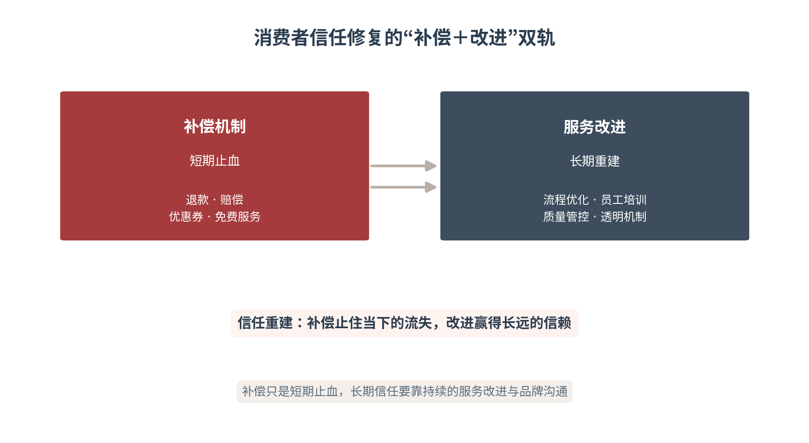

# 第十六章 声誉管理——企业危机的预警、回应与修复

本章将数据力、分发力、进化力与信任修复应用于企业危机管理，提出企业危机管理从被动应对转向早期预警、快速回应和长期修复。引入“负面飞轮与三段式防御”框架（实时监测—快速响应—转化修复），考虑AI传播放大效应，重点分析消费者信任、合作伙伴信任和资本市场信任的修复路径。本章亦为第四篇收官之章——战略、营销、产品、声誉四环闭合，方成企业增长之闭环。

本章承接第十三至十五章的企业层体系，把数据力、分发力、进化力与信任修复贯通于危机场景：预警即感知，响应即触达，修复即进化，危机治理即信任的守护。企业层的四章——战略、营销、产品、声誉——至此完成从“建立信任”到“守护信任”的完整闭环。

声誉是企业最脆弱的资产，也是最长久的资产——脆弱在它可以毁于一次危机，长久在它可以重建于一次次真诚的修复。本章的全部要义，正在于教会企业在声誉的天平上，学会经营那一头更重、也更慢的砝码。

本章的底色，是长期主义。危机的应对可以在一夜之间完成，声誉的修复却需要经年累月的真诚——这是企业传播战略在声誉维度上的终极命题。

## 16.1 早期预警——企业危机的三级预警

**舆情监测与风险识别**

AI舆情监测系统能够实现早期预警，在危机“崩塌之前看见裂缝”。监测的覆盖面包括四大源：社交媒体监测（微博、抖音、小红书等平台的用户声音）、新闻媒体监测（主流媒体与行业媒体的报道）、论坛评论监测（垂直社区的讨论）、AI问答监测（AI助手中涉及品牌的问答与引用）。四源并网，才能拼出企业声誉的完整镜像——单一渠道的监测，看到的永远只是拼图的一角。

监测系统的核心能力，是四项算法：关键词监测捕捉负面信息的萌芽，情感分析判断信息的正面/中性/负面倾向，传播路径追踪识别扩散的关键节点与速度，异常检测发现偏离常态的传播模式。四项能力共同回答一个危机管理的第一性问题：现在有没有裂缝、裂缝在哪里、会不会扩大。在哈尔滨冰雪游的案例中，文旅企业通过AI监测系统在冰雪季期间实现了“7×24小时”的舆情监测，把风险识别从“事后发现”提前到了“事中预警”[1]。

四源监测中，AI问答监测是最新也最易被忽视的一环。传统监测盯的是“人说了什么”，AI问答监测盯的是“AI在说什么”——当AI在回答“XX品牌怎么样”时开始引用负面信息，危机的“机器传播”就已经启动。AI问答监测的价值在于“超前置”：负面信息尚未在人际传播中发酵，AI可能已经把它写进了答案。对AI引用内容的定期巡检，应成为企业舆情监测的常设动作——AI是声誉的“放大器”，也可能是负面信息的“第一信使”。

**产品、服务与合规三类风险**

企业危机主要来源于三个领域：产品风险（质量缺陷、安全隐患）、服务风险（服务态度、履约问题）、合规风险（违反法规、虚假宣传）。在哈尔滨冰雪游的案例中，产品风险包括冰雪装备的质量问题、冰雪景观的安全隐患；服务风险包括酒店服务态度、餐饮卫生、导游服务质量；合规风险包括价格欺诈、虚假宣传、强制消费。三类风险的共同特征，是都可能在一夜之间被AI放大为全国性舆情。

三类风险对应三套监测重点。产品风险盯“质量信号”——投诉中的质量问题关键词、质检信息、召回公告；服务风险盯“体验信号”——差评率、投诉率、服务态度关键词；合规风险盯“监管信号”——处罚信息、监管通报、执法动态。三类信号各有其数据源与预警阈值，应分开设置、统一归集。风险监测的价值，不在于“发现危机”，而在于“发现危机的先兆”（见表16-1）。

三类风险之间存在传导链条。服务风险的累积会暴露产品风险（服务环节发现的质量问题）、产品风险的爆发会牵连合规风险（事故引发的监管调查）、合规风险的处罚又会放大服务与产品的负面认知。这条传导链提示企业：风险监测不能“各扫门前雪”——服务端的异常信号，可能是产品端危机的先兆；合规端的监管动态，可能引爆全链条的舆情。三类风险统一归集、联动研判，才能看清危机的全貌。

**危机分级与责任分工**

危机分级是预警体系落地的关键。企业应根据危机的严重程度和影响范围分级：一级危机（重大安全事故、全国性舆情）由CEO直接指挥；二级危机（区域性舆情、批量投诉）由传播副总裁指挥；三级危机（个别投诉、局部负面）由部门负责人处理。分级的意义，在于让响应能力与危机严重度匹配——一级危机用三级响应，是失职；三级危机用一级响应，是浪费。

在AI传播语境下，危机分级还应考虑“AI传播放大效应”——负面信息在AI搜索中的可见性、在AI问答中的引用率、在社交媒体上的扩散速度。哈尔滨冰雪游中的文旅企业，建立了“三级预警+四级响应”的危机管理机制：三级预警包括黄色预警（负面信息出现但未扩散）、橙色预警（负面信息开始扩散）、红色预警（负面信息大规模传播）。四级响应包括部门级响应、公司级响应、集团级响应、政府联动响应[2]。预警升级，则响应升格（见图16-1）。

图16-1　企业危机：三级预警与四级响应

分级预警的技术实现，靠的是“阈值+规则+人工复核”。阈值：为负面信息量、情感倾向、传播速度等指标设定黄橙红三档临界值；规则：当指标跨过阈值时，系统自动触发相应级别的预警工单；人工复核：预警发出后，由值班人员核实是否为真实危机，避免“狼来了”式的误报消耗响应资源。三环缺一不可——只有阈值会误报，只有规则会僵化，只有人工会迟缓。机器发信号，人来拍板，是分级预警的最佳分工。

分级预警背后的组织协同，往往比技术本身更关键。预警信号要“有人看见、有人负责、有人跟进”——舆情监测员发现信号，值班负责人研判级别，对应层级责任人启动响应，三者之间的传递链条一旦断裂，预警就只是屏幕上的一条红字。成熟的预警体系，是“技术+人+流程”的三位一体：技术负责“看得全”，人负责“判得准”，流程负责“转得快”。三者缺一，预警体系都是残缺的。

监测数据的跨源打通，是预警准确性的前提。社交媒体、新闻媒体、论坛、AI问答四个数据源，口径不一、格式各异，若各成孤岛，预警就只能“各看各的”。打通的要义，是建立统一的数据标准与标签体系，让四源数据可对齐、可比对、可联动——一条负面信息在不同平台的扩散轨迹，才能在统一视图里呈现完整的传播脉络。数据不打通的监测，如同只装了一半镜子的望远镜，看到的永远只是片面的风景。

技术监测再全面，也无法替代人的判断。情感分析会把“反讽”误判为“好评”，关键词监测会把“中性讨论”标记为“负面”，传播路径追踪也画不出“情绪背后的诉求”。因此，成熟的预警体系是“机器初筛+人工研判”：机器负责海量信息的粗筛，人负责关键信号的细判——判断这是一次“需要回应的舆情”还是一次“无需理会的噪声”。技术的极限，正是人的起点；预警的最后一道防线，永远是人。

表16-1　企业危机三类风险与分级

| 风险领域 | 典型表现 | 监测重点 | 责任层级 |
|---|---|---|---|
| 产品风险 | 质量缺陷·安全隐患 | 投诉质量关键词·质检·召回 | 集团/CEO级 |
| 服务风险 | 服务态度·履约问题 | 差评率·投诉率·态度词 | 公司/传播副总裁级 |
| 合规风险 | 违反法规·虚假宣传 | 处罚·监管通报·执法动态 | 法务+传播+CEO级 |

## 16.2 事实态度行动——危机回应的三步法

**第一时间的信息发布**

危机发生后，企业应在第一时间（最好在24小时内）发布初步声明，告知公众：企业已知晓事件、正在调查、将及时公布进展。回应应包含三个核心要素：事实（发生了什么、原因是什么）、态度（企业对此事的态度、对受影响者的关切）、行动（企业将采取什么措施、如何防止再次发生）。三要素缺一不可——只有事实是冷冰冰的通报，只有态度是空洞的煽情，只有行动是没头没尾的承诺。

哈尔滨冰雪游中的某冰雪景观企业（脱敏处理），面对“景观坍塌”的安全事故，在2小时内发布初步声明：“我们已知晓今日XX时发生的景观坍塌事件，对此深感痛心。我们正在全力配合救援，并将彻查原因。对受影响游客，我们将承担全部医疗费用并给予补偿。后续进展将及时公布。”这一回应包含了事实（坍塌发生）、态度（深感痛心）、行动（配合救援、承担费用、彻查原因），有效控制了舆情发酵[3]。速度先行的前提，是“事实—态度—行动”的完整结构——抢到时间却说不清这三件事，快反而成了新的危机。

声明发布的渠道组合，应遵循“官方首发+全渠道同步”的原则。官方渠道（官网、官方账号）首发，确立权威口径的“第一落点”；随后媒体、平台、客服话术同步跟进，确保各触点口径一致。渠道错位是危机沟通的大忌——官网还在“正在核实”，客服已经在说“全额退款”，AI抓取到的就是一份自相矛盾的企业画像。渠道协同的核心，是先定口径、再定渠道，而非先发渠道、再补口径。

**责任表达与改进承诺**

企业在危机回应中应明确承担责任，而非推诿或模糊处理。责任表达包括：承认问题的存在、承认企业的责任、向受影响者道歉。改进承诺包括：具体的整改措施、时间节点、验证方式。比亚迪出海案例中的危机管理策略值得借鉴：在面对海外市场的质量质疑时，比亚迪采取了“透明沟通+快速整改+第三方验证”的策略——第一时间公布问题原因和影响范围，宣布具体的整改措施和时间表，邀请第三方机构进行独立验证并公布结果。这种“坦诚+行动+验证”的策略，将危机转化为信任建设的契机[4]。

情境危机传播理论（SCCT）指出，回应策略应与危机情境匹配[5]。责任表达的分寸，在于“认责而不失格”。坦诚承认不等于全盘自我否定——承认的是具体的问题与责任，而非否定企业的全部价值；过度自贬非但不能赢得好感，反而会放大负面形象。恰当的认责是“就事论事的坦诚”：准确界定问题的性质与范围，明确承担应负的责任，同时传递“企业有能力、有决心改正”的坚定。改进承诺的分寸，在于“可验证”——整改措施要有明确的时间节点，验证要有第三方介入，空泛的“我们将加强管理”是最无力的承诺。

改进承诺的“可验证”，落到三个要素：可量化（整改措施有具体的数量与标准，而非“大幅提升”“显著改善”）、可追踪（每项措施有明确的时间节点，可按时检查进度）、可第三方验证（邀请独立机构或行业协会验证整改效果）。三要素的共同作用，是让承诺从“表态”变成“契约”——企业与公众之间，建立起一套可检验的兑现标准。承诺越可验证，公众的等待越有耐心。

**媒体、平台与用户沟通**

危机回应需要针对不同受众采取差异化的沟通策略。对媒体：提供事实、数据和采访机会；对平台：配合调查、遵守规则、请求处理不实信息；对用户：直接沟通、提供补偿、收集反馈。三类受众的信息需求不同：媒体要的是“可报道的事实”，平台要的是“合规的配合”，用户要的是“交代与补偿”。用同一套话术应对三类受众，是危机沟通最常见的失误。

在AI传播语境下，危机沟通还需要考虑“AI搜索中的信息呈现”。当用户询问“XX品牌安全吗”“XX景区发生过事故吗”时，AI的回答会受到危机信息的影响。因此，企业需要通过发布权威信息、优化AI可检索内容，确保AI在回答相关问题时能够引用企业的官方回应和整改措施。危机中的信息真空，会被AI以“过时的负面信息”填补——与其让AI引用旧闻，不如主动让AI引用企业的整改声明（见表16-2）。

AI信息呈现的应对，可借力GEO方法。危机发生后，企业应在官网、官方账号发布权威的初步声明与正式回应，并将关键事实整理为结构化、可检索的形态，部署到AI高频抓取的平台；同时监测AI问答中对危机的表述，发现过时或失实信息时，通过补充权威信源引导AI采信更新。目标不是“让AI不说”，而是“让AI说对”——AI无法被捂嘴，但可以被准确信息喂养。危机中的信息治理，本质是与AI争夺“答案的定义权”。

回应口径的一致性，需要一套“口径管理”机制。统一口径：所有对外表述统一出自一份经权威审核的事实说明，避免各说各话；统一发布：重大危机信息由一个权威渠道统一发布，避免多头传播造成歧义；统一纠偏：发现口径不一致时，及时以权威口径澄清，避免错误信息在AI语料中固化。口径管理看似琐碎，实则是危机信任的“地基工程”——公众对企业的信任，始于企业自身口径的一致。

48小时之后，危机沟通并未结束，而是进入“持续更新”阶段。持续更新的要义，是用权威信息的持续供给，填平危机处置与舆情平复之间的“信息真空期”——每周公布整改进展、回应新的关切、预告下一步动作。更新的节奏要“前密后疏”：危机初期高频更新，稳定后逐步降频，但始终不“失声”。一旦企业在公众仍在关注时停止发声，谣言与猜测就会重新占据真空——持续更新不是礼貌，而是危机治理的“值班义务”。

沟通模板的实战运用，要“以模板为骨架、以事实为血肉”。模板固定了“事实—态度—行动”的结构，但填空的内容必须来自真实的事实与真诚的态度——套用模板而无事实，是“有骨无肉”的空壳声明；脱离模板而随意发挥，是“有肉无骨”的混乱表述。模板的价值，在于危机来临时的“不慌乱”：让团队把精力从“怎么措辞”省下来，投向“核实事实”与“落实行动”。结构让人放心，事实让人信服。

表16-2　危机回应的受众差异化沟通

| 受众 | 核心需求 | 沟通策略 | 关键动作 |
|---|---|---|---|
| 媒体 | 可报道的事实 | 提供事实·数据·采访机会 | 新闻稿·发布会·专访 |
| 平台 | 合规的配合 | 配合调查·遵守规则 | 提交证据·请求处理不实信息 |
| 用户 | 交代与补偿 | 直接沟通·提供补偿·收集反馈 | 公告·客服·补偿通道 |

## 16.3 信任修复——消费者信任的双轨重建

**补偿机制与服务改进**

消费者信任修复需要“补偿+改进”的双轨策略。补偿机制包括：退款、赔偿、优惠券、免费服务；服务改进包括：流程优化、员工培训、质量管控。哈尔滨冰雪游中的文旅企业，在面对游客投诉时，采取了“即时补偿+系统改进”的策略——即时补偿：对受影响游客提供退款、免费重游、升级服务等补偿；系统改进：分析投诉原因，优化服务流程，培训员工，建立质量管控机制[6]。

双轨策略的逻辑，是“止血”与“治本”的分工。补偿止住的是当前的信任流失——它回应消费者的直接损失，避免不满在短期升级为对抗；改进解决的是长远的信任重建——它消除问题产生的根源，避免同样的危机重演。补偿只是短期止血，长期信任重建需要通过持续的服务改进和品牌沟通来实现（见图16-2）。

图16-2　消费者信任修复的“补偿＋改进”双轨

补偿的“度”，需要审慎把握。补偿不足，被视为“敷衍”，消费者的不满反而加深；补偿过度，可能被解读为“此地无银”，甚至引发“碰瓷式投诉”的跟风。恰当的补偿，是“与损失对等、与诚意匹配”——既覆盖受影响者的实际损失，又不至于制造新的不公。补偿的核心不在金额，而在姿态：让消费者感到“企业把我的损失当回事”，比多赔一百元更能挽回信任。

**长期品牌信任重建**

危机后的信任重建是一个长期过程，需要持续投入和系统管理。这包括：持续发布改进进展、邀请第三方监督、开展用户沟通活动、建立信任度监测机制。比亚迪出海案例中的长期信任重建策略提供了参考：其在面对质量质疑后，不仅进行了即时整改，还建立了“质量透明化”机制——定期发布质量报告、开放工厂参观、邀请用户参与测试。这种“透明化”策略，将危机后的信任重建转化为品牌资产的长期积累[4]。

长期重建的“透明化”，与本书信任力的内核一脉相承。透明化的本质，是把“承诺”升级为“可验证”：定期发布质量报告，让改进“看得见”；开放工厂参观，让过程“摸得着”；邀请用户参与测试，让用户“信得过”。这一策略在AI传播时代尤其有效——企业的整改措施与用户反馈会被AI抓取，作为判断企业可信度的新证据。透明化越彻底，AI采信企业的正面证据就越充分。

透明化的推进，也有边界。透明的对象是“改进的过程与结果”，而非“企业的全部家底”——商业机密、用户隐私、内部敏感信息，不属于透明化的范畴。透明化一旦越界，反而会制造新的风险。成熟的透明化，是“有选择地透明”：该公开的公开到底（质量数据、整改进展），该保护的严密保护（数据、隐私、机密）。透明的目的是重建信任，而非满足窥探。

**危机复盘与制度完善**

危机管理的最后一步是“复盘”——分析危机原因、评估回应效果、总结教训、完善制度。复盘的结果应转化为具体的制度改进：优化预警机制、完善回应流程、加强员工培训、建立责任追究制度。危机不仅是威胁，也是改进的契机。通过系统化的复盘和制度完善，企业可以将危机转化为组织能力提升的契机。

复盘的成果要落到三类信任的修复路径上。消费者信任：靠补偿与改进修复，重在日常体验的回归；合作伙伴信任：靠履约与担当修复，重在商业承诺的兑现；资本市场信任：靠披露与治理修复，重在信息透明与制度完善（见表16-3）。三类信任的修复节奏不同——消费者信任最快见效果、资本市场信任最慢见分晓，但三者共用同一个底层逻辑：信任靠“行动”重建，而非“表态”[7]。

三类信任的修复，须协同推进而非孤军奋战。消费者信任的修复，为合作伙伴与资本市场传递“市场基本盘稳住”的信号；合作伙伴信任的修复，为消费者提供“供应链可靠”的背书；资本市场信任的修复，又反过来增强消费者对“企业有实力兜底”的信心。三者构成一个相互支撑的信任三角——修复任何一类，都在为另外两类注入信心；忽视任何一类，都可能拖累整体的声誉重建。

危机中的回应，还须把握“速度与质量”的辩证。只求快而不求准，抢发的不实信息会成为新的危机；只求稳而不求快，拖出来的信息真空会被谣言填满。正确的平衡是“快在结构、稳在内容”：第一时间把“已知悉、正调查、将公布”的结构性声明发出去（快在结构），具体的调查结论、责任认定、整改方案则核实后发布（稳在内容）。结构性声明的“快”，与实质性结论的“稳”，共同构成危机回应的正确节奏。

信任修复的长期性，与本书“传播复利”的概念一脉相承。每一次兑现的补偿、每一项落地的整改、每一份公开的进展，都沉淀为信任资产的本金[8]，在后续的传播中产生复利；反之，每一次失信的修复承诺，都在消耗本金、透支未来的信任红利。把声誉修复放在复利视角下审视，结论是清晰的：修复不是一次性的“危机公关”，而是对信任资产的长期经营——那些看似“慢”的真诚积累，恰恰是危机来临时最快兑现的信任储备。

信任修复的最高形态，是“用户参与式修复”。邀请受影响用户参与整改验证（如邀请用户测试改进后的产品）、邀请用户代表参与监督（如设立用户监督委员会）、把用户的反馈与建议纳入整改方案——当用户从“被补偿的对象”变成“参与修复的主体”，信任的重建就从“企业单方面的努力”变成了“企业与用户的共同完成”。参与感是信任的最强黏合剂，用户亲手参与的修复，最容易被用户自己相信。

修复的效果需要度量，否则修复就是“凭感觉”。信任修复的度量，可沿用第十五章的信任指标体系：消费者信任的恢复看满意度与复购率，合作伙伴信任的恢复看续约与新增合作，资本市场信任的恢复看股价波动与机构评级。三类指标与危机前的基线对比，度量出“修复了多少”。度量的价值，在于把修复从“主观感受”变成“可追踪的进度”——没有度量的修复，容易在“似乎已经好了”的错觉中草草收场。

修复的终局，是让信任“恢复到危机前、甚至超越危机前”。前者靠“补偿+改进”的双轨策略实现，后者靠“危机后的信任增强”效应达成——当用户看到企业知错能改、系统整改、透明沟通的完整姿态，反而可能建立比危机前更深的信任。这种“超越修复”的境界，正是负面飞轮转为信任飞轮的意义所在：危机不是信任的减值，而是一次“信任的压力测试”——通过了，信任反而升值。

表16-3　三类信任的修复路径

| 信任对象 | 修复重点 | 关键动作 | 见效周期 |
|---|---|---|---|
| 消费者信任 | 体验回归 | 补偿·改进·透明沟通 | 数周至数月 |
| 合作伙伴信任 | 承诺兑现 | 履约·担当·持续合作 | 数月 |
| 资本市场信任 | 治理完善 | 披露·制度·第三方验证 | 季度至年度 |

## 16.4 三段式防御——从监测到修复

**实时监测——在崩塌之前看见裂缝**

“负面飞轮与三段式防御”框架提出“实时监测—快速响应—转化修复”的三段式防御。第一段“实时监测”的核心是：在负面飞轮启动之前，识别出微小的裂缝。AI舆情监测系统的核心功能包括：全网监测（覆盖社交媒体、新闻、论坛、AI问答）、情感分析（判断信息倾向）、传播路径追踪（识别扩散的关键节点）、异常检测（发现异常传播模式）、预警分级（根据严重程度发出不同级别预警）[9]。

哈尔滨冰雪游中的文旅企业，通过AI监测系统在冰雪季期间实现了“7×24小时”舆情监测。系统自动抓取全网提及品牌的信息，通过情感分析识别负面信息，通过传播路径分析判断扩散风险，通过预警分级触发相应级别的响应[1]。“看见裂缝”的价值，在于赢得“处置的先手”——负面飞轮的可怕之处不在它的转动，而在它转动起来之后的惯性。在它启动之前按住它，成本最低、效果最好。

监测体系还须回答“误报与漏报”的平衡问题。阈值设得太低，误报频繁，团队疲于应对而麻痹；阈值设得太高，漏报危机，等发现时已是“红色预警”。平衡之道，在于“分级分流”：低级别信号进入日常监测台账，静默观察；高级别信号触发即时预警，直接上报。误报的成本是“多看一眼”，漏报的成本是“措手不及”——两者不可同日而语。宁可让监测“敏感”一点，也不能让预警“迟钝”一寸。

**快速响应——48小时决定修复成本**

危机回应的“黄金48小时”原则强调：在危机发生后的48小时内，企业的回应速度和回应质量，将决定危机的最终修复成本。快速响应的核心要素包括：响应速度（第一时间发布初步声明）、回应口径（统一的事实、态度、行动表述）、沟通渠道（通过官方渠道、媒体、平台同步发布）、持续更新（定期公布进展，避免信息真空）[10]。

48小时的分工，是“24小时初步声明+48小时正式回应”。24小时内：发布初步声明，以“事实+态度+行动”控制舆情发酵；48小时内：发布正式回应，给出调查结果、整改措施与补偿方案。这一时间标尺的意义，不在机械执行，而在倒逼企业把响应机制“前置”——危机发生前就预设好回应流程、沟通模板、责任人分工，危机来临时才能“按图索骥”地快速响应。

48小时响应的质量，取决于三件事的“预置”程度。口径预置：把常见危机的“事实—态度—行动”声明框架提前拟好，危机时“填空”而非“重写”。流程预置：把预警到正式回应的七阶段、责任人、输出物固定下来，危机时“执行”而非“摸索”。授权预置：明确各级责任人在危机中的决策权限，避免“层层请示”拖慢响应。预置越充分，48小时越从容——危机响应的高手，功夫都下在危机到来之前。

**转化修复——把事故变成资产**

危机管理的最高境界，是将危机转化为信任资产。这需要企业：坦诚承认错误、快速采取行动、系统改进制度、透明沟通进展、邀请第三方验证。当企业将危机转化为信任资产时，负面飞轮就转变为信任飞轮——消费者看到企业“知错能改”的态度和行动，反而会增强对企业的信任。这种“危机后的信任增强”效应，在AI传播时代尤为显著，因为AI系统会抓取企业的整改措施和用户反馈，将其作为判断企业可信度的新证据[11]。

转化修复的关键，在于“让修复本身成为证据”。整改措施要可验证（第三方验证、数据公示），改进进展要可追踪（定期发布、持续更新），用户反馈要可沉淀（好评、复购、推荐被AI采信）。当企业把危机处置的过程，转化为一份“可信赖的证据链”，负面飞轮就完成了一次“反向转动”——从消耗信任，转为生产信任（见图16-3）。

图16-3　三段式防御：把负面飞轮转化为信任飞轮

> **术语释义：负面飞轮与信任飞轮**
> 负面飞轮指危机中相互强化的恶性循环：负面信息引发更多负面信息，传播放大引发更广传播，信任流失加速更多流失，如同越转越快的下坠飞轮。信任飞轮则是其反向的良性循环：坦诚认错带来信任回暖，快速行动带来口碑回升，系统整改带来信赖增强，如同越转越稳的上行飞轮。三段式防御的全部意义，就是在负面飞轮启动前按下它、启动后拦住它，并借力把它反转成信任飞轮——危机管理的最高境界，不是“没有事故”，而是“事故之后更可信”。

AI放大效应的双刃性，决定了转化修复在AI时代的分量。负面飞轮因AI而“转得更快”——一条负面信息被AI引用，就可能进入千万次问答；信任飞轮同样因AI而“转得更稳”——一份整改声明被AI采信，也会进入千万次问答。企业无法关闭AI的放大，但可以选择“喂给AI什么”：喂负面，AI放大负面；喂整改，AI放大整改。转化修复的战略价值，正在于把“AI的放大”从威胁变为武器。

三段式防御与本书“五力飞轮”形成完整对接：实时监测对应数据力（对危机的感知与监测能力）、快速响应对应分发力（权威信息对媒体、平台与用户的触达效率）、转化修复对应进化力（把事故转化为能力的进化）。三段式防御，本质是五力飞轮在危机场景的具体展开——数据力看见裂缝，分发力止住流血，信任力重建信心，进化力完成修复。危机治理的成熟，就是这几股力量的成熟。

三段式防御的能力，要靠常态化演练来维系。危机预案若只停留在纸面，危机来临时必然手忙脚乱；唯有通过定期的桌面推演与实战演练，让每个责任主体熟悉自己的位置与动作，预案才能在关键时刻“活”起来。演练的内容包括：预警信号的响应演练、48小时回应的流程演练、跨部门口径的协同演练。演练的成熟标志，是危机真的来临时，团队能“按预案走”而不是“凭感觉闯”。

负面飞轮预警指标表的使用，要点在“组合研判”而非“单点触发”。五类指标（负面信息量、情感倾向、传播速度、AI引用率、媒体介入）应交叉印证：单看负面信息量上升可能是正常的投诉波动，若同时伴随传播速度加快与AI引用率上升，则危机“飞轮启动”的概率大增。组合研判能显著降低误报、提高预警的含金量——五个指标如同五个哨兵，单个哨兵会误报，五个哨兵同时示警，才值得全城戒备。

把三段式防御放到时间轴上，是一条清晰的责任链：实时监测负责“看见”（事发前的警觉），快速响应负责“处置”（事发中的应对），转化修复负责“沉淀”（事发后的转化）。三者不是三个部门的三件事，而是同一条链上的三个环节——看见而不处置，是“迟钝”；处置而不沉淀，是“浪费”。危机治理的完整，正在于这条责任链的环环相扣、首尾相接。

## 16.5 本章行动——声誉管理的落地要点

本章提供三张落地工具。企业危机响应流程表（见表16-4）[12]回答“危机来了按什么节奏走”——从预警到复盘七阶段，每个阶段的时间节点、核心行动、责任人、输出物一表厘清。声誉修复沟通模板（见表16-5）回答“初步声明和正式回应怎么写”——两段模板把“事实—态度—行动”的结构固定下来，危机时“填空”即可。负面飞轮预警指标表（见表16-6）回答“什么信号意味着什么级别的危机”——负面信息量、情感倾向、传播速度、AI引用率、媒体介入五指标的黄橙红分级。

三张表的使用节奏：预警指标表用于日常监测，是“哨兵”；响应流程表用于危机启动，是“作战图”；沟通模板用于对外发布，是“标准口径”。三表联动，企业的危机管理就从“临场发挥”升级为“制度应对”。

表16-4　企业危机响应流程表

| 阶段 | 时间节点 | 核心行动 | 责任人 | 输出物 |
|---|---|---|---|---|
| 预警 | 发现后1小时内 | 确认信息·初步评估 | 舆情监测员 | 预警报告 |
| 启动 | 确认后2小时内 | 启动机制·组建小组 | 传播副总裁 | 响应方案 |
| 初步回应 | 24小时内 | 发布初步声明 | 公关团队 | 声明稿 |
| 深入调查 | 48小时内 | 调查原因·评估影响 | 调查小组 | 调查报告 |
| 正式回应 | 72小时内 | 正式回应·整改措施 | CEO/传播副总裁 | 正式声明 |
| 持续更新 | 每周 | 公布进展·回应关切 | 公关团队 | 进展报告 |
| 复盘 | 危机后1个月内 | 分析原因·完善制度 | 传播副总裁 | 复盘报告 |

表16-5　声誉修复沟通模板

| 类型 | 结构 | 模板内容 |
|---|---|---|
| 初步声明 | 事实+态度+行动 | 我们已知晓[时间]发生的[事件]。对此，我们深感[态度]。我们正在[行动]，并将[承诺]。对受影响的[对象]，我们将[补偿措施]。后续进展将及时公布。 |
| 正式回应 | 原因+责任+整改+验证 | 关于[事件]，经调查，原因是[原因]。我们对此承担[责任]。我们将采取以下整改措施：[措施1]、[措施2]、[措施3]。我们邀请[第三方]进行独立验证。我们将[补偿措施]。 |

表16-6　负面飞轮预警指标表

| 预警指标 | 黄色预警 | 橙色预警 | 红色预警 |
|---|---|---|---|
| 负面信息量 | 日增10—50条 | 日增50—200条 | 日增200条以上 |
| 情感倾向 | 负面占比10—30% | 负面占比30—60% | 负面占比60%以上 |
| 传播速度 | 局部传播 | 跨平台传播 | 全网传播 |
| AI引用率 | AI开始引用 | AI高频引用 | AI首条引用 |
| 媒体介入 | 个别自媒体 | 行业媒体报道 | 主流媒体介入 |

作为第四篇的收官之章，本章与前三章构成企业层的完整闭环：第十三章解决“传播的战略定位”，第十四章解决“营销的落地闭环”，第十五章解决“产品的信任表达”，本章解决“声誉的守护修复”——战略、营销、产品、声誉四环闭合，企业传播的战略升级就此完整。以此收官企业层，全书随之转入第五篇——协同传播，把国家、城市、企业的分层势能，汇聚为系统的传播合力。

使用三表时须把握三个原则。数据真实：预警指标表的价值在于真实的数据源，以“好看”的数据自欺，只会让企业在错误的信号上做出错误的响应。口径统一：响应流程表与沟通模板共同守住“一个声音对外”的底线，任何层级的擅自发挥都可能引发口径的连锁失守。长期主义：危机治理的能力建设是慢功夫，三表的价值在常态化演练中兑现，而非在危机来临时的“临时抱佛脚”。危机不是练兵场，能力的真空无法在危机中临时填补。

危机治理的“进化力”，是把每一次危机都转化为下一次更强的能力。危机复盘沉淀的方法、更新后的预案、完善的制度、训练过的团队，都是企业“危机免疫力”的组成部分。拥有强大危机免疫力的企业，不仅能在危机中“少受伤”，更能在危机后“恢复快”——因为它的组织记忆里，已经存下了应对危机的“抗体”。以此收官企业层，本书随之转入第五篇，把企业的危机治理能力，接入国家、城市、企业协同的更大系统。

本章三表与第八、十二章的危机体系一脉相承：企业危机响应流程与城市“24小时+48小时”机制、国家危机治理的“事实—态度—行动”逻辑共享同一套方法论内核——看见裂缝、止住流血、完成修复。不同的是落地场景：国家层重公信力，城市层重声誉，企业层重品牌。三层的危机治理能力，将在第五篇的协同传播中汇合，构成国家、城市、企业“信任力协同”的完整防线。

> **本章案例｜企业声誉危机：预警、回应与修复**
> 【案例背景】在AI传播时代，企业声誉危机呈现出“传播速度快、影响范围广、AI放大效应强”的新特征：一条负面视频可以在数小时内全网扩散，AI问答会在第一时间引用负面信息，用户的信任在信息真空与情绪放大中快速流失。某企业（脱敏处理）面对产品合规危机，通过AI舆情监测、48小时快速回应和长期信任修复，成功将危机转化为信任资产。
> 【核心问题】如何在产品、服务或合规危机中，用AI实现早期预警、快速回应与长期修复。
> 【模型工具】用AI舆情监测实现早期预警与风险识别；在48小时内以“事实—态度—行动”完成快速回应；通过承担、纠正与服务改进修复消费者、伙伴与资本市场信任，把事故转化为长期信任资产。具体实施路径：第一，部署AI监测系统，全网抓取提及品牌的信息，设置三级预警（黄色—局部负面、橙色—跨平台传播、红色—全网传播）。第二，预设48小时快速回应机制，2小时内启动响应、24小时内发布初步声明、48小时内发布正式回应。第三，用“事实—态度—行动”统一所有对外口径。第四，危机结束后系统复盘，把复盘结果沉淀为制度与信任资产。
> 【案例启示】企业危机管理从被动应对转向“预警—回应—修复”的主动体系：AI让风险在“崩塌之前被看见”，回应让信任“在48小时内止血”，修复把负面飞轮转化为信任飞轮。
> 【案例复盘】复盘本案例可提炼出危机治理的三条底线。速度底线：抢在负面信息定型前回应，用权威信息的“首发”地位夺回定义权；口径底线：以“事实—态度—行动”统一所有对外表述，避免多口多发、口径打架；闭环底线：以复盘把危机处置沉淀为制度改进，让每一次危机都成为组织能力的升级。三条底线之上，是把“事故”转化为“资产”的方法论自觉。
> 【延伸启示】本案例对各类企业的普适借鉴在于三点。其一，预警要“前置”——AI监测的价值不在“事后追溯”，而在“事前拦截”，裂缝越早看见，修复成本越低。其二，回应要“有据”——快速的前提是“事实—态度—行动”的结构完整，抢时间不能以牺牲准确为代价。其三，修复要“沉淀”——危机后的整改与反馈，应转化为AI可检索的正面证据，反哺品牌的长期声誉。危机不是声誉的终点，而是声誉的试金石。
> 【案例延伸】把本案例放在AI传播的坐标系里看，其普适价值更为清晰：危机的“AI放大效应”意味着任何企业都无法在负面信息面前“隐身”，但同样意味着整改与修复也获得了同等的放大机会。企业要做的，是尽早“看见裂缝”、快速“止住流血”、系统“完成修复”，并在每一个环节把真实的行动转化为AI可检索的证据——如此，危机就不再是声誉的终点，而是声誉在AI时代的一次“压力测试后的升级”。

## 本章参考文献

[1] 项目方披露（2025）. 文旅企业AI舆情监测实施情况.

[2] 本书第十六章. 企业危机分级与责任分工. 参见本书内证.

[3] 哈尔滨文旅企业发布（2025）. 冰雪景观安全事故初步声明.

[4] 比亚迪企业发布（2025）. 海外市场质量危机应对与整改披露.

[5] Coombs, W. T. (2007). Protecting Organization Reputations During a Crisis: The Development and Application of Situational Crisis Communication Theory. Corporate Reputation Review, 10(3), 163-176.

[6] 本书第十六章. 消费者信任修复的补偿与改进双轨. 参见本书内证.

[7] Mayer, R. C., Davis, J. H., & Schoorman, F. D. (1995). An Integrative Model of Organizational Trust. Academy of Management Review, 20(3), 709-734.

[8] 本书第十三章. 四大战略资产与三重护城河. 参见本书内证.

[9] 本书第十六章. AI舆情监测系统的核心功能. 参见本书内证.

[10] 本书第十六章. 危机回应的黄金48小时原则. 参见本书内证.

[11] 本书第十六章. 负面飞轮与三段式防御框架. 参见本书内证.

[12] 本书第十六章. 企业危机响应流程表. 参见本书内证.
