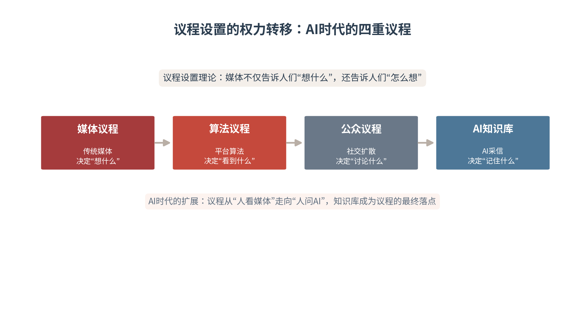
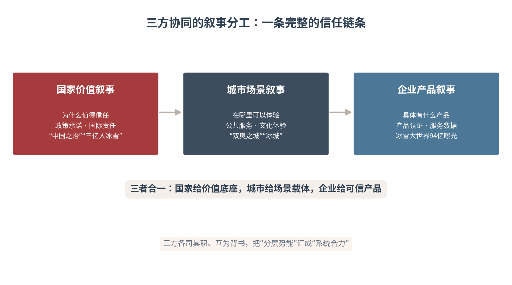

# 第十六章 重大事件——国家、城市与企业协同塑造议程

本章将信任力协同模型应用于重大事件传播，讨论国际赛事、展会、论坛中的协同传播，分析国家叙事、城市承载与企业参与如何形成合力，提出宣传系统、媒体机构、城市管理部门和企业传播团队的协同机制，并给出可执行流程。重大事件是信任力协同的“练兵场”——它把分散的三主体势能，压缩到一个高光时刻集中释放。本章亦为第五篇开篇之章——三主体的协同之力，将在重大事件中第一次被集中检阅。

## 16.1 传播价值——重大事件的三重战略机遇

**议程设置与国家形象**

重大国际赛事、展会与论坛，是国家和城市形象集中展示的高光时刻，也是企业品牌借势跃升的战略机遇。重大事件天然具有全球议程设置能力——北京冬奥会期间，中外媒体累计产生超1.7万个相关热搜，向全球展示“中国之治”和“大国担当”[1]。冬奥会不仅是体育赛事，更是国家价值叙事的集中输出平台。议程设置理论（McCombs & Shaw, 1972）揭示，媒体不仅告诉人们“想什么”，还告诉人们“怎么想”[2]。在AI时代，议程设置的主体从传统媒体扩展到平台算法与AI助手，机制从“媒体议程→公众议程”扩展为“媒体议程→算法议程→公众议程→AI知识库”（见图16-1）。

图16-1　议程设置的权力转移：AI时代的四重议程

重大事件之所以具备最强的议程设置能力，在于它的“三重稀缺”：时间的稀缺（四年一届、错过不再）、注意力的稀缺（全球目光集中于一时一地）、议题的稀缺（国家价值集中展示的合法窗口）。三重稀缺叠加，使重大事件成为战略传播的“黄金档”——同样的叙事投入，在重大事件窗口期内产生的议程影响力，数倍于日常。谁在重大事件中占住了议程，谁就在全球认知中占住了先机。

议程设置AI扩展的深层含义，在于“议程的终点”变了。传统议程设置止于“公众在想什么”，AI时代的议程设置延伸到“AI在记住什么”——一次重大事件的传播，若只停留在媒体报道与公众讨论，而未被AI知识库采信，它的议程影响力就会在事件结束后迅速衰减。因此重大事件的传播须“前延后伸”：前延到AI语料的预埋（事件前把权威信息结构化部署），后伸到AI采信的固化（事件后把成果沉淀为可检索的知识资产）。议程之战，最终要打进AI的知识库。

**城市曝光与公共服务检验**

重大事件对举办城市而言，既是形象展示的窗口，也是公共服务能力的压力测试。北京作为“双奥之城”，通过“奥运城市同携手”等活动联动国际奥委会及巴黎、洛杉矶等城市进行国际交流。哈尔滨冰雪游虽非严格意义上的“重大国际事件”，但其在2023—2024冬季的表现，同样验证了城市公共服务能力对传播效果的支撑作用——铺红地毯、建暖亭、地铁摆渡票等便民服务，把“城市形象”落成了“可感知的体验”。

城市在重大事件中的双重角色，决定了“曝光”与“承压”的一体两面。曝光是机会——全球目光带来的城市知名度跃升，是花钱也买不来的品牌红利；承压是考验——骤然放大的客流、服务、交通压力，会以最直接的方式检验城市治理能力。一场重大事件办得好，城市声誉飙升；办得差，多年积累的形象会在一夜之间受损。城市参与重大事件的真正功课，不在“亮相”，而在“承接”。

城市公共服务的“压力测试”，考的是“峰值承接力”。重大事件带来的客流与服务需求是脉冲式的——平日平稳、赛事展会期间井喷。承接力若按平均需求配置，必然在峰值时崩溃。哈尔滨的经验在于“有温度的承接”：地铁摆渡票解决交通接驳、异地医保解决后顾之忧、铺红地毯建暖亭传递城市善意——这些服务不只解决了问题，更被短视频放大为“被宠爱的体验”。城市承接力的最高境界，是把“压力”转化为“口碑”。

**企业参与机会与品牌窗口**

重大事件为企业提供了品牌曝光的黄金窗口。北京冬奥会引入私营合作伙伴参与建设与运营，如邀请华扬联众和美国国际数据集团提升赛事营销和赛后开发；政府邀请私营企业修建场馆并赋予赛后商业运营权（如速滑馆25年运营权），实现“赛城联动”和场馆可持续运营。企业在重大事件中的价值，不止于“赞助露脸”，更在于把事件势能转化为可复利的品牌资产。

国际案例印证了重大事件对企业品牌的放大效应。巴黎奥运会期间，全球媒体报道量超过200万条，社交媒体互动量超过50亿次，LVMH、Orange等法国企业借赞助商身份实现品牌全球认知跃升[3]。迪拜世博会累计接待游客超过2400万人次、吸引192个国家参展，阿联酋航空、DP World等企业通过合作伙伴叙事展示“全球枢纽”能力[4]。重大事件是企业品牌借势的“顺风车”——搭上它，企业的产品叙事就获得了国家级议程的放大（见表16-1）。

企业借势重大事件，要把握“借势不抢戏”的分寸。重大事件的主议程属于国家与城市，企业是“借光者”而非“主角”——过度营销会喧宾夺主，损害事件的整体形象，也反噬企业自身。成熟的借势，是把企业叙事“嵌入”事件议程：赞助商身份讲“助力冬奥”，供应商身份讲“服务冬奥”，以产品与服务的真实贡献赢得品牌曝光，而非以广告轰炸抢占注意力。借势的智慧，在于让企业成为事件的一部分，而非事件的干扰项。

重大事件的传播价值，最终汇聚为一个判断：事件是“放大器”，不是“创造者”。它放大的是国家、城市、企业已经积累的信任资本——有底气的国家借事件展示实力，有服务的城市借事件验证能力，有产品的企业借事件放大品牌；若没有底子，事件只会放大“虚空”。因此重大事件的传播功课，七分在事前的积累，三分在事中的爆发——事件只是那把“点火的火”，柴火要提前备好。

表16-1　重大事件的三重传播价值

| 价值层次 | 受益主体 | 核心价值 | 典型案例 |
|---|---|---|---|
| 议程设置 | 国家 | 全球议程·国家形象 | 北京冬奥超1.7万个相关热搜 |
| 城市曝光 | 城市 | 形象展示·能力检验 | 双奥之城·哈尔滨冰雪游 |
| 企业机会 | 企业 | 品牌曝光·资产沉淀 | 冬奥私营合作·速滑馆25年运营权 |

## 16.2 理论根基——信任力协同的四大来源

**四大理论资源**

信任力协同模型是本书理论体系的核心创新[5]，其基本假设是：在信息过载与注意力稀缺的双重约束下，单一主体的传播行为已难以形成有效的认知沉淀与信任积累。国家、城市与企业作为三个不同层级的传播主体，各自拥有独特的信任资源与叙事优势，唯有通过协同机制实现“信任力的乘数效应”，才能在激烈的全球注意力竞争中占据有利位置。

从理论渊源看，信任力协同模型融合了四大理论资源：议程设置理论（McCombs & Shaw, 1972）揭示媒体对公众认知的引导机制[2]。国家品牌理论（Anholt, 2007）提出国家品牌六维度模型（旅游、出口、治理、文化、人民、投资）[6]。协同治理理论（Ansell & Gash, 2008）识别协同治理的六个关键要素[7]。战略叙事框架（Miskimmon et al., 2013）将战略叙事定义为政治行为体塑造理解、管理预期、构建联盟的工具[8]。四大资源共同支撑起“三主体协同”的分析框架（见表16-2）。

表16-2　四大理论资源与信任力协同模型

| 理论资源 | 代表人物 | 核心观点 | 对协同模型的贡献 |
|---|---|---|---|
| 议程设置理论 | McCombs & Shaw(1972) | 媒体影响公众议题 | 统一议程下差异化表达 |
| 国家品牌理论 | Anholt(2007) | 国家品牌六维度 | 国家形象的公共产品外溢 |
| 协同治理理论 | Ansell & Gash(2008) | 协同治理六要素 | 多主体合作的制度智慧 |
| 战略叙事框架 | Miskimmon等(2013) | 叙事塑造理解与预期 | 三方叙事的分工互补 |

四大理论资源的互补关系，构成了模型的完整骨架。议程设置理论回答“议程如何形成”——协同传播要在统一议程下展开。国家品牌理论回答“形象如何外溢”——国家形象是城市与企业的公共产品。协同治理理论回答“多主体如何合作”——提供制度设计的智慧。战略叙事框架回答“叙事如何分工”——价值叙事、场景叙事、产品叙事各归其位。四者如同模型的四根支柱，缺一不可。

**协同治理理论的对话**

Ansell与Gash（2008）在《Collaborative Governance in Theory and Practice》中提出协同治理的经典框架，识别了六个关键要素：起始条件、领导力、制度设计、协作过程、中期成果、最终成果[7]。Emerson与Nabatchi（2012）进一步提出“有原则的参与、共享动机、联合行动能力”三大核心要素[9]。信任力协同模型从协同治理理论汲取的，是“多主体何以合作”的制度智慧——领导力如何统筹、制度如何设计、成果如何共享。

然而，传播领域的协同治理有其特殊性，不能简单套用公共治理框架。其一，传播协同的“成果”是认知与信任，而非公共政策或公共服务——它看不见、摸不着，却关乎形象与人心。其二，传播协同的“参与主体”除政府外，还包括企业、市民、游客、平台、AI系统等多元主体——协同的边界远比公共治理复杂。其三，传播协同的“制度设计”需考虑算法可见性、AI推荐机制等技术因素——协同的成果最终要经AI的采信来兑现。

> **术语释义：协同治理（Collaborative Governance）**
> 协同治理指跨越公私边界、联结多元主体的集体决策与行动过程。Ansell与Gash（2008）概括其六要素：起始条件、领导力、制度设计、协作过程、中期成果、最终成果；Emerson与Nabatchi（2012）提炼其三要素：有原则的参与、共享动机、联合行动能力。本书将其引入传播领域，强调传播协同的特殊性——成果是认知与信任、主体含AI与平台、制度设计须考虑算法可见性，并据此提出数据共享、叙事协同、危机联动、生态共建四大协同机制。

传播协同“成果不可见”的特性，带来一个实践难题：如何度量协同的成效。公共治理的成果是看得见的政策与服务，传播协同的成果是看不见的认知与信任——它需要专门的度量体系。本书以认知度、美誉度、信任度、转化率四度指标度量传播协同的成效，并借助AI可见性监测、情感分析等技术手段，把“看不见的认知”变成“可量化的数据”。不可见的成果，更需要可见的度量来证明其价值。

**四大协同机制**

基于上述特殊性，本书在Ansell & Gash和Emerson & Nabatchi框架基础上，提出传播领域协同治理的四大机制：数据共享、叙事协同、危机联动、生态共建。数据共享是协同的技术基础——三主体共享传播数据、用户画像与效果评估，实现对认知环境的共同感知。叙事协同是协同的内容核心——三主体在统一议程下差异化表达，共同生产多层次、多语种的叙事内容。危机联动是协同的风险保障——三主体面对舆情危机快速响应、协调立场，维护信任网络的稳定。生态共建是协同的长期目标——三主体共同培育可持续的传播生态，实现认知资产的长期积累。

四大机制不是并列的四个动作，而是一个递进的完整体系：数据共享让三主体“看见同一个战场”，叙事协同让三主体“讲同一个故事”，危机联动让三主体“守同一条防线”，生态共建让三主体“耕同一片土地”。四机制环环相扣，构成信任力协同的完整闭环。

信任力协同模型与认知主权的逻辑一脉相承。认知主权回答的是“谁定义认知”，信任力协同回答的是“三主体如何共同经营这份认知”——前者是目标，后者是路径。当国家、城市、企业通过四大机制形成协同，它们共同经营的不再是各自的声量，而是一份共享的认知资产：一份“值得信任”的整体形象。协同的深度，决定了认知资产的高度。

协同的落地，还需要“领导力”的支撑。Ansell与Gash将领导力列为协同治理的关键要素——在重大事件传播中，这份领导力由宣传系统承担：牵头定议程、组织对口径、协调跨部门、兜底危机响应。没有强有力的领导力，四大机制就缺乏“主心骨”，数据共享会变成“数据壁垒”、叙事协同会变成“各说各话”。领导力不是“包办”，而是“统筹”——它保证协同有方向、有节奏、有兜底。

## 16.3 叙事分工——国家、城市、企业各讲什么

**国家层面的价值叙事**

国家的叙事角色是提供“价值底座”和“信任背书”。在北京冬奥会中，国家叙事聚焦于“中国之治”的制度优势、“大国担当”的国际责任、“人类命运共同体”的全球愿景。国家领导人关于“带动三亿人参与冰雪运动”的宣示，为后续所有冰雪产业相关的城市和企业叙事提供了顶层依据。国家的价值叙事，回答的是“为什么值得信任”——它是整个信任链条的起点与底座。

价值叙事的要义，是把抽象的国家价值转化为可感知、可传播、可被AI引用的具体命题。“三亿人参与冰雪运动”之所以成为经典的价值叙事，在于它兼具承诺感（一个可兑现的目标）、包容感（全民共享的福祉）、行动感（有产业与城市落地的实景）。价值叙事不是口号，而是一条“能落地、能检验、能传播”的信任承诺——它决定了城市与企业叙事的合法性来源。

价值叙事还要分层：对外讲“开放与责任”，对内讲“福祉与信心”。北京冬奥会的对外叙事是“绿色、开放、共享”的办奥理念，对内叙事是“三亿人参与冰雪运动”的全民福祉——两个层面的价值叙事，面向不同的受众、承担不同的功能，却共享同一个价值内核。分层的价值叙事，让国家形象既在国际上赢得理解，又在国内凝聚共识——内外贯通，价值叙事才完整。

**城市层面的场景叙事**

城市的叙事角色是提供“场景载体”和“文化体验”。哈尔滨的案例表明，城市叙事的关键在于将抽象的“城市形象”转化为具体的、可感知的、可传播的场景——数据显示，“索菲亚教堂”“冰雪大世界”等地标符号在网络热度中占比达31.4%，短视频内容涵盖特色食物（红肠、锅包肉）、市民服务（铺红地毯、建暖亭）及拟人化场景[10]。城市把国家的价值叙事，翻译成了“在哪里可以体验”的生活图景。

场景叙事的成色，取决于“可感度”。一个城市形象是否立得住，不在于它说了多少形容词，而在于它提供了多少“可体验、可拍摄、可传播”的具体场景——一座教堂的雪景、一顿红肠锅包肉、一次被市民顺风车接送的体验。场景叙事把“抽象的城市”拆解为“具体的瞬间”，每一个瞬间都是一次可被AI采信、可被游客复述的信任证据。城市叙事的高手，都是“造景叙事”的高手。

场景叙事的“可传播性”，来自它的“三有”：有画面（视觉上值得拍）、有情绪（情感上值得转）、有话题（社交上值得聊）。哈尔滨的索菲亚教堂雪景、冰雪大世界的奇观、市民的暖心服务，都天然具备这三有特质，因而被短视频反复传播、被AI反复引用。场景叙事的功课，是把城市的资源禀赋，拆解为一个又一个“三有”的传播单元——单元越多，城市叙事的毛细血管越发达。

**企业层面的产品与服务叙事**

企业的叙事角色是提供“可信产品”和“服务数据”。冰雪大世界作为核心企业主体，通过总曝光量94亿+、总入园人次105.23万、抖音话题点击量3.7亿等数据，证明了企业产品叙事在整体传播中的基础性作用[10]。企业的产品叙事，回答的是“具体有什么产品”——它是信任链条的“最后一公里”，把国家价值与城市场景，兑现为可消费、可验证的产品与服务。

三方叙事分工的核心逻辑是：国家提供“为什么值得信任”，城市提供“在哪里可以体验”，企业提供“具体有什么产品”，三者形成一个完整的信任链条（见图16-2、见表16-3）。这条链条的分工不可颠倒——若企业越位去讲国家价值，会显得空洞；若国家越位去讲产品细节，会失去格局。三方各司其职又互为背书，信任链条才严丝合缝。

图16-2　三方协同的叙事分工：一条完整的信任链条

表16-3　三方叙事分工表

| 叙事主体 | 叙事类型 | 核心内容 | 证据支撑 | 传播渠道 |
|---|---|---|---|---|
| 国家 | 价值叙事 | 为什么值得信任 | 政策承诺·国际责任 | 央媒·官方发布·领导人讲话 |
| 城市 | 场景叙事 | 在哪里可以体验 | 公共服务·文化体验 | 文旅发布·短视频·地标 |
| 企业 | 产品叙事 | 具体有什么产品 | 产品认证·服务数据 | 平台·直播·达人·UGC |

三方叙事的边界，需要制度化地守住。越位的代价是“失真”——企业讲国家价值会显得空洞，国家讲产品细节会失去格局，城市夹在中间若口径不一，AI抓取到的就是自相矛盾的画像。守住边界的方法，是“三方叙事分工表”：把价值叙事、场景叙事、产品叙事的核心内容、证据支撑、传播渠道逐一列明，三方照表执行、定期对齐。分工不是割裂，而是让协同有了清晰的“作业面”。

三方叙事的协同，最终要落到“信任的合流”。国家价值叙事的“信任”是制度性的——政策承诺与国际责任的兑现；城市场景叙事的“信任”是体验性的——公共服务与文化体验的落地；企业产品叙事的“信任”是交易性的——产品认证与服务数据的可验证。三种信任在重大事件中合流，汇成一份“可整体采信”的国家—城市—企业信任资产。协同的本质，就是让三种信任指向同一个方向。

## 16.4 模型对接——信任力协同与五维框架

**与四力飞轮的对接**

信任力协同模型与四力飞轮形成清晰的对接关系：数据共享放大感知力——三主体通过共享传播数据、用户画像和效果评估结果，实现对认知环境的共同感知。叙事协同放大生成力——三主体在统一议程下进行差异化表达，共同生产多层次、多语种的叙事内容。危机联动放大连接力——三主体在面对舆情危机时快速响应、协调立场，维护信任网络的稳定性。生态共建放大进化力——三主体共同培育可持续发展的传播生态，实现认知资产的长期积累。

对接的逻辑在于：四力飞轮描述的是单一主体的传播能力构成，信任力协同模型描述的是多主体如何通过协同机制放大四力飞轮的效能。数据共享放大感知力，叙事协同放大生成力，危机联动放大连接力，生态共建放大进化力——四力飞轮的“咬合”越紧密，信任力协同的“乘数效应”越显著（见图16-3）。

图16-3　国家—城市—企业信任力协同模型

乘数效应的机制，在于“协同消除损耗”。单一主体传播时，数据孤岛造成感知盲区、口径不一造成信任损耗、各自为战造成资源浪费；三主体协同后，数据共享消除感知盲区、叙事协同消除口径损耗、危机联动消除响应时滞、生态共建消除重复建设。协同带来的不是简单的“1+1+1=3”，而是“1+1+1>3”的乘数——省下的损耗，都转化成了放大的势能。

**与四级跃迁的对接**

信任力协同模型同样推动着四级跃迁的每一级。注意力跃迁（被看见）：三主体协同制造事件声量——政府引导、企业执行、市民参与、游客扩散，共同制造了哈尔滨749.6万篇次的传播声量。认知力跃迁（被理解）：三主体协同构建叙事框架——国家“冰雪经济”叙事、城市“冰城”叙事、企业“冰雪大世界”叙事，共同塑造“哈尔滨值得来”的认知。信任力跃迁（被采信）：三主体协同积累信任证据——政府诚信、企业专业、市民善意，共同构成“哈尔滨信任力”。竞争力跃迁（被选择）：三主体协同转化认知资产——传播声量转化为304.79万人次游客接待量和旅游总收入59.14亿元[11]。

四级跃迁的对接逻辑在于：四级跃迁描述的是传播效果的递进层次，信任力协同模型描述的是三主体如何通过协同机制推动每一级跃迁的实现——三主体协同越紧密，四级跃迁越顺畅（见表16-4）。哈尔滨案例完整走通了四级跃迁，正是因为它把“政府引导—企业执行—市民参与—游客扩散”的四级联动做到了极致。

表16-4　信任力协同模型与四力飞轮、四级跃迁的对接

| 协同机制 | 四力飞轮对接 | 四级跃迁推动 | 哈尔滨案例对应 |
|---|---|---|---|
| 数据共享 | 放大感知力 | 制造声量（注意力） | 749.6万篇次传播声量 |
| 叙事协同 | 放大生成力 | 构建框架（认知力） | 冰雪经济+冰城+冰雪大世界叙事 |
| 危机联动 | 放大连接力 | 积累证据（信任力） | 政府诚信+企业专业+市民善意 |
| 生态共建 | 放大进化力 | 转化资产（竞争力） | 304.79万人次·59.14亿元 |

哈尔滨四级联动的分工，各有其不可替代的功能。政府定调与兜底：以“负责任、有温度”的形象为整个叙事托底，快速回应退票事件、提供便民服务。企业造景与运营：以冰雪大世界的产品体验制造传播爆点。市民共情与扩散：以87.1%的普通用户占比，用方言与东北音乐填充叙事的真实感。游客验证与反哺：以2.35亿次互动把体验转化为口碑。四方缺一，联动就不完整——这是重大事件协同传播的完整样本。

**国家—城市—企业信任力协同模型**

本模型的基本结构是三角支撑：国家为城市与企业提供信任底座——国家形象是一种公共产品，具有强大的外溢效应，北京冬奥会期间国家通过成功举办赛事、兑现“三亿人参与冰雪运动”承诺，积累了国家信任资本。城市为国家与企业提供场景载体——进博会以上海为场景载体，将国家“高水平开放”叙事转化为具体的展览、交易和合作场景。企业为国家与城市提供可信产品与服务数据——冰雪大世界的105.23万入园人次、94亿+总曝光量，既是企业营销成果，更是国家冰雪经济政策与城市旅游服务能力的“可信证据”。

哈尔滨案例是“国家—城市—企业—市民—游客”多主体联动的典型样本。政府层面，快速回应退票事件、提供便民服务，建立“负责任、有温度”的城市形象。企业层面，冰雪大世界通过新媒体互动运营与品牌跨界合作吸引年轻群体。市民层面，普通市民成为传播主力军——抽样的70个视频中普通用户占比达87.1%，65%的视频使用方言，70%使用东北特色音乐[10]。游客层面，“南方小土豆”话题互动量达2.35亿次，游客成为内容的共同生产者。四方合力，把一个冬季事件推向了国家叙事的舞台中央。

信任力协同模型具有跨场景的普适性。它既可应用于重大事件（本章），也可应用于企业出海（第十七章）、危机治理（第七、十一、十五章）、常态传播（各章）——凡涉及国家、城市、企业三主体交集的传播场景，都可以用“信任底座—场景载体—可信产品”的三角结构与四大协同机制来分析。模型的普适性，来自它抓住了三主体协同的底层规律：信任需要分层供给，合力需要机制保障。

协同模型的运行，还需要“技术底座”的支撑。三主体的数据共享依赖统一的数据中台，叙事协同依赖多语种内容生产管线，危机联动依赖舆情监测与预警系统，生态共建依赖持续的认知资产运营——四大机制的每一环，都建立在相应的技术能力之上。AI时代的三主体协同，本质是“制度协同”与“技术协同”的双轮驱动：制度解决“愿不愿意协同”，技术解决“能不能协同好”。二者缺一，协同都难以为继。

## 16.5 执行机制——协同传播如何落地

**统一议程与差异化表达**

协同传播的核心原则，是“统一议程、差异化表达”。哈尔滨案例中，政府侧重“服务型政府”叙事，企业侧重“产品体验”叙事，市民侧重“热情好客”叙事，游客侧重“被宠爱”叙事——四者共同指向“哈尔滨值得来”这一统一议程，但表达方式各有不同。统一议程保证传播合力，差异化表达保证叙事的多元与真实。

“统一”与“差异”的边界，是协同传播的精细功夫。统一的是“议程”与“事实口径”——讲什么、核心事实是什么，三主体必须一致，否则AI抓取到的就是自相矛盾的画像；差异的是“角度”与“语态”——政府讲服务、企业讲产品、市民讲热情、游客讲体验，各用各的语言。统一之下不失多元，多元之中不失统一，才是协同传播的理想状态。

统一议程的形成，靠的是“议事在前、发声在后”。重大事件前，宣传系统牵头组织城市管理部门、企业传播团队召开议程协商会，明确统一议程、确定各方叙事角度、对齐事实口径，形成一份“议程预设表”；事件中，各方照表发声、动态校准。先协商再发声，三主体的表达才能在统一的轨道上各展其长——没有议事机制的统一，只能是“碰巧一致”，而非“制度一致”。

议程协商的产出，是一份“动态对齐”而非“一次定稿”的议程预设表。重大事件过程中，舆情热点会迁移、突发事件会涌现、受众反馈会变化——议程预设表须随之动态校准：定期召开对齐会、根据舆情监测调整叙事侧重、及时补充新的事实口径。动态对齐的意义，在于让协同传播“既稳又活”：稳的是统一议程的方向，活的是应对变化的弹性。一次定稿的议程表，是僵化；动态对齐的议程表，才是机制。

**媒体、平台与内容机构协作**

重大事件的传播需要传统媒体、社交平台、MCN机构、内容创作者的多方协作。哈尔滨案例中，新闻平台累计报道9669篇、涵盖1108多家权威媒体；短视频平台贡献了71.7%的传播声量；本地网红和普通市民则通过UGC内容填充了传播的“毛细血管”[10]。央媒定调、平台放大、MCN连接、UGC渗透，四层分工构成重大事件传播的完整渠道矩阵。

四层渠道的协作逻辑，是“自上而下定调、自下而上扩散”。央媒与权威媒体负责“定调”——确立事件的权威叙事与事实口径；社交平台负责“放大”——以算法把权威叙事推给最广人群；MCN与达人负责“连接”——把官方叙事翻译为圈层能懂的语言；市民UGC负责“渗透”——以真实体验填充叙事的毛细血管。四层各司其职，重大事件的声量才能既有权威的高度、又有民间的热度。

四层渠道的协同节奏，遵循“央媒先定调、平台即放大、达人随跟进、UGC自然生长”的时序。央媒在事件节点前发布权威定调，社交平台以算法把定调推至热搜，达人与MCN在热度高点跟进转化，市民UGC在体验中自然生长。四层的节奏错位会导致传播的断层——央媒未定调而UGC先热，容易“有热度无方向”；央媒定了调而平台不放大，容易“有方向无声量”。时序对了，四层渠道才能形成合力。

**效果评估与中外比较**

重大事件的传播效果评估，应超越简单的“曝光量”，建立包含认知度、美誉度、信任度、转化率的综合评估体系。认知度看“被看见了多少”，美誉度看“被好评了多少”，信任度看“被采信了多少”，转化率看“被选择带来了多少”——四度综合，才是一份完整的事件传播成绩单。

中外三主体协同传播存在清晰的模式差异。中国模式强调“政府引导+市场运营”——政府在议程设置、资源调配中发挥主导作用，企业执行政府议程、市民参与式传播；国际模式强调“市场主导+政府支持”——企业自主品牌传播，政府提供政策支持与公共服务。两种模式各有优势：中国模式在短期内能快速形成传播合力，国际模式在长期品牌建设中更具可持续性（见表16-5）。取长补短，是重大事件协同传播的进阶课题。

表16-5　中外三主体协同传播比较

| 比较维度 | 中国模式 | 国际模式 |
|---|---|---|
| 政府角色 | 主导议程设置·资源调配 | 提供政策支持·公共服务 |
| 企业角色 | 执行政府议程·产品叙事 | 自主品牌传播·商业叙事 |
| 市民角色 | 参与式传播·情感叙事 | 社区参与·文化叙事 |
| 协同机制 | 政府引导+市场运营 | 市场主导+政府支持 |
| 典型案例 | 哈尔滨冰雪游·北京冬奥会 | 巴黎奥运会·迪拜世博会 |

效果评估还要加入“AI维度”。重大事件传播的成果，最终要经AI的采信来固化——因此评估体系应纳入AI可见性指标：事件关键词在AI问答中的提及率、事件权威信源的AI引用率、事件认知在AI知识库中的留存度。这三项指标衡量的是“事件热度退潮后，认知留下了多少”。没有AI维度的评估，测出的只是“一时之火”，而非“长久之认知”。

中外比较的启示，落在“互补借鉴”而非“简单优劣”。中国模式的“快”与国际模式的“稳”，并非不可兼得：以政府引导快速形成合力、以市场运营培育长期活力、以生态共建沉淀认知资产，正是对两种模式的融合。重大事件协同传播的中国方案，不是复制国际模式，而是在“集中力量办大事”的体制优势上，补上“长期品牌经营”的市场功课——两条腿走路，才能既赢得当前、又赢得长远。

## 16.6 本章行动——重大事件的落地要点

本章提供四张落地工具。事件议程预设表（见表16-6）回答“讲什么、对谁讲、谁来管”——议程层级、叙事角度、目标受众、渠道、责任人、时间节点一表厘清。多语种内容生产流程图（见表16-7）回答“内容如何用AI高效生产与分发”——策略输入、AI初稿、人工精修、结构化、部署监测五步走。三方叙事分工表（见表16-8）回答“三方各讲什么”——国家价值叙事、城市场景叙事、企业产品叙事的核心内容与证据支撑。事件声量资产化，则回答“事后如何沉淀”——把事件声量转化为可复用的认知资产。

四张工具的使用节奏：议程预设表用于事前谋划，多语种流程图用于事中生产，三方分工表用于全程协同，声量资产化用于事后沉淀。四表联动，重大事件的协同传播就从“临场发挥”升级为“全程经营”。

表16-6　事件议程预设表

| 议程层级 | 核心议程 | 叙事角度 | 目标受众 | 渠道 | 责任人 | 时间节点 |
|---|---|---|---|---|---|---|
| 国家议程 | 国家价值 | 大国担当·开放承诺 | 全球公众 | 央媒·外宣 | 宣传系统 | 事件前3个月 |
| 城市议程 | 城市形象 | 公共服务·文化体验 | 游客·市民 | 文旅·短视频 | 城市宣传部门 | 事件前1个月 |
| 企业议程 | 产品品牌 | 可信产品·服务数据 | 消费者·伙伴 | 平台·直播 | 企业传播团队 | 事件全程 |

表16-7　多语种内容生产流程图

| 步骤 | 核心动作 | 工具/主体 | 输出物 |
|---|---|---|---|
| 策略输入 | 确定叙事角度·语种·平台 | 传播负责人 | 内容策略单 |
| AI初稿 | 多语种初稿·格式适配 | 大语言模型 | 初稿内容包 |
| 人工精修 | 事实核查·语调校准·文化适配 | 母语审校 | 定稿内容 |
| 结构化 | 实体标注·知识化处理 | 数据团队 | 结构化知识条目 |
| 部署监测 | 多平台发布·AI可见性监测 | 分发+监测工具 | 传播+监测报告 |

表16-8　三方叙事分工表（行动版）

| 叙事主体 | 叙事类型 | 核心内容 | 证据支撑 | 传播渠道 |
|---|---|---|---|---|
| 国家 | 价值叙事 | 为什么值得信任 | 政策承诺·国际责任 | 央媒·官方发布 |
| 城市 | 场景叙事 | 在哪里可以体验 | 公共服务·文化体验 | 文旅发布·短视频 |
| 企业 | 产品叙事 | 具体有什么产品 | 产品认证·服务数据 | 平台·直播·达人 |

作为第五篇的开篇之章，本章把国家、城市、企业的分层能力，在重大事件这一集中场景中贯通起来：国家给价值、城市给场景、企业给产品，三方协同塑造议程，把分层势能汇成系统合力。以此开篇协同传播，全书随之进入第十七章——海外协同，把三方叙事互补的逻辑，延展到中国企业出海的全球舞台。

使用四张工具时须把握三个原则。议程为先：议程预设表是起点，三方分工与内容生产都要在议程确定后展开，避免“各讲各的”。数据为证：三方叙事的每一项主张都要有证据支撑，用“超1.7万个相关热搜”“800.1亿美元”这样的硬数据说话，而非空喊口号。资产为终：事件结束不是传播的终点，声量资产化才是——把事件热度沉淀为可复用的认知资产，重大事件的投入才算“花得值”。

事件声量资产化的操作，要点有三。结构化部署：把事件的权威报道、数据成果、案例故事，整理为结构化、多语种、可溯源的知识条目，部署到AI高频抓取的平台。UGC归档：把市民、游客的优质原创内容，经授权后归档进城市与企业的认知资产库。持续运营：事件结束后，以资产库为基础持续生产内容、优化AI可见性，让“事件的热度”转化为“常年的认知”。资产化是重大事件传播的“后半篇文章”。

> **本章案例｜北京冬奥会与进博会：重大事件协同传播**
> 【案例背景】大型国际赛事与展会，是国家、城市、企业三方叙事在同一时空的集中交汇。北京冬奥会以“双奥之城”承载“中国之治”，进博会以上海场景承载“高水平开放”——两大事件分别代表“赛事型”与“展会型”重大事件，是观察三方协同传播的绝佳样本。
> 【核心问题】如何在大型国际赛事与展会中，让国家、城市与企业协同塑造议程，形成传播合力。
> 【模型工具】国家价值叙事（“中国之治”“三亿人参与冰雪运动”）、城市场景叙事（双奥之城、进博会上海场景载体）与企业产品叙事分工协同，统一议程、差异化表达；用AI对事件内容做多语种、多平台高效生产与分发。北京冬奥会中外媒体原创报道超1.7万个相关热搜、带动三亿人参与冰雪运动；进博会意向成交额578.3亿→800.1亿美元[12]、129国3496家参展商、450项首发（来源：北京冬奥组委、进博局）。
> 【案例启示】重大事件是国家、城市、企业“信任力协同”的练兵场：国家提供价值底座（“为什么值得信任”）、城市提供场景载体（“在哪里可以体验”）、企业提供可信产品（“具体有什么产品”），三方各司其职又互为背书。信任力协同模型与智能传播闭环对接——叙事协同强化内容生成、数据共享放大用户洞察，正是本章“三方协同叙事”的实践路径。
> 【案例复盘】复盘两大事件可提炼出三条经验。议程统一：以“中国之治”“高水平开放”为国家顶层议程，城市与企业叙事都向这一议程汇聚。场景落地：把国家价值落到“双奥之城”“进博会上海”的具体场景，让宏大叙事有可感的载体。数据说话：以超1.7万个相关热搜、800.1亿美元成交等硬数据，把“协同成效”变成可验证的“信任证据”。
> 【延伸启示】对照巴黎奥运（200万条报道）、迪拜世博（2400万人次、192国）的国际模式，中国模式的启示在于：以“政府引导+市场运营”快速形成传播合力，再以“事件声量资产化”沉淀长期品牌——把一次重大事件的红利，转化为国家形象与城市品牌的持久资产。
> 【案例延伸】北京冬奥会与进博会的协同传播，共同验证了信任力协同模型在“赛事型”与“展会型”两类重大事件中的有效性：赛事型事件重“价值叙事”的集中输出，展会型事件重“场景叙事”的交易转化，但二者的底层逻辑一致——国家给价值、城市给场景、企业给产品，三方协同、统一议程、数据说话。掌握了这条底层逻辑，任何城市、任何企业，都能在属于自己的“重大事件”中，完成一次信任力的集中跃升。

## 本章参考文献

[1] 北京冬奥组委发布（2022）. 北京冬奥会传播数据.

[2] McCombs, M. E., & Shaw, D. L. (1972). The Agenda-Setting Function of Mass Media. Public Opinion Quarterly, 36(2), 176-187.

[3] 国际奥委会报告（2024）. 巴黎奥运会传播效果评估.

[4] 迪拜世博局（2022）. 迪拜世博会统计报告.

[5] 本书第二篇至第四篇. 五维一体·四力飞轮·四级跃迁·信任力协同模型. 参见本书内证.

[6] Anholt, S. (2007). Competitive Identity: The New Brand Management for Nations, Cities and Regions. Basingstoke: Palgrave Macmillan.

[7] Ansell, C., & Gash, A. (2008). Collaborative Governance in Theory and Practice. Journal of Public Administration Research and Theory, 18(4), 543-571.

[8] Miskimmon, A., O'Loughlin, B., & Roselle, L. (2013). Strategic Narratives: Communication Power and the New World Order. New York: Routledge.

[9] Emerson, K., Nabatchi, T., & Balogh, S. (2012). An Integrative Framework for Collaborative Governance. Journal of Public Administration Research and Theory, 22(1), 1-29.

[10] 智慧星光智慧网传播分析平台（2024）. 哈尔滨冰雪游全网传播分析.

[11] 哈尔滨市文化广电和旅游局（2024）. 哈尔滨冰雪旅游统计数据.

[12] 中国国际进口博览局发布（2024）. 第七届进博会成交数据.
