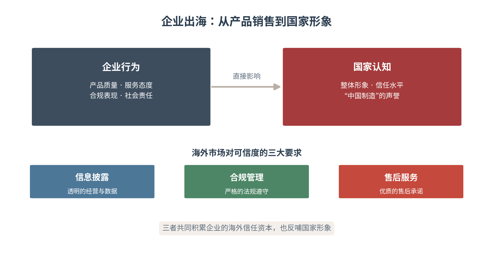
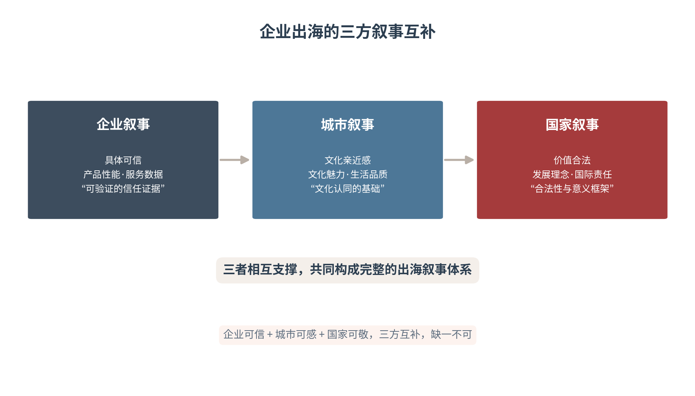
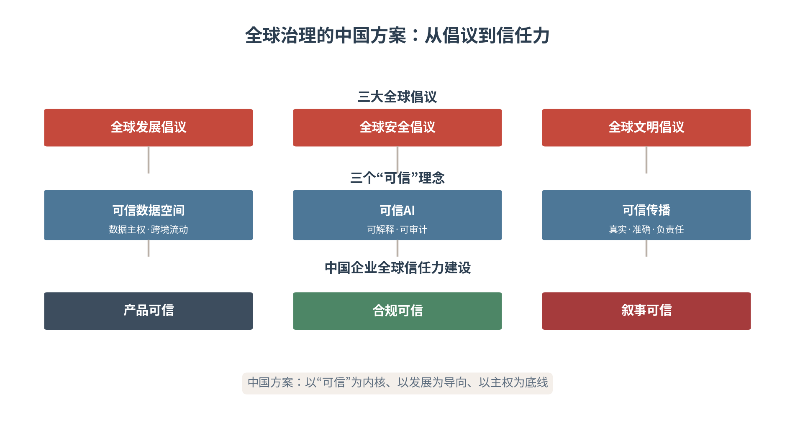

# 第十七章 海外协同——中国企业出海中的三方叙事互补

本章将理论体系应用于海外场景，讨论中国企业出海过程中的国家、城市与企业叙事协同，分析企业品牌如何与国家形象、城市国际交流相互支撑，深化“三方叙事互补”的理论基础，将合规风险纳入信任力框架，辅以中外国际企业案例，融入全球治理。本章亦为第五篇收官之章，也是全书正文的最后一章——三方叙事互补，为全书画上句点。

出海的信任资本，是“慢积累、快兑现”的资产。一次可靠的产品、一份透明的披露、一项兑现的售后，都是信任本金的积累；而一次产品质量事故、一起合规违规、一桩售后失诺，都可能瞬间清零多年的积累。企业出海经营信任，因此必须秉持长期主义——不求一时的声量，但求每一次互动的可靠。信任资本积累得越厚，企业的出海之路走得越稳。

出海之路，是一条信任的修路之路：企业用产品可信铺路，城市用文化亲近垫路，国家用价值合法开路。三方叙事互补，中国企业出海才能既“走出去”、又“立得住”。

## 17.1 出海与国家——企业行为如何塑造国家认知

**企业行为如何影响国家认知**

在全球化背景下，企业是国家形象的重要载体。中国企业在海外的产品质量、服务态度、合规表现，直接影响海外受众对中国的整体认知。一家企业的产品质量事故，会被海外媒体上升为“中国制造”的问题；一家企业的优质服务，也会被海外用户转化为“中国可信”的证据。企业与国家形象之间，存在一条“个体—整体”的认知传导链——每一次出海，都是一次国家形象的代言——国家品牌理论（Anholt，2007）的六维度模型中，企业与出口正是国家形象的重要支柱[1]。

这条传导链在AI时代被显著强化。当海外用户向AI询问“中国产品可靠吗”“中国品牌怎么样”时，AI调用的语料，正是海量中国企业的产品信息、用户评价与媒体报道。单个企业的信任证据，在AI的聚合中构成了“中国制造”的整体画像；单个企业的负面信息，也会在AI的引用中放大为国家形象的污点。企业出海的传播责任，因此超越了商业本身——它经营的不只是自己的品牌，更是国家形象的一份子（见图17-1）。

图17-1　企业出海：从产品销售到国家形象

企业出海传播责任的双重性，决定了“内外兼修”的必要。对内，企业要把产品、服务、合规做扎实——这是出海信任的根基；对外，企业要把证据、叙事、口碑经营好——这是出海信任的呈现。根基不牢，呈现再美也是“沙滩上的楼阁”；呈现不力，根基再实也是“深巷里的好酒”。内外兼修，企业才能在海外既“立得住”、又“传得开”。

**海外市场对可信度的要求**

海外市场对中国企业的可信度要求往往高于本土市场。本土市场有熟悉与了解的缓冲，海外市场则天然带有“陌生溢价”——陌生的品牌需要更高的信任门槛。企业需要通过三大要素积累信任资本：透明的信息披露（经营与数据的公开）、严格的合规管理（法规与标准的遵守）、优质的售后服务（承诺与责任的兑现）。三要素共同构成海外市场的“信任入场券”（见表17-1）。

“陌生溢价”的破解之道，在于“证据前置”。海外用户无法像本土用户那样通过口碑与人情了解企业，他们的信任只能来自可验证的证据——认证、审计报告、第三方评测、真实用户评价。因此出海企业必须把“证据建设”前置于“市场开拓”：先建起一座可被海外受众与AI共同采信的证据库，再谈市场进入。没有证据的出海，是在陌生市场里“裸奔”。

可信度三要素之间，是“递进互补”的关系。信息披露是“底座”——透明的经营数据是信任的起点；合规管理是“护栏”——严格的法规遵守是信任的边界；售后服务是“黏合剂”——优质的售后承诺是信任的延续。三者缺一不可：只披露不合规，是“透明的违规”；只合规不披露，是“看不见的守法”；既披露又合规却没有售后，是“只管卖不管顾”。三要素齐备，信任资本才能稳步积累。

**从产品销售到价值沟通**

企业出海的进阶，是从“产品销售”走向“价值沟通”。产品销售回应的是“买什么”，价值沟通回应的是“为什么信”——企业不仅要让海外用户买到产品，更要让他们理解产品背后的价值理念、社会责任与长期承诺。这一进阶，是企业从“卖货”到“立信”的跃升，也是企业品牌与国家形象深度绑定的起点。

国际企业案例印证了价值沟通的路径。三星出海，通过“企业产品叙事+国家韩流+城市首尔支撑”的三方互补，实现了从“韩国制造”到“全球科技品牌”的跃升[2]。丰田出海，通过“产品可靠性叙事+日本制造形象+丰田市国际交流”的三方互补，实现了从“日本车企”到“全球移动出行公司”的转型[3]。两个案例的共同点，在于企业都不满足于“卖产品”，而是借助国家与城市的叙事资源，完成了品牌的价值升维。

价值沟通在AI时代的落地，是把“价值观”转化为“可检索的知识”。企业出海时，不仅要让海外用户“感受到”企业的价值理念，更要让AI“采信到”企业的价值叙事——把社会责任、ESG报告、可持续发展承诺等价值信息，整理为结构化、多语种、可溯源的知识资产，部署到AI高频抓取的平台。当海外用户问“这家中国企业值得信赖吗”，AI能引用企业的价值证据作答时，价值沟通才真正打通了“人心”与“算法”两条通道。

企业出海的传播，不能是国内传播的“复刻”。国内市场的流量打法、达人生态、话题逻辑，在海外市场往往水土不服——国内的“爆款”未必能在海外“引爆”，国内的“大V”未必有海外的“话语权”。出海的传播策略，要在“本地化”与“一致性”之间找平衡：本地化解决“听得懂”——用当地的语言、当地的文化、当地的平台；一致性解决“信得过”——品牌的核心叙事与信任证据，跨市场保持统一。本地化不改内核，一致性不失灵活。

出海传播的节奏，也要“本地化校准”。不同市场的成熟度、媒介习惯、文化心理各不相同：欧美市场重“合规与认证”的信任证据，东南亚市场重“性价比与口碑”的体验证据，中东市场重“品牌与品质”的形象证据。企业出海传播，须按市场成熟度配置信任证据的“组合拳”——把最匹配的证据，投放到最需要它的市场。一稿多发的“全球同步”，看似高效，实则常常“水土不服”。

表17-1　海外市场可信度的三大要素

| 要素 | 核心内容 | 信任功能 | 企业动作 |
|---|---|---|---|
| 信息披露 | 经营与数据的公开 | 透明的信任 | 财报·ESG·经营数据公开 |
| 合规管理 | 法规与标准的遵守 | 合规的信任 | 认证·审计·合规记录 |
| 售后服务 | 承诺与责任的兑现 | 责任的信任 | 售后网络·质保·响应 |

## 17.2 叙事互补——出海的三方理论支撑

**战略叙事理论的指引**

“三方叙事互补”框架的理论基础，在于战略叙事理论（Miskimmon et al., 2013）。战略叙事理论强调，叙事是政治行为体塑造受众理解、管理预期、构建联盟的工具[4]。在企业出海场景中，这一理论揭示了：单一企业的叙事难以在陌生的国际环境中赢得信任，唯有企业与国家、城市三方叙事的互补，才能构成一套完整、可信、有说服力的出海叙事。

战略叙事的核心，在于“叙事的协作”而非“叙事的堆砌”。三方叙事不是各说各话，而是围绕同一个出海目标，在三个层次上分工协作：企业讲清“产品为什么可信”，城市讲清“文化为什么亲近”，国家讲清“合作为什么正当”。三个层次层层递进，共同构成海外受众理解中国企业的完整语境。

战略叙事的“三层次”结构，对应出海叙事的三重功能。系统层叙事回答“我们是谁”——国家的发展理念与国际身份，为所有出海叙事提供宏观背景。身份层叙事回答“我们是怎样的企业”——企业的定位与价值，为产品叙事提供主体坐标。议题层叙事回答“我们在解决什么问题”——具体的产品与服务，为受众提供行动理由。三层叙事层层具体化，把宏大的国家叙事，落到了具体的产品价值。

**企业叙事——具体可信**

企业叙事侧重产品性能、服务质量和商业价值，为海外受众提供可验证的“信任证据”。当比亚迪在海外发布安全测试报告时，其叙事为“中国制造”提供了具体的、可验证的信任证据[5]。企业叙事的独特价值，在于它的“具体”——产品参数、测试数据、用户评价都是可验证的事实，是三方叙事中最“接地气”的一层。

企业叙事的可信，来自“可验证”而非“声音大”。在海外市场，一句“我们是行业领先”远不如一份“通过欧盟安全认证”来得有力。企业叙事要把“声称”转化为“证据”：产品性能有测试数据、服务质量有用户评价、商业价值有市场数据。证据越具体，信任越扎实——这是第十二章“信任证据链”在海外场景的延伸。

企业叙事证据的出海适配，要点在“翻译”而非“照搬”。本土市场的信任证据（如国内认证、本土评测），在海外市场的说服力有限；出海需要把证据“翻译”为海外受众认可的形态——国内的质检报告，翻译为ISO、CE等国际认证；本土的用户口碑，翻译为海外的第三方评测与真实评价。证据的适配，是企业叙事“落地”的关键——同一份产品实力，要用海外市场“听得懂的语言”重新表达。

**城市叙事——文化亲近感**

城市叙事侧重文化魅力、生活品质和合作机会，为海外受众提供“文化亲近感”。当哈尔滨的冰雪文化通过国际交流传播时，其为当地企业出海提供了文化认同的基础。城市叙事的独特价值，在于它的“温度”——文化、生活、人情，是比产品与政策更易亲近、更易共鸣的叙事元素。

文化亲近感的机制，是“降低陌生感”。海外受众对一家中国企业的警惕，往往源于对中国的陌生；而一座有魅力的中国城市——北京的双奥之城、上海的开放之城、哈尔滨的冰雪之城——能以文化的力量软化这种陌生。城市叙事是企业叙事的“信任缓冲”：它让海外受众先“喜欢上一座城市”，再“接受一座城市的企业”。

城市叙事的文化输出，是“润物细无声”的信任培育。一座城市的文化魅力——美食、风景、艺术、生活方式——以最柔软的方式拉近海外受众与中国的距离。当海外受众因为喜欢一座中国城市而愿意了解中国、因为了解中国而愿意信任中国企业时，城市叙事就完成了它最深层的作用：把“文化的好感”转化为“信任的土壤”。城市叙事是出海叙事中最“慢”也最“深”的一层。

**国家叙事——价值合法**

国家叙事侧重发展理念、国际责任和合作愿景，为海外受众提供“价值合法”。当中国提出“全球发展倡议”时，其为中国企业出海提供了合法性和意义框架。国家叙事的独特价值，在于它的“高度”——发展理念与国际责任，赋予企业出海以超越商业的意义。

三方叙事互补的核心逻辑是：企业叙事提供“具体可信”，城市叙事提供“文化亲近”，国家叙事提供“价值合法”。三者相互支撑，共同构成完整的出海叙事体系（见图17-2）。缺了企业叙事，出海“无物可信”；缺了城市叙事，出海“无人亲近”；缺了国家叙事，出海“无理可依”。三足鼎立，出海叙事才站得稳。

图17-2　企业出海的三方叙事互补

> **术语释义：战略叙事（Strategic Narrative）**
> 战略叙事由Miskimmon、O'Loughlin与Roselle（2013）系统提出，指政治行为体通过叙事投射来塑造国内外受众理解、管理预期、构建联盟的工具。在企业出海场景中，战略叙事理论揭示：叙事不是“讲故事”的修辞，而是“塑造认知”的战略——企业、城市、国家三方叙事的互补，正是用一套完整的叙事体系，为海外受众构建“中国企业可信”的认知框架。

三方叙事互补的完整性，可以用“三问”来检验。海外受众问“这产品可信吗”——企业叙事能否给出可验证的答案；问“这家企业从哪里来”——城市叙事能否给出有温度的背景；问“为什么要接受中国企业”——国家叙事能否给出有价值的回答。三问全答得上，出海叙事才是完整的；任何一问“卡壳”，都意味着叙事体系存在缺口。三方互补的功课，就是把这三问都答好。

三方叙事互补的“度”，也需要把握。企业叙事不能过度依赖国家背书——“拉大旗”式的过度政治化，反而会招致海外受众的警惕；城市叙事不能脱离企业实际——“蹭城市热度”式的空洞关联，反而会显得轻浮；国家叙事不能替代企业自强——“顶层背书”再强，也兜不住产品与服务本身的失分。三方互补是“各安其位”，而非“相互推诿”。

三方叙事互补在AI时代的落地，是“把互补写进知识资产”。企业、城市、国家三方叙事的互补，不仅要体现在“传播的内容”里，更要体现在“AI可检索的知识”里——企业的产品证据、城市的文化符号、国家的价值理念，要作为相互关联的结构化知识，共同进入AI的知识库。当海外用户向AI询问中国企业时，AI能同时调用三方叙事，给出“产品可信+文化亲近+价值合法”的完整回答，三方互补才算真正落地。

## 17.3 友城传播——城市国际交流的信用外溢

**友城合作与城市形象**

友好城市是城市国际交流的重要渠道，也是企业出海的城市支撑。北京依托世界奥林匹克城市联盟等平台，举办北京国际体育电影周和奥运城市发展论坛，助力国际交往中心建设。友城合作的价值，在于以“城市对城市”的交往，为“企业对市场”的进入铺路——一座与海外城市友好的中国城市，其企业出海会多一份天然的亲近。

友城传播的实质，是“城市信用的外溢”。友城之间的长期交往，积累的是城市间的信任与了解；这份信任会自然外溢到城中的企业身上——海外伙伴因为“信任这座城市”，而更愿意“信任这座城市的企业”。企业出海时善用友城资源，等于借用了城市长期积累的信用存量。

友城传播的机制化，需要“常态化运营”而非“临时借用”。友城关系要持续经营：定期的互访交流、常态的文化活动、持续的项目合作，让友城间的信任不断累积。企业出海时，才能从这口“常满的井”里取水——若友城关系“平时不维护、出海才想起”，其信任外溢的效果必然大打折扣。友城是城市的长期资产，需要长期经营。

**海外园区、展会与文化交流**

海外园区是中国企业“抱团出海”的重要形式，也是城市形象海外传播的空间载体。进博会作为国家级展会，累计意向成交额从首届的578.3亿美元增长至800.1亿美元，吸引129个国家和地区的3496家参展商，参展企业共展出450项首发新产品、新技术、新服务[6]。展会与园区，把国家叙事的“开放”与城市叙事的“场景”，落成了可交易、可合作的具体平台。

海外园区与展会的传播价值，在于“集群效应”。单个企业出海是孤舟，集群出海则是船队——园区与展会提供的，不只是物理空间，更是“抱团”的品牌合力：一个园区的整体形象、一场展会的集中曝光，能放大其中每一家企业的可见度。企业出海善用园区与展会平台，等于把个体的声量，并入了集群的势能。

海外园区的软实力，体现在“集群品牌”的塑造。一个经营良好的海外园区，其整体形象——规范的管理、完善的服务、优质的企业——本身就是一张“中国出海”的名片。园区内的企业，共享这份集群品牌带来的信任红利；而任何一家企业的负面事件，也会反噬园区的整体形象。因此海外园区不仅是“物理的集聚”，更是“信任的共同体”——一荣俱荣，一损俱损。

**城市叙事对企业出海的支撑**

城市叙事可以为企业出海提供“文化亲近感”和“信任缓冲”。哈尔滨的冰雪文化、北京的“双奥之城”形象、上海的“开放之城”定位，都可以成为当地企业出海的“城市名片”。企业出海时把“城市名片”挂在自己的品牌上，海外受众就有了一个“熟悉的文化坐标”来认识这家企业（见表17-2）。

城市名片的价值，在于“认知的捷径”。海外受众面对一家陌生的中国企业，需要一个快速建立认知的入口；“来自双奥之城北京”“来自冰雪之城哈尔滨”这样的城市背书，就是最高效的入口。城市名片把“认识一座城市”的认知，嫁接为“认识一家企业”的起点——企业出海的传播，要善于借用这份城市带来的“认知红利”。

城市名片的AI可检索性，是其价值兑现的前提。城市名片要在AI时代“好用”，须把它整理为结构化、多语种、可被AI引用的知识资产——“双奥之城北京”“冰雪之城哈尔滨”这样的城市符号，要能出现在AI回答“中国企业出海”相关问题时引用的语料里。城市名片的建设，因此不只是“起个好名字”，更是“经营好这个名字在AI认知中的位置”。

表17-2　城市国际交流对企业出海的支撑

| 城市资源 | 核心价值 | 企业可用方式 | 典型案例 |
|---|---|---|---|
| 友城合作 | 城市信用外溢 | 借助友城渠道拓展市场 | 北京·世界奥林匹克城市联盟 |
| 海外园区 | 抱团出海合力 | 入驻园区共享品牌 | 海外产业园区 |
| 国际展会 | 集中曝光平台 | 参展展示产品形象 | 进博会450项首发 |
| 城市名片 | 文化认知捷径 | 品牌绑定城市形象 | 双奥之城·冰雪之城·开放之城 |

城市对企业出海的支撑，也有清晰的边界。城市提供的是“背景与背书”，而非“担保与兜底”——城市名片能给企业带来“认知的捷径”，却替代不了企业自身的“产品的过硬”。企业若把城市背书当作“尚方宝剑”，忽视自身的产品与服务，那么城市的信任外溢反而会成为“信任的透支”。城市支撑是“锦上添花”，企业自强才是“立身之本”。

友城与出海企业的联动，可以落为具体的机制。企业可以借助友城渠道获取市场信息与商业网络；城市可以通过友城活动为企业搭台——组织企业随团出访、在友城举办推介会、借助友城媒体曝光企业。这种“城市搭台、企业唱戏”的联动，让城市的国际交流资源，实实在在地转化为企业的出海助力。联动越机制化，城市资源的利用效率越高。

城市国际交流的“长期账”，值得企业算清楚。友城、园区、展会等城市资源的投入回报，往往不体现在“一次活动”的成交，而体现在“长期信任”的积累——一次随团出访建立的商业关系、一场推介会积累的海外口碑、一个园区集聚的集群品牌，都是“慢变量”里的长期资产。企业出海善用城市资源，要有“算长期账”的耐心。

## 17.4 机构合规——海外传播的协同与风控

**三方叙事互补的机构落地**

在海外传播中，企业叙事侧重产品性能、服务质量和商业价值；城市叙事侧重文化魅力、生活品质和合作机会；国家叙事侧重发展理念、国际责任和合作愿景。三者相互支撑，共同构成完整的中国叙事。但叙事的落地，需要专业机构的分工协同——MCN、广告公司、营销公司，是海外传播的三支专业力量。

三支专业力量各有其角色。MCN机构帮助企业对接海外网红与内容创作者，解决“谁来讲”；广告公司提供本地化的创意与媒介策略，解决“怎么讲”；营销公司执行精准的投放与效果评估，解决“讲给谁、讲得怎么样”。三者的协同，是把三方叙事从“理念”转化为“可执行的传播动作”的关键（见表17-3）。

表17-3　海外传播的机构角色与合规边界

| 机构/主体 | 核心角色 | 合规责任 | 协作要点 |
|---|---|---|---|
| MCN机构 | 对接海外网红·内容创作者 | 内容合规审查 | 达人内容须经品牌审核 |
| 广告公司 | 本地化创意·媒介策略 | 广告法合规 | 本地化创意须文化适配 |
| 营销公司 | 精准投放·效果评估 | 数据合规 | 投放数据须合规采集 |
| 企业合规团队 | 双重审核·合规专员·海外律师 | 合规前置 | 嵌入产品设计与流程 |

三方叙事互补的机构协同，需要“一个总协调”的制度安排。海外传播涉及企业、MCN、广告公司、营销公司等多方主体，若各自为政，极易出现口径打架、节奏错位。建议由企业传播团队担任“总协调”：统一三方叙事的口径、协调各机构的动作、审核各渠道的内容。总协调不是“包办”，而是“对表”——让多方在同一张议程、同一个口径下协同作战。

**合规纳入信任力框架**

海外传播面临的首要挑战是合规风险。欧盟GDPR、中国《个人信息保护法》及美国相关法规对数据跨境传输有严格限制[7][8]。从信任力理论视角看，合规风险不仅是法律问题，更是信任资产的建设问题：合规记录是信任证据链的重要组成部分；合规披露是透明沟通的具体体现；合规前置是信任资产长期积累的制度保障。因此，企业应将合规纳入“信任力”框架，将合规投入视为信任资产投资。

合规的三种形态，对应信任的三个层次。合规记录（审计报告、认证）是“信任的证据”——它让海外受众与AI“查得到”企业的合规表现。合规披露（主动公开合规信息）是“透明沟通”——它让海外受众“看得见”企业的合规诚意。合规前置（把合规嵌入产品设计）是“信任的积累”——它让企业在风险发生前就“立得住”。三者层层递进，把“守法”升华为“立信”。

合规信任的证据链建设，是企业出海信任资产的“硬核”。合规审计报告、认证资质、合规披露记录，都应整理为结构化、多语种、可溯源的知识资产，部署到AI高频抓取的平台——当海外用户或合作伙伴询问“这家企业合规吗”，AI能引用企业的合规证据作答。合规证据的AI可检索性，决定了合规投入的信任回报：合规做得再好，若AI查不到，其信任价值也大打折扣。

**合规策略与文化地雷**

海外合规的应对策略包括：建立全球统一数据合规体系，实施分级分类管理；利用定制化合同明确数据权责，通过技术手段（如本地化云服务器存储、分离监管与非监管数据）满足跨境传输要求；优化主体架构以平衡数据主权与合规。在内容风控方面，前端构建本地化数据集进行模型迁移学习，制定文化适配性过滤规则；中后端启用专项语义过滤模块；采用“翻译+检测”组合方案；建立“双重审核+合规专员+海外律师顾问”机制。

多语种AI生成内容，还易踩中“文化地雷”——文化禁忌、宗教、民族和历史敏感性问题。实际案例印证了风险管控的价值：传声港在高风险品类执行“双重审核+合规专员+海外律师顾问”机制，从源头规避GDPR、FTC等合规风险[9]。科通技术制定分级分类数据合规策略，适配欧盟GDPR、美国隐私法及中国法律[10]。某跨境电商（脱敏处理）通过“翻译+检测”组合方案，将外文违规内容检出率从60%提升至90%[11]。技术管内容，制度管合规，人管边界——三重防线，才能守住海外传播的安全底线。

文化地雷的识别与规避，需要“本地化前置”。多语种内容的文化风险，往往藏在本土团队才能察觉的细节里——一句看似无害的表述，可能在某个文化语境中触犯禁忌。因此文化风控要“前置”到内容生产环节：本地化数据集训练、文化适配性过滤、本地团队审核，三重把关把文化风险挡在发布之前。文化地雷“踩不得”，因为它炸掉的不是一条内容，而是整个品牌的海外信任。

海外传播的信任底线，归结为一条：宁可慢一点，不可假一点。海外市场的信任是“脆弱的资产”——一次数据违规、一条失实内容、一次文化冒犯，都可能在AI的放大下演变为品牌的信任危机。因此海外传播的每一步，都要把“合规”与“真实”放在“效率”之前。守住底线，企业才能在海外走得久；突破底线，走得越快、跌得越重。

海外传播的“文化敏感度”，是企业合规能力之外的第二道防线。合规守住的是“法律的底线”，文化敏感守住的是“信任的底线”——法律不禁止的内容，未必不冒犯文化。因此企业出海传播，要建立“合规+文化”的双重审核：合规团队审“合不合法”，本地团队审“合不合宜”。两道防线齐备，海外传播才能在“不踩红线”的同时，也“不踩雷区”。

## 17.5 中国方案——全球AI治理的可信路径

**人工智能全球治理的中国倡议**

在AI技术快速发展的背景下，全球治理面临新的挑战：数据主权、算法透明、内容安全、伦理规范等问题亟待解决。中国提出的“全球发展倡议”“全球安全倡议”“全球文明倡议”，为AI全球治理提供了中国方案——以发展为导向、以安全为底线、以文明为纽带，在AI治理的国际讨论中发出中国声音。

三大倡议落到AI治理，对应三个“可信”理念：可信数据空间，在保护数据主权和隐私安全的前提下实现数据跨境流动与共享；可信AI，符合伦理规范、可解释、可审计；可信传播，在AI辅助下实现真实、准确、负责任的传播。三个“可信”，为AI时代的全球信任治理，提供了以“可信”为内核、以发展为导向、以主权为底线的路径参考（见图17-3）。

图17-3　全球治理的中国方案：从倡议到信任力

三大倡议的传播意义，在于为AI全球治理提供“中国的价值坐标”。在AI治理的国际讨论中，不同国家的立场分歧巨大；中国的三大倡议，以“发展、安全、文明”三个关键词，为分歧中的对话提供了共识的起点。三大倡议不是“自说自话”，而是“主动供给”——供给一套兼顾发展与安全、连接技术与文明的中国方案，参与并塑造AI治理的全球议程。

**中国企业的全球信任力建设**

中国企业的全球信任力建设，需要从三个层面推进：产品可信——以质量认证、安全测试、用户评价等可验证证据，立住“产品值得买”。合规可信——以合规记录、审计报告、合规披露，立住“企业值得信”。叙事可信——以真实、准确、负责任的叙事，立住“品牌值得传”。三层递进，构成中国企业出海的完整信任体系。

三层信任力的建设，是一个“从产品到品牌、从个体到整体”的跃升过程。产品可信是起点——没有过硬的产品，一切叙事都是空中楼阁；合规可信是保障——没有合规的底线，信任随时可能崩塌；叙事可信是放大——没有可信的叙事，产品的可信无法转化为品牌的信任。三层层层支撑，中国企业才能在海外市场既“走得出去”，又“立得住脚”。

三层信任力的递进机制，是一条“从物到人、从交易到关系”的链条。产品可信建立的是“交易信任”——海外用户愿意买；合规可信建立的是“制度信任”——海外伙伴愿意合作；叙事可信建立的是“品牌信任”——海外受众愿意相信并传播。三层信任层层递进，把企业与海外市场的关系，从“一次交易”升级为“长期信赖”。中国企业出海的终极目标，就是完成这三层信任的积累。

可信数据空间的技术内涵，是“数据主权与数据流动的平衡”。它不主张数据的“闭关锁国”，也不放任数据的“无序流动”，而是在保护数据主权与隐私安全的前提下，实现数据的跨境流动与共享——通过技术架构而非行政壁垒，解决数据治理的“既要安全、又要流通”的难题。可信数据空间的价值，在于为全球数据治理提供了一条“第三条道路”。

中国方案的全球意义，在于提供了一个“可信”的治理范式。与“以技术霸权的控制”和“以放任自流的无序”两种倾向不同，中国方案以“可信”为内核——可信数据空间、可信AI、可信传播——把“信任”确立为AI治理的第一原则。这一范式若能获得国际认同，将为AI时代的全球治理提供一条兼顾发展与安全的中国路径。可信，是中国方案的核心贡献。

三大倡议与三方叙事互补，在“可信”这一内核上深度衔接。三大倡议为出海叙事提供“价值合法”的顶层依据，三可信理念为出海传播提供“技术可信”的落地标准，三层信任力建设为出海企业提供“从产品到品牌”的进阶路径。三者层层贯通，把“全球治理的中国方案”与“企业出海的三方叙事互补”，统一到了“以可信立信”的共同逻辑之下。

中国方案的落地，最终要靠“千千万万出海企业”的实践。国家的倡议是“顶层设计”，企业的合规、可信、负责任经营是“基层实践”——顶层设计只有落到基层实践，才能从“理念”变成“信任”。每一家出海企业的合规记录、每一次诚信经营、每一份可信证据，都在为“可信的中国方案”添砖加瓦。中国方案的全球信誉，最终由出海企业的集体行为来定义。

至此，本章完成了全书正文的收束：从国家层的认知主权，到城市层的认知价值链，再到企业层的四大战略资产，最终在协同与海外场景中，汇聚为“三方叙事互补”的完整体系。全书的理论逻辑一以贯之——信任是AI时代最稀缺的资源，而信任的积累，靠的是国家、城市、企业三主体的协同经营[12]。传播力即竞争力，信任力是终极竞争力。

## 17.6 本章行动——海外协同的落地要点

本章提供四张落地工具。企业出海信任证据与合规边界梳理表（见表17-4）回答“出海前该备齐什么”——质量认证、合规记录、社会责任报告、客户评价四类证据，及其在不同市场的合规边界。联动城市国际交流与国家形象资源（见表17-5）回答“如何借势”——善用友城、园区、展会、城市名片，把城市与国家的信任资源并入企业出海。构建多语种AI传播与本地化体系（见表17-6）回答“如何表达”——多语种生产、分发、监测与本地化质量保障。用AI监测海外可信度与推荐度，则回答“如何守护”——实时感知海外市场的信任波动。

四张工具的使用节奏：出海前梳理证据、出海时借势联动、传播中多语种本地化、经营中AI监测。四者构成企业出海从“准备”到“经营”的完整链条。

表17-4　企业出海信任证据与合规边界梳理表

| 证据类型 | 证据内容 | 来源 | 适用市场 | 合规要求 |
|---|---|---|---|---|
| 产品质量认证 | ISO 9001·CE认证等 | 权威机构 | 全球 | 各国认证标准 |
| 合规记录 | GDPR合规审计报告 | 第三方审计 | 欧盟 | GDPR |
| 社会责任报告 | ESG报告 | 企业发布 | 全球 | 各国披露要求 |
| 客户评价 | 用户反馈 | 用户生成 | 全球 | 平台规则 |

表17-5　联动城市国际交流与国家形象资源

| 资源类型 | 操作要点 | 预期收益 |
|---|---|---|
| 友城合作 | 借助友城渠道对接海外市场 | 城市信用外溢 |
| 海外园区 | 入驻园区共享集群品牌 | 抱团出海合力 |
| 国际展会 | 参展展示产品与形象 | 集中曝光平台 |
| 国家形象资源 | 借力国家叙事背书 | 价值合法性 |

表17-6　多语种AI传播与本地化体系

| 环节 | 核心动作 | 工具/主体 | 质量保障 |
|---|---|---|---|
| 内容生产 | 多语种初稿·格式适配 | 大语言模型 | 母语审校 |
| 内容分发 | 多平台·多市场部署 | 分发工具 | 本地化渠道 |
| 内容监测 | AI可见性·合规监测 | 监测工具 | 双重审核 |
| 本地化质量 | 文化适配·术语统一 | 本地团队 | 文化适配过滤 |

作为第五篇的收官之章、全书正文的最后一章，本章把国家、城市、企业的分层能力，延展到海外这一最广阔的舞台：企业以可信产品立信，城市以文化亲近感赋能，国家以价值合法背书，三方叙事互补，构成中国企业出海的完整信任体系。以此收官，全书的理论体系完成了从国家、城市、企业到协同、海外的完整闭环——传播力，终将成为AI时代最核心的竞争力。

作为全书正文的收官，本章的三方叙事互补，为全书的理论体系画上了句点：五维一体的理论框架，经国家、城市、企业三个主体的分章展开，最终在协同与海外场景中汇合——国家以价值合法立“可信”，城市以文化亲近立“可感”，企业以具体可信立“可用”，三方叙事互补，构成了AI时代战略传播的完整中国方案。传播力即竞争力，信任力是终极竞争力——这，正是本书的全部要义。

使用四张工具时须把握三个原则。证据为先：信任证据是出海的地基，先梳理证据再谈传播，没有证据的出海传播是“空中楼阁”；合规为底：合规是出海传播不可逾越的底线，任何传播动作都要先过合规关；本地化为要：多语种传播的价值在于本地化的精准，而非翻译的机械。三原则守住，企业出海的传播才能在海外既“走得快”、又“走得稳”。

> **本章案例｜中国企业出海的三方叙事互补**
> 【案例背景】中国企业出海，面对的是陌生的市场、陌生的受众与更严的可信度要求。单靠企业的“单打独斗”，难以在陌生的信任环境中立足；唯有企业、城市、国家三方叙事的互补，才能构成一套完整、可信的出海叙事。本章以出海企业为样本，呈现三方叙事互补的实践路径。
> 【核心问题】如何让中国企业出海时，企业品牌与国家形象、城市国际交流相互支撑。
> 【模型工具】企业以可信产品（安全认证、销量数据）反哺国家信任，国家与城市为企业提供背书与场景；用多语种AI传播、合规知识资产建设与海外社媒运营，构建企业—城市—国家互动的全球信任网络。将合规纳入信任力框架：合规记录是信任证据链、合规披露是透明沟通，以“双重审核+合规专员+海外律师顾问”机制规避GDPR、FTC风险。对照国际案例：三星（企业产品叙事+国家“韩流”+首尔城市支撑）、丰田（产品可靠性+日本制造形象+丰田市国际交流）。
> 【案例启示】出海传播不是企业“单打独斗”：三方叙事互补有战略叙事理论基础——企业叙事提供“具体可信”、城市叙事提供“文化亲近感”、国家叙事提供“价值合法”，共同构成完整出海叙事体系。企业可信、城市可感、国家可敬互为支撑，AI让这种互补从口号变为可检索、可引用的全球知识资产——正是本章“全球治理与中国方案”的落点。
> 【案例复盘】复盘出海企业的三方叙事互补，可提炼出三条经验。证据先行：先备齐产品认证、合规记录等信任证据，再谈市场开拓——没有证据的出海，是在陌生市场“裸奔”。借势联动：善用友城、园区、展会、城市名片，把城市与国家的信任资源并入企业出海。合规立信：把合规从“成本”转为“信任资产”，以合规记录、披露、前置积累长期信任。
> 【延伸启示】对照三星、丰田的出海路径，中国企业出海的启示在于：三方叙事互补不是“锦上添花”，而是“出海必需”——企业叙事解决“产品可信”，城市叙事解决“文化亲近”，国家叙事解决“价值合法”，三者缺一，出海叙事都不完整。补齐三方支撑，中国企业才能像三星、丰田一样，完成从“产品出海”到“品牌出海”、再到“信任出海”的跃升。
> 【案例延伸】把本案例放到全书收官的坐标系里看，其意义更为深远：中国企业出海的“三方叙事互补”，正是全书“五维一体”理论在海外场景的最终落点——国家以价值合法立“可信”，城市以文化亲近立“可感”，企业以具体可信立“可用”，三方互补，把分散的主体势能汇成系统的出海合力。掌握了这条路径，中国企业就能像三星、丰田一样，完成从“产品出海”到“品牌出海”、再到“信任出海”的完整跃迁。

## 本章参考文献

[1] Anholt, S. (2007). Competitive Identity: The New Brand Management for Nations, Cities and Regions. Basingstoke: Palgrave Macmillan.

[2] 三星企业公开信息（2025）. 三星出海三方叙事策略.

[3] 丰田企业公开信息（2025）. 丰田出海三方叙事策略.

[4] Miskimmon, A., O'Loughlin, B., & Roselle, L. (2013). Strategic Narratives: Communication Power and the New World Order. New York: Routledge.

[5] 比亚迪企业发布（2025）. 海外安全测试报告与信任证据.

[6] 中国国际进口博览局发布（2024）. 第七届进博会成交数据.

[7] European Union (2016). General Data Protection Regulation (GDPR). Official Journal of the European Union.

[8] 全国人民代表大会常务委员会（2021）. 中华人民共和国个人信息保护法.

[9] 传声港企业发布（2025）. 高风险品类合规审核机制. （待第三方验证）

[10] 科通技术企业发布（2025）. 分级分类数据合规策略. （待第三方验证）

[11] 某跨境电商企业发布（2025）. 多语种内容风控方案.

[12] 本书第十六章. 信任力协同模型与三方叙事分工. 参见本书内证.
