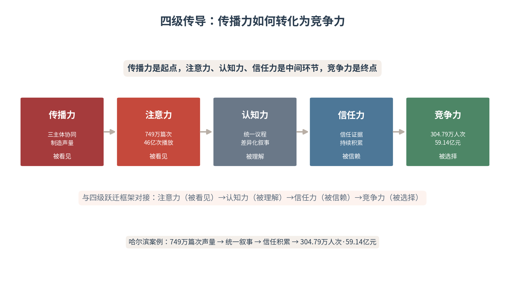

# 结语 传播力即竞争力

从国家、城市到企业，从理论、方法到案例，本书用十八章的篇幅，回答了一个核心问题：在AI深度重构信息生态的时代，传播力究竟是什么、凭什么成为竞争力、又该如何被建设。答案可以浓缩为一句话——AI时代的战略传播不是附属功能，而是国家、城市和企业必须建设的基础能力。未来的竞争，不仅是产品、产业和资本的竞争，更是叙事能力、信任能力和转化能力的综合竞争。本结语作为全书的收束，把散落在十八章中的理论线索，收拢为一套完整的判断。

## 一、传播力正在成为核心竞争力

在信息过载的时代，注意力成为稀缺资源，认知成为竞争焦点。一个国家的国际影响力、一座城市的吸引力、一家企业的品牌价值，都越来越依赖于其传播能力。传播力不再是“软实力”的点缀，而是“硬实力”的组成部分——它决定了谁能被看见、被理解、被信赖、被选择。

哈尔滨案例充分证明了这一点。2023—2024冬季，哈尔滨通过高效的传播协同，实现了从“东北老工业城市”到“顶流旅游目的地”的形象跃迁——全网传播量749.6万篇次、旅游总收入59.14亿元、影响力指数95.2%。这些数据背后，是传播力向竞争力的直接转化。一座城市的命运，可以因传播力的强弱而改写；一个国家的形象、一家企业的兴衰，同样如此。传播力，已经站到了竞争力的最前排。

从国际比较的视野看，传播力的竞争早已是大国博弈的一部分。全球主要经济体纷纷以国家战略的高度布局AI叙事与形象塑造——法国的“绿色包容”奥运叙事、阿联酋的“未来城市”世博叙事、韩国的“韩流”文化输出，都是传播力转化为国家竞争力的鲜活样本。中国以“可信”为内核的传播体系，同样在这场全球传播力的竞赛中书写着自己的方案。传播力的建设，从来不是一个传播部门的局部事务，而是关乎全局的战略工程。

## 二、四级传导：传播力向竞争力的转化机制

传播力向竞争力的转化，可以概括为“四级传导”。第一级，传播力→注意力：通过多主体协同制造事件声量，获得目标受众的注意——哈尔滨749.6万篇次传播声量、46亿次话题播放量，解决了“被看见”的问题。第二级，注意力→认知力：通过统一议程下的差异化叙事，使受众准确理解核心价值——“南方小土豆”等情感标签和市民服务的细节叙事，解决了“被理解”的问题。

第三级，认知力→信任力：通过持续一致的信任证据积累，使受众形成稳定信任——政府快速回应退票事件、市民真诚服务游客，解决了“被信赖”的问题。第四级，信任力→竞争力：通过信任资产的长期积累，使主体在同类选择中成为“默认选项”——304.79万人次游客接待量和旅游总收入59.14亿元，是信任力向竞争力转化的直接体现（见图1）。

图1　四级传导：传播力如何转化为竞争力

这一“四级传导”机制，与本书的“四级跃迁”框架形成完整对接：传播力是起点，注意力、认知力、信任力是中间环节，竞争力是终点。十八个章节的方法论——从内容生产到知识资产，从智能分发到人机交互，从危机治理到信任修复——都可以归结到这条传导链上：它们都在为传播力向竞争力的转化，铺设某一级台阶。

四级传导的普遍性，在于它适用于一切传播主体。对国家而言，传播力转化为国际影响力；对城市而言，传播力转化为吸引力与投资；对企业而言，传播力转化为品牌价值与市场份额。主体不同，场景各异，但传导的链条不变——声量、认知、信任、选择，四步走完，传播力才真正兑现为竞争力。任何一个环节的断裂，都会让传播的投入“打了水漂”。认清这条传导链，传播的每一分投入才能花在刀刃上。

## 三、注意力、认知力、信任力决定长期竞争力

注意力是“被看见”，认知力是“被理解”，信任力是“被信赖”。三者层层递进，共同决定长期竞争力。哈尔滨案例中，短视频平台71.7%的传播声量和46亿次话题播放量解决了“被看见”；“南方小土豆”等情感标签和市民服务的细节叙事解决了“被理解”；政府快速回应、市民真诚服务解决了“被信赖”。三个层次的传播效果，最终转化为304.79万人次接待和旅游总收入59.14亿元。

三者之中，信任力是“压舱石”。注意力会转移，认知会遗忘，唯有信任能够穿越时间。一次爆款能带来短暂的注意力，但只有持续的信任积累，才能把“一时的热度”变成“长久的竞争力”。本书反复强调的“信任复利”，正是这一判断的机制表达：注意力与认知是“流量”，信任才是“存量”——流量可以买，存量只能养。

## 四、五维框架的收束

本书的理论体系，可以用五个维度来收束。主体共生：国家、城市、企业三个主体在信任力协同中互为支撑，谁也不能独善其身。机制重塑：从内容生产到知识资产，从流量运营到信任运营，传播的底层机制被AI系统性地重写。目标跃迁：传播的目标从“被看见”逐级跃升为“被选择”，从注意力经济走向信任经济。

体系闭环：数据力、生成力、分发力、信任力、进化力构成五力飞轮，数据洞察、内容生成、智能分发、人机交互、品牌优化构成智能传播闭环，两个闭环相互咬合、持续运转；分层协同：国家层立价值、城市层立场景、企业层立产品，三层的分工协同，最终汇聚为系统的传播合力。五维合一，构成AI时代战略传播的完整图景——它不是一个孤立的“传播技巧”，而是一套贯穿主体、机制、目标、体系与分层的系统工程。

五维框架的实践指向，在于“系统化”而非“碎片化”。现实中，许多主体的传播是碎片化的——有内容没战略，有流量没信任，有爆款没沉淀。五维框架的价值，正在于把碎片化的传播动作，整合为一套系统的能力：主体上协同、机制上重塑、目标上跃迁、体系上闭环、分层上衔接。唯有系统化的传播，才能在信息过载的竞争中站稳脚跟——碎片化的努力，终究拼不过系统化的能力。

## 五、复利引擎：数据力、传播力飞轮与信任力

本书的理论工具中，有三样构成了传播的“复利引擎”。数据力是基础能力——没有数据采集、分析与应用能力，传播就是“盲人摸象”。传播力飞轮（注意力、认知力、信任力、竞争力）是增值机制——四者相互促进，形成正向循环。信任力是终极目标——信任一旦建立，就产生复利效应，降低未来的传播成本，提高未来的转化效率。

哈尔滨案例中，三者的作用清晰可见：数据力体现在传播策略的实时优化上——监测各平台数据表现，及时调整内容策略与渠道投放。传播力飞轮体现在“传播—到访—口碑—再传播”的循环中——游客的正面体验转化为新内容，吸引更多游客到访。信任力复利体现在“哈尔滨”城市品牌的长期增值上——一次爆红沉淀为持久的城市信誉。三样引擎的协同运转，是传播力持续转化为竞争力的根本动力。

三样引擎的协同，是一个“以数据驱动、以飞轮增值、以信任定锚”的完整链条。数据力让传播“看得见”——实时感知受众与效果；传播力飞轮让传播“滚得动”——五力相互促进、正向循环；信任力让传播“稳得住”——以复利效应锁定长期价值。三者的关系，如同“眼睛、轮子与锚”：没有眼睛会迷路，没有轮子会停滞，没有锚会被浪潮冲走。三样齐备，传播才能既快、又稳、又远。

## 六、协同传播：三主体的能力共建

国家、城市、企业都需要建立协同传播能力。国家层面，需要建立价值叙事的生产与输出能力，为城市和企业提供信任底座。城市层面，需要建立场景叙事的设计与运营能力，为国家叙事提供具象载体、为企业产品提供展示平台。企业层面，需要建立产品叙事与服务数据的积累能力，为国家信任和城市体验提供可信证据。

哈尔滨案例是这一能力共建的缩影：国家“冰雪经济”“东北振兴”的政策叙事、城市“冰城”品牌与“宠客”形象的场景叙事、企业冰雪大世界与本地商户的产品叙事，三者形成了完整的协同链条。三方各司其职、互为背书，把分散的势能拧成一股绳——这是本书第五篇“协同传播”的全部要义：单打独斗的时代已经过去，协同作战的能力才是未来。

## 七、面向智能体时代的传播能力升级

随着AI智能体（Agent）技术的快速发展，未来的传播生态将发生深刻变化：智能体将成为信息获取和决策的重要中介，人类受众的注意力将进一步被智能体过滤和引导。当“问AI”取代“看媒体”成为信息获取的第一入口，传播能力的竞争就演变为“信任力基础设施”的竞争。

在这一背景下，传播能力的升级方向有三：从“面向人类的传播”转向“面向人类和智能体的双重传播”——既要赢得人心，也要赢得算法。从“内容生产”转向“知识资产建设”——一次性的内容会过期，结构化的知识资产才可持续。从“流量运营”转向“信任力运营”——流量是借来的潮水，信任是自己挖的河床。三个转向，是智能体时代每一个传播主体都必须完成的能力进化。

## 八、认知主权与信任力：AI时代的终极竞争力

认知主权不是通过一次性的宣传攻势“抢占”的，而是通过持续的、一致的、可信的传播行为“种植”的。从认知主权的理论视角看，它的积累遵循“信任复利”逻辑：每一次可信的传播行为都在为认知主权“存款”，每一次不一致的行为都在“取款”。哈尔滨案例的启示正在于此：城市形象的构建，不是一次营销活动的结果，而是政府、企业、市民长期共同努力的积累。

由此可以给出本书的终极判断：在AI时代，信息生产的成本趋近于零，信息过载成为常态，唯有信任力是稀缺资源。信任力是AI时代战略传播的终极竞争力——它无法被算法操纵，无法被流量购买，只能通过真实的、一致的、负责任的行为来积累。认知主权是种出来的，不是抢来的；信任力是养出来的，不是买来的。这，是全书一以贯之的价值立场。

信任力的稀缺性，源自它“不可速成”的本质。注意力可以一夜引爆，认知可以一次刷新，唯独信任，只能靠一次次言行一致的兑现来缓慢积累。这是它在AI时代愈发珍贵的原因：当一切信息都能被廉价生产时，唯有真实积累的信任，是无法被复制、无法被替代的稀缺品。本书把信任力置于终极竞争力的位置，不是修辞的拔高，而是对AI时代竞争本质的准确判断——技术可以买，流量可以买，唯有信任买不来。

## 九、主案例收束——一座城市的四级跃迁

全书的主案例追踪，最终收束于哈尔滨的四级跃迁。第一级，产品IP：冰雪大世界以94亿+总曝光、105.23万入园人次、3.7亿话题点击量，确立全国冰雪文旅龙头地位。第二级，城市IP：哈尔滨以“宠客”服务、市民热情、地标符号的传播，把单一冰雪产品升级为“冰城”城市品牌，影响力指数95.2%、话题占比51.7%。

第三级，区域叙事：哈尔滨的爆红带动整个东北的关注，“南方小土豆”与“东北大冻梨”的互动，把城市叙事扩展为东北振兴的区域叙事。第四级，国家叙事：哈尔滨冰雪游最终被纳入国家“冰雪经济”“扩大内需”的宏观叙事，成为展示中国消费活力、城市治理能力与文化软实力的国家案例。这一四级跃迁的实现，依赖于政府、企业、市民、游客的多主体联动——普通市民贡献了87.1%的传播内容，65%的视频由本地人拍摄并使用方言，70%使用东北特色音乐。一座城市的四级跃迁，正是国家、城市、企业传播合力的缩影。

## 十、全书核心概念回扣

本结语作为全书的收束，系统回扣全书的核心概念（见表1）。五维框架为总纲，认知主权是目标，数据力是基础，五力飞轮是能力，四级跃迁是路径，认知价值链、算法品牌权益、四大战略资产、三重护城河则是这条路径在各层级、各场景的落点。

所有这些概念，最终都指向同一个结论：传播力即竞争力，而信任力，是AI时代战略传播的终极竞争力。从理论篇的方法论奠基，到国家、城市、企业三个主体的分层应用，再到协同与海外的收束，本书的全部努力，都在为这个结论提供论证——它不是一个口号，而是一套可以被检验、可以被操作、可以被复制的行动指南。

表1　全书核心概念回扣

| 核心概念 | 结语回扣 |
|---|---|
| 五维框架 | 主体共生·机制重塑·目标跃迁·体系闭环·分层协同 |
| 认知主权 | “认知主权是种出来的”——信任力协同是积累机制 |
| 数据力 | 数据共享是协同机制的技术基础 |
| 五力飞轮 | 信任力协同模型与之对接，放大数据/生成/分发/信任/进化力 |
| 四级跃迁 | 三主体协同推动注意力—认知力—信任力—竞争力跃迁 |
| 认知价值链 | 协同贯穿认知锚定—分发—转化—变现全链条 |
| 算法品牌权益 | 协同提升品牌在AI认知系统中的站位 |
| 四大战略资产 | 协同放大品牌/数据/渠道/智力资产的效应 |
| 三重护城河 | 协同强化产品/资产/认知三重护城河 |

面向未来，本书的结论可以化作三句行动的提醒。对决策者：把传播从“成本部门”提升为“战略能力”，为传播能力建设配置足够的资源与重视。对实践者：把注意力从“流量指标”转向“信任指标”，用长远的眼光经营短期的动作。对研究者：把目光从“单一主体”转向“协同体系”，在智能体时代的传播实践中检验并发展本书的理论框架。三句提醒，是本书交给读者的最后一份行动清单。

本书写到这里，可以画上句号了。但AI时代的战略传播，才刚刚开始。智能体正在成为新的传播中介，知识资产正在成为新的竞争资源，信任正在成为新的稀缺品。对于国家、城市和企业的每一位传播者而言，时代的命题已经清晰：不要做流量的追逐者，而要做信任的建设者；不要只经营一时的声量，而要经营长久的信誉。因为——传播力即竞争力，而信任力，是AI时代战略传播的终极竞争力。
